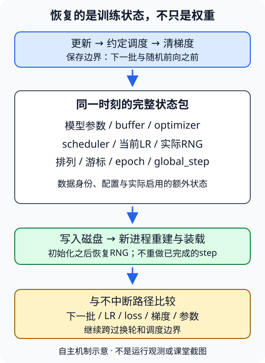

# 优化回顾与全课程工程总结

## 学习问题：换了优化器，究竟改变了什么？

用一个小模型把训练流程闭合：先固定数据与起点，再比较更新规则；在中途断开进程后，证明恢复的是同一条训练轨迹，而不只是“还能运行”。最后把全课的任务、形状、损失、评估与资源约束整理成自己的工程地图。

这不是重训整门课的邀请。复用已经完成的实验记录，仅为优化器比较新建一个有限预算的小MLP；旧翻译模型与BERT没有可供本批直接加载的自训磁盘checkpoint。完整模型路线不因准备CS336而删去CNN、CV或RNN。

本实验由你在本地用Python/PyTorch自行实现，程序、配置和学习记录仅供自己保存与自检；无需Git提交、推送、上交报告或上传本站，也不要求排行榜提交。个人学习与任务进度不作为教程完成条件，不由agent认证或追踪。

按[实验指导](#/c/d2l-pytorch-2021/lab/optimization-capstone?v=guide)逐项完成。本地使用Python/PyTorch练习。

### 四任务原文

| 任务ID | 原任务（保持不变） |
|---|---|
| `optimization-capstone-1` | 在同一小模型/数据划分上比较SGD、动量和Adam，固定比较条件并记录曲线；其余算法作为教材对照，不声称视频逐节覆盖。 |
| `optimization-capstone-2` | 检查学习率调度、数值稳定性与优化器状态保存；恢复训练时同时恢复模型和优化器。 |
| `optimization-capstone-3` | 整理MLP/CNN/CV/RNN/Attention/BERT的任务、输入形状、损失、评估与资源限制，自行安排观看课程总结原视频。 |
| `optimization-capstone-4` | 输出自己的CS336准备清单：训练循环、token/mask、Transformer、性能测量与数据评估；论文阅读不是此阶段验收。 |

## 任务1：把公平条件写在曲线之前

### A. 冻结一张运行卡

推荐复用已有Fashion-MNIST真实图像缓存和257训练/73验证的小划分。它们均来自官方60,000张训练集，划分种子为2021；沿用原始样本ID与顺序，不能把新抽出的同样数量称为同一划分。指导中的主验记录给出具体排列与候选划分方式。官方10,000张测试集本任务不评分、不调参。

输入为`(B,1,28,28)`，转换为float32并按固定规则归一化，MLP展平为`(B,784)`，输出`(B,10)`原始logits，标签为`(B,)`的整数类别。不要先softmax再交给交叉熵。隐藏宽度、激活、初始化方法与参数量在运行前登记；不以旧CNN结果充当本次MLP结果。

| 必须相同 | 必须显式记录的可变项 |
|---|---|
| 模型结构、参数初值、全部buffer | SGD/动量SGD/Adam更新规则 |
| 样本ID、预处理、train/val划分 | 各自学习率及选取依据 |
| 每轮排列、batch边界、尾批处理 | momentum、betas、eps等算法参数 |
| 更新次数、训练样本暴露次数 | 是否含调参预算、是否有独立调度对照 |
| dtype、设备、线程、评估时点 | 实际失败/发散，不删除不利结果 |
| 正则化、损失reduction、随机层策略 | 优化器状态内存，不当作模型参数量 |

先生成一个独立的初始状态快照，三份模型分别加载；不要连续构建三个随机初始化模型就称“同seed公平”。不要让后运行的优化器继续消费前一组已推进的采样器。最小比较可不用随机增强或dropout；如保留，必须配对随机序列，不能只固定初始化种子。

### B. 学习率公平不是“数字相同”

在运行前声明下面哪一种问题是主问题：

1. **固定超参数的机制比较**：给三种算法预先指定学习率和其他参数，用相同预算观察本配置。可以不同学习率，但不得解释成“各算法最优表现排名”；也可同一学习率观察机制，仍不等于公平调优。
2. **等调参预算的经验比较**：三组各有相同候选数、每候选相同更新预算，只用验证集选择；最后按预声明规则报告。调参成本不能从总预算中隐去，不得看测试集挑学习率。

本批统一主验采用新的有限配对小MLP，具体学习率与预算由实际运行卡给出；本页不预填胜者。其他优化算法只整理教材思想对照，不追加必须训练的模型，也不把第11章所有小节说成视频逐节覆盖。

### C. 留下可复核的曲线

每个优化器至少留下初始点、相同更新数的中间点与末点：训练集评估CE、验证CE、验证准确率、实际学习率；可另记在线batch loss和梯度范数。训练曲线的分母必须一致：尾批不能和完整批等权平均。固定数据上的`eval`训练CE与训练过程中不断变化模型的在线loss分开命名。

横轴优先用`global_step`或累计训练样本数。若补充时间轴，应说明计时边界、预热、数据读取和验证是否计入；单次短CPU训练不构成硬件性能排名。曲线必须来自实际日志，不画猜测的“Adam更快”示意充当结果。若用平滑，保留原点并标注方法。

本地记录与自检：运行卡、初值与排列一致性证据、三组实际日志和曲线、末点表，以及一句限定到数据规模/预算/LR策略的结论。发散也是结果，应定位首次非有限值，不能只留下成功组。

## 任务2：调度、稳定性与完整恢复

### A. 调度器也是训练状态

可以让任务1三组共享同一调度合同，或另选一组做有限调度检查；不能只给一组加调度却把差异全归因于优化器，也不强制额外跑无调度组。可采用`StepLR`等简单策略，明确一次`scheduler.step()`对应一轮还是一次参数更新；字段名`last_epoch`不能替你决定调用单位。

记录**更新前实际使用的学习率**，完成`optimizer.step()`后才在合同规定的边界推进scheduler；按轮调度不能每batch调用。记录边界前后及恢复后的LR。若采用`ReduceLROnPlateau`，输入应是独立验证指标，还需恢复最佳值与等待计数；它不是无参固定周期调度。

### B. 数值稳定不是隐藏NaN

至少准备三类局部检查并记录输入、dtype与误差：

- 大幅度但有限logits：对比朴素指数计算与稳定CE/logsumexp的有限性；给所有类别加同一常数，CE在浮点容差内不变。loss与梯度都要检查。
- 分母与尾批：不等长batch汇总按样本数加权；迁移到语言任务时改为有效token数，不能混用样本平均与token平均。
- 训练路径：loss、梯度、优化器状态与参数逐段检查有限性。若采用梯度裁剪，记录裁剪前范数、阈值与触发次数；裁剪不能修复已经NaN的梯度。合成大梯度触发不等于真实训练发生梯度爆炸。

不允许用`nan_to_num`、跳过异常批次或删除失败曲线冒充稳定实现。纯CPU float32合同不强制AMP；若实际使用混合精度，需补充scaler、反缩放/裁剪顺序和跳过更新时的step语义。

### C. 从“权重可加载”升级为“训练可续接”

图为编者自绘合同，不是运行结果。保存边界位于一次完整更新及约定调度完成之后、下一批随机操作之前。默认没有待累积梯度；若选择别的边界，必须保存相应梯度与累积计数。

| 状态组 | 本实验至少包含什么 |
|---|---|
| 模型 | 参数、注册buffer、结构/配置、训练模式约定 |
| 优化器 | 状态字典、参数组及稳定参数顺序；动量buffer或Adam一二阶矩与step |
| 调度器 | 状态字典、策略配置、调用单位、当前组LR |
| RNG | torch CPU全局状态；实际使用的独立shuffle Generator；若用Python/NumPy、CUDA或MPS随机源，也逐一恢复 |
| 采样进度 | 当前epoch的完整排列、下一未消费样本游标、尾批策略；不能只存一个seed |
| 训练进度 | epoch编号及含义、global_step、累计样本数；下一步是取批还是换轮 |
| 数据与环境 | split/预处理/配置身份、框架版本、dtype、设备；不是把整个数据集塞进checkpoint |
| 条件性状态 | AMP scaler、梯度累积、EMA、早停最佳值/耐心、日志累计量等，实际启用才纳入 |

最低恢复场景用单进程CPU和确定性批读取，避免把worker预取队列误当已消费样本。多worker或分布式恢复是额外工程范围，不能凭保存DataLoader generator就宣称任意位置精确重放。

安排一条不中断参考轨迹与一条磁盘恢复轨迹：

1. 在同配置、同初值、同顺序下训练到轮内非零游标，完成一次更新后写入磁盘；记录文件大小、摘要与保存边界。
2. 参考轨迹继续运行。另起一个新进程，重新构造模型、优化器、scheduler，再从磁盘装载状态；不依赖父进程保留的对象或`BytesIO`。
3. 装载时保持参数组与顺序；完成会消耗随机数的初始化之后，再恢复实际RNG，确保下一批/前向不额外消耗随机数。
4. 对齐下一批ID、更新前LR、loss、梯度、更新后参数、优化器/scheduler及采样进度。至少跨过一个换轮点和一个调度点，比较范围写清，不能以一步相同代替任意长期恢复。
5. 加一个**仅权重加载、空优化器**的负对照，保持相同下一批与随机输入，观察真实有历史状态的优化器下一步是否偏离；不拿尚无动量的一步SGD作必然失败例。

CPU同环境可争取逐位相同；若只能容差一致，先规定容差、报告最大误差及原因，不把跨版本/跨设备逐位一致作为PyTorch承诺。磁盘恢复校验可以临时持有新checkpoint，发布时只保留小型证据，不上传数据或模型。

本地记录与自检：调度时序表、稳定性反例与修正方向、checkpoint字段合同、跨进程连续/恢复对照、负对照及未涵盖边界。**P10的内存序列化验证不是本任务的磁盘证明。**

## 任务3：工程地图与原视频自主学习

写一张自己的工程地图，至少含下列各行；不要用“都是神经网络”合并掉任务差异。$B$为批量，$T$为序列长度，$V$为词表大小，$C$为类别数。

| 路线 | 必须解释的形状与目标 | 评估/成本问题 |
|---|---|---|
| MLP与泛化 | 表格`(B,F)`或展平图像；回归标量或分类logits | MSE/log-RMSE与CE/accuracy不可混比；预处理仅fit训练折 |
| CNN分类 | `(B,C,H,W)`；卷积通道、步幅、池化与残差 | 分类CE/accuracy；分辨率、激活、参数与过拟合 |
| CV迁移 | 同一预处理和标签空间；冻结头/解冻层 | 预训练权重身份、BN模式、可训练参数、数据重合未核 |
| CV检测 | 图像→类别与框；anchor匹配、框编码和NMS | AP所用IoU/类别/坐标；损失下降不等于有可用检测框 |
| CV分割/风格 | 分割`(B,C,H,W)`对`(B,H,W)`；风格优化图像本身 | ignore像素、mIoU；Gram/TV与真实视觉效果、图像授权 |
| RNN/GRU/LSTM | token`(B,T)`与隐状态；next-token logits | 有效token CE/PPL、状态detach、长序列串行依赖 |
| Attention/seq2seq | 源长S、目标长T；Q/K/V与padding | teacher forcing不等于自由生成；语料级BLEU与错误样例 |
| Transformer | 多头`(B,h,T,dh)`、因果/交叉mask、位置 | 全前缀与增量一致性、KV缓存、长度平方成本 |
| BERT | token/segment/position；MLM槽位与NSP句对 | 两个loss分母、SNLI标签方向；双向编码不等于因果生成 |

每行填写：自己的任务、预处理及形状、loss的单位/分母、验证协议、一个真实失败、证据位置、资源约束、还不会独立完成的部分。可以引用旧运行记录而不重训；记录存在不代表自己的全任务已完成。

LEC71目标检测竞赛总结、LEC72优化算法与LEC73课程总结的原视频由学习者自行安排观看，可按需要在本地记下收获或问题。视频学习不由agent认证、追踪或作为教程完成条件；教材导读不等于课堂内容，当前课堂未核事实也不能改写为已观看。本站不另生成课堂逐段整理或中文译稿。

### 证据四层，不互相顶替

| 层次 | 能支持什么 | 不能推出什么 |
|---|---|---|
| 合成机制检查 | 形状、梯度、mask、分母或状态机局部成立 | 真实数据泛化或竞赛得分 |
| 真实小训练 | 特定数据/划分/预算的loss与样例表现 | 完整任务、全规模模型或算法优劣排名 |
| 预训练迁移 | 指定权重与预处理下的迁移路径 | 已自行完成预训练、权重可任意再分发 |
| 硬件实测 | 已测设备、计时范围与样本的吞吐/内存 | 未测GPU、多机扩展或理论加速自动兑现 |

旧Fashion/Ames/banana/VOC/Time Machine/英法翻译与BERT记录继续有效；R18/VGG19/教材BERT权重另归预训练层；已有CPU微基准另归硬件层。历史竞赛的认证文件、评分器、牛仔`image_id`与`id`、像素xyxy合同仍未核，不绕过访问限制，也不借LEC71标题编造获奖方法。

## 任务4：自己的CS336准备清单

这是本课程后的自主能力盘点，不是另加一门前置课、论文必读表或CS336官方入学要求。每行用“能独立做／需局部提示／尚未做／受资源限制”之一标记，并附上你自己的证据和最小下一步。

| 能力 | 一次可执行的自查 | 遇阻时的最小回补 |
|---|---|---|
| 训练循环 | 解释从取batch到更新、eval及完整恢复的一轮状态转移 | 用本实验一个batch查梯度清零、分母与checkpoint |
| token与mask | 手工列BOS/EOS/PAD、输入右移、有效loss与causal可见范围；改未来token检查前缀 | 回到已完成序列实验的固定短句，不另下语料 |
| Transformer | 追踪多头拆合/位置/FFN/残差；说清训练和增量cache差异 | 在旧机制证据上定位具体轴或offset，不重训翻译器 |
| 性能测量 | 给出预热、同步、重复测量、吞吐单位与内存口径 | 无GPU则说明CPU已测范围，GPU指标标未测 |
| 数据与评估 | 解释split、去重、train-only词表、test封存、有效token CE及错误样例 | 检查旧语料划分/署名/许可；不靠一个好样例判断质量 |

额外写清：字符/空白分词经验不等于已掌握大规模子词分词；BERT的双向目标不是自回归语言模型目标；翻译BLEU不是通用语言模型质量指标；理论FLOPs不是实际tokens/s。只把不会的具体动作放进清单，不把“读完若干论文”作为通过条件。

本地记录与自检：带证据的个人清单、一段最需要改进的工程习惯，以及下一次自主练习的可检验目标。没有资源的扩展可如实标记，不伪造实测，也不删去相应知识项。

## 本地记录与自检

- 四个任务保留为本地知识练习与自检建议；视频观看由学习者自行安排，无需记录或上交观看进度。
- 优化器结论附公平条件与学习率策略；曲线来自实际日志。
- 恢复比较来自新真实小模型、磁盘和新进程；旧模型不被要求重新训练。
- 工程地图包含MLP、CNN、完整CV、RNN、Attention、Transformer与BERT。
- 证据层次、课堂来源边界、竞赛访问限制与硬件未测范围保持独立；无完整解答代码、数据或权重随文发布。

## 引用与来源

- [PyTorch 2.5优化器](https://docs.pytorch.org/docs/2.5/optim.html)、[SGD](https://docs.pytorch.org/docs/2.5/generated/torch.optim.SGD.html)、[Adam](https://docs.pytorch.org/docs/2.5/generated/torch.optim.Adam.html)：本合同的更新、参数组及状态语义。
- [StepLR](https://docs.pytorch.org/docs/2.5/generated/torch.optim.lr_scheduler.StepLR.html)、[可复现性](https://docs.pytorch.org/docs/2.5/notes/randomness.html)、[保存与加载](https://docs.pytorch.org/tutorials/beginner/saving_loading_models.html)：scheduler、RNG与训练checkpoint边界。保存教程是当前网页，不伪装为2.5历史快照。
- [CrossEntropyLoss](https://docs.pytorch.org/docs/2.5/generated/torch.nn.CrossEntropyLoss.html)、[logsumexp](https://docs.pytorch.org/docs/2.5/generated/torch.logsumexp.html)：logits、reduction与稳定计算。
- [Fashion-MNIST官方项目](https://github.com/zalandoresearch/fashion-mnist)：Zalando SE，2017，28×28灰度十分类；复用P2归档的README、MIT许可与实际下载记录，不在本站发布数据。
- [教材优化章](https://zh.d2l.ai/chapter_optimization/index.html)作为原练习范围；固定源码是当前中文第二版，不是2021全书快照。此worker审阅原任务/目录与官方API，不冒称新读整章或课堂逐节覆盖；机制讲解见[LEC72](#/c/d2l-pytorch-2021/lec/lec72?v=notes)，收尾见[LEC73](#/c/d2l-pytorch-2021/lec/lec73?v=notes)。
- 精确审阅范围、复用证据、主agent验证合同见`sources/p11-optimization-capstone/`。课堂来源未核事实与牛仔认证/文件/scorer边界保持独立；本实验没有课堂时间轴、课堂问答或获奖方案。
