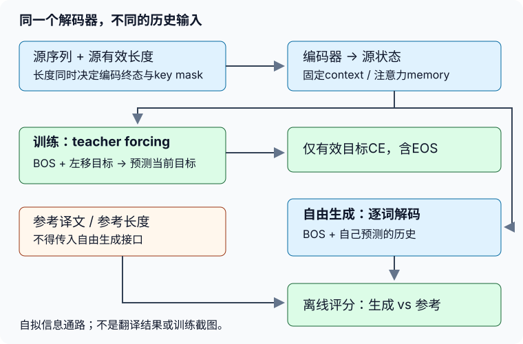
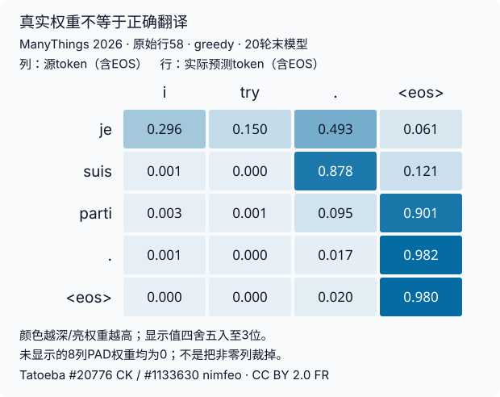

# Seq2Seq与注意力实验指导

## 路线：先证明看见什么，再比较学会什么

[实验说明](#/c/d2l-pytorch-2021/lab/seq2seq-attention?v=zh)规定数据、预算、搜索及指标。这里把四个任务拆成可检查的小接口：先数据与mask，再固定context基线，再搜索与独立注意力机制，最后换成Bahdanau并观察真实对齐。不要从复制整个训练脚本开始；每一层只需要留下能推翻错误实现的证据。



图为编者自绘：参考答案能进入训练的“历史目标”与离线评分，不能穿过自由推理接口。训练teacher forcing使用的是左移目标，不是当前答案。下文所有符号小例均为机制说明，不是真实语料训练记录。

## 任务1路线：把数据账做成可重放的输入

### 第一步：别让第三列成为语言

当前ManyThings的`fra.txt`是三列，而教材镜像是两列。若把每行直接空白切分，`CC-BY`、作者名、句子ID会混进词表；若照搬教材`len(parts)==2`，当前包的所有正常行反而会被跳过。先按TAB解析完整记录，再对英语和法语分别清洗。

推荐每条记录分成两层：

| 层 | 保存内容 | 可以送给模型吗？ |
|---|---|---|
| 语言 | 清洗后完整源/目标token、编码数组与有效长度 | 源可；目标只在训练或独立评分使用 |
| 身份 | 原始行号、完整句对hash、原文、第三列署名、句子ID | 不作为输入；只用于复现、选样与合法展示 |

校验压缩包后从外部cache读取，语料不复制进`content/`。两个同名包必须用不同缓存名及hash：教材2019镜像用于来源核对，带署名的2026发布包用于本次真实小训练；不能用当前包的行号解释旧包结果。

### 第二步：先group，再切，再fit

按照说明中的规范化方法生成完整源句和完整目标句。先按句对去重，再按源句的固定hash分桶；这是为了阻止同一英文句的不同法译落入训练和验证两侧。不要用Python内置`hash()`，它不适合作为跨进程稳定划分；盐、UTF-8编码、截取前8hex、模100都要固定。

保留原文件顺序选512训练/64验证，再只用这512对的**截断前token**拟合词表。训练清洗规则不从验证数据学习；OOV统计可以看，但不能因此悄悄把验证词塞回词表。复现记录应能回答“token X为什么获得ID Y”，而不是只有一个随机seed。

局部自查：

- 构造两条仅大小写/NBSP不同的记录，看看清洗后是否按同一规范去重。
- 构造一个源句对应两种译文，检查它们一定同桶。
- 将只在验证出现的自拟词送入编码器，期望映射UNK，词表大小不变。
- 向验证追加记录，不应改变训练512的词表；修改训练集合当然可能改变词表。
- 源/目标ID即使数值相同也不代表同一个词；禁止拿源词表解码法语输出。

### 第三步：画出EOS与三个mask的责任

在最大长度$N$内预留EOS位置：最多保留$N-1$正文token，然后EOS，再PAD。不是先pad后补EOS，也不是从未截断长度直接生成mask。有效长度是编码完成后的真实非PAD数量。

这里有三种不同责任，不能用一个“已经mask过”含糊带过：

1. **编码器长度**：决定循环终态停在哪里。
2. **注意力key mask**：决定哪些源位置能被查询。
3. **目标损失mask**：决定哪些目标位置贡献CE。

假设源内容为符号`u v EOS PAD PAD`，长度为3。若GRU读完5步才取末状态，即使PAD向量为零，状态仍可能经过两次带bias和循环权重的变换；attention把最后两列遮住，并不能恢复正确初态。

teacher forcing可用纸笔核对：目标`[A,B,EOS,PAD]`，输入`[BOS,A,B,EOS]`。预测B时已经见过A，但不应该见过B。最后一个输入EOS对应PAD目标，损失为零；不能因为它出现在解码输入里就把EOS目标也排除。

## 任务2路线：把一个基线拆成三个接口

### 1. 编码器：有效终态不依赖PAD尾巴

最小接口写成文字合同即可：`encode(source_ids, source_lengths)`返回源memory和有效终态。先使用单层单向GRU，不急着增加层数和方向。

局部提示：PyTorch的`pack_padded_sequence`接受`(B,S,E)`时要指定`batch_first=True`；长度tensor放CPU，未按长度降序排列时用`enforce_sorted=False`。解包后的memory要与原样本身份对齐，且恢复到约定的源长度以便mask。hidden的形状仍是`(layers,B,H)`，`batch_first`不改变它。

**反例优先的检查**：取一个较短样本，分别单独编码、与较长样本放同一batch编码、增加右侧PAD编码。关闭dropout，这三种有效终态应一致；把PAD位置的ID换成其他词，只要长度不变，有效终态仍应一致。若只检查输出shape，根本发现不了这个错误。

若不用packing，单层单向可在`length-1`处收集顶层输出。此捷径不自动解决多层每层hidden、LSTM的cell或双向反向终态；本实验不要求为未用扩展强造通用抽象。

### 2. 初始化状态：固定与动态分开

基线至少维护两个量：

- `encoder_context`：固定源编码，每个目标步复用；它是可参与梯度传播的张量，不是要求`detach`。
- `decoder_hidden`：上一解码步的动态状态；初始化为编码终态，然后每步更新。

“固定”指时间上不改值，**不指阻断梯度**。如果训练时把context detach，编码器会少掉一条本来应有的梯度路径；如果推理每次从新的decoder hidden重建context，又把基线变成另一套递推。

固定教材示例恰好有跨`forward`调用边界的差异：整段调用时context只取一次，单token调用时会重新从已更新state取。本站按独立固定context定义实验，而不是原样执行教材helper。用同一组teacher-forcing输入分别整段、逐步喂入，在`eval`下比较每一步logits，才算证明状态协议一致。

### 3. 一步解码：前缀只推进一次

一步接口接收“上一个token”和状态，返回下一个token的logits及更新状态。第一个上一个token是BOS。训练时这些上一token来自左移目标；生成时来自已预测历史，两个模式共享同一个状态递推。

常见一位错位：先用BOS预测第一个词，再把BOS送一次；或者将新预测的词在当前步处理后，下一轮又处理一次。给每个状态标上“已消费到哪个输入token”的标签，能比看整句输出更快定位。

局部梯度检查只需在小batch上证明：有效目标位置对logits有梯度，PAD目标位置为零；编码器和解码器参数都有有限梯度。不要以某个单一参数恰好零梯度推断整条计算图坏了。

### 4. 有效token CE的两个分母

一个batch用于更新的标量是有效token CE总和除以有效token数；整个epoch报告则是各batch CE总和、token数分别累计后再相除。

纸笔例：两个batch的CE和分别是6与8，有效token数分别2与4。报告应为$(6+8)/(2+4)$，而不是$(6/2+8/4)/2$。这是自拟算术，不是模型结果。增加PAD只改变张量面积，不改变分母；把EOS从mask移走则真的改变训练目标。

训练日志至少保留：seed、数据顺序seed、参数量、optimizer配置、每轮有效token总数、更新步数、CE总和、全局梯度裁剪前后范数。初末固定评分与训练时边更新边累计的loss不是同一统计量，分开记录。验证调用前后比较参数/buffer/已有梯度，避免`eval()`被误解为“自动禁止梯度或optimizer”。

## 任务2搜索路线：先用概率树，不先用法语句子

### 为什么局部最大不等于整句最大

自拟小树可以设置第一步`A:0.6,B:0.4`；A后EOS概率0.5，B后EOS概率0.9，其余质量分给其他合法延续。贪心先选A，而两步结束路径的概率分别为$0.30$与$0.36$。必须把剩余概率、最大长度与未结束路径也补成合法树，再枚举全体候选；只给两条路径不能证明全局最优。

把每个节点的状态设成可识别的“前缀身份”，就能检查beam父索引是否正确。两个最高候选可能来自同一父项，不能假定每个父亲只留下一个孩子。

### beam状态清单

| 项目 | 随父索引重排/复制？ | EOS后怎么办？ |
|---|---|---|
| 已生成历史与累计log概率 | 是 | 原样保留 |
| 解码hidden；若扩展LSTM则含h/c | 是 | 不再推进 |
| 固定encoder context | 依所属源样本关联 | 不变 |
| 注意力源memory与源长度 | 依所属源样本关联 | 不变 |
| 对齐历史、完成标志、生成长度 | 是 | 不再追加一行EOS |

单源时memory可以共享，不必真实拷贝；但batch中重排后必须仍指向正确源样本。并行实现可用父索引gather，朴素列表也可作为小例oracle；不要为一个小实验做通用搜索框架。

全程用log概率相加，不把每一步的概率直接相加，也不从softmax下溢成0后再取log。中间共享active/finished池按原累计log概率剪枝，最多$k$项；完成项不扩展。到终点时先看池内是否有完成项：有则在完成项中按$S/L^{0.6}$选，无则返回未完成并标明到达上限。$L$含EOS不含BOS。这种结束优先策略本身会影响结果，应与束宽一起写进日志。

先验$k=1$与贪心相同；再验$k=3$下父项重复、顺序交换、提前EOS、无EOS达到上限。长度归一化会改候选排序，但不能让已剪掉的路径复活。搜索能提高模型分数也未必提高翻译质量；错误概率模型不会因更认真搜索而自动变正确。

## 任务3路线：先辨认Q、K、V，再写矩阵乘法

### 核回归的最小心算例

取查询$q=1$、键$[0,2]$、值$[2,6]$、$w=1$，两键与查询距离相同，权重应各半，输出为4。将查询移近左键，左值权重应变大；把两个值交换，权重不变、加权输出变化。这些关系足够检查“是不是把value拿来打分”这一常见错误。

从三个版本依次推进：全局均值；固定高斯核；带参数$w$的高斯核。图中横轴是查询位置，曲线是输出，权重热图才是query×key。$w$在平方里，$w$和$-w$产生同样权重，不要把符号当有方向的注意力；从0初始化可能卡在零梯度。

带参数训练用留一键值集合：第$i$个训练查询不能访问自己的$y_i$。局部提示是去掉对角项，不是只把对角value改零（后者仍占softmax概率质量）。独立查询只能访问训练键值，不能把查询的真值也作为value送进去。合成回归可短训练，记录其独立MSE；不得拿这条曲线冒充双语训练损失。

### 加性注意力形状账

设query为`(B,Q,Dq)`，key为`(B,S,Dk)`，共同评分隐维为$A$：分别投影后得到`(B,Q,A)`与`(B,S,A)`。query增加key轴、key增加query轴，广播相加得到`(B,Q,S,A)`；经过`tanh`与标量投影，只有最后一维被消去，score为`(B,Q,S)`。

不要写不带维度的`squeeze()`：当$B=1$或$Q=1$时，它可能把batch/query轴一并删掉，后面的广播还可能“碰巧能算”。加性函数里非线性不是装饰；如果删掉`tanh`，某些query相关项会变成对全部key相同的常数，在softmax里抵消，使权重无法随query变化。

### 缩放点积的形状账

query/key最后维同为$d$：

$$
Q:(B,Q,d),\quad K^\top:(B,d,S)
$$

$$
QK^\top:(B,Q,S)
$$

沿key轴softmax后与`V:(B,S,Dv)`相乘，输出`(B,Q,Dv)`。$D_v$不需要等于$d$；不能把`keys.T`当作任意高维张量最后两维转置。除以$\sqrt d$针对的是query/key特征维，不是源长度或batch大小。

### masked softmax：数值与语义同时成立

做三个小检查比只画热图更有辨识力：

1. 同一行score全相同但有效长度为2：仅前两项各半，其余为0。
2. 保持有效部分不变，把PAD区score/value改成极大数：权重与输出不变。
3. `valid_lens`分别是`(B,)`和`(B,Q)`时，每个query确实使用对应长度，而不是把batch/query顺序展平错配。

有效分数可很大，沿有效key减最大值再指数化，或直接使用稳定softmax。不能先softmax再置零而不重归一化。全mask本实验不是有效输入：入口拒绝0长度，清洗与EOS保证真实数据不会走到它；不要添加“返回均匀分布”的假答案。

检查图显示dropout前归一化权重或`eval()`权重；训练时dropout后的权重和不必精确为1。检查PAD权重本身为零之外，还要从头编码一个PAD尾部变化样本，确认padding没有通过初始hidden泄漏。

## 任务4路线：只替换context的产生方式

注意力decoder的状态由源memory、源长度、动态hidden组成。第$t$步先从更新前hidden取query，对源memory算key/value与masked权重，得到$c_t$；再将$c_t$与上一步目标embedding拼接，推进GRU并投影为logits。

可以用以下问题审查一次forward，不需要照抄完整类：

- 第一个query来自哪里？应来自源编码初始化的decoder hidden，而不是空的预测句或当前目标。
- 哪一层hidden作为query？本实验单层；若扩展多层，一般使用顶层但初始化仍需所有层。
- 同一输入分成整段与逐token两次执行，logits和每步权重是否一致？关闭dropout，状态与权重收集不能漏步或重复。
- 保存权重是在预测当前词时，还是下一步才取？若晚取一步，图的行标签就会错位。
- 上一个样本的权重列表是否清空？图不能混入此前batch或不同句子的历史。

### 同样本比较的最小证据

预先锁定验证前几条。训练完成后，基线与Bahdanau各自从BOS自由生成，保留所有生成token、EOS/上限原因、log概率与参数checkpoint。对比时先问“输入和tokenization是否相同”，再看输出。不要把一个模型teacher-forcing输出与另一个自由生成输出并排当公平比较。

实际热图应来自固定首条验证样本在Bahdanau生成时保存的权重。列只显示源有效token含EOS，行显示预测token含生成EOS；若输出为空文本但立刻EOS，仍有一行可解释的EOS权重。基线没有对应矩阵，只列译文/分数。给图标明：数据版本、原始行号、源/参考句主及ID、模型、自由生成方式、实际终止条件。

若注意力集中在EOS或几乎均匀，照实记录；不能补画“理想对齐”替代。要画理想示意时必须另标“合成”，不得放进真实训练证据。注意力峰值不是自动证明这个词具有因果重要性。

### BLEU：从计数而不是分数开始

对每条输出在句内列出unigram/bigram计数，匹配数按对应参考出现次数裁剪。例如参考只有一个A，输出五个A不能得到五次匹配。各句的裁剪匹配数/候选总数分别相加，最后计算两阶等权几何平均与**全语料**BP。

主合同是BLEU-2、无平滑、固定2阶、0–1。只有一个生成词的句子没有bigram；在语料内它贡献unigram和长度统计，不凭空贡献bigram；整组若没有bigram则分数0。短句诊断的bigram加一/effective-order与语料分数不同，不能把诊断均值当主指标。

参考保留原清洗token，不映射UNK，也不按12步裁短。否则一个不会翻译的新词可能在假设与参考都变成UNK后被算作正确；这叫指标泄漏，不是OOV鲁棒性。模型参考的完整文本与目标数组可以同时保存，二者用途不同。

## 一次真实观察：损失下降，首条仍然译错

主agent已按上述合同完成512对训练、64对验证的小运行；两模型各20轮320步。这里只检查预先固定的**第一条验证记录**，而不是挑选成功样例。它是当前ManyThings包原始第58行：

| 内容 | 原样文本（已按合同清洗） |
|---|---|
| 英语输入 | `i try .` |
| 法语参考 | `j'essaye .` |
| 固定context基线，greedy | `je suis malheureux .` |
| Bahdanau，greedy | `je suis parti .` |

两模型均生成EOS，但两句都没有表达“我尝试”的意思。不能把输出流畅或训练CE下降当作正确翻译的证据。署名对应原句/参考，而不是模型生成：英语Tatoeba **#20776，CK**；法语 **#1133630，nimfeo**，经ManyThings整理，CC BY 2.0 FR；具体链接见页底。修改仅为合同指定的小写化与标点空格化。



图直接重绘自同一次greedy生成日志，行依次是`je / suis / parti / . / EOS`，列是`i / try / . / EOS`；显示3位小数，完整浮点值保留在主验收JSON。源端右侧8个PAD位置的权重实际为0，图仅省略这些列。前两步较偏向标点，后面几步大量权重落在源EOS上，**没有证据说它学会了正确词对齐**。基线没有注意力矩阵，不为其伪造一张热图。

全64条验证的语料BLEU-2并未支持“attention或beam更好”：greedy下基线约0.115、注意力约0.105；beam3分别约0.096、0.091。完整计数、CE、参数量、裁剪、全部生成及运行环境统一见[公共资料](#/c/d2l-pytorch-2021)，本页不重复整张实测表。这是有限短句训练证据，不是全语料翻译基准；独立核回归短训练等全部学生实现任务仍不能由此自动认定完成。

## 排错顺序

| 现象 | 先检查什么 | 不应如何处理 |
|---|---|---|
| 当前语料解析得到0条 | 三列格式与解析条件 | 换成自造英法句填满数据 |
| 验证loss异常低 | 同源分组、fit范围、目标左移 | 直接宣布模型优秀 |
| 加PAD后输出变化 | 编码器有效终态、源mask | 只把热图PAD列裁掉 |
| loss随最大长度变小 | 有效token分母 | 用更长padding“优化”指标 |
| 整段/逐步logits不同 | 固定context、状态消费时刻、dropout | 把差异归咎于teacher forcing本身 |
| beam1不等贪心 | 候选屏蔽、EOS、平分顺序、状态重排 | 特判beam1返回另一套结果掩盖问题 |
| 权重和不为1 | softmax轴、mask时机、是否dropout后 | 仅调整图颜色 |
| 合理译文BLEU低 | 单参考异译、分词、短句/无平滑 | 挑句、换平滑却保留旧指标名 |

## 自测与局部答案

<details>
<summary>为什么给PAD设置零embedding还不够？</summary>

循环层还有旧hidden与bias，输入零不等于状态保持；应按有效长度停下递推或取正确终态。attention mask只管查询可见位置，不管decoder初态是否已被污染。
</details>

<details>
<summary>teacher forcing为什么不是当前答案泄漏？</summary>

条件目标本来就是给定源句和目标历史预测下一个词；左移后仅输入历史。把当前目标放到同位置输入，或自由生成时读取参考长度，才越过此任务信息边界。训练与生成的历史分布仍不同，可能产生误差积累。
</details>

<details>
<summary>为什么相同key会产生均匀权重？</summary>

对同一query，评分函数对相同key给相同score，合法位置softmax相等。value可以不同，但value不参与上述评分；输出是这些value的均值。这个机制不证明真实模型一定学会了有意义的对齐。
</details>

<details>
<summary>为什么更大的beam可能翻译更差？</summary>

搜索优化的是既定模型和长度/结束策略下的分数，不直接优化BLEU或人工质量；更好的模型分数也可能对应过短、重复或错误译文。有限宽剪枝还不保证更宽在所有长度归一化策略下严格支配更窄。
</details>

<details>
<summary>能否把全部验证参考换成乱码，检查推理不偷看？</summary>

可以作为隔离检查：同一模型与相同源输入的生成和注意力应保持不变；评分当然会改变。推理接口不接收目标比“接收但自称不用”更容易维护与审计。
</details>

## 引用与来源

- 本页为四任务的编者路线与局部提示，不是官方英文Lab译文，也不是可提交的完整实现。固定教材原件与链接、语料身份/署名及数据合同见[实验说明页底](#/c/d2l-pytorch-2021/lab/seq2seq-attention?v=zh)。对应[LEC60](#/c/d2l-pytorch-2021/lec/lec60?v=notes)、[LEC61](#/c/d2l-pytorch-2021/lec/lec61?v=notes)、[LEC62](#/c/d2l-pytorch-2021/lec/lec62?v=notes)、[LEC63](#/c/d2l-pytorch-2021/lec/lec63?v=notes)、[LEC64](#/c/d2l-pytorch-2021/lec/lec64?v=notes)、[LEC65](#/c/d2l-pytorch-2021/lec/lec65?v=notes)、[LEC66](#/c/d2l-pytorch-2021/lec/lec66?v=notes)。
- 当前中文第二版固定提交`e6b18ccea71451a55fcd861d7b96fddf2587b09a`的9.5–9.8、10.2–10.4；不是2021教材快照。自绘信息边界图概括9.5–9.7、10.4，未使用课堂截图或外部图片。示例符号与概率树是编者机制小例。
- [PyTorch 2.5 packed sequence文档](https://docs.pytorch.org/docs/2.5/generated/torch.nn.utils.rnn.pack_padded_sequence.html)用于补足源有效长度合同。[Papineni等，BLEU（2002）](https://aclanthology.org/P02-1040/)§2.1.1、§2.3用于区别语料汇总与句级平均；2阶选择、固定划分和小预算是本实验约定，不冒称原论文或官方课程基准。
- 教材许可与数据许可分开：[ManyThings](https://www.manythings.org/anki/)、[Tatoeba §6](https://tatoeba.org/en/terms_of_use)、[CC BY 2.0 FR](https://creativecommons.org/licenses/by/2.0/fr/deed.en)。不提交语料全文，公开个例逐句署名、附许可并说明清洗修改。
- 上图原始句对：Tatoeba [英语#20776（CK）](https://tatoeba.org/en/sentences/show/20776)、[法语#1133630（nimfeo）](https://tatoeba.org/en/sentences/show/1133630)，署名取自当前ManyThings包第58行第三列；不声称本次另行审阅句子历史页面。经[ManyThings](https://www.manythings.org/anki/)整理，[CC BY 2.0 FR](https://creativecommons.org/licenses/by/2.0/fr/deed.en)，已按合同改为小写、标点空格化。模型输出另标模型生成，不给句主冒署模型文本。
- 真实图数据来自`sources/p9-shared/seq2seq-smoke.json`中的以下字段。绘图只取前4个有效源列，没有平滑、人工重排或替换权重。对应主agent实际训练记录，本worker仅重绘已观测数值，不自行运行模型。

```text
models.attention.fixed_first4_validation_samples[0].greedy.attention
```

- 本worker仅获取资料、编写合同及指导，未运行数值、训练、测试、浏览器或构建。主agent统一实测与真实图记录以[公共资料](#/c/d2l-pytorch-2021)及`sources/p9-shared/`为准；本页不填虚构翻译/BLEU/GPU性能。
