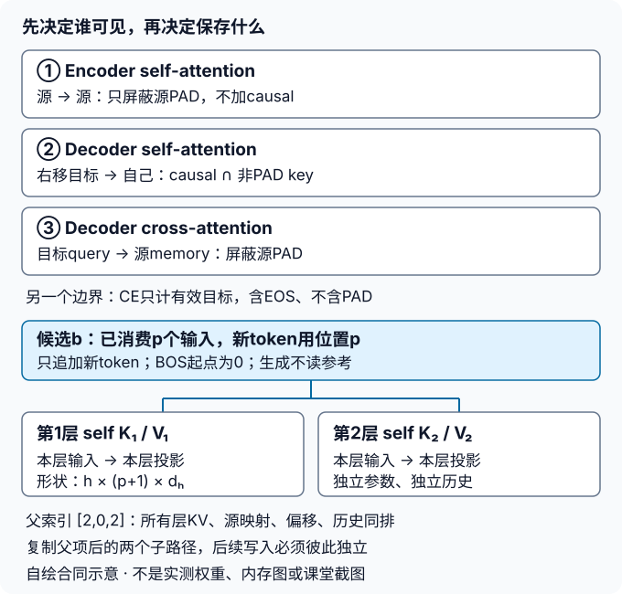

# Transformer实验指导

## 先画信息边界，再写训练循环

[实验说明](#/c/d2l-pytorch-2021/lab/transformer?v=zh)规定四任务、固定数据与交付合同；本页给出先后顺序和失败定位，不提供可直接运行的完整Lab。可先回看[LEC67](#/c/d2l-pytorch-2021/lec/lec67)的多头/位置补充与[LEC68](#/c/d2l-pytorch-2021/lec/lec68)的架构导读；前置mask与BLEU口径沿用[Seq2Seq指导](#/c/d2l-pytorch-2021/lab/seq2seq-attention?v=guide)。

| 任务 | 推荐路线 | 停下来检查什么 |
|---|---|---|
| `transformer-1` | 投影→拆头→缩放点积→合头→位置→AddNorm/FFN→堆层 | 轴顺序可逆；位置偏移连续；LayerNorm只沿d |
| `transformer-2` | 先三张允许矩阵，再接三处attention和CE | 未来变化不影响之前；PAD不改变有效预测 |
| `transformer-3` | 复用P9身份→真实小训练→序列化恢复→源端推理→固定评分 | 优化器/RNG/批次都继续；参考不进生成接口 |
| `transformer-4` | 全前缀oracle→每层projected KV→重复父重排→成本推导 | 每步logits等价，不仅是最后译文相同 |

## 任务1路线：让形状错误无处藏身

### 1. 用不对称尺寸，而不是全1张量

自拟组件例可取`B=2,Q=3,K=5,d=8,h=2`，令各位置/头/样本有不同标记。先说明为什么cross-attention能有`Q != K`，再检查分数为`(2,2,3,5)`。沿最后维softmax；分母是`√4`，不是`√8`。禁止key的权重应为0。

拆头路径应能逐元素说明`(B,L,d)→(B,L,h,dh)→(B,h,L,dh)`；合头必须逆序。`reshape`不能代替缺失的轴交换。若展平B与h，样本长度`[5,3]`对应的四行应为`[5,5,3,3]`，不是`[5,3,5,3]`。全1数据可能让错误交换仍“看起来一样”。

**局部提示**：先把投影暂视为已给出的矩阵，只核对拆合；再检查投影参数有梯度。不要把一整个Transformer的坏损失当作形状调试入口。共享输入不等于共享Q/K/V权重；堆叠“同结构”也不等于所有层使用同一个参数对象。

### 2. 位置编码的长度不是当前chunk长度

源从0起；目标BOS从0起。设之前消费$p=3$个decoder输入，新来2个token，应取位置3、4。整段位置`0:5`与先`0:3`、再`3:5`拼接应一致，必须在关闭dropout的情况下比较。另做“故意每次重置为0”的反例，使检查确实能抓到偏移错误。

位置编码只是把顺序信号加到表示中，不代替causal mask；正余弦也不保证模型一定学会任意长距离外推。源端和目标端的偏移计数不能混用。

### 3. 哪一层会偷偷混合时间？

FFN是每个位置共享同一$d\to f\to d$函数；`LayerNorm(d)`只看该位置最后维。`LayerNorm([T,d])`把整段放进统计量，即使attention有causal，未来位置仍可经归一化影响过去。改变一个位置，单独的FFN与LayerNorm不应改变其他位置输出。

教材post-norm顺序是`LN(X + dropout(sublayer(X)))`。若改成pre-norm，应另列设计与配置，不能将两者结果混称同一实现。残差要求输出回到d；FFN中间f可不同，最后层不能留在f。

## 任务2路线：分别证明四个mask的责任

### 1. 先手画两条不同长度的句子

对源长度`[4,2]`、源数组宽5，所有源query都只允许访问本句前4/2个key。encoder不应使用下三角；否则把双向源表示错误改成自回归。

对decoder输入`[BOS,A,B,EOS,PAD]`：第0行可见BOS，第1行可见BOS/A，第2行可见BOS/A/B；EOS位的query已经不计有效损失，但不能让PAD key重新成为可见历史。cross-attention的query长度来自目标，key mask长度来自源，不能把源长与目标长取最小值当“万能有效长”。

用“允许key”的逻辑交集表达causal与目标key-padding；在实现边界再转成API需要的布尔或加性mask。不凭变量名`mask`猜True含义。广播后检查batch、head、query、key四条轴，而不只是最终shape可广播。

### 2. 正反两面检查

| 自拟用例 | 应保持的量 | 容易暴露的问题 |
|---|---|---|
| 只改D的第3位及以后 | logits位置0–2 | causal漏加/方向反了/跨时间LayerNorm |
| 只改Y的第2位 | logits位置0–2 | teacher forcing未右移；变化最早应在3 |
| 替换源PAD区内容，长度固定 | 有效encoder输出与decoder logits | encoder或cross层漏源mask |
| 源右侧多补两列PAD | 同上 | PAD参与softmax分母/归一化 |
| 目标尾部多补PAD列 | 有效logits、累计NLL/有效数 | loss按数组宽度或batch均值归约 |
| 反传后查看PAD目标位置的logits梯度 | 精确为0 | CE mask漏乘；注意不是整个PAD embedding参数梯度声明 |

这些是**待学习者执行的检查条件**，不是表内给出了测试结果。先用`eval`排除dropout噪声，保存误差而不是只记录布尔值。建议CPU float32等价对照先使用`atol=1e-5,rtol=1e-4`，记录实际最大误差；容差是数值比较约定，不是允许语义性泄漏。随机小例变化偶然不明显时，加入有区分度的构造输入，不能据此删掉检查。

不要为PAD query制造全mask行。仅mask非法key，再让CE忽略无效query，足以保持有效位置边界。权重检查取dropout前或`eval`下矩阵；若合法key为空，报输入合同错误。

## 任务3路线：把训练、生成、恢复分成三个接口

### 1. 复用的是数据身份，不是旧模型

运行前读取P9来源记录，确认两个外部缓存存在：

```text
/tmp/d2l-p9-corpus-cache/fra-eng.zip
/tmp/d2l-p9-corpus-cache/manythings-fra-eng.zip
```

本轮worker已确认这两个文件存在，大小分别3420152/8242175字节；未重新获取或训练P9。真实训练必须选后一个带逐句署名的2026包。读取P9固定line IDs、句对hash、词表hash，不仅检查“样本数差不多”。若重建token数组，只按既有清洗规则做确定性复现，不重新决定划分或fit验证词表。

建议把一条batch的四件事分开打印检查：源ID/源长、目标Y/目标长、右移D、有效损失mask。预留EOS，长度含EOS。teacher forcing可用目标前缀训练；自由生成不能复用那个需要Y的训练函数包装后悄悄传入参考长度。

### 2. 先用同一个CE计量，再讨论学习曲线

局部提示：保留NLL总和与有效token数两个累加器，最终才相除。改变验证batch大小不应改变指标定义，只允许浮点舍入差。训练日志中的batch均值不能再简单平均成epoch CE；padding宽均值也不能冠名“有效token CE”。

训练使用`train`并裁剪真实梯度；初末对照、验证使用`eval`与不建图模式。记录实际更新步数、参数量、梯度有限性与裁剪发生次数，不只抄超参数。按说明建议配置先跑固定上限，不以“直到验证更漂亮”为隐藏停止规则。小数据可能过拟合，不保证Transformer优于P9 GRU。

### 3. 恢复检查的分叉点

1. 在真实模型完成若干训练更新后建立序列化快照，先明确保存发生在optimizer.step、清梯度及数据游标更新的哪一侧。
2. A保持现状走后续批次；B新建模型/Adam，从序列化内容恢复模型、优化器、RNG、批次进度再走相同批次。
3. 比较后续损失、参数与Adam状态；建议多于一步并覆盖一次shuffle边界。若用了dropout，应在恢复之后才消耗下一组随机数。
4. 另外只加载权重、使用空Adam状态作负对照；它即使初始logits相同，下一更新也不能据此认作正确续训。

只保存`manual_seed`不够：RNG在训练中已经推进。只保存shuffle generator也不能恢复当前epoch已经生成的排列与游标。Python/NumPy没有参与时标“不适用”，不要声称保存了未用的运行状态。更换硬件、框架版本、算子或并行方式可能破坏逐位复现，需另验。

本地主验的BytesIO序列化是实际保存/反序列化，不等于创建了一份可复用的磁盘checkpoint；学生的落盘、重新进程加载、后续多步验证应另行交付。不要将未保存的P9或P10权重作为下次任务的现成依赖。

### 4. 固定验证输出不要美化

以验证列表顺序固定前4条展示，全部64条计算P9语料BLEU-2。计分器在生成完成后读取完整参考，生成函数根本不接收参考。保留EOS终止与到上限未完成标记；候选BOS/PAD在log_softmax之后禁止但不重归一化。

可以用自拟符号例核对BLEU：两个句子各1个token时，全语料没有候选bigram，固定2阶分数为0；不能跨句拼出一个bigram。重复词的匹配计数逐句按参考裁剪；参考OOV仍是原词，不改成UNK来制造匹配。句级平滑诊断与主分数分栏，教材句级示例也不替代本合同。

## 任务4路线：把“缓存看似能跑”变成可核对的等价关系

### 1. 给每个缓存写清所有者与时间



图为自绘机制合同。每层独立投影self KV；cross KV可按本层源memory投影后复用，但不是跨层共享一组投影。

推荐在纸上写出状态账，而不是先设计复杂类层级：

| 状态 | 所有者 | 什么时候改变 |
|---|---|---|
| encoder memory、源mask | 源样本 | 换源时重建；候选重排时保持映射 |
| self K/V | decoder层×候选 | 每消费一个新输入追加一次 |
| cross K/V（若缓存） | decoder层×源/候选映射 | 源不变时只读，不随目标步追加 |
| offset | 候选已消费输入 | 消费q个新token后加q |
| token历史/score/done | 候选 | 按搜索合同扩展；EOS项冻结 |

一次只输入最新token，不能把完整历史再次追加到旧KV。两层使用不同权重，各自缓存自己的输入投影；不要从最顶层缓存倒推所有层。对新句清空self KV。缓存训练态图跨batch会留下错误依赖；这里缓存仅用于`eval`生成，teacher-forcing每个batch从空状态开始。

### 2. 对照顺序很重要

- **固定token前缀对照**：不先做argmax，取给定同一前缀，比较整段causal计算与逐token计算的每个logits。这样不会让第一处偏差变成后续不同输入。
- **分块对照**：将长度5前缀按3+2分块；后一chunk位置从3开始，query内部仍有causal约束。不能因为`eval`就把两token chunk全部互相可见。
- **真实生成对照**：固定源/模型，greedy分别用全前缀与缓存，比较首4条的token/EOS及每步分布；这一步不使用真实目标驱动解码。
- **重复父对照**：对多层不同内容的缓存应用父索引`[2,0,2]`，各子项下一步与单独从对应父前缀计算的结果对照。修改一个复制子项的缓存，不应改变兄弟项。

同一源的beam候选可以共享只读cross KV；一旦跨源batched top-k，必须保留源身份，不能仅靠候选在数组中的当前位置推断。每个层的KV、mask、offset和历史必须同向重排。完成项不再消费EOS，也不增长缓存。

### 3. 成本推导的核对表

固定d、h、f、batch和层数，只让长度$n\to2n$：

| 项 | 理论变化 | 不可推出的结论 |
|---|---|---|
| self QK/AV和显式分数存储 | 约4倍 | 整模型耗时/峰值内存恰4倍 |
| Q/K/V/Wo与FFN | 约2倍 | FFN一定不是瓶颈 |
| cross，仅T翻倍、S固定 | 约2倍 | cross与self同为T平方 |
| 增量self KV存储 | 约2倍 | 全生成时间变线性 |
| 候选数翻倍、不共享self历史 | KV/相关计算约2倍 | 大beam一定提高BLEU |

补齐常数：两个KV分别占一份，每层/候选都要算；乘dtype字节数。把attention score矩阵与保存的KV分开，不把`O(n²)`的训练分数矩阵误称`O(n²)`的增量KV。融合attention减少物化矩阵的空间不等于取消密集attention的所有算术。

这些是解析比较；没有同步、预热、计时边界、峰值测量与硬件条件，就不写“速度提升×倍”。主验在CPU检查正确性，未做硬件性能实验。

## 主验收已执行的小运行

以下记录来自主agent保存的真实证据，**不是本worker运行，也不是完整学生任务或全数据基准**。环境为Python3.11.8、PyTorch2.5.1、Apple M2 Max、CPU单线程float32；CUDA0，MPS仅探测，未用于训练。

- 数据逐行复用P9的512训练/64验证、156/429词表、最大长12、1919/269有效目标token；未重下语料、重训旧GRU或评估测试集。
- 实际配置：encoder/decoder各2层、d32/h4/FFN64、post-norm、正余弦位置、dropout0.1、74861参数；模型seed2029、shuffle2030，PyTorch默认初始化，Adam0.005、B32、clip1、20轮320更新，不挑seed。
- 初始/最终有效token训练CE为5.879510→0.574303；末轮验证CE4.462685。242次更新发生梯度裁剪。B32/B17验证CE差约4.54e-7，参数、buffer与已有梯度未被验证改动。低训练CE与验证走差提示短数据上的过拟合，不能用训练损失宣称译文正确。
- 全64条greedy语料BLEU-2为0.121069；两阶匹配66/6、候选ngram数163/99，总假设/参考长163/205、BP0.772851。只是P9同合同下的小样本观测，不是架构排名或GPU成绩。

固定首条为原始行58：源`i try .`，参考`j'essaye .`，模型原样生成`j'ai pleuré .`，遇EOS结束。**这是错译**，不是润色过的示例。源句作者[CK，Tatoeba #20776](https://tatoeba.org/en/sentences/show/20776)，参考作者[nimfeo，#1133630](https://tatoeba.org/en/sentences/show/1133630)；由ManyThings/Charles Kelly筛选，遵循[CC BY 2.0 France](https://creativecommons.org/licenses/by/2.0/fr/deed.en)。展示文本经过P9小写化与标点空白分词；模型输出不归属参考句主、不暗示其背书。

机制与恢复证据另记：

| 主验范围 | 实际记录 |
|---|---|
| 未来输入扰动/源PAD身份扰动 | 有效输出最大差均0；源PAD宽度变化约5.96e-7 |
| 每层projected self KV与整段前缀对照 | 最大差约6.56e-7；多token chunk约5.96e-7；偏移重置反例被抓到 |
| 父重排与复制 | 最大差约5.36e-7，重复父子项后续写独立；合成机制，不是真实beam评分 |
| PAD损失/自由生成 | PAD位置logits梯度为0；首4条greedy全前缀与增量输出相同 |
| 真实Transformer继续训练 | 完成160更新后序列化模型、Adam、CPU与shuffle RNG等状态，恢复后下一批、损失、梯度、优化器相同，参数最大差0 |
| 权重而非完整恢复的反例 | 空Adam只加载权重，下一更新参数最大差约0.010352 |

恢复使用990380字节的**内存BytesIO序列化与反序列化**，不是简单共享参数对象；但没有持久化可复用checkpoint，也未据此声明跨进程/磁盘恢复及任意多步续训已验。cross K/V在本次实现中每步重算，只验证per-layer projected **self** KV缓存；上文cross KV复用的成本解释不是已执行性能优化。完整语料、真实Transformer beam、测试评分、GPU/MPS运行、硬件计时、原Notebook兼容及所有学生变体均未执行。

## 引用与来源

- 固定教材[10.5多头注意力](https://zh.d2l.ai/chapter_attention-mechanisms/multihead-attention.html)、[10.6自注意力与位置编码](https://zh.d2l.ai/chapter_attention-mechanisms/self-attention-and-positional-encoding.html)、[10.7 Transformer](https://zh.d2l.ai/chapter_attention-mechanisms/transformer.html)。当前中文第二版源码固定提交，不等同2021课堂；本页的缓存、反事实、checkpoint和评估合同为编者工程补充。
- 语料版本、逐句署名及许可复用[Seq2Seq实验](#/c/d2l-pytorch-2021/lab/seq2seq-attention?v=zh)的来源记录；教材代码Apache-2.0不替代Tatoeba数据条件。源页面不重复再发布完整数据、权重或课堂内容。
- 精确阅读范围、原件hash和建议数值用例在`sources/p10-transformer/`；主验来源为：

```text
sources/p10-shared/transformer-smoke.json
sources/p9-shared/corpus-acquisition.json
sources/p9-shared/split-provenance.json
```

- 本文不生成缺乏课堂依据的逐段稿、问答或时间码；课堂缺口及牛仔竞赛认证/评分边界与本实验独立。最终运行与页面状态以[公共资料](#/c/d2l-pytorch-2021)为准。
