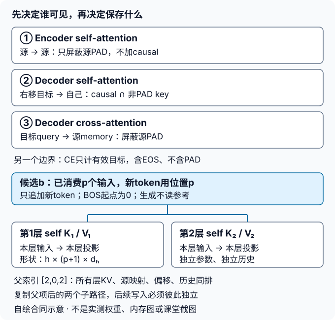

# 从注意力到Transformer

## 学习问题：并行预测为什么没有偷看未来？

把多头注意力、位置编码和前馈块接成小型英译法编码器—解码器。训练时并行处理已右移的目标；推理时只读源句与自己的历史。证明这两个计算过程在相同前缀下相容，再讨论翻译输出与长度成本。缓存不是另一种模型，也不能用更低训练损失掩盖信息泄漏。

按[实验指导](#/c/d2l-pytorch-2021/lab/transformer?v=guide)完成自己的实现。页面通用的xv6 `make qemu` / `make grade`命令不适用；没有官方Git分支、分值或保证通过的BLEU阈值。本实验不提供完整答案脚本。

### 四任务原身份

| 任务ID | 原任务 |
|---|---|
| `transformer-1` | 逐步实现/解释Q/K/V投影、多头拆合、位置编码、残差与前馈层。 |
| `transformer-2` | 核对padding与causal mask；构造未来词变化不影响此前位置输出的局部检查。 |
| `transformer-3` | 以教材翻译任务完成小型编码器-解码器Transformer训练，保存恢复并在固定样本推理。 |
| `transformer-4` | 比较训练与增量生成的输入/状态处理，估算序列长度增加的注意力计算与内存成本。 |

## 任务1：先说明每条轴，再搭积木

令批量为$B$、源长度$S$、目标输入长度$T$、模型宽度$d$、头数$h$、每头宽度$d_h=d/h$、前馈宽度$f$。本实验取$d$为正偶数，且能被$h$整除；这里不要求所有多头实现都必须等宽。

### A. 投影与拆合

| 对象 | 形状及含义 |
|---|---|
| 查询输入、键值输入 | `(B,Q,d)`、`(B,K,d)`；交叉注意力时Q与K通常不同 |
| Q/K/V线性投影 | 分别映射到d；不是把未投影原输入直接复制h份 |
| 每头Q、K、V | `(B,h,Q,dh)`、`(B,h,K,dh)`、`(B,h,K,dh)` |
| 缩放分数/权重 | `(B,h,Q,K)`；softmax沿最后的key轴 |
| 每头汇聚 | `(B,h,Q,dh)` |
| 拼接、输出投影 | 先交换头轴与位置轴，再合成`(B,Q,d)`，经过Wo |

$$
A=\operatorname{softmax}\left(QK^{\mathsf T}/\sqrt{d_h}+M\right)
$$

$$
O=\operatorname{Concat}(A_1V_1,\ldots,A_hV_h)W_o
$$

公式按行向量记法。$M$在允许处为0、禁止处为负无穷；有限填充值的实现也必须确实排除禁止位置。缩放用每头宽度而非模型宽度。若将`B,h`展平为`B*h`，长度/mask必须按同一“样本优先、头次之”顺序扩展，不能错把下一样本的长度给当前头。

先在含不同位置/头标记的小张量上证明拆合可逆；只看全1输入的shape不足以暴露轴置换错误。投影后每头可学不同函数，不保证某头天然对应某种语义。

### B. 位置、残差与归一化

源端与目标端各自从位置0计数；目标BOS占位置0。使用固定正余弦位置编码，输入为$\sqrt d\,E[\mathrm{token}]+P$：

$$
P_{p,2j}=\sin\left(p/10000^{2j/d}\right)
$$

$$
P_{p,2j+1}=\cos\left(p/10000^{2j/d}\right)
$$

训练整段输入使用`P[0:T]`。增量已有$p$个已消费输入token时，新输入使用`P[p:p+q]`，$q$为本次新输入数；不能每次单token调用都取`P[0]`。位置表不参与梯度，随设备与dtype正确迁移；若作为buffer保存，记录checkpoint策略。最大位置容量与生成上限分别检查，不静默绕回0。

本实验沿用教材的post-norm：每个子层输出先dropout，与输入相加，再`LayerNorm(d)`。FFN逐位置共享两层映射$d\to f\to d$，中间ReLU；它混合特征，不混合时间位置。残差两侧必须都是`(B,L,d)`。

**只沿最后特征轴归一化。** 不照搬教材某些形状演示中的`LayerNorm([L,d])`：那会使当前位置依赖其他位置，也不能直接用于变长增量输入。源块为“自注意力→FFN”，目标块为“masked自注意力→交叉注意力→FFN”，每个子层各有自己的AddNorm。

交付：形状表、拆合不变量、位置偏移约定、各层参数是否共享的解释。无需写成通用推理框架。

## 任务2：三处可见范围与一个损失范围



图为编者自绘机制示意，不是课堂截图或实测注意力。源padding、目标未来、目标padding、损失padding是不同的边界。

### A. 不把causal当padding

以下约定“允许”为True；调用实际API前自行核对其布尔mask语义，不同接口可能相反。设`Ls`为源有效长，`Lt`为含EOS的目标有效长。`D = BOS + Y[:-1]`为右移目标输入。

| 位置 | query/key来源 | 允许的key |
|---|---|---|
| 编码器self-attention | 源/源 | `key_index < Ls`；不加causal |
| 解码器self-attention | D/D | `key_index <= query_index` **且** D的key不为PAD |
| decoder cross-attention | 当前decoder/encoder memory | `key_index < Ls`；不按目标长度屏蔽源 |
| CE | logits/目标Y | `target_index < Lt`；EOS计入、PAD不计 |

例如`Y=[A,B,EOS,PAD,PAD]`，`D=[BOS,A,B,EOS,PAD]`。D的key-padding根据**移位后的D**定义，不把Y的PAD位置机械照搬。有效预测query只有前三个；D中的EOS只会被无效预测位置看到，不改变有效损失。causal允许当前位置，是因为该位置输入已经右移，尚不含待预测目标。

仅把PAD embedding置零不能替代mask：位置编码、线性bias、softmax分母仍可能传递影响。key-padding不自动把PAD query的输出置零；PAD query可以有有限输出，但不能贡献损失，且不能在后续层变成合法key。不要把无效query整行屏蔽成全负无穷后期望softmax产生合法概率。本实验源端至少有EOS、目标端至少有BOS，合法query始终有可见key；全mask输入应明确拒绝而非悄悄均匀化。

### B. 反事实检查不是“运行不报错”

在`eval`、关闭dropout随机性的条件下，固定源和目标前缀：

1. 改变目标输入D的$j$位及之后内容，所有$i<j$的logits应不变；因右移，改变标签Y的$j$位最早只能影响预测位置$j+1$，不能改变$j$位logits。
2. 只修改源padding区的token/表示，或追加右侧PAD并保持`Ls`，有效encoder输出和decoder有效logits应不变。
3. 只改变目标PAD区，或追加目标PAD列，有效logits、有效token CE不变；PAD目标位置的logits梯度为0。
4. 检查dropout前权重：禁止key权重为0，合法行权重非负且和为1；训练时dropout后的权重不必和为1。
5. 验证也保留causal mask。`model.eval()`只改变dropout等行为，不会替你决定信息可见范围。

交付：每项输入扰动、比较的有效位置、dtype、容差、最大误差和失败定位。不是把“应该不变”写成“已经通过”。

## 任务3：真实小训练、保存恢复与自由翻译

### A. 数据延续P9，不重新发明划分

复用[Seq2Seq实验](#/c/d2l-pytorch-2021/lab/seq2seq-attention?v=zh)已经取得的ManyThings 2026-02-13英法包与P9固定清洗/划分。历史2019教材包只作身份核对，不混用句对行号；不重下语料、不重训P9两个GRU，也不假称P9留下了可加载权重。

1. 2026包第三列署名只进元数据，不进入词表。保留ManyThings/Charles Kelly、Tatoeba、逐句句主/ID及CC BY 2.0 France条件；仓库不存完整语料或权重。
2. U+202F/U+00A0转空格、lower；在`,.!?`前且前字符非空格时补空格；按空白切词并单空格join，保留重音与撇号。
3. 完整规范化句对去重保留首次署名；完整规范化源句按SHA256分桶。输入为`p9-v1`、**实际TAB U+0009**、source拼接，取前8个hex转整数再模100；小于80训练、小于90验证，其余测试。同源多译不跨段。
4. 各段保留原文件顺序，只取前512训练、64验证；测试封存。P9去重后240357对，候选桶192038/24326/23993。这些是**复用的P9来源统计**，不是本轮Transformer训练结果；短句排序偏差不变。
5. 仅这512训练对、截断前token拟合独立词表，minfreq1，频数降序、同频Unicode字典序。源/目标156/429，UNK/PAD/BOS/EOS为0/1/2/3。验证OOV源54/目标65，不为提高指标扩大词表。
6. 两端先保留最多11普通token，再加EOS并右pad到12；长度含EOS。P9所选子集没有截断，训练/验证有效目标数为1919/269。原始行ID、句对与词表hash以页底的固定provenance文件为准，不另生成“同名新划分”。

### B. 有限预算与有效token CE

下表固定本批有界主验收的配置；实际结果见指导末节。学习者仍须自行实现与记录，不能把编者小运行当作自己的实验已经完成。

| 项目 | 本批主验配置 |
|---|---|
| 模型 | encoder/decoder各2层；d32、4头、每头8、FFN64、ReLU、post-norm |
| 参数细节 | Q/K/V/Wo无bias；FFN与输出线性层有bias；独立源/目标embedding，不绑权重；LayerNorm eps=1e-5 |
| 随机性 | 模型seed2029；独立shuffle generator seed2030；训练dropout0.1，eval关闭 |
| 更新 | batch32；Adam lr0.005、betas(0.9,0.999)、eps1e-8、weight_decay0；全局L2裁剪1 |
| 预算 | 20轮，上限320次更新；无调度器、无混合精度；先在CPU float32小运行 |
| 初始化 | PyTorch模块默认初始化；不按结果筛选种子 |
| 解码 | 首先固定greedy，最多12个生成token，EOS也占一个位置 |

未归约交叉熵$l_{bt}$、目标有效mask$m_{bt}$给出：

$$
A=\sum_{b,t}m_{bt}l_{bt},\qquad K=\sum_{b,t}m_{bt}
$$

$$
L=A/K
$$

一次更新按该batch有效token取均值；epoch和验证重新累计所有$A,K$再相除，不平均batch均值。EOS与UNK计入，PAD不计；logits直接给CE，不预先softmax。初末训练CE均在同数据、`eval`与不建图模式重算；验证不能改变参数、buffer或已有梯度。教材helper的padding宽度均值不等于本合同，不直接拿其日志作可比CE。

### C. “保存恢复”必须继续更新真实模型

选定一次**真实训练更新后、梯度已清理的边界**保存；不是对一个孤立Linear层做示例，也不是只保存权重后再打印相同预测。checkpoint至少包含：

- 模型参数与buffer、完整模型配置，词表/划分身份；
- Adam参数组、step、动量与二阶矩；若用了调度器或AMP，也保存相应状态；
- epoch/global_step、当前批次排列与下一批游标，独立shuffle generator状态；只保存seed不能恢复已走到中途的排列；
- 实际使用的Python、NumPy及PyTorch CPU/device RNG状态；未使用的RNG明确标不适用。

在同一固定CPU环境做A/B分叉：A从保存点正常继续至少两次真实更新；B新建模型和优化器、从落盘checkpoint重建所有状态，再用相同的后续批次继续。**构造新模型会消耗随机数，RNG恢复放在构造/加载之后、下一次随机操作之前。** 比较后续损失、参数、buffer、Adam状态及步数；dropout0.1使遗漏RNG状态更容易暴露。保存点之前的已完成更新不再执行。纯推理权重加载成功不能证明优化器续训正确。

只加载自己生成且可信的本地checkpoint，明确反序列化选项和版本；不为方便而加载来历不明的pickle文件。checkpoint留在外部运行目录，不随网页发布。

### D. 预测接口、固定例与P9指标

自由推理接口只接收源token、源长度、固定模型及生成配置。BOS开始，把自己刚生成的词回送，EOS结束；未结束到上限则记`max_steps_unfinished`。不得读取参考长度、参考EOS位置、真实前缀或根据参考决定何时停止。打乱参考译文/长度不应改变输出。

在`log_softmax`之后禁选BOS/PAD、不重新归一化；UNK允许。先固定验证前4条展示，完整64条计分；记录原始行号、句对hash、源/参考完整清洗文本、生成、终止原因及模型checkpoint身份。原句和参考须带句主/ID、许可及规范化说明；模型生成不能冒署参考作者。保留错译和重复词，不手改输出、不按结果选seed。

**保持P9语料BLEU-2合同**：单参考、同一清洗后空白词元、固定2阶均匀权重、无平滑、非effective-order、0–1尺度；逐句裁剪ngram计数后汇总，不跨句计数、不平均句级BLEU。假设去BOS/PAD，在首EOS前截取；UNK保留。参考使用完整清洗文本，不映射UNK，也不按训练最大长度截断。

$$
\mathrm{BP}=\exp(\min(0,1-R/C))
$$

$$
\mathrm{BLEU}=\mathrm{BP}\sqrt{p_1p_2}
$$

$C,R$是语料总长度；整组空输出、任一阶零匹配或没有候选bigram时得0，个别空输出仍贡献参考长度。保存两阶匹配/分母及BP；P9另列的句级bigram add-one/effective-order诊断不可混入主分数，教材$2^{-n}$指数也不是本指标。

若与P9已存GRU结果并列，标明参数量、dropout和架构不同，非等参数排名；不重新训练旧模型。beam不是额外新增任务，但若采用，必须沿用P9的共享active/finished容量、原始logprob剪枝、EOS冻结、最终已完成优先及长度归一化合同，不能换搜索规则后归因于Transformer。

## 任务4：全前缀对照、每层KV与长度成本

### A. 先实现容易审计的路径

全前缀基准：源memory每句只编码一次；第$t$次将`BOS + 自己已经生成的历史`整段送decoder，明确causal和padding mask，位置从0起，取最后位置logits。每次调用不携带上次decoder缓存，避免重复追加前缀。固定模型、`eval`下，它是增量实现的对照，不是使用真实目标的teacher-forcing评分。

增量路径：每次只消费最新输入token。第$\ell$层保存的是该层self-attention输入经本层$W_k^{(\ell)},W_v^{(\ell)}$投影、拆头后的KV，形如`(B*beam,h,p,dh)`；不是最后一层输出，也不是一个可供所有层共用的列表。新token投影后只追加一次，该次query关注已有KV及自己。Q不必持久缓存。

每层cross-attention还可缓存由encoder memory经**该层自己的**K/V投影得到的`(B*beam,h,S,dh)`，整个生成过程固定。相同源的候选可共享只读cross KV，但必须保留正确源映射与mask；不同候选的self KV历史不可共享可变写入。

固定教材缓存的是每层未投影隐藏表示，下一次仍会重新投影历史；它不是这里要求核对的projected KV cache。教材位置模块每次从0切片、decoder以training开关决定causal的示例也不能不加分析地套到任意全前缀/增量接口。上述约定是编者工程补充，不声称逐字复现Notebook。

### B. 候选身份与偏移

缓存长度$p$表示已经消费的decoder输入数。BOS首次输入位置0；消费BOS后缓存长1，下一输入位置1。若一次消费$q>1$个新token，内部query仍需禁止看该chunk中未来token：允许key索引不大于$p+query\_index$。单token时历史加当前位置已经构成因果边界，但padding仍独立处理。

top-k得到的是“父候选、下一token”。扩展后必须依父索引同步gather**所有层self KV、cross KV或源索引、源mask、位置计数、历史、累计分数、完成标记**。父项可重复，例如`[2,0,2]`，代表一个父候选复制出两个独立子路径；不能只重排token，也不能让兄弟追加写入互相污染。已完成候选不再扩展、分数与长度冻结。

交付两类证据：相同固定前缀下逐步logits、KV形状与位置偏移对照；真实源句greedy全前缀与缓存输出对照。先比较logits，再看argmax；相同输出不排除数值错误。另用有不同层/父标记的合成缓存验证重复父重排及后续分叉，此合成检查不冒充真实beam翻译成绩。

### C. 成本是解析估算，不是计时结果

普通密集注意力、固定层数/宽度/头数时，单层长度$n$的self-attention：

$$
\text{投影}=O(Bnd^2),\quad \text{QK与AV}=O(Bn^2d)
$$

$$
\begin{aligned}
\text{FFN}&=O(Bndf)\\
\text{显式分数矩阵}&=O(Bhn^2)
\end{aligned}
$$

交叉注意力分数/汇聚项为$O(BTSd)$，显式分数矩阵$O(BhTS)$。仅目标长翻倍时cross项约2倍；源和目标都翻倍才约4倍。self的二次项翻4倍，而投影/FFN只翻2倍，不能声称整个模型恰好慢4倍。

对生成$T$步：重复全前缀self注意力累加$\sum_{t=1}^T t^2=O(T^3)$；projected KV增量累加$\sum_{t=1}^T t=O(T^2)$。缓存不能消除必须逐token生成的依赖。设decoder层数$L_d$、候选数$C$，self KV存储为约$2L_dCThd_h$个元素，cross KV为约$2L_dCShd_h$个元素（同源共享时可降低重复项）；元素字节数再乘dtype大小。每步查询权重长度仍随历史增长。

手算示例：`B=2,h=4,n=12`的一层显式分数矩阵有1152个元素；长度24为4608个，float32分别为4608/18432字节。这只是一张分数矩阵的理论大小，不包含梯度、激活、KV、参数、Adam、临时空间与分配器，更不是内存峰值实测。融合实现可能不物化完整分数矩阵，不能用此公式替其硬件测量。CPU小运行不外推GPU吞吐或加速比。

## 交付与完成边界

1. **组件账**：各轴、投影、拆合、位置偏移、LayerNorm与残差/FFN的不变量。
2. **机制账**：三种attention mask、损失mask、未来反事实、PAD不变、每层projected KV、重复父重排、全前缀等价。
3. **真实训练账**：P9固定数据身份、实际配置与更新预算、参数量、CE、真实checkpoint继续训练、固定生成和同合同BLEU。
4. **成本账**：注明长度/宽度/层/候选数的解析式与字节估算；另列未测硬件、未跑扩展。

本站主验收结果见[实验指导](#/c/d2l-pytorch-2021/lab/transformer?v=guide)。本页给出完整要求，主验仅证明已列出的有限小运行，不代表学生所有实现变体已完成。无可靠课堂内容的逐段稿、牛仔竞赛认证文件/评分合同及LEC71课堂缺口继续独立保留，不因本实验完成而解除。

## 引用与来源

- 阿斯顿·张、李沐、扎卡里·C. 立顿、亚历山大·J. 斯莫拉，《动手学深度学习》，当前中文第二版[固定提交e6b18cce…b09a](https://github.com/d2l-ai/d2l-zh/tree/e6b18ccea71451a55fcd861d7b96fddf2587b09a)；[10.5多头注意力](https://zh.d2l.ai/chapter_attention-mechanisms/multihead-attention.html)、[10.6自注意力与位置编码](https://zh.d2l.ai/chapter_attention-mechanisms/self-attention-and-positional-encoding.html)、[10.7 Transformer](https://zh.d2l.ai/chapter_attention-mechanisms/transformer.html)。不是2021教材快照，章节实现以固定源码审读为准。本文自主讲解和练习改编，不重复翻译中文教材；不额外加入必读论文。
- [ManyThings发布页](https://www.manythings.org/anki/)；[Tatoeba使用条件](https://tatoeba.org/en/terms_of_use)；[CC BY 2.0 France](https://creativecommons.org/licenses/by/2.0/fr/deed.en)。此轮复用P9获取与许可阅读记录，不声称重新审查所有原始贡献者权利。教材代码许可不覆盖语料、视频、第三方图片或权重。
- P9包身份、许可记录及固定划分文件（只复用，不重建）：

```text
sources/p9-shared/corpus-acquisition.json
sources/p9-shared/split-provenance.json
```

- 2026包与词表关键hash如下，完整行ID及其他hash以provenance为准：

| 对象 | SHA-256 |
|---|---|
| ManyThings 2026英法包 | `9e35994767f7307dc1fa9d5efcc36681f3756a1bdaaa02c1381b3eb11461261e` |
| 源词表 | `f4f5cffd4864dc34736cd1584f77387496eac910c16399bf4e21c0fe4edf5cdf` |
| 目标词表 | `bfc551e914d34cdd1af7d5c260cd95324589474ab5dc3048e1b1708d0c9e1cdd` |

- 固定源码原件、精确阅读范围、SHA-256、主验收候选用例见`sources/p10-transformer/`。本实验不新增课堂稿、英文Lab或重复materials；未读取音视频，不编时间码、课堂演示或问答。
