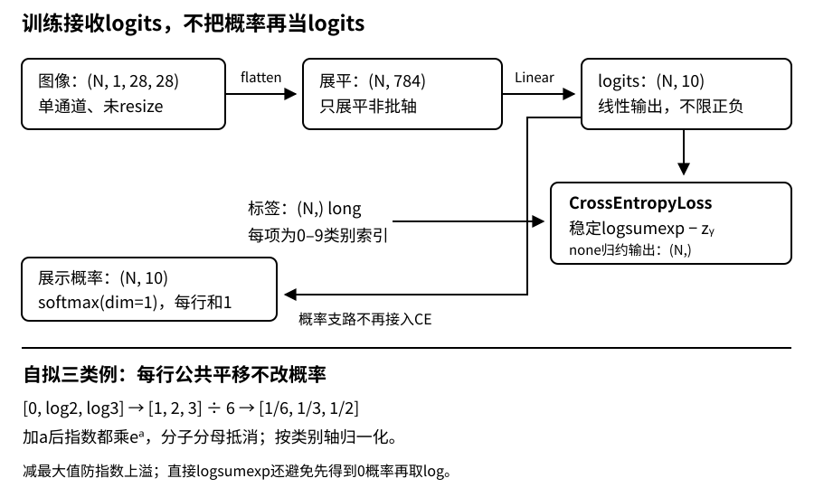

# Softmax回归：从图像形状到稳定交叉熵

## 1. 分类不是把类别编号当连续数值

服装标签0与1只是类别身份，不表示类别1比类别0“大一点”。若直接回归编号，交换类别编号就会改变误差含义。多类分类改为给每个类别一个分数，再把分数解释为概率。

用$N$表示批中样本数，$d$表示输入特征数，$C$表示互斥类别数。行样本约定下：

$$
\begin{aligned}
Z&=XW+b,\\
X&\in\mathbb R^{N\times d},\\
W&\in\mathbb R^{d\times C},\\
Z&\in\mathbb R^{N\times C}.
\end{aligned}
$$

$Z$叫**logits**，可以是任意实数，不要求正、不要求和为1。每个类别一列，每个样本一行。这里是“每张图恰好属于一个类别”的多类问题，不是多个独立标签同时成立的多标签问题。

虽然softmax本身非线性，softmax回归的两类分界仍满足$z_j=z_k$，即$X$的仿射分界；它没有学习非线性的隐藏特征。下一讲MLP才改变这一点。

## 2. Fashion-MNIST：真实数据契约与玩具张量必须区分

教材3.5使用Fashion-MNIST，不是手写数字MNIST。未缩放的图像是**28×28、单通道灰度**；官方训练部分60000张、测试部分10000张，共10类。以下是教材PyTorch读取路径的契约，不是本页已下载数据的运行报告。

| 阶段 | 图像/输出形状 | dtype或含义 |
| --- | --- | --- |
| 单张图经`ToTensor()` | `(1, 28, 28)` | 浮点像素，原8位像素缩放到`[0,1]` |
| 普通DataLoader批图像 | `(N, 1, 28, 28)` | `torch.float32`（常规默认浮点设置） |
| 批标签 | `(N,)` | 类别索引，`torch.long`，值为0–9 |
| 保留批轴展平 | `(N, 784)` | `flatten(start_dim=1)` |
| 线性输出 | `(N, 10)` | logits，不是标签、不必是概率 |
| 未归约交叉熵 | `(N,)` | 每张图一个损失 |

类别索引按教材顺序为：0 T恤、1裤子、2套衫、3连衣裙、4外套、5凉鞋、6衬衫、7运动鞋、8包、9短靴。**分类标签不能沿用回归的`(N,1)`列形状。** 本页使用索引标签路径，不需要构造60000×10的one-hot矩阵。

工程注意：

- `nn.Flatten()`默认保留第0维。不要把批轴也展平；`nn.Linear(784,10)`只看输入最后一维，不会替你猜图像布局。
- 教材允许`resize`；如果改成64×64，输入就不是784，而是4096。不能同时声称沿用原始尺寸。
- 原始数据对象、PIL图像、转换后的张量是不同阶段；不能把`ToTensor`前的数据说成已经`[0,1]`。
- 教材把`train=False`返回的官方测试部分用于演示评估。自己的超参数实验应从训练部分再划出验证集，最终测试集不参与选轮数/学习率。
- 本页短例不依赖torchvision、不下载数据；完整数据路径在[线性训练实践](#/c/d2l-pytorch-2021/lab/linear-training)中独立验收。合成零张量的形状通过不等于真实数据加载通过。

## 3. softmax究竟沿哪一维

对第$i$个样本，类别$j$的预测概率为：

$$
p_{ij}=\frac{e^{z_{ij}}}{\sum_{k=1}^{C}e^{z_{ik}}}.
$$

`dim=1`在`(N,C)`中表示沿类别轴归一化。分母形状应为`(N,1)`，方便给每一行广播；`keepdim=True`不是装饰。如果错误地取`dim=0`，同一类别在不同样本之间竞争，一张图的预测会被同批其他图改变。

自拟三类例子：$z=[0,\log2,\log3]$，指数为$[1,2,3]$，所以$p=[1/6,1/3,1/2]$。若只需要预测类别，直接对logits做`argmax(dim=1)`即可；指数和公共正分母不改变大小次序，无须先计算softmax。

### 平移不变，不是缩放不变

每一行加同一个常数$a$：

$$
\frac{e^{z_j+a}}{\sum_ke^{z_k+a}}
=\frac{e^a e^{z_j}}{e^a\sum_ke^{z_k}}
=p_j.
$$

不同样本可以有不同的$a$，但同一个样本的所有类别必须用同一个$a$。对logits乘以一个正数通常改变概率的尖锐程度，虽然不改变`argmax`。因此“只要类别顺序相同，交叉熵就相同”是错的。



图：编者自绘。概率支路用于解释和展示，训练损失直接从logits计算；不把概率再作为logits送入交叉熵。

## 4. 损失函数：为什么准确率不适合直接反向

准确率只看最大分数的类别，分数改变但最大者不变时它毫无变化，不能给普通梯度训练提供连续的纠正信号。交叉熵则关心真实类别的概率：

$$
\ell_i=-\log p_{i,y_i},\qquad L=\frac1N\sum_i\ell_i.
$$

真实类别概率从0.5降到0.1，损失从约0.693升到约2.303；**自信地错**比犹豫地错惩罚更重。用自然对数，单位是nat。三类均匀预测损失是$\log3$，十类均匀预测是$\log10$；这些是解析参照，不是要求随机初始化网络恰好达到的运行值。

one-hot写法只是同一目标的另一种表示：

$$
\ell_i=-\sum_j t_{ij}\log p_{ij},\qquad
t_{ij}=\mathbf1[j=y_i].
$$

推导训练最有用的结果：先写$\ell=\log\sum_ke^{z_k}-z_y$，再求导得到

$$
\frac{\partial\ell}{\partial z_j}=p_j-\mathbf1[j=y].
$$

仍用$p=[1/6,1/3,1/2]$，真实类别索引为2，单样本梯度是$[1/6,1/3,-1/2]$，三项和为0。负梯度更新会提高正确类别分数、压低错误类别分数；如果目标是批均值，各行梯度还要除以$N$。

### 同一个“损失”词，选择不同

以下为编者机制比较，不冒充未审阅的“损失函数”视频内容：平方损失对残差$r$的导数与$r$成正比，离群点影响大；绝对值损失$|r|$在非零处导数只有正负号，较不受极大残差支配，但零点要用次梯度约定。两者用于连续目标时有清楚的数值距离含义；不能把类别编号的距离套进去。交叉熵用概率解释分类目标，准确率用于评价最终硬预测。损失下降但准确率暂时不变，可能只是模型对同一预测更有信心，并非必然程序出错。

## 5. 稳定性：减最大值只解决了一半

直接计算`exp(1000)`可能上溢。利用平移不变性，令$m=\max_jz_j$，先用$z-m$计算softmax。指数最大为1，分母至少有一项1，避免指数上溢。

但是，若$z=[1000,-1000]$且真实类别为1，减最大值后的真实类指数是$e^{-2000}$，浮点中可能下溢成0；随后`log(0)`仍产生负无穷。**稳定softmax再取log，不等于稳定log-softmax。**

把运算合并在对数域：

$$
\begin{aligned}
\operatorname{logsumexp}(z)&=m+\log\sum_k e^{z_k-m},\\
\ell&=\operatorname{logsumexp}(z)-z_y.
\end{aligned}
$$

等价地，损失可写成$\log\sum_k e^{z_k-m}-(z_y-m)$。极端例子的损失约为2000，仍可表达，不必先得到小到无法表示的真实类概率。稳定算法减少的是中间运算的问题，不能修复输入已经含`NaN/inf`或精度早已丢失的情形。

```python
import torch
import torch.nn.functional as F

z = torch.tensor([[1000.0, -1000.0], [2.0, 1.0]], dtype=torch.float64)
y = torch.tensor([1, 0], dtype=torch.long)
shifted = z - z.max(dim=1, keepdim=True).values
manual = shifted.logsumexp(dim=1) - shifted[torch.arange(len(y)), y]
builtin = F.cross_entropy(z, y, reduction="none")
print(manual.tolist())  # 解析预期：约[2000, 0.3132616875]
print(torch.allclose(manual, builtin))  # 解析预期：True
print(torch.allclose(z.softmax(dim=1), (z + 123).softmax(dim=1)))  # True
```

这段是数值机制小例，不是训练实现。训练默认选择框架稳定交叉熵，不用“给概率加一个epsilon”掩盖错误的数据路径；随意加epsilon也会改变目标和梯度。

## 6. 两种实现的边界：最重要的是输出语义

| 位置 | 教材3.6从零写法 | 教材3.7简洁写法 / 本页工程对照 |
| --- | --- | --- |
| 展平 | 显式`reshape`，每图784维 | `nn.Flatten()` |
| 仿射参数 | $W:(784,10),b:(10,)$ | `nn.Linear(784,10)`，weight为`(10,784)` |
| 网络返回值 | 教学版返回softmax概率 | 返回原始logits |
| 损失 | 取真实类概率，再负对数 | `nn.CrossEntropyLoss`接收logits |
| 归约 | 每样本损失，再sum/mean | `reduction='none'`后按实际样本归约，或直接mean |
| 更新 | 自定义SGD | `torch.optim.SGD` |

从零不意味着必须永远保留不稳定的概率路径：学会公式后，可以手写仿射前向、使用稳定损失，再对照高层层对象。**不能把从零网络返回的概率直接接到`CrossEntropyLoss`前面。** 它会把概率当成新的一组logits再做一次归一化，计算另一个目标；可能不报错，却训练错误。

本页限定无类别权重、无忽略标签、无标签平滑的普通索引标签路径：`logits:(N,C)`浮点、`y:(N,)`为`long`且值在`[0,C)`。PyTorch也支持与logits同形状的浮点概率目标，这是另一个API分支；不要把索引标签误转浮点来“修复”错误。

下面用两样本、两特征、三类做从零仿射与`Linear`的一次局部对照；不是Fashion-MNIST样本，也不是完整训练循环。

```python
import torch
from torch import nn

X = torch.tensor([[1.0, 0.0], [0.0, 1.0]])
W = torch.tensor([[0.0, 1.0, 2.0], [2.0, 1.0, 0.0]], requires_grad=True)
b = torch.zeros(3, requires_grad=True)
y = torch.tensor([2, 0], dtype=torch.long)
layer = nn.Linear(2, 3)
with torch.no_grad():
    layer.weight.copy_(W.T)
    layer.bias.copy_(b)
z_manual = X @ W + b
z_module = layer(X)
criterion = nn.CrossEntropyLoss()
loss_manual = criterion(z_manual, y)
loss_module = criterion(z_module, y)
loss_manual.backward()
loss_module.backward()
print(torch.allclose(z_manual, z_module))  # 解析预期：True
print(torch.allclose(W.grad.T, layer.weight.grad))  # 解析预期：True
print(torch.allclose(b.grad, layer.bias.grad))  # 解析预期：True
print(loss_manual.item())  # 解析预期：约0.407606
```

## 7. 从可用模型到可信指标

每批的正确样本数相加，最后除以实际总样本数，才是整集准确率。批大小不同时不要直接平均批准确率；损失同样按样本数加权。训练只能更新训练集对应的损失，评估不更新参数。

`model.eval()`切换模型行为，`torch.no_grad()`关闭普通求导记录，两者职责不同。纯线性层目前几乎看不出train/eval输出差别，但之后加入Dropout就会改变行为；从现在就明确两个开关，而不是等评估失真再补。

| 症状 | 可定位的错误 |
| --- | --- |
| 概率列和为1、行和不为1 | 把`dim=0`当类别轴 |
| `CrossEntropyLoss`形状或类型报错 | 标签是否为`(N,)` long，是否混入`(N,1)`或one-hot |
| 损失有限但训练不对 | 是否先softmax再CE，标签映射是否错位 |
| logits很大后出现无穷 | 是否直接exp再log；输入是否已经非有限 |
| 改batch后同一图概率改变 | 是否跨批次归一化，而非逐样本跨类别 |
| 仅尾批指标奇怪 | 实际$N$、重复平均、样本数加权 |

## 8. 自测

1. 对$z=[0,\log2,\log3]$、真实类别2，损失和单样本logits梯度是多少？
2. 为什么每行加100不改变概率，而每行乘100通常会改变？
3. `(8,1,28,28)`应变成什么输入和输出形状？标签是什么形状与dtype？
4. 减最大值之后为什么不直接计算`log(softmax(z))`？
5. 一个大小为3的批准确率为1，另一个大小为1的批为0，整集准确率是多少？

<details>
<summary>展开答案与推理</summary>

1. $\log2$；梯度$[1/6,1/3,-1/2]$。若有$N$个样本并取均值，还要除$N$。
2. 加法对应指数中的公共因子，分子分母抵消；乘法改变不同类别之间的分数差。
3. 展平为`(8,784)`，输出`(8,10)`logits，标签`(8,)` long。
4. 小概率仍可能下溢成0，取log变成负无穷。直接用logsumexp或框架交叉熵。
5. $3/4$而不是$1/2$；每个样本应有同等权重，不是每批同等权重。

</details>

## 来源、视频分P与缺口

- **教材依据**：《动手学深度学习》中文第二版，阿斯顿·张、李沐、扎卡里·C. 立顿、亚历山大·J. 斯莫拉。实际读完固定提交的[3.4 softmax回归](https://github.com/d2l-ai/d2l-zh/blob/e6b18ccea71451a55fcd861d7b96fddf2587b09a/chapter_linear-networks/softmax-regression.md)、[3.5图像分类数据集](https://github.com/d2l-ai/d2l-zh/blob/e6b18ccea71451a55fcd861d7b96fddf2587b09a/chapter_linear-networks/image-classification-dataset.md)、[3.6从零实现](https://github.com/d2l-ai/d2l-zh/blob/e6b18ccea71451a55fcd861d7b96fddf2587b09a/chapter_linear-networks/softmax-regression-scratch.md)、[3.7简洁实现](https://github.com/d2l-ai/d2l-zh/blob/e6b18ccea71451a55fcd861d7b96fddf2587b09a/chapter_linear-networks/softmax-regression-concise.md)全文；实现解释取PyTorch及通用分支。当前中文第二版固定源码不是2021教材快照。没有展开章节参考论文为额外必读。
- **API定点补充**：已读PyTorch 2.5 [CrossEntropyLoss](https://docs.pytorch.org/docs/2.5/generated/torch.nn.CrossEntropyLoss.html)的logits契约、两类target、形状和归约；[Linear](https://docs.pytorch.org/docs/2.5/generated/torch.nn.Linear.html)的权重布局。API属于编者补充，不是视频指定阅读。
- **许可**：[固定仓库LICENSE](https://github.com/d2l-ai/d2l-zh/blob/e6b18ccea71451a55fcd861d7b96fddf2587b09a/LICENSE)为Apache-2.0；不据此授权视频、Fashion-MNIST数据或第三方图片。未保存数据图像，本页图为自绘，代码是独立小例。
- **视频身份**：[09 Softmax 回归 + 损失函数 + 图片分类数据集](https://www.bilibili.com/video/BV1K64y1Q7wu)，作者“跟李沐学AI”，发布时间2021-03-29 03:45:34（UTC+8）；历史课表为3月28日，保留课表原日期。

| 分P入口 | 实际元数据标题 | 时长 | 内容边界 |
| --- | --- | --- | --- |
| [P1](https://www.bilibili.com/video/BV1K64y1Q7wu?p=1) | Softmax 回归 | 10分26秒（626秒） | 讲授未核实 |
| [P2](https://www.bilibili.com/video/BV1K64y1Q7wu?p=2) | 损失函数 | 6分24秒（384秒） | 讲授未核实 |
| [P3](https://www.bilibili.com/video/BV1K64y1Q7wu?p=3) | 图片分类数据集 | 9分25秒（565秒） | 演示未核实 |
| [P4](https://www.bilibili.com/video/BV1K64y1Q7wu?p=4) | Softmax 回归从零开始实现 | 18分43秒（1123秒） | 演示未核实 |
| [P5](https://www.bilibili.com/video/BV1K64y1Q7wu?p=5) | Softmax 回归简洁实现 | 4分9秒（249秒） | 演示未核实 |
| [P6](https://www.bilibili.com/video/BV1K64y1Q7wu?p=6) | QA | 30分59秒（1859秒） | 问答未核实 |

2026-11-13先核实view全部P，再查询全部6个cid的标准公开player：均HTTP 200、业务码0，字幕列表为空；未重复刷空请求、不绕登录风控、不默认下载媒体。元数据时长不是片内内容时间线，空列表也不排除烧录字幕等情况。未观看音视频，不能生成真实逐段整理或课堂问答，故draft保留阻塞且不建占位；materials无必要独立阅读，标not_required、不造重复文。视频`copyright=1/no_reprint=1`不是开放许可。证据与代码清单存于`sources/p2-lec09/`；本页两段代码CPU核对通过。真实Fashion-MNIST读取与257/73小规模训练证据见[公共资料](#/c/d2l-pytorch-2021)和`sources/p2-shared/`，不外推教材Notebook、全量训练或完整学生作业。
