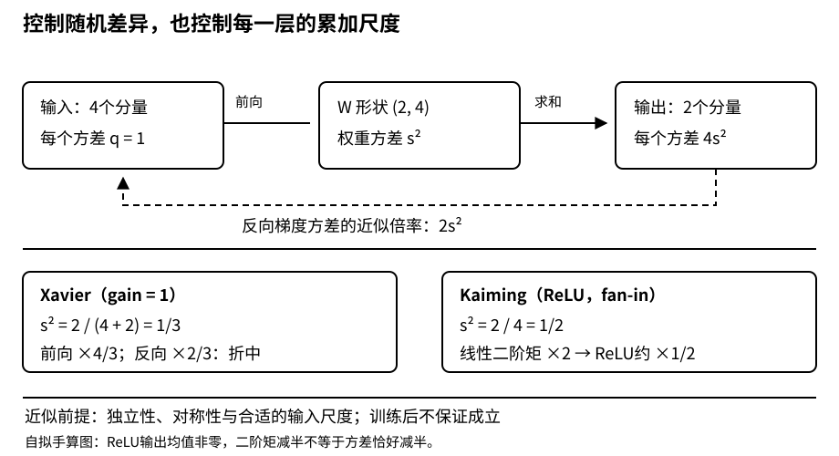

# 数值稳定与初始化：让信号传得动，也让神经元学得不同

## 1. 三种问题，不要都叫“梯度算错了”

| 问题 | 发生了什么 | 单靠提高浮点精度能解决吗 |
| --- | --- | --- |
| 数值表示问题 | 中间值溢出为Inf、下溢为0，或相近数相减损失有效数字 | 有时推迟发生，但稳定计算形式更重要 |
| 优化尺度问题 | 梯度仍是有限数，但更新过大或小到学不动 | 一般不能，仅“能表示”不等于“好优化” |
| 参数对称性问题 | 不同隐藏单元从相同状态出发，始终学出同样功能 | 不能，需要打破相应对称性 |

因此初始化既要安排随机差异，又要控制尺度。随机数不是越大越能“打破对称”；全部缩到接近零，也不是越稳越好。

计算形式和初始化各管一部分。例如log-sum-exp对$z=[1000,1001]$，直接先指数会给常见浮点类型带来溢出风险；改写为：

$$
\begin{aligned}
m&=\max_i z_i,\\
\log\sum_i e^{z_i}&=m+\log\sum_i e^{z_i-m}.
\end{aligned}
$$

得到有限的$1001+\log(1+e^{-1})\approx1001.313262$。这是编者的数值形式补充：不应试图通过“把网络权重初始化得更小”永久修复一个不稳定的损失实现。

## 2. 链式法则为什么容易让前层学不动

采用列向量写法，单样本网络为：

$$
z^{(l)}=W^{(l)}h^{(l-1)}+b^{(l)},\qquad h^{(l)}=\phi_l(z^{(l)}).
$$

| 对象 | 形状 |
| --- | --- |
| 上一层激活$h^{(l-1)}$ | $(n_{l-1},1)$ |
| 权重$W^{(l)}$ | $(n_l,n_{l-1})$ |
| 当前激活$h^{(l)}$、偏置$b^{(l)}$ | $(n_l,1)$ |
| 局部雅可比$J_l=\partial h^{(l)}/\partial h^{(l-1)}$ | $(n_l,n_{l-1})$ |

设最终损失$L$是标量，反向传播中的梯度满足：

$$
\begin{aligned}
\nabla_{h^{(l-1)}}L&=J_l^\top\nabla_{h^{(l)}}L,\\
J_l&=\operatorname{diag}(\phi_l'(z^{(l)}))W^{(l)}.
\end{aligned}
$$

更早层的梯度要经过更多矩阵乘法。标量直觉最容易手算：连续20层的局部导数若都是0.5，总倍率$0.5^{20}\approx9.5367\times10^{-7}$；若都是2，倍率$2^{20}=1048576$。这两个值仍可能正常表示，但优化行为已天差地别。

矩阵情形不能只看每个元素是否小于1，更不能把不同矩阵的特征值简单逐项相乘。一个安全的上界是：

$$
\|J_L\cdots J_1v\|_2\le\left(\prod_l\|J_l\|_2\right)\|v\|_2.
$$

这里矩阵2-范数是最大奇异值，给出最强放大方向；各层的方向组合也重要。此上界说明风险，不证明某个实际样本一定爆炸。我们只需理解连乘尺度，不新增矩阵分析论文任务。

### 激活函数改变了每一层的倍率

- Sigmoid导数为$\sigma(z)(1-\sigma(z))\le1/4$；饱和区更接近0。若暂时忽略权重带来的放大，10个最大导数连乘也只有$4^{-10}\approx9.5367\times10^{-7}$。这不是“所有sigmoid网络梯度都严格小于这个值”的结论，因为真实雅可比还包含权重。
- Tanh在原点附近导数接近1，但饱和后同样很小；激活的输入尺度决定多少单元落在饱和区。
- ReLU在正半轴导数为1，缓解了正路径中的饱和问题；负半轴导数为0，若单元对全部训练输入都为负，可能长期不更新。使用ReLU并不能保证深网不消失、不爆炸。

```python
import torch

for factor in (0.5, 2.0):
    x = torch.tensor(1.0, dtype=torch.float64, requires_grad=True)
    y = x
    for _ in range(20):
        y = y * factor
    y.backward()
    print(factor, x.grad.item())
z = torch.tensor([1000.0, 1001.0], dtype=torch.float64)
print(torch.logsumexp(z, dim=0).item())
# 解析预期：9.5367431640625e-7、1048576.0、约1001.3132616875。
# 此片段不包含网络训练。
```

## 3. 对称性：两个神经元为什么不能一直是复制品

设两个隐藏单元接收相同输入，有相同的入权重、偏置，且它们连接到输出的权重也相同。在相同数据、确定性计算和相同更新规则下，两者前向值相同，反向梯度也相同，之后的参数仍相同。增加一个复制单元，没有获得预期的独立表达能力。

**条件不能漏掉输出侧。** 仅“第一层两行相同”并不必然永远对称：不同的输出连接就可能带来不同梯度。完整的置换对称状态才会被对称的梯度更新保持。独立随机初始化权重通常能打破它；固定随机种子只保证整次初始化可复现，不是给所有单元填同一个随机值。

自拟例子：输入$x=1$，隐藏激活为tanh，两个入权重$w_1=w_2=0$，两个输出权重$v_1=v_2=1$，预测$\hat y=v_1\tanh(w_1x)+v_2\tanh(w_2x)$，目标为1，损失$(\hat y-1)^2/2$。此时预测0、损失0.5，$\nabla_wL=[-1,-1]$、$\nabla_vL=[0,0]$；一步SGD后两入权重仍相等。如果所有出入权重都为0，这个例子的隐藏权重梯度也会为0。

```python
import torch

w = torch.tensor([0.0, 0.0], dtype=torch.float64, requires_grad=True)
v = torch.tensor([1.0, 1.0], dtype=torch.float64, requires_grad=True)
pred = (v * torch.tanh(w)).sum()  # 输入x=1
loss = (pred - 1).square() / 2
loss.backward()
print(loss.item(), w.grad.tolist(), v.grad.tolist())
# 解析预期：0.5、[-1.0, -1.0]、[0.0, 0.0]。
```

这不禁止所有零初始化：单层线性回归没有这种隐藏单元复制问题；隐藏层权重随机后，偏置常可初始化为零。需要判断的是“哪些功能会被锁成一样”，而不是机械遵守“任何参数都不能为零”。

## 4. 初始化方差：每层相加了多少个随机贡献

考虑无偏置线性层的一个输出$z_i=\sum_{j=1}^{n_{\mathrm{in}}}w_{ij}x_j$。暂时假设：权重独立同分布、均值0、方差$s^2$；输入零均值、方差$q$，各项独立，且输入与权重独立。于是交叉项消失：

$$
\mathbb E[z_i]=0,\qquad
\operatorname{Var}(z_i)=n_{\mathrm{in}}s^2q.
$$

如果输入维度从10变成1000，却仍让每个权重方差为1，输出方差会从$10q$变成$1000q$。问题不在“随机数是否以0为中心”，而在累加了多少项。



图为编者在独立性近似下的自绘推导。真实训练后输入、权重和梯度常有相关性，因此这是初始化启发式，不是逐层分布严格不变的保证。

### Xavier：折中照顾前向与反向

无非线性的近似下，保持前向方差希望$n_{\mathrm{in}}s^2=1$；保持反向梯度方差希望$n_{\mathrm{out}}s^2=1$。当输入输出宽度不同，不能同时精确满足。Xavier（gain=1）选折中：

$$
\begin{aligned}
s^2&=\frac{2}{n_{\mathrm{in}}+n_{\mathrm{out}}},\\
a&=\sqrt{\frac6{n_{\mathrm{in}}+n_{\mathrm{out}}}},\\
w&\sim\mathcal N(0,s^2)\ \text{或}\ U(-a,a).
\end{aligned}
$$

这里$s$是标准差，$s^2$才是方差。均匀分布$U(-a,a)$方差为$a^2/3$，所以两个分布的尺度可以对齐。

手算$n_{\mathrm{in}}=4,n_{\mathrm{out}}=2,q=1$：Xavier方差$1/3$，标准差约0.57735，均匀边界为$\pm1$。前向方差倍率是$4/3$，反向近似倍率是$2/3$，**不是两边都精确为1**。当两种宽度相等时，才同时满足这一线性近似下的条件。

### ReLU：保留的是二阶矩，不要误写成方差减半

对围绕0对称的随机变量$z$，ReLU把负半边置零，有：

$$
\mathbb E[\operatorname{ReLU}(z)^2]=\tfrac12\mathbb E[z^2].
$$

但ReLU输出均值通常不为0，因此不能直接写“输出方差恰好是输入方差的一半”。正态零均值输入的确切方差倍率甚至是$1/2-1/(2\pi)$，而不是$1/2$。

按二阶矩传播的近似，为抵消这次减半，ReLU常采用Kaiming/He的fan-in方差$2/n_{\mathrm{in}}$，标准差$\sqrt{2/n_{\mathrm{in}}}$。这部分是基于已读PyTorch初始化API的编者补充，不把它冒充4.8源码已完整推导的内容。

$n_{\mathrm{in}}=4$时方差为0.5；若输入二阶矩为1，线性输出二阶矩近似为2，ReLU后近似回到1。注意这与上一段Xavier的$1/3$并不相同；初始化要与激活及传播方向配套。

## 5. 在PyTorch里不要把fan方向写反

`nn.Linear(n_in, n_out)`的权重存储为`(n_out, n_in)`，批输入$X$形状为$(B,n_{\mathrm{in}})$，实际计算相当于$XW^\top+b$。初始化API按这种存储解释fan-in/out。

若你从零实现用$XW$，把$W$存成$(n_{\mathrm{in}},n_{\mathrm{out}})$，调用依赖fan方向的初始化时应按文档对转置视图进行初始化；否则尤其是Kaiming的fan-in/fan-out会互换。Xavier gain=1的公式对两种fan求和，恰好对交换对称，不能因这一例子没出错就忽略约定。

不要默认框架的每一种层都采用你想象中的同一个初始化。核实当前层及API后再显式覆盖；初始化函数通常在`no_grad`模式下修改参数，且只应在创建模型或有意重置时调用，不应每个batch重新初始化。

工程诊断顺序：

1. 固定一个小batch，先确认输入、标签和loss有限，loss公式稳定，张量形状正确。
2. 观察每层激活的均值/二阶矩、零比例，以及梯度范数；要看随深度的趋势，而非只看最后一层。
3. 梯度为None时先查图断开、未参与loss、是否读取非叶`.grad`，不要立刻归因于消失。
4. 梯度有限但更新发散，再检查学习率、loss归约和初始化尺度。记录更新量与参数量的相对大小，零参数处不要盲目除零。
5. 梯度裁剪可以限制过大更新，但不能恢复已经断开的路径或饱和到近零的梯度，更不能把非有限计算自动变正确。

本讲只要求理解这些机制和手算预期，不要求另读初始化论文、构建超深网络或提交完整实验答案。

## 6. 自测

<details>
<summary>0.5连续乘20次仍是非零数，为什么也可能叫梯度消失？</summary>

“消失”不要求浮点值严格为0。约百万分之一的倍率已可能让前层更新远小于后层，学习进度严重失衡；提高精度不能自动改变优化尺度。

</details>

<details>
<summary>隐藏层两个入权重相同，输出权重不同，是否一定永远相同？</summary>

不一定。不同输出连接会传回不同误差信号。永久保持对称要求相应出入连接、偏置、更新和随机行为也满足对称条件。

</details>

<details>
<summary>4输入、2输出的Xavier初始化能同时把前后向方差倍率设为1吗？</summary>

gain=1时方差为1/3，前向倍率4/3，反向近似倍率2/3；它是折中而不是两边都严格不变。

</details>

<details>
<summary>为什么ReLU的2/fan-in不能直接称为“严格保持所有层方差”？</summary>

推导主要控制独立、对称近似下的二阶矩。ReLU产生非零均值，真实层间还会相关；即使初始近似成立，训练也会改变这些条件。

</details>

## 来源、版本与视频覆盖边界

- 全文审阅[固定源码4.8 数值稳定性和模型初始化](https://github.com/d2l-ai/d2l-zh/blob/e6b18ccea71451a55fcd861d7b96fddf2587b09a/chapter_multilayer-perceptrons/numerical-stability-and-init.md)，含练习，代码重点为PyTorch sigmoid导数与矩阵连乘分支。当前中文第二版固定源码非2021快照；未执行教材随机矩阵连乘、绘图或完整训练。
- 已审阅[PyTorch2.5初始化文档](https://pytorch.org/docs/2.5/nn.init.html)中的`calculate_gain`、Xavier uniform/normal、Kaiming uniform/normal及fan方向说明；不是全初始化API审阅。Kaiming、二阶矩澄清、完整对称条件、稳定log-sum-exp例为编者补充。
- 本页不引用未读的4.7作证据；4.7在原课表无独立指定链接，本页链式法则直接围绕4.8的雅可比表达展开。不新增必读论文，教材的“额外阅读”不升级成用户任务。定位已足够，`materials=not_required`。
- [原视频](https://www.bilibili.com/video/BV1u64y1i75a)：《14 数值稳定性 + 模型初始化和激活函数【动手学深度学习v2】》，作者“跟李沐学AI”，2021-04-18 19:19:02 UTC发布（北京时间次日03:19:02）。2026-11-13核实全部分P如下。

| P | 平台标题 | cid | 时长（秒） | 公开player字幕 |
| --- | --- | --- | --- | --- |
| 1 | 数值稳定性 | 326162337 | 921 | 请求成功，空列表 |
| 2 | 模型初始化和激活函数 | 326162532 | 1443 | 请求成功，空列表 |
| 3 | QA | 326162451 | 1349 | 请求成功，空列表 |

分P元数据不是内容时间线。没有下载或观看媒体，没有可审阅字幕，课堂演示与QA均未核实；中文原课通过页头观看，本课不另作课堂逐段整理；不编造时间码。空列表不证明其他字幕形式不存在，不重复刷公开接口。

证据和教材`.txt`在`sources/p2-lec14/`。根Apache-2.0与setup包MIT-0字段分开，均不外推视频；平台copyright=1/no_reprint=0，0也不构成开放转载许可。两段机制代码CPU核对通过，涵盖连乘梯度、稳定logsumexp和对称梯度，见`sources/p2-shared/notes-smoke.json`；没有运行教材随机矩阵连乘、初始化统计实验或完整网络训练。
