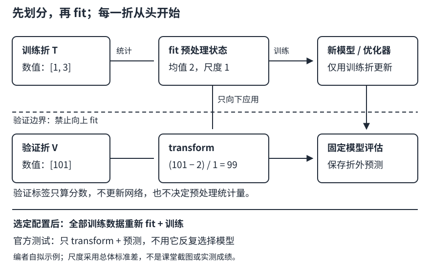

# 房价预测：先把验证做诚实，再谈模型变复杂

## 1. 一条完整基线究竟交付什么

预测房价不只是让网络输出一个数。完整基线需要回答：**拿什么数据训练，用什么规则变换新房屋，什么指标算好，验证结果是否可信，最后怎样恢复同一个预测系统？**

本讲先做表格回归，不要求刷排行榜。学习顺序是：识别列与标签 → 固定验证划分 → 折内拟合预处理 → 线性基线 → 对数指标 → 误差检查。复杂MLP是后续对照，不是发现数据错误的替代品。

两项同名“房价”任务必须分开：

| 对象 | 本讲的处理方式 |
| --- | --- |
| 教材4.10的Ames房价，Kaggle `house-prices-advanced-regression-techniques` | 本文形状、`SalePrice`、CSV与log RMSE讨论的对象 |
| 2021课程“加州2020年房价预测”，`california-house-prices` | 历史竞赛扩展；不同数据、规则和来源，不能把Ames结果说成复现了它 |

## 2. 从一行CSV到一行张量

教材记录训练CSV形状为$(1460,81)$，测试CSV为$(1459,80)$：训练文件比测试文件多标签`SalePrice`。其中`Id`只用于识别和提交对齐；删除`Id`与标签后，原始输入有79列。数值列、类别列和缺失值混在一起，不能直接把整个表强转浮点。

设一批有$B$栋房屋，预处理后有$d$个特征：

| 对象 | 形状与语义 |
| --- | --- |
| $X$ | $(B,d)$，每行一栋房，每列一个固定含义的输入 |
| $w$ | 数学列向量$(d,1)$；`nn.Linear(d,1).weight`存储为$(1,d)$ |
| $b$ | 一个标量偏置；框架形状$(1,)$ |
| $y,\hat y$ | 都用$(B,1)$，原价或对数价必须声明 |

线性预测为：

$$
\hat y=Xw+b.
$$

若$y$是$(B,)$而输出是$(B,1)$，相减可能广播成$(B,B)$，程序能跑但比较了每个预测与所有标签。第一条断言应当是形状完全相同，而不是仅仅损失为有限数。

**列顺序也是模型的一部分。** 即使训练、验证都各有300列，只要独热列的顺序不同，同一个权重就对应了不同含义。教材合并训练/测试后得到331列是其处理结果，不是任何版本、任何折都必须达到的数字。

## 3. fit与transform：预处理也会“学”

数值标准化使用训练部分的均值$\mu_j$与尺度$s_j$：

$$
\begin{aligned}
\mu_j&=\frac{1}{n_j}\sum_{i\in T_j}x_{ij},\\
s_j&=\sqrt{\frac{1}{n_j}\sum_{i\in T_j}(x_{ij}-\mu_j)^2},\\
z_{ij}&=\frac{x_{ij}-\mu_j}{s_j}.
\end{aligned}
$$

$T_j$表示当前训练折中第$j$列的非缺失行，$n_j$为其个数。本式采用总体标准差（`ddof=0`）；教材`pandas.std()`默认采用样本标准差，两者都可形成一致管线，但必须记录约定，不要混用。

- **fit**：只在当前训练折统计均值、尺度、类别词表等状态。
- **transform**：用这套固定状态处理训练折、验证折，以及最终推理输入；不能在验证集重新求均值。
- **数值缺失**：训练均值填补后标准化等于填0。缺失可能意味着“没有地下室”而非“忘了填写”；必要时加缺失指示列，不能默认缺失完全随机。
- **常数列**：训练尺度为0时约定尺度置1，避免除0；全缺失列没有可估均值，要事先规定删除或固定填充值与缺失指示，且不向验证集借统计量。
- **类别列**：训练折建立词表，缺失用单独类别；未知类别走预先约定的未知桶或全零编码。验证列要按训练列重排，不能独立编码后凭位置相乘。
- **数据类型**：独热列可能是布尔值；张量输入要明确统一成浮点数，不依赖混合表格转数组后的隐式类型。

### 一个泄漏可以手算的小例子

训练面积是$[1,3]$，验证面积是$[101]$。训练均值为2，总体标准差为1，因此训练标准化为$[-1,1]$，验证为$[99]$。验证点很极端，这是值得检查的事实，不应靠把它纳入拟合来“修好”。

若偷偷合并后拟合，均值变成35，训练与验证都被重新缩放。没有使用验证标签，也已经利用了未来输入分布。本地验证不再模拟“只看到训练样本”的流程。它**不保证每次让分数更好**，但改变了所测问题。

独立机制片段A（仅NumPy，不训练模型）：

```python
import numpy as np

train = np.array([[1.0], [3.0]])
valid = np.array([[101.0]])
mean = train.mean(axis=0)
scale = train.std(axis=0, ddof=0)
scale = np.where(scale == 0, 1.0, scale)
z_train = (train - mean) / scale
z_valid = (valid - mean) / scale
assert np.array_equal(z_train[:, 0], [-1.0, 1.0])
assert np.array_equal(z_valid[:, 0], [99.0])
print(mean.tolist(), scale.tolist(), z_valid.tolist())
```

解析预期为`[2.0] [1.0] [[99.0]]`。这不是完整预处理器：真实作业还要自行处理缺失、类别和列对齐。

### 教材简化与工程基线的区别

固定源码先拼接训练与无标签测试特征，再统一标准化/独热编码，然后才做K折。这样方便对齐列，但各验证折已经参与了统计量计算；测试特征参与拟合还属于使用未标注目标域输入的设定。是否允许这种做法要看具体竞赛规则，不能外推到所有部署情境。

**本文的基础路线明确改为：先划分，再在每折内部fit。** 这不是声称老师课堂改过代码，而是编者为可审计验证所作的调整。



图：编者自绘。虚线边界表示验证输入只能被transform，不能反向参与fit。

## 4. log RMSE衡量什么，训练又在最小化什么

设房价$y_i>0$、预测$\hat y_i>0$，自然对数残差为$e_i=\log\hat y_i-\log y_i$：

$$
\begin{aligned}
R_{\log}&=\sqrt{\frac1n\sum_{i=1}^n e_i^2},\\
e_i&=\log\frac{\hat y_i}{y_i}.
\end{aligned}
$$

预测为真实值的两倍，残差是$\log2$；预测为一半，残差是$-\log2$，平方后同罚。100预测成200与1000预测成2000具有同样的对数误差，却有完全不同的原价误差。

当$\hat y=y(1+\delta)$且$|\delta|$很小时，$\log(1+\delta)\approx\delta$，所以对数残差近似相对误差。它不是对所有误差都精确等于百分比误差，也不是在原价上计算RMSE后再取对数。

教材PyTorch代码的两件事不能混淆：

| 环节 | 固定源码实际做法 |
| --- | --- |
| 反向传播的训练损失 | `MSELoss(net(X), y)`，在原价格尺度上最小化平方误差 |
| 记录、比较的指标 | 先把预测下限截到1，再算预测对数与标签对数的RMSE |

例如对两套房$y=[100,1000]$、预测$[200,2000]$，原价MSE为505000，对数RMSE约0.693147。把训练损失打印成“log RMSE”会掩盖两者差异。

独立机制片段B（Python标准库）：

```python
import math

y = [100.0, 1000.0]
pred = [200.0, 2000.0]
raw_mse = sum((p - t) ** 2 for p, t in zip(pred, y)) / len(y)
log_rmse = math.sqrt(
    sum((math.log(p) - math.log(t)) ** 2
        for p, t in zip(pred, y)) / len(y)
)
assert raw_mse == 505000.0
assert math.isclose(log_rmse, math.log(2.0), abs_tol=1e-12)
print(raw_mse, round(log_rmse, 6))
```

解析预期为`505000.0 0.693147`。

### 一个值得比较的替代目标

让网络输出$z_i=f_\theta(x_i)$，训练目标改为：

$$
\begin{aligned}
L(\theta)&=\frac1n\sum_i(z_i-\log y_i)^2,\\
\hat y_i&=\exp(z_i).
\end{aligned}
$$

这样$\sqrt L$与不截断预测时的log RMSE对应；平方根单调，最小值位置相同，但对损失做平方根会改变梯度尺度，不等于训练过程相同。预测对数再指数化偏向几何尺度，**不自动等于条件平均价格**，因此不能承诺它必然优化原价RMSE。

教材的截到1用于避免非正预测取对数。它改变了评价映射，且单位相关：价格单位换成“万元”后不能不加思考地仍截到1。若把截断直接放进训练损失，低于阈值区域还可能出现零梯度。基础对照应明确选“原价MSE”或“对数价MSE”，保留原始输出检查，不用截断掩盖发散、NaN和溢出。

## 5. K折的核心是K套独立训练过程

把有标签数据索引分成$K$个互斥部分$V_1,\ldots,V_K$。第$k$轮用其余数据$T_k$训练，在$V_k$上评估：

1. 固定索引与随机种子；索引划分要与部署条件相符。
2. 用$T_k$重新fit预处理器。
3. 新建网络、重新初始化、新建优化器；不能继承上一折的参数或动量。
4. 训练只消费$T_k$标签；验证只前向、算指标，不更新参数。
5. 将$V_k$预测放回原样本位置，形成out-of-fold（OOF，折外）预测。

若同一房屋有多条记录，随机拆行可能让相关记录跨折；这是假设性排错项，不宣称本数据一定存在重复。若目标是预测未来，随机拆分可能过于乐观。本批公开页面核实的加州竞赛就明确写了测试房屋成交晚于训练房屋，且私榜晚于公榜；时间划分因此具有任务依据，但不能把这一事实套到教材Ames文件上。

教材用`n // k`切等长片段。一般情况下若$n$不能整除$K$，末尾余数可能遗漏。比如7条数据分3折，应为3、2、2条或其他完整分配，而不是只用6条。验收索引应满足：每行恰好验证一次，训练/验证交集为空。

对不等长折，合并OOF后的指标为：

$$
R_{\mathrm{OOF}}=\sqrt{\frac{\sum_k n_kR_k^2}{\sum_k n_k}}.
$$

它通常不等于各折RMSE的简单平均；即使等长，平方根也不能随意搬出平均号。平均折分数可作另一个摘要，但报告必须命名清楚。LEC18会继续解释如何比较这些结果。

## 6. 最终训练与交付，不让验证过程失效

选定模型和超参数后，重新在**全部有标签训练数据**上fit预处理、训练最终模型，再对官方无标签测试集transform与预测。不要拿测试榜单反复决定缺失处理、层数和停止轮次；反复试探排行榜同样会形成模型选择偏差。

交付至少包括：数据来源与哈希、划分索引、预处理状态与列名顺序、模型结构/权重、目标单位、评价公式、配置与环境。CSV提交要核对`Id`顺序、行数、唯一性以及预测全为有限正数；不要把Pandas的行索引误写成额外列。

数据获取也要能审计。固定教材写的是HTTP镜像与SHA-1；本批其他来源采集已用同host的HTTPS取得两个Ames CSV并核对SHA-1（证据见页底）。哈希用于确认是否与固定教材文件一致，不代表数据许可，也不代表SHA-1是抵御恶意替换的现代安全保证。教材下载函数核验旧缓存，但新下载后未再次核验；工程流程应检查HTTP状态及新文件哈希，失败就停止，不把HTML错误页交给训练。

本讲不是实验答案：完整训练循环与四项阶段作业仍由学习者完成。CPU小规模基线足以检查管线，不要求历史竞赛提交、排名或特定分数。

## 7. 自测

<details>
<summary>1. 没有读验证标签，只在全表上求均值，算不算泄漏？</summary>

对本文“只用训练折拟合”的验证协议，算。均值和词表也是数据依赖状态。它不一定让分数提高，但已改变评估设定；应先切分再fit。
</details>

<details>
<summary>2. 预测翻倍与预测减半，log RMSE处罚一样吗？原价MSE呢？</summary>

对同一正标签，对数残差分别为正负log 2，处罚一样。原价误差分别为y与-y/2，平方处罚相差4倍。
</details>

<details>
<summary>3. 每折都重建网络，却共用一个全表拟合的预处理器，够独立吗？</summary>

不够。每折还必须重新fit预处理，并新建优化器；否则验证输入统计或上一折优化状态可能跨过边界。
</details>

<details>
<summary>4. 只有权重文件，可以在新CSV上保证同样预测吗？</summary>

不能。还缺列含义/顺序、缺失与类别规则、标准化状态、模型结构、目标变换与单位等。预测系统不等于权重矩阵。
</details>

## 来源、分P与缺口

- [中文教材4.10](https://zh.d2l.ai/chapter_multilayer-perceptrons/kaggle-house-price.html)：实际阅读固定源码全文1–632行，重点PyTorch训练、对数指标、K折与提交；[固定源码](https://github.com/d2l-ai/d2l-zh/blob/e6b18ccea71451a55fcd861d7b96fddf2587b09a/chapter_multilayer-perceptrons/kaggle-house-price.md)。中文第二版当前源码，非2021快照。折内fit、OOF汇总和严格数据契约为编者补充。
- [2021课程课表](https://courses.d2l.ai/zh-v2/)与[公告](https://courses.d2l.ai/zh-v2/announcements.html)区分教材比赛与[加州历史竞赛](https://www.kaggle.com/c/california-house-prices/overview)。本批另一采集任务已浏览公开Description/Evaluation/Data页：数据需登录接受比赛规则，许可为“Subject to Competition Rules”；未登录、未下载加州数据、未提交。访问结果见`sources/p3-mlp-generalization/california-access.json`，不是声称平台不可用；Ames运行不代表加州复现。
- [本讲视频](https://www.bilibili.com/video/BV1NK4y1P7Tu)，作者“跟李沐学AI”，发布2021-04-18（UTC）。2026-11-13核实全部3P：P1“实战 Kaggle 比赛：预测房价”870秒；P2“课程竞赛：加州2020年房价预测”519秒；P3“QA”201秒。此表仅为分P身份与时长，不是讲授时间索引。
- 每P公开player请求一次，均`code=0`、字幕空列表。未下载/观看媒体，未核实课堂演示与QA；不猜时间码，不生成draft占位。没有独立中文阅读需求，materials为`not_required`。
- 来源原件、SHA-256、阅读范围和预期输出在`sources/p3-lec15/manifest-fragment.json`。Ames HTTPS获取证据在`sources/p3-mlp-generalization/ames-access.json`；数据不入库。根Apache-2.0仅记录教材仓库适用许可，不外推视频、数据或第三方图片。本页两段机制代码由子agent编写但未执行，CPU统一验收由主agent记录。
