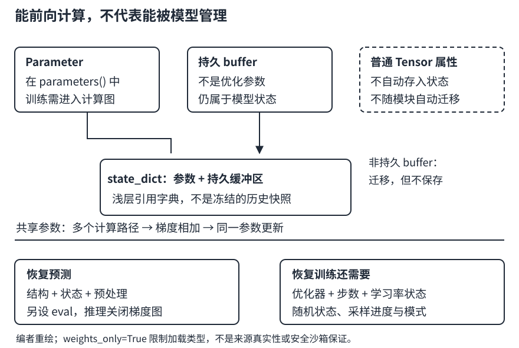

# 把张量计算变成模型：注册、共享与保存的边界

## 1. Module不只是给forward套一个类

一个模块有两条彼此关联的结构：

1. **计算路径**：输入经过哪些运算，输出如何产生，梯度如何回传。
2. **注册结构**：哪些参数、子模块和缓冲区属于这个模型，能否被优化器发现、迁移设备、保存与恢复。

“前向算对”只能验证第一条。把层藏进普通Python列表，或在`forward`里使用参数的`.data`，都可能得到看似合理的输出，却破坏训练或管理契约。

设输入$X$形状为$(B,d)$，隐藏宽度$h$，输出维度$q$：

$$
\begin{aligned}
H&=\operatorname{ReLU}(XW_1^\top+b_1),\\
Y&=HW_2^\top+b_2.
\end{aligned}
$$

| 对象 | PyTorch形状 |
| --- | --- |
| $W_1,b_1$ | $(h,d)$、$(h,)$ |
| $H$ | $(B,h)$ |
| $W_2,b_2$ | $(q,h)$、$(q,)$ |
| $Y$ | $(B,q)$ |

例如$d=2,h=3,q=1$时参数数目为$3\times2+3+1\times3+1=13$。批量大小只改变激活量，不改变这一参数数目。

`nn.Sequential`适合单条依次连接的路径；分支、复用同一层或显式控制流适合自定义`nn.Module`。先在`__init__`调用`super().__init__()`，再创建需要训练的层；通常不要在每次`forward`里新建随机层，否则参数身份、初始化与优化器追踪都会错位。调用`net(x)`，而不是把`net.forward(x)`当作完全等价的工程入口：模块调用机制还负责钩子等管理行为。

## 2. 三类张量，不同的管理责任

| 存放方式 | 自动进入`parameters()` | 默认进`state_dict()` | 随模块`.to(device)`迁移 |
| --- | --- | --- | --- |
| 属性上的`nn.Parameter` | 是，即使`requires_grad=False`仍是参数 | 是 | 是 |
| `register_buffer`注册的非空张量 | 否 | 是；`persistent=False`除外 | 是 |
| 普通张量属性 | 否 | 否 | 否 |

`requires_grad=True`表示自动微分需要追踪，不等于已经注册进模型。优化器如果只收到`net.parameters()`，看不见一个未注册的普通张量，即使该张量能得到梯度。

不训练但属于模型状态的量，例如固定投影矩阵、中心值或运行统计，适合缓冲区。缓冲区“不在参数迭代器里”不表示数值永远不会变：前向过程仍可以按算法更新它。标签、训练数据则不该为方便迁移就塞进模型状态。

子模块赋到`self.layer`会注册；多个子模块用`nn.ModuleList`，键值组织可用对应的模块容器。普通列表不会自动递归注册其中的模块。`ModuleList`负责登记，不自动规定前向执行顺序；循环或分支仍由你在`forward`定义。不要仿照教学内部原理代码直接依赖私有`_modules`字典，日常使用公开API。



图：编者自绘。图中“状态字典”是数据，不是一个可自行执行的模型。

## 3. 自定义层：既检查输出，也检查梯度

教材的无参数中心化层计算$X-X.mean()$，是减去**整个输入张量**的均值。如果希望每个样本沿特征轴中心化，应明确写对应维度，不能将它们混为一谈。

例如：

$$
X=\begin{bmatrix}1&3\\5&7\end{bmatrix}.
$$

全局均值为4，结果为$[[-3,-1],[1,3]]$；逐行均值为$[2,6]$，结果为$[[-1,1],[-1,1]]$。前者使不同样本相互影响，批量划分变化就可能改变输出。它不是前一讲“用训练统计固定变换新样本”的预处理器，也不是批量归一化的完整实现。

### 固定源码中的一个重要陷阱

5.4的PyTorch `MyLinear.forward`使用`self.weight.data`和`self.bias.data`计算。**注册了Parameter但前向绕过它的自动微分关系，不是安全训练模板。** 本文编者实现直接使用参数本身；手动初始化放在`torch.no_grad()`中，不通过`.data`绕开自动微分。

下面自定义层采用数学列权重$(2,1)$，故用$XW$；这与内置`nn.Linear`使用$(1,2)$权重并转置的约定不同，二者都合法，不能混抄形状。

独立机制片段A：

```python
import torch
from torch import nn

class AffineOffset(nn.Module):
    def __init__(self):
        super().__init__()
        self.weight = nn.Parameter(torch.tensor([[2.0], [-1.0]]))
        self.bias = nn.Parameter(torch.tensor([1.0]))
        self.register_buffer("offset", torch.zeros(2))

    def forward(self, x):
        return (x - self.offset) @ self.weight + self.bias

net = AffineOffset()
x = torch.tensor([[1.0, 2.0]], requires_grad=True)
y = net(x)
y.sum().backward()
assert y.item() == 1.0
assert torch.equal(net.weight.grad, torch.tensor([[1.0], [2.0]]))
assert torch.equal(x.grad, torch.tensor([[2.0, -1.0]]))
assert net.bias.grad.item() == 1.0
assert set(dict(net.named_parameters())) == {"weight", "bias"}
assert set(net.state_dict()) == {"weight", "bias", "offset"}
print(y.item(), net.weight.grad.flatten().tolist(), x.grad.tolist())
```

解析预期为`1.0 [1.0, 2.0] [[2.0, -1.0]]`。这里对输出求和仅为了检查局部导数，不是房价训练目标。若改用`.data`导致权重梯度消失，不能只以输出为1宣布成功。

## 4. 参数共享不是“初始化得一样”

两个独立层即使初值相等，也有独立参数对象和优化状态。真正共享是复用同一层/同一Parameter。共享参数被计算路径多次使用时，各路径的导数相加。

把所有维度压缩成标量最容易看清。令$h=wx$、$y=wh=w^2x$，同一个$w$使用两次：

$$
\begin{aligned}
\frac{\partial y}{\partial w}
&=\underbrace{h}_{\text{第二次使用}}+
\underbrace{w x}_{\text{经第一次使用回传}},\\
&=2wx.
\end{aligned}
$$

当$x=3,w=2$时，$h=6,y=12$，总梯度为12。若改成两个独立参数$w_1,w_2$，则各自梯度都是6，不能把两个独立权重的更新称为共享更新。

独立机制片段B：

```python
import torch
from torch import nn

shared = nn.Linear(1, 1, bias=False)
with torch.no_grad():
    shared.weight.fill_(2.0)
net = nn.Sequential(shared, shared)
y = net(torch.tensor([[3.0]]))
y.sum().backward()
assert net[0].weight is net[1].weight
assert len(list(net.parameters())) == 1
assert y.item() == 12.0
assert shared.weight.grad.item() == 12.0
print(y.item(), shared.weight.grad.item(), len(list(net.parameters())))
```

解析预期为`12.0 12.0 1`。默认参数遍历去重，不需要手工把同一参数再次塞给优化器。`state_dict`可能有指向同一共享状态的不同路径键；不能据键数量推断独立参数数量。

保存后重建时，**共享关系也必须在架构代码里重建**。把相同数值加载到两个原本独立的层，不会凭空把它们变成同一个Parameter。

## 5. 初始化、冻结与优化器的身份问题

初始化通常在训练前做一次。`net.apply(fn)`递归处理模块，初始化函数需要识别目标层；`nn.init`工具已按其约定处理梯度记录。手工填值使用`no_grad`，并且不要把重新初始化塞到训练循环里。

排错时沿这条链检查：

1. `named_parameters()`里有预期名字、形状和数量吗？
2. 对应参数的`requires_grad`是否合适？
3. 前向是否真正用到它，是否中途`detach`或`.data`？
4. 反向后`.grad`是`None`还是数值为0？两者含义不同。
5. 优化器是否持有**现在模型的这些参数对象**？

例如创建优化器后再用新层替换`net.head`，优化器可能还握着旧层参数。重新组合模型、迁移设备等操作应在建立优化器之前完成；需要训练中替换时必须显式管理参数组和已有状态，不是只给属性赋值就结束。

`eval()`不冻结参数，不关闭自动微分；它切换Dropout/BatchNorm等层的行为。`no_grad()`抑制梯度图建立，也不等于持久冻结。若训练中冻结参数，还要考虑已有梯度与优化器状态，不能把三个概念混成一个“停止训练开关”。

## 6. state_dict保存了什么，没保存什么

默认`state_dict()`包含注册参数和持久缓冲区；它不自动包含模型结构代码、训练/评估模式、每个Parameter的`.grad`、优化器动量、数据预处理器或训练进度。

还有一个容易踩的坑：`best = net.state_dict()`只是取得含张量引用的浅层状态字典，并不是冻结的历史快照。随后训练可能让`best`随之变化。需要立即序列化，或对保留的状态做深拷贝。不要在每步都无目的复制全部参数；只在确实需要保存的检查点做。

### 最小推理恢复流程

1. 重建同样的模型结构、参数形状与共享关系。
2. 从可信文件加载状态数据，明确`weights_only=True`和`map_location`。
3. 默认严格匹配键名，排查遗漏/多余键和尺寸错误，不用`strict=False`把错误藏起来。
4. `load_state_dict`之后调用`eval()`；推理时另外使用`no_grad()`。
5. 对固定输入比较保存前后结果，并恢复同样的输入预处理。

独立机制片段C只在内存中序列化，不留下权重文件：

```python
import io
import torch
from torch import nn

net = nn.Linear(2, 1)
with torch.no_grad():
    net.weight.copy_(torch.tensor([[2.0, -1.0]]))
    net.bias.fill_(1.0)
net.eval()
x = torch.tensor([[1.0, 2.0], [3.0, 4.0]])
buffer = io.BytesIO()
torch.save(net.state_dict(), buffer)
buffer.seek(0)
state = torch.load(buffer, map_location="cpu", weights_only=True)
clone = nn.Linear(2, 1)
clone.load_state_dict(state)
clone.eval()
with torch.no_grad():
    expected = net(x)
    restored = clone(x)
assert torch.equal(restored, expected)
assert torch.equal(restored, torch.tensor([[1.0], [3.0]]))
print(restored.flatten().tolist(), clone.training)
```

解析预期为`[1.0, 3.0] False`。这证明的只是该小模型状态往返的契约；不能据此宣称恢复了任意训练任务。

### 安全加载不是“下载后直接torch.load”

固定教材5.5使用未显式设置`weights_only`的旧式写法。PyTorch2.5官方API中它默认是`False`；本文明确写`True`，不依赖版本默认值。它限制反序列化对象类型，降低任意pickle对象执行风险，但**不是不可信文件的安全沙箱**，也不是来源真实性验证。

只加载来源可信、内容未被篡改的文件。遇到受限加载失败，不要为了“能跑”自动改成`weights_only=False`或盲目放宽白名单。保存整个Python模型还绑定类路径和代码环境，通常不如“结构代码＋状态字典＋配置”清楚。

## 7. 恢复预测，与接着训练，是两种验收

| 目标 | 除权重/持久缓冲区外需要的状态 |
| --- | --- |
| 复现固定输入的推理 | 结构、模式、预处理、目标变换、版本与精度 |
| 从某一步继续优化 | 优化器状态、学习率计划、步数/epoch、训练模式；若使用混合精度，还需缩放器状态 |
| 尽量接续同一训练轨迹 | 进一步保存随机数状态、采样/批次位置、数据版本与配置；跨硬件/版本仍不保证逐位相同 |

为什么优化器状态重要？对带动量SGD，写成：

$$
\begin{aligned}
v_t&=\beta v_{t-1}+g_t,\\
w_{t+1}&=w_t-\eta v_t.
\end{aligned}
$$

即使恢复了同一个$w_t$，若把$v_{t-1}$清零，下一步也不同。手算例：$L=w^2$、$w_0=1$、$\eta=0.1$、$\beta=0.9$、初始动量0；第一步$g_0=2$，得到$w_1=0.8$、动量2。第二步梯度1.6，继续训练的动量为3.4，$w_2=0.46$；只恢复权重、动量清零则得到0.64。

最小恢复训练验收是：固定一小批数据，保存一步后的模型与优化器状态；一条分支继续一步，另一条重建后恢复再走同一步；比较参数和优化器状态。使用随机层时，还要对齐随机状态和模式。仅比较加载后的前向输出相同，尚未覆盖这项要求。

## 8. 自测

<details>
<summary>1. 一个普通Tensor设置requires_grad=True，会自动被net.parameters()收集吗？</summary>

不会。自动微分与模块注册是两条契约。需要训练且属于模型的张量应注册成Parameter，并确保优化器持有它。
</details>

<details>
<summary>2. 固定矩阵不用梯度，为什么还要register_buffer？</summary>

因为它仍属于模型状态，需要随设备迁移并可能保存恢复。普通张量属性不会自动获得这些管理行为。
</details>

<details>
<summary>3. 两个层的权重元素完全相等，能证明共享吗？</summary>

不能。应检查对象身份及计算图使用方式。相等初值可在下一步更新后分离；共享参数会收集所有使用路径的梯度。
</details>

<details>
<summary>4. 加载权重后输出一致，是否说明断点训练恢复正确？</summary>

不说明。还需验证优化器、步数、模式及随机/数据状态；动量例中下一步可能是0.46，也可能是0.64。
</details>

## 来源、分P与缺口

- 实际阅读中文第二版固定源码全文：[5.1层和块](https://zh.d2l.ai/chapter_deep-learning-computation/model-construction.html)1–723行；[5.2参数管理](https://zh.d2l.ai/chapter_deep-learning-computation/parameters.html)1–739行；[5.4自定义层](https://zh.d2l.ai/chapter_deep-learning-computation/custom-layer.html)1–317行；[5.5读写文件](https://zh.d2l.ai/chapter_deep-learning-computation/read-write.html)1–326行。重点核对PyTorch，未把其他框架代码当作PyTorch API。未宣称已读5.3。
- 编者现代API补充：[PyTorch2.5 Module](https://docs.pytorch.org/docs/2.5/generated/torch.nn.Module.html)、[ModuleList](https://docs.pytorch.org/docs/2.5/generated/torch.nn.ModuleList.html)、[torch.load](https://docs.pytorch.org/docs/2.5/generated/torch.load.html)、[序列化语义](https://docs.pytorch.org/docs/2.5/notes/serialization.html)所列阅读范围；[官方保存/恢复教程](https://docs.pytorch.org/tutorials/beginner/saving_loading_models.html)中的state_dict、推理恢复与通用checkpoint节是当前非固定版本页面，不是2021课堂材料。必要短引证据保存在`official-api-evidence.txt`，不要求整篇额外通读。
- [本讲视频](https://www.bilibili.com/video/BV1AK4y1P7vs)，作者“跟李沐学AI”，发布2021-04-24（UTC）；2026-11-13核实全部5P：P1模型构造807秒，P2参数管理1040秒，P3自定义层328秒，P4读写文件363秒，P5 QA 651秒。仅为身份与时长，不据此推测讲授段落。
- 每P公开player字幕请求一次均成功空列表；未下载/观看媒体，课堂讲解、演示、QA均未核实。中文原课通过页头观看，本课不另作课堂逐段整理；必要中文教材定位已在本文，materials为`not_required`。
- 固定提交、原件SHA-256、现代API阅读范围与代码预期在`sources/p3-lec16/manifest-fragment.json`。教材根Apache-2.0与包字段MIT-0分开记录，均不外推视频或其他文档。子agent未执行上述代码、构建或测试，主agent统一记录实际验收。
