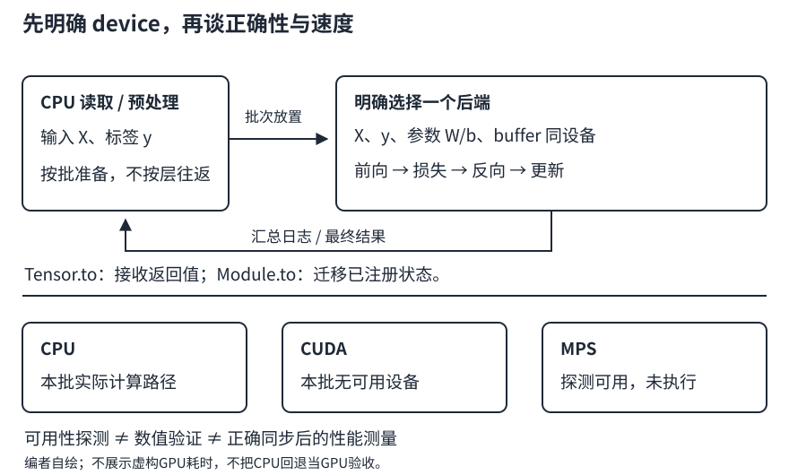

# 设备放置：知道数据在哪里，才知道计算在哪里

## 1. device不是张量形状的另一种写法

一个张量至少有四类需要同时检查的信息：**数值、形状、dtype、device**。两个$(2,3)$的浮点矩阵，若一个在CPU、一个在CUDA设备上，不能因为形状一致就假设它们可以直接相加。

设备描述回答“由哪个执行后端持有并计算这个张量”，不改变矩阵乘法的数学定义。模型参数和参与运算的非标量输入通常要位于兼容的同一设备；本讲统一采用全部显式同设备的约定，不依赖个别CPU标量操作的特例。

| 后端 | 表示方式 | 不应混淆的事 |
| --- | --- | --- |
| CPU | `torch.device("cpu")` | 多核CPU也不是多GPU；能完成本阶段基础学习 |
| NVIDIA CUDA | `torch.device("cuda:0")`等 | 需要相应硬件、运行环境与PyTorch支持；Apple GPU不是CUDA |
| Apple MPS | `torch.device("mps")` | Metal后端，设备支持/算子支持与CUDA不同；不是把`.cuda()`换个驱动就能得到 |

构造一个`torch.device("cuda:1")`只是描述设备，并不证明机器真的有第二块卡。实际分配、执行时才会使用相应后端。`cuda`不带编号指当前CUDA设备，通常最初是0；不能在所有上下文里都当作永远固定的`cuda:0`。

教材`try_gpu(i)`在缺少所需卡时回退到CPU，有利于演示。但回退后得到有限输出，只能说明**CPU路径**执行了，不能证明第$i$块GPU路径正确。基础学习可以回退；GPU专项验收应报告跳过原因，而不是静默把CPU结果登记为GPU成功。

## 2. 数据与模型如何相遇

设$X$是$(B,d)$，全连接层权重$W$是$(q,d)$、偏置$b$是$(q,)$：

$$
Y=XW^\top+b,\qquad Y\in\mathbb R^{B\times q}.
$$

迁移之前检查：$X$、$W$、$b$的形状匹配，dtype适合对应算子，device一致。迁移后数学关系不变，但硬件与精度实现可能带来小量数值差异，跨设备验收通常比较容差而非承诺逐位相等。

**张量和模块的`.to()`语义不同：**

- `x.to(device)`返回目标张量，不应假定它修改了变量`x`。跨设备时需要接住返回值，例如把迁移结果绑定回`x`。
- 若设备和dtype都已符合，且未要求复制，Tensor `.to()`可以返回自身；它不是“总复制一次”。
- `net.to(device)`会迁移模块的注册参数和缓冲区，原地修改模块并返回自身。
- 普通张量属性不会自动随模块迁移；这就是LEC16强调`register_buffer`的原因。

通常先完成模型构造和设备迁移，再创建优化器，使优化器持有正确的参数对象。每个批次把输入和标签迁移到目标设备，然后前向、求损失、反向和更新。不要在每层之间无理由地往返CPU/GPU。



图：编者自绘的单设备训练路径。CPU、CUDA、MPS是不同执行选择，图中不代表三个设备同时训练，也不代表本批实际运行过GPU。

### 容易遗漏的临时张量

即使模型和输入都搬好了，在`forward`中直接新建默认CPU张量仍可能出错。需要创建掩码、常量或累加器时，要明确从输入继承device/dtype，或把真正属于模型的固定状态注册成buffer。

标签也别漏掉。分类标签通常是整数索引，不能为了“和输入一样”把所有张量都强转成同一种浮点dtype。设备一致与dtype完全相同不是同一条要求；以所用算子的接口为准。

## 3. 一个明确只在CPU运行的机制片段

下面不自动选择最快设备。它特意固定CPU，使没有GPU的学习者也能核对放置、形状和梯度契约。环境探测仅打印能力，不在CUDA/MPS上创建张量。

```python
import torch
from torch import nn

print("CUDA count:", torch.cuda.device_count())
print("MPS built/available:",
      torch.backends.mps.is_built(), torch.backends.mps.is_available())
device = torch.device("cpu")
net = nn.Linear(2, 1, bias=False).to(device)
with torch.no_grad():
    net.weight.copy_(torch.tensor([[1.0, 2.0]], device=device))
x = torch.tensor([[1.0, 1.0]], device=device)
y = torch.tensor([[1.0]], device=device)
pred = net(x)
loss = (pred - y).square().mean()
loss.backward()
assert x.device == y.device == net.weight.device == pred.device
assert pred.item() == 3.0
assert loss.item() == 4.0
assert torch.equal(net.weight.grad, torch.tensor([[4.0, 4.0]]))
assert x.to(device) is x
print(str(pred.device), pred.item(), loss.item(), net.weight.grad.tolist())
```

数值行的解析预期为`cpu 3.0 4.0 [[4.0, 4.0]]`。推导：预测$1\times1+2\times1=3$，残差2，损失4，权重梯度为$2(3-1)[1,1]=[4,4]$。前两行依机器而变，不能把CUDA数量或MPS能力硬编码为所有读者的期望。

本批主agent实际探测记录：macOS26.3.1-arm64、Python3.11.8、PyTorch2.5.1；`torch.version.cuda`为`null`，CUDA不可用、数量0；MPS构建支持和可用性均为`true`。**本批执行设备仍明确选CPU；MPS可用探测不等于MPS运算已验证。** 这也不是“这台Mac没有GPU”。

## 4. GPU为什么未必让小程序更快

先看一个明确标注为假设的时间模型：

$$
\begin{aligned}
T_{\mathrm{CPU}}&=T_c,\\
T_{\mathrm{GPU}}&=T_{\mathrm{传入}}+T_{\mathrm{调度}}
+T_g+T_{\mathrm{传出}}.
\end{aligned}
$$

若某个很小任务CPU需1毫秒，GPU计算只需0.2毫秒，但传入/调度/传出合计2毫秒，那么端到端GPU是2.2毫秒，反而更慢。这些是**编者假设数值，不是硬件实测**。批量更大或连续多层在设备上计算时，固定开销才更容易摊薄。

参数和激活的内存也不是一回事。float32每个元素4字节，一个$1000\times1000$矩阵的原始数据为4,000,000字节（约3.81 MiB）。两个输入矩阵加一个输出至少12,000,000字节原始存储；训练还可能保留反向所需中间量、参数梯度、优化器状态及工作区。因此“模型权重只占几百MB”不能直接推出训练显存足够。

CUDA离散显存与Apple统一内存的物理组织不同，但PyTorch的逻辑device区分仍在。不能因为统一内存就假定所有CPU/MPS张量可以无管理成本地混算。

## 5. 性能计时的五个必要条件

GPU操作常常异步提交。Python很快返回，并不等于GPU已完成工作。只在一条矩阵乘法调用前后读时钟，可能主要量到了提交开销。

若将来做硬件扩展，应明确：

1. **记录环境**：具体设备、PyTorch与驱动/后端、dtype、矩阵大小、批量、线程条件。
2. **预热**：排除首次初始化和一次性准备；不要把预热当正式样本。
3. **同步边界**：CUDA按所选设备同步；MPS用其独立同步API；CPU不用调用GPU同步函数。
4. **说明测量口径**：仅算子耗时，还是包括读取/传输/预测导出的端到端耗时。
5. **重复并检查输出**：报告多次计时的分布或中位数，先确认结果合理；不能只比较一次最小值。

对应官方接口是`torch.cuda.synchronize(device)`与`torch.mps.synchronize()`，两者不可互换。本文只说明接口语义，不给虚构GPU耗时，也不把这一节当作已完成性能实验。

每批把GPU损失转成Python数值、打印整个张量、频繁回CPU做NumPy操作，可能引入传输和等待。可以在设备端汇总若干批的统计再返回，但不要用“把所有带计算图的loss长期塞进列表”替代合理日志；那会延长计算图生命周期、增加内存占用。

`non_blocking=True`也不是保证更快的魔法开关：是否能有效异步与后端、数据路径等有关。本阶段先保证正确的单设备路径，不把并行拷贝、多卡或混合精度作为入门门槛。

## 6. 排错顺序：不要先重装全部依赖

| 现象 | 先查什么 |
| --- | --- |
| 构造device成功，分配张量失败 | 设备是否实际可用，编号是否越界；设备描述不分配资源 |
| expected all tensors on the same device | 逐项打印输入、标签、参数、buffer及临时张量的device |
| 模型在GPU，固定矩阵还在CPU | 固定矩阵是否只是普通属性；是否应注册buffer |
| CUDA为0，但Mac有GPU | 是否应检查MPS；不能用CUDA探测结果代替MPS探测 |
| 结果正确但比CPU慢 | 任务是否太小、传输过多、频繁同步、计时口径不同 |
| 内存不断上涨 | 是否保存了带图激活/损失，批量是否过大；不只看参数大小 |
| checkpoint载入要求不存在的设备 | 从可信状态字典显式`map_location="cpu"`加载，再安排模型目标设备 |

教材展示了第二块CUDA设备和直接`.cuda(1)`的操作，单卡/无CUDA机器不能照搬。`try_gpu(1)`回退CPU，也不意味着后面的硬编码`.cuda(1)`自动变得安全。先用本讲CPU契约练习，真正有两块CUDA设备再做跨卡复制，明确记录实际路径。

## 7. 硬件采购属于扩展，不属于课程通关条件

视频元数据中确有“购买GPU”这一P，但没有可靠课堂文本，不能据此转述老师推荐的型号、价格、性价比或购买策略。旧价格即使有来源也不代表今天。

编者的选择顺序是：先确认真实任务的算子/后端兼容性，再估计参数、激活和批量所需内存，最后比较时间与费用。CPU足以完成当前机制学习和小规模表格基线；需要更大规模CNN/RNN训练时再决定本机GPU、合规云资源或缩小运行规模。保留全课程内容，不等于要求先购买硬件。

## 8. 自测

<details>
<summary>1. x.to("cuda:0")之后，x一定已经在CUDA上吗？</summary>

不一定。Tensor.to返回目标张量；跨设备时若没有接收返回值，原变量仍指向原张量。实际还需设备可用，不能只凭代码字符串判断。
</details>

<details>
<summary>2. CPU代码跑通、MPS.is_available为True，能写“MPS验收通过”吗？</summary>

不能。前者验证CPU数值路径，后者仅探测能力。必须在MPS上实际执行相应运算并检查数值，性能验收还要单独计时。
</details>

<details>
<summary>3. x与W形状正确且都在同一设备，为什么仍可能报错？</summary>

还可能有dtype不兼容、标签类型不符、维度约定错误等。同设备是必要的工程契约之一，不是所有算子的充分条件。
</details>

<details>
<summary>4. 为什么“GPU调用耗时0.01毫秒”不能直接证明加速？</summary>

可能只量到异步提交，没有同步完成；也可能省略传输而CPU计时包含全部工作。需要同口径、预热、同步、重复和结果检查。
</details>

## 来源、分P与缺口

- 实际读[教材5.6 GPU](https://zh.d2l.ai/chapter_deep-learning-computation/use-gpu.html)固定源码1–520行全文，重点PyTorch设备、复制、模块迁移与练习；固定提交非2021快照。正文对`cuda`当前设备、CPU回退、跨卡硬编码和内存口径作工程解释，不声称课堂如此讲授。
- 编者API补充实际读：[PyTorch2.5 MPS](https://docs.pytorch.org/docs/2.5/notes/mps.html)、[Tensor.to](https://docs.pytorch.org/docs/2.5/generated/torch.Tensor.to.html)、[Module.to](https://docs.pytorch.org/docs/2.5/generated/torch.nn.Module.html#torch.nn.Module.to)、[CUDA同步](https://docs.pytorch.org/docs/2.5/generated/torch.cuda.synchronize.html)、[MPS同步](https://docs.pytorch.org/docs/2.5/generated/torch.mps.synchronize.html)。MPS是当前工程补充，不冒充2021教材内容。
- [视频](https://www.bilibili.com/video/BV1z5411c7C1)，作者“跟李沐学AI”，发布2021-04-24（UTC）。2026-11-13核实3P：P1使用GPU 814秒，P2购买GPU 534秒，P3 QA 483秒。仅列身份与时长，没有推测片内时间轴。
- 3次公开player请求均成功空字幕；未下载/观看媒体，不复述未核实采购建议、演示或问答。中文原课通过页头观看，本课不另作课堂逐段整理，materials为`not_required`。
- 原件与SHA-256、许可、阅读范围、代码预期见`sources/p3-lec17/manifest-fragment.json`。设备探测证据为`sources/p3-shared/environment.json`；CPU数值验收另由主agent记录。子agent没有执行任何课程代码，不宣称CUDA、MPS、多GPU或性能比较已完成。
