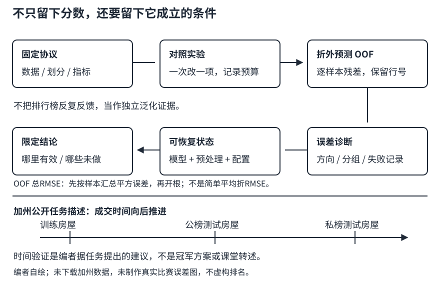

# 竞赛复盘：把一个分数拆成可解释、可复现的证据

## 1. 复盘不是为排行榜写一个好听的故事

LEC15解决“如何建立可信基线”，本讲解决“怎样知道改动真的有用，以及学到的是什么”。复盘的交付不是一句“加深网络涨分了”，而是一条可以检查的推理链：

**任务定义 → 验证协议 → 对照实验 → 逐样本误差 → 可重现配置 → 有边界的结论。**

没有可审计课堂文本时，不能把通用经验改写成老师或优胜选手的实际做法。以下均为编者方法，以教材4.10为关联练习，不列未经核实的名次、冠军模型、调参技巧或课堂问答。

### 先把比赛身份写对

| 项目 | 教材Ames房价 | 2021加州房价竞赛 |
| --- | --- | --- |
| 用途 | 4.10的教学案例，本站基础路线可用 | 课程历史扩展，不能由Ames替代复现 |
| Kaggle标识 | `house-prices-advanced-regression-techniques` | `california-house-prices`，host为`d2lcourse` |
| 目标字段 | `SalePrice` | 公开规则/数据说明写`Sold Price` |
| 提交主列 | `Id, SalePrice` | `Id, Sold Price` |
| 本批取得的数据 | 教材HTTPS镜像CSV已有获取与哈希证据 | 只看公开页面，未登录接受规则、未下载数据 |

公开加州页面明确描述2020年售出的加州房屋，测试房屋成交晚于训练房屋，私榜房屋又晚于公榜。Evaluation写的是预测对数与真实售价对数之间的RMSE，**不是自行猜测的`log1p`指标**。Data页列出train/test/sample_submission，显示89.8 MB、83 columns；这些是页面显示信息，不是本批解析过CSV后的列统计。数据访问要求登录接受比赛规则，不能把“公开页面能看”理解为允许下载或再分发。

## 2. 验证协议是结论的适用范围

一个分数应当带着它的条件阅读：

- **数据版本与划分**：哪些行训练、哪些行验证，是否有分组或时间顺序？
- **预处理拟合范围**：每折是否独立fit，标签和未来输入有没有越界？
- **训练预算**：总更新次数、批量、学习率和停止规则是什么？
- **评价口径**：原价还是对数价？截断下限、缺失值和无效预测如何处理？
- **模型选择次数**：已经试过多少个方案，是否多次根据同一验证集修改？

针对具有时间顺序的加州任务，**编者建议**用较早样本训练、较晚样本验证，以更贴近未来预测，而不是把随机K折结论直接当成真实部署表现。若做多个时间窗口，应让每个窗口只使用它之前的数据；不能让训练部分越过对应验证时点。具体切点仍需合法取得数据后核对日期字段、覆盖与样本数；这里没有凭页面描述虚构切分结果。

反复看同一验证集再修改模型，会逐渐把验证集用于模型选择。它并没有通过梯度更新模型，却仍影响最终选择，因此“没反向传播”不等于“从未利用它”。需要保留更外层的独立评估，或在结论中如实说这是开发验证结果。历史竞赛公榜与私榜同样不是两个可无限试探的训练反馈源。



图：编者自绘复盘证据链。下方时间轴对应公开加州任务说明，不是某位参赛者实际使用的验证方法。

## 3. 从每个样本的残差开始，而不是只留一个均值

对正数房价，定义：

$$
\begin{aligned}
e_i&=\log\hat y_i-\log y_i,\\
R&=\sqrt{\frac1n\sum_i e_i^2}.
\end{aligned}
$$

$e_i>0$表示高估；$e_i<0$表示低估。$\exp(e_i)$是预测价与实际价之比，例如$e_i=\log2$表示预测为实际的两倍。**签名残差保留方向，平方残差反映对总误差的贡献**，两者都值得记录。

假设三栋房的对数残差为$[0,0.2,0.3]$，都是编者自拟数字：

- 第一栋预测完全吻合；后两栋分别约高估22.14%与34.99%。
- 平均残差为$1/6\approx0.1667$，显示这一小例整体偏高。
- 平方残差和为0.13；第三栋贡献0.09，约占总平方误差的69.23%。
- 总log RMSE为$\sqrt{0.13/3}\approx0.208167$。

不能据某个误差很大的样本就删除它。先排查标签与单位、原始输入、缺失解释和适用人群；它可能是脏数据，也可能是真正需要服务的困难案例。按真实标签划价位组可以用于**验证后的诊断**，但不能把真实售价组当作推理时可用输入。

## 4. 折均值、OOF指标与分组指标不是同一数字

OOF预测要求每条记录的预测来自**没有拿它训练的模型**。预测按原始行号放回，形成与标签同形状的$(n,1)$张量；不要把各折预测简单拼起来后忘了标签对应顺序。

如果第$k$折有$n_k$条记录、RMSE为$R_k$，那么：

$$
\begin{aligned}
\mathrm{SSE}_k&=n_kR_k^2,\\
R_{\mathrm{OOF}}&=\sqrt{\frac{\sum_k\mathrm{SSE}_k}{\sum_k n_k}}.
\end{aligned}
$$

因为平方根是非线性的，平均折RMSE不等于整体RMSE。折间离散程度可以提示不稳定，但各折训练集高度重叠，不能不加条件地把它当作独立重复实验的置信区间。

独立机制片段（Python标准库，仅汇总自拟残差）：

```python
import math

fold_errors = [[0.0, 0.2], [0.3]]
fold_rmse = [
    math.sqrt(sum(e * e for e in fold) / len(fold))
    for fold in fold_errors
]
mean_fold_rmse = sum(fold_rmse) / len(fold_rmse)
pooled = math.sqrt(
    sum(e * e for fold in fold_errors for e in fold)
    / sum(len(fold) for fold in fold_errors)
)
assert math.isclose(pooled, math.sqrt(0.13 / 3), abs_tol=1e-12)
assert not math.isclose(pooled, mean_fold_rmse, abs_tol=1e-6)
print(round(pooled, 6), round(mean_fold_rmse, 6))
```

解析预期为`0.208167 0.220711`。按互斥分组计算指标也遵循相同的平方误差汇总关系。某个小组的RMSE下降，不保证总体下降；大组变差可能抵消它。反过来，总体提升也可能掩盖少数重要人群退化。

## 5. 如何做一个能够解释的对照实验

先保留一个最简单、确实可复现的基线，再提出一个可以被证伪的假设。例如：“缺失本身有信息，因此增加缺失指示可能减少这类样本误差。”这比“模型不够先进，所以换更深网络”更容易验证。

每次对照尽量只改变一项，保持相同数据版本、划分、指标和合理的比较预算：

| 假设 | 改动 | 应观察的证据 | 不能据此声称 |
| --- | --- | --- | --- |
| 数值尺度影响优化 | 仅改变标准化方案 | 训练曲线、梯度/损失是否有限、验证误差 | 所有标准化都一定提高泛化 |
| 缺失携带信息 | 增加缺失指示 | 对应缺失组与整体OOF误差 | 缺失就是价格变化的因果原因 |
| 模型容量不足 | 线性改小MLP | 相同划分下训练/验证差距与预算 | 更深一定更好 |
| 正则化缓解过拟合 | 只改变衰减或Dropout配置 | 多次训练下验证变化与训练代价 | 一次幸运种子足够证明稳定提升 |

预算公平不总是简单地“epoch一样”：改变批量大小会改变每轮更新次数，改变模型宽度会改变每步计算量。若比较的是精度，报告实际训练预算；若比较效率，另报时间口径，不能既换模型又增大预算还把提升全部归因于结构。

面对很小的分数差，先问：差异是否小于训练随机性？是否只在一个折有效？是不是修正了评价脚本而不是模型变好？最好在同一批验证样本上比较逐样本损失差：

$$
\Delta_i=(e_i^{\mathrm{new}})^2-(e_i^{\mathrm{base}})^2.
$$

$\Delta_i<0$表示新模型在该样本更好。把差异按时间、缺失情况或有依据的类别汇总，可以看出收益来自哪里；分组仍须保留足够样本，并谨慎对待反复寻找“最好看的一组”的选择偏差。

## 6. 残差相关性：为什么集成不是必涨分

以下是编者数学补充，不是优胜方案复述。假设两个模型在**对数空间**的残差分别是$e_A,e_B$，平均它们的对数预测，则新残差为$(e_A+e_B)/2$：

$$
\begin{aligned}
&\mathbb E\left[\left(\frac{e_A+e_B}{2}\right)^2\right]\\
&\quad=\frac14\mathbb E[e_A^2]\\
&\qquad+\frac12\mathbb E[e_Ae_B]\\
&\qquad+\frac14\mathbb E[e_B^2].
\end{aligned}
$$

这里$\mathbb E$可理解为固定验证样本上的平均。如果两模型总在同一批样本上犯同样的错，交叉项很大，平均未必带来明显收益。若一个模型系统性很差，也可能拖累另一个。只有根据合法的折外预测进行比较，才有资格讨论组合是否改进。

单样本算例：真实价格100，两个预测分别80和125。对数误差为$\log0.8$与$\log1.25$，恰好互为相反数；平均对数预测对应几何平均$\sqrt{80\times125}=100$。如果平均原价格则得到102.5，二者不是同一种集成。这个特制算例只解释算式，不能推广成“集成会消除真实数据误差”。

选择权重同样是调参。若利用验证标签反复试组合，再把同一验证分数作为无偏最终结果，就重走了验证过拟合的老路。

## 7. 一份能交给未来自己的复盘记录

不需要长篇报告，但下面六项应完整：

1. **身份**：数据来源、许可/访问条件、文件哈希、目标列与单位；明确Ames或加州。
2. **协议**：训练/验证索引与时间规则、每折预处理fit范围、目标变换、指标公式。
3. **基线**：结构、种子、更新次数、优化器、环境，以及失败运行也保留的配置。
4. **对照**：只改了什么，哪些条件没改，OOF与各组误差怎样变化。
5. **恢复**：预处理状态、列顺序、模型结构/权重与必要优化器状态能否恢复；固定输入是否一致。
6. **结论边界**：哪些在CPU真实运行，哪些只做机制演示；有无下载数据、完整训练或提交，未做的明确写出。

“失败”不是只有NaN。训练误差下降但验证变差、某个时间窗口变差、恢复后预测不一致，都是可以定位的结果。不要删除失败证据后只保留一次漂亮曲线，也不要把“代码没有报错”当作“模型学到了有用规律”。

完成本阶段的合理标准是能够解释一条诚实的训练/验证管线、定位一次失败，并重现自己的小基线。历史排名、奖品和截止日不作为今天的验收门槛；这不会删去后续CNN/CV/RNN课程内容，也不额外增加论文必读。

## 8. 自测

<details>
<summary>1. 验证分数提高了0.001，能否写“新结构更好”？</summary>

先核实相同数据/指标/预算，再看种子变化、逐折与逐样本损失差。一个开发验证集上的微小提升最多支持有限条件下的观察，不自动支持普遍结论。
</details>

<details>
<summary>2. 两折RMSE分别为0.141421和0.3，能否直接平均作为所有样本的RMSE？</summary>

不能。要先还原各折平方误差和、按样本数合并再开根。本讲两折大小为2和1，整体约0.208167，而均值约0.220711。
</details>

<details>
<summary>3. 在Ames上生成了Id,SalePrice，能直接证明加州任务提交格式也正确吗？</summary>

不能。两数据集不同；加州公开规则写Id,Sold Price，还有自己的数据与许可条件。即使评价都涉及对数RMSE，也不能互换任务身份。
</details>

<details>
<summary>4. 加州公榜涨分但私榜下降，一定是实现有bug吗？</summary>

不一定。公开说明中私榜时间晚于公榜，时间分布变化与榜单选择偏差都值得检查；也要排查实现。但没有实际数据与记录，不能断言某一种原因，更不能把推测当课堂结论。
</details>

## 来源、分P与缺口

- [教材4.10](https://zh.d2l.ai/chapter_multilayer-perceptrons/kaggle-house-price.html)固定源码1–632行实际全文阅读，作为**编者关联**的基线、K折和模型选择素材；2021课表“预测房价竞赛总结”行没有教材链接。复盘框架、残差分组与集成推导均为编者补充，不是课堂内容摘要。
- [课程课表](https://courses.d2l.ai/zh-v2/)与[公告](https://courses.d2l.ai/zh-v2/announcements.html)的历史身份；[加州公开Overview](https://www.kaggle.com/competitions/california-house-prices/overview)和[Data](https://www.kaggle.com/competitions/california-house-prices/data)在2026-11-13由本批采集任务实际浏览，本文读取其筛选证据`sources/p3-mlp-generalization/california-access.json`。没有登录、接受规则、取得加州数据或提交，不绕访问条件。
- [视频](https://www.bilibili.com/video/BV15Q4y1o7vc)，作者“跟李沐学AI”，发布2021-05-15（UTC）。2026-11-13核实全部2P：P1“竞赛总结”999秒、P2“QA”1563秒。它们不是正文段落时间戳。
- 每P公开player仅请求一次，均成功空字幕。未下载/观看媒体，未核实课堂复盘、参赛者做法或问答；中文原课通过页头观看，本课不另作课堂逐段整理。没有新增独立中文阅读，materials为`not_required`。
- 阅读范围、复用教材原件路径/SHA-256、元数据、许可与代码预期在`sources/p3-lec18/manifest-fragment.json`。教材许可不外推视频或比赛文件。本讲所有数值例子是手算设计，子agent未执行课程代码；实际CPU实验与本页片段执行由主agent分别记录，不能互相替代。
