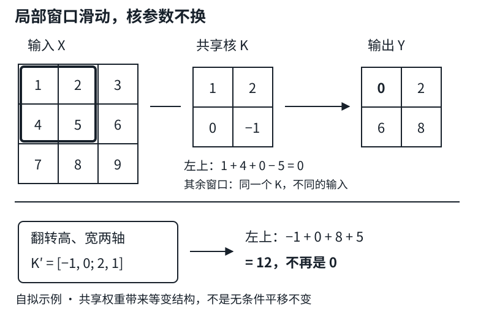

# 从全连接到卷积：共享一个局部检测器

## 1. 先把两个约束分开：看哪里，用谁的权重

把一张灰度图展平成向量，再送入全连接层，并不会丢掉像素值，但网络不再显式利用像素的邻接关系。它必须从数据中学习：左上角的边缘与右下角的边缘，可能值得用同一种方式识别。

卷积引入两条**归纳偏置**，不是证明所有图像必然满足的定律：

- **局部性**：一个输出位置先看附近的小窗口，而不是立刻看整张图。远距离关系可通过后续层聚合。
- **参数共享**：所有空间位置使用同一个检测器。不需要为左上角与右下角分别学习一组权重。

仅局部连接、但不同位置使用不同权重，叫局部连接层，仍不是这里的共享卷积。共享也不意味着所有输出值相同：权重相同，输入窗口通常不同。

例如输入$32\times32$、输出$30\times30$，均为单通道：

| 连接方式 | 权重数（不计偏置） |
|---|---:|
| 每个输出看完整输入 | $900\times1024=921600$ |
| 每个输出只看$3\times3$，不共享 | $900\times9=8100$ |
| 共享一个$3\times3$核 | $9$ |

这三种层的输出大小相同，连接约束不同；不是说九个权重能表达任意921600权重的函数。全连接通常每个输出一个偏置，标准单输出通道卷积则共享一个偏置。

## 2. 从四个索引推到一个小核

先忽略通道与非线性。$X_{u,v}$为输入，$Y_{i,j}$为输出，全连接可写成：

$$
Y_{i,j}=b_{i,j}+\sum_{u,v}A_{i,j,u,v}X_{u,v}.
$$

权重同时依赖“输出在哪里”和“输入在哪里”。令$u=i+a,v=j+b$，只是把绝对位置换成相对偏移，还没有减少参数：

$$
\begin{aligned}
V_{i,j,a,b}&=A_{i,j,i+a,j+b},\\
Y_{i,j}&=b_{i,j}+\sum_{a,b}V_{i,j,a,b}X_{i+a,j+b}.
\end{aligned}
$$

共享要求$V_{i,j,a,b}=K_{a,b}$且$b_{i,j}=\beta$；局部性再要求窗口外权重为零。采用程序里从0开始的窗口坐标，在无填充、步幅1时：

$$
Y_{i,j}=\beta+\sum_{a=0}^{k_h-1}\sum_{b=0}^{k_w-1}K_{a,b}X_{i+a,j+b}.
$$

| 符号 | 本讲形状/意义 |
|---|---|
| $X$ | $(H,W)$，单通道输入 |
| $K$ | $(k_h,k_w)$，可学习核 |
| $Y$ | $(H-k_h+1,W-k_w+1)$ |
| $\beta$ | 标量，在全部输出位置共享 |

一个窗口与核逐元素相乘，再把所有乘积相加，才得到**一个**输出值。不是矩阵乘法，也不是保留逐元素乘法后的整个窗口。



图为编者自拟算例；同一组四个核元素在所有窗口重复使用，非教材原图或课堂截图。

## 3. 互相关与数学卷积：固定核不能随便互换

深度学习中通常称为“卷积”的实现其实是互相关：直接把核放到窗口上，不翻转。数学离散卷积的一种写法是：

$$
(X*K)_{i,j}=\sum_{a,b}K_{a,b}X_{i-a,j-b}.
$$

为了用同一套有效窗口坐标比较，可以先把有限二维核沿高、宽各翻一次（旋转180°），再做互相关。只转置核不是旋转180°。

自拟输入与核：

$$
X=\begin{bmatrix}1&2&3\\4&5&6\\7&8&9\end{bmatrix},\qquad
K=\begin{bmatrix}1&2\\0&-1\end{bmatrix}.
$$

左上窗口输出$1\times1+2\times2+4\times0+5\times(-1)=0$，其余窗口同理：

$$
\begin{aligned}
\operatorname{corr}(X,K)&=\begin{bmatrix}0&2\\6&8\end{bmatrix},\\
\operatorname{corr}(X,\operatorname{flip}(K))&=\begin{bmatrix}12&14\\18&20\end{bmatrix}.
\end{aligned}
$$

**同一个固定核的两个输出不同。** 当核可以自由学习时，翻核只是参数的一一重排，两类层能表达相同的函数族；这不保证同一初始化、同一随机训练过程会得到相同轨迹，更不允许加载旧权重时擅自翻核。

下面不依赖`d2l`，手写小参考实现与PyTorch内置互相关对照。`unfold`不是本讲必需知识；显式窗口循环更方便手算。生产训练仍用优化后的内置算子。

```python
import torch
import torch.nn.functional as F

x = torch.arange(1., 10.).reshape(3, 3)
k = torch.tensor([[1., 2.], [0., -1.]])
manual = torch.stack([
    torch.stack([(x[i:i+2, j:j+2] * k).sum() for j in range(2)])
    for i in range(2)
])
y = F.conv2d(x[None, None], k[None, None])[0, 0]
flipped = F.conv2d(x[None, None], k.flip((0, 1))[None, None])[0, 0]
assert torch.equal(manual, y)
print(y.tolist())
print(flipped.tolist())
# 解析预期：[[0.0, 2.0], [6.0, 8.0]]
#           [[12.0, 14.0], [18.0, 20.0]]
```

`[None, None]`把二维矩阵扩成$(N,C,H,W)=(1,1,H,W)$；核扩成$(C_{out},C_{in},k_h,k_w)$。通道求和将在下一讲组的LEC21展开。

## 4. 平移等变不是平移不变

定义平移$(T_\delta X)_{i,j}=X_{i-\delta_h,j-\delta_w}$。在无限网格、步幅1、同一共享核和共享偏置的理想条件下：

$$
\begin{aligned}
F(T_\delta X)_{i,j}
&=\beta+\sum_{a,b}K_{a,b}X_{i+a-\delta_h,j+b-\delta_w}\\
&=(T_\delta F(X))_{i,j}.
\end{aligned}
$$

这叫**等变**：输入右移，响应图也右移。**不变**则要求$F(T_\delta X)=F(X)$，响应图完全不动，单个卷积层一般不满足。

教材6.1把“输入平移导致隐藏表示平移”的性质放在“平移不变性”标题下；本文按数学等式明确称为等变，避免把分类希望得到的位置不敏感与中间特征图的行为混为一谈。

实际工程必须补上边界条件：

1. **有限图像有裁剪。** 物体移出边界后信息丢失，不可能要求输出与原图完全对应。
2. **零填充引入特殊边缘。** 边缘窗口看到人工零值；在同尺寸有限画布上“先平移再填充”和“先计算再平移”不总是交换。只在两边所需窗口都不受边界影响的对应位置，才能直接套用理想推导。
3. **步幅大于1改变采样网格。** 位移不是步幅整数倍时，不对应输出网格上的整数位移，见LEC20。
4. 对每个位置施加同一ReLU仍保留理想的等变结构；最终做空间聚合可能获得某种不变性，但不能抹去裁剪、填充与采样造成的限制。

## 5. 边缘检测与学习核，是同一条计算图

行信号$[1,1,0,0]$与核$[1,-1]$互相关得到$[0,1,0]$。它测的是水平方向的变化，因此对图像中的**竖直边界**有响应。把核转成列向量，才会测垂直方向变化、响应水平边界；核方向与边界方向不要混为一谈。

若核未知，可从输入与目标响应学习。以零核起步，平方误差取$L=\frac12\sum_j(\hat y_j-y_j)^2$：初始$L=0.5$，只有窗口$[1,0]$的残差是$-1$，所以核梯度为$[-1,0]$。学习率0.1的一步更新得到$[0.1,0]$，预测$[0.1,0.1,0]$，损失为0.41。这里用确定性的一步，**不声称复现教材随机初始化的十轮结果**。

```python
import torch
import torch.nn.functional as F

x = torch.tensor([[[[1., 1., 0., 0.]]]])
target = torch.tensor([[[[0., 1., 0.]]]])
w = torch.zeros((1, 1, 1, 2), requires_grad=True)
loss = 0.5 * (F.conv2d(x, w) - target).square().sum()
loss.backward()
print(loss.item(), w.grad.flatten().tolist())
with torch.no_grad():
    w -= 0.1 * w.grad
    after = 0.5 * (F.conv2d(x, w) - target).square().sum()
print(w.flatten().tolist(), after.item())
# 解析预期：0.5、[-1.0, 0.0]；更新核约[0.1, 0.0]，损失约0.41。
```

教材PyTorch分支以`nn.Parameter`注册核和偏置；训练示例通过`.data`更新权重。工程上优先使用优化器，或像上面在`torch.no_grad()`里更新，而不是绕过自动求导的版本跟踪。若写多步循环，每次反向前还需清除旧梯度；不要用`torch.tensor(已有计算结果)`重新包装而切断计算图。

## 6. 多叠一层为什么能看得更远

一个$3\times3$、步幅1的卷积输出看见输入的$3\times3$区域。再接一个相同卷积，第二层的$3\times3$窗口覆盖第一层相邻响应，它们在原输入上的并集是$5\times5$。若无空洞、每层步幅1，沿单个轴：

$$
r_L=1+\sum_{\ell=1}^{L}(k_\ell-1).
$$

这是结构上的**理论感受野**，不是每个像素都实际产生同等影响；权重为零、激活关闭等都可使影响减弱。存在填充时，名义窗口还可能包含画布外的填充值。两层线性卷积不自动等于任意大核的全部参数自由度；中间加非线性后更不能简单合并成一个线性核。

## 7. 自测：先说条件，再算数

1. “局部连接就一定共享参数”对吗？输入$32\times32$、输出$30\times30$、局部$3\times3$时差多少权重？
2. 上面$2\times2$核做数学卷积时只转置够吗？左上输出是多少？
3. 输入向右平移一个像素，卷积输出一定完全不变吗？
4. 三个$3\times3$、步幅1卷积的理论感受野是多少？
5. 为什么增加图像大小不会增加同一个卷积层的参数量，却会增加计算量？

<details>
<summary>展开答案</summary>

1. 不对。不共享时8100个权重，共享时9个；差8091个，不计偏置。
2. 不够，需同时翻转高宽两轴；左上是12。固定核的互相关输出是0，两者不同。
3. 不是不变；理想步幅1条件下是等变。有限边界、裁剪、填充或更大步幅都要另查。
4. $1+3\times2=7$，即$7\times7$。
5. 核在更多位置复用，存储的权重不增，但需要计算更多窗口和输出激活。

</details>

## 来源、分P清单与缺口

实际阅读固定提交中的[6.1 从全连接层到卷积](https://github.com/d2l-ai/d2l-zh/blob/e6b18ccea71451a55fcd861d7b96fddf2587b09a/chapter_convolutional-neural-networks/why-conv.md)与[6.2 图像卷积](https://github.com/d2l-ai/d2l-zh/blob/e6b18ccea71451a55fcd861d7b96fddf2587b09a/chapter_convolutional-neural-networks/conv-layer.md)全文，包括习题与PyTorch实现。作者为《动手学深度学习》作者团队；这是当前中文二版固定源码，非2021课堂快照。中文原文不另译；本页为自主讲解，平移术语边界与确定性小例是编者补充，无论文必读。

2026-11-13核实[作者上传](https://www.bilibili.com/video/BV1L64y1m7Nh)，作者“跟李沐学AI”（mid 1567748478），标题“19 卷积层【动手学深度学习v2】”；发布时间2021-05-15 18:25:51 UTC（北京时间次日02:25:51），与原课表的5月15日排期分别记录。

| 分P | 接口标题 | 时长 |
|---|---|---:|
| P1 | 从全连接到卷积 | 15:00 |
| P2 | 卷积层 | 11:02 |
| P3 | 代码 | 10:08 |
| P4 | QA | 07:44 |

合计43:54。此表只证明文件身份与时长，**不是课堂内容时间索引**。全部4P公开player各请求一次，成功但字幕列表为空；没有下载或观看媒体，未核实演示、问答、片内起止，不编造时间线。`draft`保持阻塞且无占位文件；无独立中文阅读需要拆篇，`materials=not_required`。

来源快照、SHA-256、实际阅读行范围与片段预期见`sources/p3-lec19/manifest-fragment.json`。教材根LICENSE为Apache-2.0，setup包MIT-0字段另记，均不外推视频、第三方图片。视频copyright=1/no_reprint=1，不具备开放全文转录授权。本讲代码未由撰写者执行，未运行教材训练或旧Notebook。
