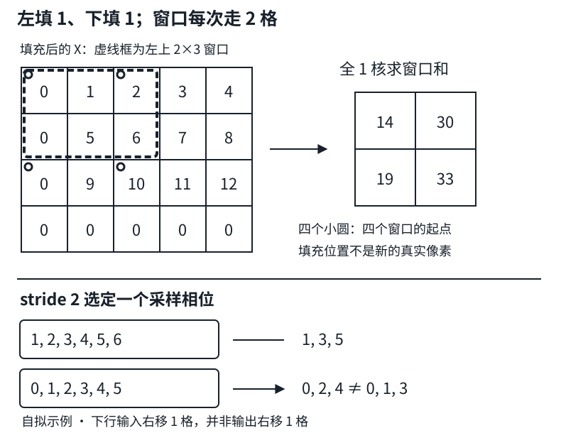

# 填充与步幅：先定位窗口，再计算输出大小

## 1. 两个按钮控制两件事

- **填充（padding）**：先在输入四周添加像素，通常是零。这样边缘位置也能落入更多窗口，并可控制输出尺寸；填出来的零不是真实观测，不是恢复了图像外的信息。
- **步幅（stride）**：窗口起点每次移动多少格。步幅2不是把核放大两倍，也不是窗口内部隔格取值；它让相邻输出对应的窗口起点间隔2。

无填充、步幅1的$3\times3$卷积，每层让高宽各减少2。连续十层会各减少20，而不是缩到原来的$1/2^{10}$。想保持尺寸可加填充，想主动降采样可加步幅；两者可以同时使用。

本讲默认普通二维互相关、`dilation=1`、零填充。所有形状先在一条轴上推导，高和宽再独立套用。通道数和批量大小不参与这个空间尺寸公式。

## 2. 从“最后一个合法窗口”推导floor

沿一条轴，输入长度$n$、左侧填充$p_l$、右侧填充$p_r$、核长$k$、步幅$s$。填充后的长度为：

$$
L=n+p_l+p_r.
$$

第$q$个窗口（从0计数）的起点是$qs$，最后一个元素索引是$qs+k-1$。窗口必须完整放得下：

$$
\begin{aligned}
qs+k-1&\le L-1,\\
q&\le\frac{L-k}{s},\\
n_{out}&=\left\lfloor\frac{L-k}{s}\right\rfloor+1.
\end{aligned}
$$

这里要求正整数$s$且$L\ge k$；如果核根本放不下，不要把负的尺寸当正常输出，先修正网络配置。floor是向下取整，因为不够一个完整窗口的尾部不能再算一个输出。例如$n=6,k=3,s=2,p_l=p_r=0$时起点只有0和2，输出长度2；起点4需要读到索引6，越界，不能四舍五入成3。

二维使用四个独立的填充量：

$$
\begin{aligned}
H_{out}&=\left\lfloor\frac{H+p_t+p_b-k_h}{s_h}\right\rfloor+1,\\
W_{out}&=\left\lfloor\frac{W+p_l+p_r-k_w}{s_w}\right\rfloor+1.
\end{aligned}
$$

下标$t,b,l,r$分别代表上、下、左、右；$s_h,s_w$是高宽步幅。对称填充$p_t=p_b=p_h$时，高度分子才可以写成$H+2p_h-k_h$。

**教材的记号需要看上下文。** 6.3前面的公式用$p_h,p_w$表示一条轴的**总**填充量；PyTorch的`padding=(2,1)`却表示上下**各**2、左右**各**1。本文使用四边符号，避免多乘或少乘一个2。

若以后使用空洞卷积，工程补充是先把核尺寸换成有效覆盖长度：

$$
k_{eff}=d(k-1)+1.
$$

再用$k_{eff}$代替上式的$k$。本讲小例不使用空洞，不把窗口起点的stride与窗口内部间隔的dilation混为一谈。

## 3. 非对称填充：输出大小相同，不代表对齐相同

步幅1要保持长度$n$，需要$p_l+p_r=k-1$。奇数核$k=3$可左右各填1；偶数核$k=2$总共只需填1，必须选左1右0或左0右1等非对称方案。

两种分配输出长度都为$n$，但第$q$个窗口在**原输入坐标**的起点为：

$$
qs-p_l.
$$

因此把一个零从右移到左，会改变所有窗口的对齐方式，不只是边缘值。对于残差连接或多分支拼接，仅检查高宽相等还不够，也要检查采样点是否对齐。

不要把“same”理解成“每边填一样多”。抽象的same尺寸约定通常以$n_{out}=\lceil n/s\rceil$为目标，所需最少总填充可推为：

$$
\begin{aligned}
n_{out}&=\lceil n/s\rceil,\\
p_{total}&=\max\{(n_{out}-1)s+k-n,0\}.
\end{aligned}
$$

多出来的一格放哪侧还需约定。不同框架的字符串API支持范围也不能互相套用；这里的代码全部显式指定四边填充，不依赖`padding='same'`是否支持某个stride。

## 4. 一次手算，串起四边填充与两个步幅

自拟输入：

$$
X=\begin{bmatrix}1&2&3&4\\5&6&7&8\\9&10&11&12\end{bmatrix}.
$$

使用$2\times3$全1核，左填1、右填0、上填0、下填1，步幅$(2,2)$，无偏置。填充后：

$$
X_{pad}=\begin{bmatrix}
0&1&2&3&4\\
0&5&6&7&8\\
0&9&10&11&12\\
0&0&0&0&0
\end{bmatrix}.
$$

合法窗口起点（填充坐标）为$(0,0),(0,2),(2,0),(2,2)$，分别求和得到：

$$
Y=\begin{bmatrix}14&30\\19&33\end{bmatrix}.
$$

尺寸独立计算：

$$
\begin{aligned}
H_{out}&=\lfloor(3+0+1-2)/2\rfloor+1=2,\\
W_{out}&=\lfloor(4+1+0-3)/2\rfloor+1=2.
\end{aligned}
$$



图为编者自绘。上半图标出同一算例的四个窗口起点；下半图说明stride2只取一个采样相位，移动输入会改变抽中的值。

```python
import torch
import torch.nn.functional as F

x = torch.arange(1., 13.).reshape(1, 1, 3, 4)
k = torch.ones((1, 1, 2, 3))
# F.pad顺序：left, right, top, bottom；不是top, bottom, left, right。
xp = F.pad(x, (1, 0, 0, 1))
y = F.conv2d(xp, k, stride=(2, 2), padding=0)
print(tuple(xp.shape), tuple(y.shape))
print(y[0, 0].tolist())
# 解析预期：(1, 1, 4, 5)、(1, 1, 2, 2)
#           [[14.0, 30.0], [19.0, 33.0]]
```

`nn.Conv2d(..., padding=(p_h,p_w))`的两个数是高宽方向的对称每侧填充；若要四边不同，像上面先`F.pad`，然后卷积`padding=0`。否则容易重复填充。

## 5. 步幅的相位：为什么平移一个像素可能变很多

步幅2可以理解成先计算步幅1的响应，再保留某个采样网格上的值。对一维长度6信号，用长度1、权重1的核：

$$
\begin{aligned}
X&=[1,2,3,4,5,6],\\
F_2(X)&=[1,3,5].
\end{aligned}
$$

把输入在有限画布上右移一格，左补零，得到$[0,1,2,3,4,5]$；输出为$[0,2,4]$。它不是把$[1,3,5]$简单向右移一个输出格得到的$[0,1,3]$。原因是原先取偶数索引，移动一格后对应原输入的奇数索引；**采样相位变了**。

右移两格则得到$[0,0,1,2,3,4]$，输出$[0,1,3]$，这次才对应输出右移一格。理想无限网格中，位移为步幅整数倍时可以保留相应的等变关系；有限边界和裁剪仍需单独处理。高宽有不同步幅时，两轴都要分别满足整数倍条件。

```python
import torch
import torch.nn.functional as F

x = torch.arange(1., 7.).reshape(1, 1, 1, 6)
k = torch.ones((1, 1, 1, 1))
for shift in (0, 1, 2):
    moved = F.pad(x, (shift, 0, 0, 0))[..., :6]
    y = F.conv2d(moved, k, stride=(1, 2))
    print(shift, y.flatten().tolist())
# 解析预期：0 -> [1.0, 3.0, 5.0]
#           1 -> [0.0, 2.0, 4.0]
#           2 -> [0.0, 1.0, 3.0]
```

所以stride能减少输出激活与计算量，但会丢弃部分空间采样信息，不能逆推出原输入，也不自动带来平移不变性。卷积核若没有学到合适的低通行为，降采样还可能产生混叠；本讲仅解释风险，不新增信号处理前置课程。

## 6. 工程排错顺序

1. 写出输入NCHW，不把通道或批量误放到高宽里。
2. 把四边padding、两个stride、两个核尺寸写全，先算输出形状；确认核放得下。
3. 写出第一个与最后一个窗口的原坐标起点，检查对齐和floor余数。
4. 检查`F.pad`是否又叠加了卷积的`padding`；它们都会生效。
5. 使用随机初始化的卷积演示只能验形状，不能断言具体输出值。要验算数，显式给定核与偏置。
6. 教材`comp_conv2d`为了单图单通道示例，临时增加两个维度并在输出去掉；真实批量代码不要照搬这个reshape来丢掉$N,C$。

核大小和通道不变时，调整padding或stride不会改变参数量，但会改变输出激活数量和计算量。若高宽都大约减半，输出空间位置约变为四分之一；实际必须用floor公式，不把近似当精确结果。

## 7. 自测

1. 输入$8\times8$，核$3\times5$，`padding=(0,1)`，`stride=(3,4)`，输出高宽是多少？
2. 输入长度6、核3、stride2、无填充，为什么不是3个输出？
3. 长度5、核2、stride1，左填1与右填1的输出大小一样，数值对齐一样吗？
4. `F.pad(x,(1,2,3,4))`给哪四边填充？输入高宽$(5,6)$会变成多少？
5. stride2的输入平移1格，为什么通常不能对应输出整数格平移？

<details>
<summary>展开答案</summary>

1. 高$\lfloor(8-3)/3\rfloor+1=2$；宽$\lfloor(8+2-5)/4\rfloor+1=2$，即$2\times2$。这里左右各填1，总共2。
2. 起点0、2合法，起点4会读到索引6，超出0到5；所以floor后输出2。
3. 大小都为5，但窗口起点分别是$q-1$与$q$，对齐不同，通常数值也不同。
4. 左1、右2、上3、下4，得到高12、宽9。
5. 1不是stride2的整数倍，输入改变了采样相位。对应半个输出格的平移不在离散输出网格上。

</details>

## 来源、分P清单与缺口

实际阅读[固定教材6.3 填充和步幅](https://github.com/d2l-ai/d2l-zh/blob/e6b18ccea71451a55fcd861d7b96fddf2587b09a/chapter_convolutional-neural-networks/padding-and-strides.md)全文、全部习题与PyTorch分支。作者为《动手学深度学习》作者团队；中文二版固定源码不是2021快照。四边记号、显式padding小例、采样相位及空洞有效核说明为编者补充，不宣称来自课堂；无额外论文必读。

2026-11-13核实[作者上传](https://www.bilibili.com/video/BV1Th411U7UN)，作者“跟李沐学AI”（mid 1567748478），标题“20 卷积层里的填充和步幅【动手学深度学习v2】”；发布时间2021-05-16 16:23:17 UTC（北京时间5月17日00:23:17）。原课表5月16日排期与上传时间分别保留。

| 分P | 接口标题 | 时长 |
|---|---|---:|
| P1 | 填充和步幅 | 14:08 |
| P2 | 代码实现 | 05:05 |
| P3 | QA | 23:57 |

合计43:10。仅元数据与文件时长已核实，**不是已审读的课堂时间轴**。3P公开player各请求一次，成功且字幕列表为空；未下载或观看音视频，未核实演示、QA与片内时间段。`draft`阻塞，不建占位；必要阅读已内联定位，`materials=not_required`，不另写重复教材译文。

证据、原件SHA-256与实际阅读范围见`sources/p3-lec20/manifest-fragment.json`。教材根LICENSE Apache-2.0与setup包MIT-0字段分开，均不外推视频。视频copyright=1/no_reprint=1，未取得全文转录授权；本页小例未由撰写者执行，未运行原教材Notebook或训练。
