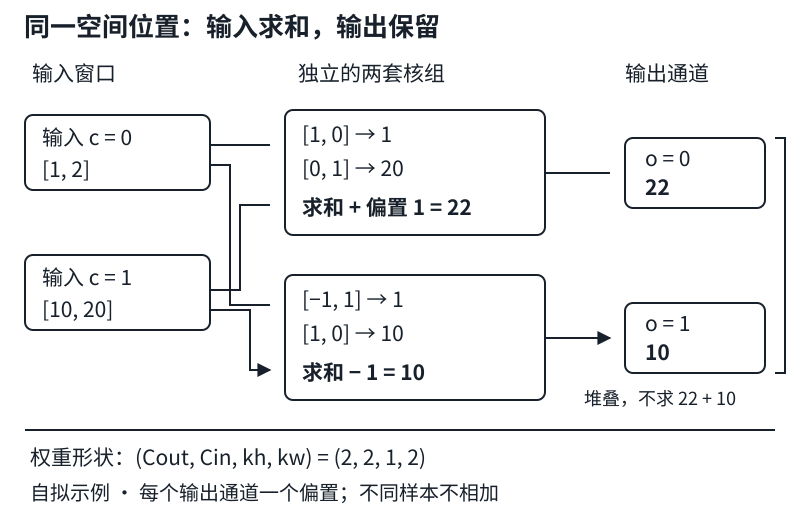

# 多输入多输出通道：输入求和，输出堆叠

## 1. 通道不是批量，也不是第三条空间轴

RGB图像在同一个位置有三个数，是三个**输入通道**。一批32张RGB图是32个样本，各有3通道。标准PyTorch二维卷积按NCHW解释输入：

| 张量 | 形状 | 每个轴的意义 |
|---|---|---|
| 输入$X$ | $(N,C_{in},H,W)$ | 批量、输入通道、高、宽 |
| 权重$K$ | $(C_{out},C_{in},k_h,k_w)$ | 输出通道、输入通道、核高、核宽 |
| 偏置$b$ | $(C_{out},)$ | 每个输出通道一个数 |
| 输出$Y$ | $(N,C_{out},H_{out},W_{out})$ | 批量、输出通道、新高、新宽 |

本讲默认`groups=1`的普通稠密通道卷积。它在空间上滑动，但**不会把输入通道当作高或宽滑动**；每个输出通道都读取全部输入通道。RGB只是第一层的常见输入，隐藏通道是模型学到的特征坐标，不自动对应红绿蓝或某个人类可命名概念。

一个输出通道使用一个形状为$(C_{in},k_h,k_w)$的核组；多个输出通道就是多组这样的权重。不要说“一个二维小核与RGB三个通道依次算完，就产生三个输出通道”——那些中间结果会先求和。

## 2. 先沿输入通道求和，再沿输出通道堆叠

用$\tilde X$表示已完成填充的输入，$n$为样本编号、$o$为输出通道、$c$为输入通道。把长式子拆成两步：

$$
\begin{aligned}
R_{n,o,c,i,j}
&=\sum_{a=0}^{k_h-1}\sum_{b=0}^{k_w-1}
K_{o,c,a,b}\tilde X_{n,c,is_h+a,js_w+b},\\
Y_{n,o,i,j}&=b_o+\sum_{c=0}^{C_{in}-1}R_{n,o,c,i,j}.
\end{aligned}
$$

第一步对每个输入通道做二维互相关；第二步在同一空间位置把这些响应**相加**，再加一个输出通道的偏置。这样得到一张二维输出图。换一套核组，再算下一张；最后把$C_{out}$张图沿通道轴**堆叠**起来，而不是继续求和。

- 求和使输入通道轴在该次运算里消去，但不同通道的信息经过不同权重混合后仍会影响输出。
- 堆叠创建输出通道轴，保留不同核组的响应。
- 不同样本互不相加；同一组模型权重在批量内复用。
- 偏置每个输出通道加一次，不是每个输入通道加一次，也不是每个像素独立学一个。

教材`corr2d_multi_in`中的`sum(...)`与`corr2d_multi_in_out`中的`stack(...,0)`分别对应这两个动作。教材注释里的“叠加”要结合实际`stack`理解为新增轴堆叠，不要误读成数值求和。



图为编者自绘，显示下面算例左上输出位置的两套核组。两套核都看相同输入，但使用不同参数。

## 3. 两输入、两输出的小例：每一步都能追踪

单样本有两个输入通道，各为$2\times3$：

$$
\begin{aligned}
X_0&=\begin{bmatrix}1&2&3\\4&5&6\end{bmatrix},\\
X_1&=\begin{bmatrix}10&20&30\\40&50&60\end{bmatrix}.
\end{aligned}
$$

核大小$1\times2$，步幅1、无填充。输出0使用$K_{0,0}=[1,0]$、$K_{0,1}=[0,1]$，偏置$b_0=1$。左上输出为：

$$
\begin{aligned}
Y_{0,0}&=(1\times1+2\times0)\\
&\quad +(10\times0+20\times1)+1=22.
\end{aligned}
$$

输出1使用$K_{1,0}=[-1,1]$、$K_{1,1}=[1,0]$，偏置$b_1=-1$；左上为$(-1+2)+(10+0)-1=10$。完整输出两张图：

$$
Y_0=\begin{bmatrix}22&33\\55&66\end{bmatrix},\qquad
Y_1=\begin{bmatrix}10&20\\40&50\end{bmatrix}.
$$

张量形状是$(1,2,2,2)$。空间宽从3变2，高仍为2；通道从2变2是因为选择了两组输出核，**不是**因为空间核宽为2。

```python
import torch
import torch.nn.functional as F

x = torch.tensor([[[[1., 2., 3.], [4., 5., 6.]],
                   [[10., 20., 30.], [40., 50., 60.]]]])
w = torch.tensor([[[[1., 0.]], [[0., 1.]]],
                  [[[-1., 1.]], [[1., 0.]]]])
b = torch.tensor([1., -1.])
y = F.conv2d(x, w, b)
# 显式拆输入通道，各自互相关，再求和；最后拼成两输出通道。
per_output = []
for o in range(2):
    pieces = [F.conv2d(x[:, c:c+1], w[o:o+1, c:c+1])
              for c in range(2)]
    per_output.append(sum(pieces) + b[o])
reference = torch.cat(per_output, dim=1)
assert torch.equal(y, reference)
print(tuple(w.shape), tuple(y.shape), w.numel() + b.numel())
print(y[0].tolist())
# 解析预期：(2, 2, 1, 2)、(1, 2, 2, 2)、10
# [[[22.0, 33.0], [55.0, 66.0]], [[10.0, 20.0], [40.0, 50.0]]]
```

这里每个`per_output`已经带长度为1的通道轴，所以用`cat(dim=1)`合并。教材每个结果是二维矩阵，使用`stack`新增通道轴。是否已有轴，决定用`cat`还是`stack`，不是二者可以随意替换。

## 4. 参数量、计算量与激活内存，分别算

普通卷积、启用偏置时：

$$
\begin{aligned}
\#K&=C_{out}C_{in}k_hk_w,\\
\#b&=C_{out},\\
\#\text{parameters}&=C_{out}(C_{in}k_hk_w+1).
\end{aligned}
$$

关闭偏置就去掉最后的$C_{out}$。参数不随批量$N$或图像大小$H,W$改变；同一组核在更多窗口复用而已。小例是$2\times2\times1\times2+2=10$个参数。

直接实现每个输出标量要做$C_{in}k_hk_w$次乘法。把一次乘法及其累加记作一个MAC，理论工作量约为：

$$
\mathrm{MACs}=N H_{out}W_{out}C_{out}C_{in}k_hk_w.
$$

这是算子层面的密集计算估算，不是具体后端指令计数；部分FLOPs口径会把一个MAC计作约2 FLOPs。实际时间还受内存访问、内核选择、设备与批量影响。

例如$N=2,C_{in}=3,C_{out}=8$，输入$16\times16$，$3\times3$核、每侧填1、步幅1：

- 参数$8(3\times9+1)=224$。
- 输出$2\times8\times16\times16=4096$个数；float32只算输出就占16 KiB。
- 理论MAC数$2\times16\times16\times8\times3\times9=110592$。

把$C_{in}$和$C_{out}$同时翻倍，权重数量和MAC约为4倍，偏置是2倍；激活输出通道只翻倍，所以输出激活是2倍。训练内存还包括保存的输入/中间结果、参数梯度、优化器状态与后端工作区，不能仅用参数文件大小估计显存。

这也解释为什么把一张图切成更大分辨率后，模型文件没变，却可能内存不足。

## 5. 1×1卷积：在每个位置做同一个通道变换

当$k_h=k_w=1$、步幅1、无填充时：

$$
Y_{n,o,i,j}=b_o+\sum_c K_{o,c,0,0}X_{n,c,i,j}.
$$

它只混合同一位置的通道，不直接读取相邻像素。把一个位置的$C_{in}$个数看作向量$x$，令$A_{o,c}=K_{o,c,0,0}$，就得到$y=Ax+b$。

若把单样本展成$X_{flat}\in\mathbb R^{C_{in}\times HW}$，每一列是一个像素的通道向量：

$$
\begin{aligned}
A&\in\mathbb R^{C_{out}\times C_{in}},\\
Y_{flat}&=AX_{flat}+b\mathbf1^\top.
\end{aligned}
$$

同一个$A$用于所有列。因此它是“逐位置共享的全连接”，不是把整张图展平成$C_{in}HW$个数后做普通全连接；后者会混合不同空间位置且参数更多。

举例$C_{in}=2,C_{out}=3$：

$$
A=\begin{bmatrix}1&2\\-1&1\\0&0.5\end{bmatrix},\qquad
b=\begin{bmatrix}1\\0\\-1\end{bmatrix}.
$$

位置向量$x=[1,10]^\top$变为$[22,9,4]^\top$；位置向量$[2,20]^\top$变为$[43,18,9]^\top$。参数共$3\times2+3=9$，空间大小不影响它。

```python
import torch
import torch.nn.functional as F

x = torch.tensor([[[[1., 2.], [3., 4.]],
                   [[10., 20.], [30., 40.]]]])
a = torch.tensor([[1., 2.], [-1., 1.], [0., 0.5]])
b = torch.tensor([1., 0., -1.])
y = F.conv2d(x, a[:, :, None, None], b)
flat = a @ x[0].reshape(2, -1) + b[:, None]
assert torch.equal(y[0], flat.reshape(3, 2, 2))
print(y[0].tolist())
# 解析预期：[[[22.0, 43.0], [64.0, 85.0]],
#           [[9.0, 18.0], [27.0, 36.0]],
#           [[4.0, 9.0], [14.0, 19.0]]]
```

1×1卷积可压缩或扩展通道，帮助控制后续大核计算量。它本身是仿射变换，不会凭空创造非线性；后接ReLU等才加入非线性。没有中间非线性、步幅1且无特殊边界操作的连续1×1层，可合成为另一个仿射通道变换。

空间分辨率保持不变还依赖步幅1和无填充，**不能只看核是1×1就下结论**。若使用stride2，它仍会对子采样网格做通道混合，输出高宽会缩小，LEC20的相位限制同样存在。

## 6. 工程陷阱：形状正确还要看语义

- `reshape`只重新解释元素排列，不交换维度。图像若原为NHWC，转换到NCHW需要`permute(0,3,1,2)`，不能仅`reshape`成目标尺寸。
- PyTorch卷积权重首先是$C_{out}$、其次是$C_{in}$。当两个数恰好相等时，写反也可能不报形状错误，却算了错误的映射。
- 教材用`zip(X,K)`逐输入通道循环；若自写参考实现，要保证两个通道数相同，不能接受`zip`默默截到较短长度。内置卷积会检查匹配关系。
- 普通卷积不同输出核组参数独立，但在训练目标与后续层中共同优化，不能断言“第1通道永远检测边缘，第2通道永远检测颜色”。
- 本讲公式以`groups=1`为前提；分组或深度卷积会改变通道连接与权重形状，不能直接沿用$C_{out}C_{in}k_hk_w$。此处不提前扩展一套架构课程。
- 通道混合不消除空间位置：步幅1的共享多通道卷积在理想边界下仍是平移等变，不是自动平移不变。

## 7. 自测

1. 输入$(4,3,8,8)$，`Conv2d(3,5,3,padding=1)`的权重、偏置、输出形状与参数量分别是多少？
2. 三个输入通道各产生一张二维互相关结果，要得到一个输出通道，应求和还是stack？
3. 为什么1×1卷积可以将64通道压成16通道，却不能直接比较相邻两个像素？
4. 批量从4变8、模型结构不变，参数量也翻倍吗？
5. `stack`与`cat`何时分别适用？

<details>
<summary>展开答案</summary>

1. 权重$(5,3,3,3)$，偏置$(5,)$，输出$(4,5,8,8)$，参数$5(3\times9+1)=140$。
2. 同位置求和，再加该输出通道的偏置。不同输出核组的最终二维图才stack。
3. 每个位置用$16\times64$矩阵混合其64维通道向量；核空间覆盖只有一个位置，没有直接访问邻居。若输入特征之前已包含邻域信息，这种信息仍可通过通道传递。
4. 不翻倍；批量内共享参数。输出激活与理论计算量约翻倍。
5. 多张二维图要新建通道轴用stack；每张已含长度1通道轴时沿该轴连接可用cat。本页参考实现采用后一种。

</details>

## 来源、分P清单与缺口

实际阅读[固定教材6.4 多输入多输出通道](https://github.com/d2l-ai/d2l-zh/blob/e6b18ccea71451a55fcd861d7b96fddf2587b09a/chapter_convolutional-neural-networks/channels.md)全文、全部习题与PyTorch共享实现，包括通道求和、输出堆叠、1×1矩阵乘法。作者为《动手学深度学习》作者团队；这是当前中文二版固定源码，不是2021教材快照。算例、偏置细化、NCHW排错与内存估算为编者补充，不新增论文必读。

2026-11-13核实[作者上传](https://www.bilibili.com/video/BV1MB4y1F7of)，作者“跟李沐学AI”（mid 1567748478），标题“21 卷积层里的多输入多输出通道【动手学深度学习v2】”；发布时间2021-05-16 16:31:36 UTC（北京时间5月17日00:31:36），与原课表5月16日排期分别记录。

| 分P | 接口标题 | 时长 |
|---|---|---:|
| P1 | 多输入输出通道 | 19:34 |
| P2 | 代码实现 | 06:36 |
| P3 | QA | 19:16 |

合计45:26。此表是元数据清单，**不是课堂时间线**。3P公开player各请求一次均成功空字幕；未下载或观看音视频，未核实讲解、演示或QA，不猜片内起止。`draft`保持阻塞且不建占位，`materials=not_required`，必要中文教材阅读已在本页定位。

来源原件、SHA-256、实际阅读范围和代码预期在`sources/p3-lec21/manifest-fragment.json`。教材根LICENSE为Apache-2.0，setup包MIT-0字段另记，均不外推视频。视频copyright=1/no_reprint=1，未取得开放全文转录授权。本页代码未由撰写者运行，未执行教材随机验证或整套Notebook。
