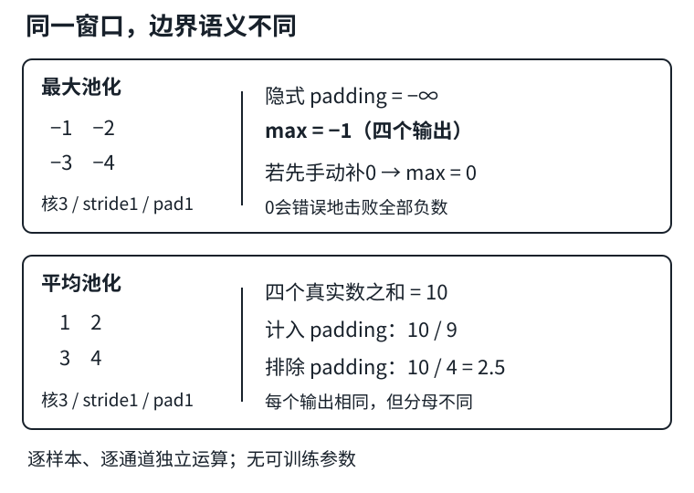

# 池化：丢掉哪些位置，保留什么信息

## 1. 池化不是另一种可学习卷积

先复用[LEC20的空间尺寸公式](#/c/d2l-pytorch-2021/lec/lec20?v=notes)与[LEC21的NCHW、通道含义](#/c/d2l-pytorch-2021/lec/lec21?v=notes)。池化在每个样本、每个通道内独立滑窗，**不跨通道求和，不含可训练权重**。输入$(N,C,H,W)$变为$(N,C,H_o,W_o)$；批量和通道数不变。

对于窗口内的数$x_1,\ldots,x_m$：

$$
\begin{aligned}
y_{\max}&=\max(x_1,\ldots,x_m),\\
y_{\mathrm{avg}}&=\frac{1}{m}\sum_{t=1}^{m}x_t.
\end{aligned}
$$

最大池化保留强响应，忽略赢家在窗口内的精确位置；平均池化保留局部平均强度，但尖峰可能被稀释。例如窗口$[1,3;2,8]$，最大值8，平均值3.5。两者都不可逆：知道8或3.5，都不能还原四个输入。

最大池化的梯度通常传给被选中的最大项；并列最大值处不可微，不要假定框架会平均分配梯度。平均池化将上游梯度按分母分配到参与的真实输入。**没有参数不等于没有梯度**：前面的卷积仍依赖这条反向通路学习。



图为编者自绘；负数例子专门揭示“最大池化补0”的错误。

## 2. stride、floor与ceil：先决定窗口从哪里开始

本页常规池化取dilation=1，$p$是每侧填充，$k$是窗口大小，$s$是步幅。默认`ceil_mode=False`时，每条空间轴分别计算：

$$
H_o=\left\lfloor\frac{H+2p-k}{s}\right\rfloor+1.
$$

`MaxPool2d`允许dilation，此时有效窗口为$d(k-1)+1$；`AvgPool2d`没有dilation参数。

- `MaxPool2d(2)`和`AvgPool2d(2)`默认stride均为2，**不是卷积常见的默认stride=1**。
- $H=5,k=2,s=2,p=0$时默认输出2，最后一个输入没有被完整窗口覆盖。
- `ceil_mode=True`允许末尾不完整窗口，这个例子输出3；窗口起点为0、2、4。
- 不能只把floor机械换成ceil就结束：若最后窗口起点已经落在右侧/下侧填充区，它会被丢弃。以补齐坐标计算，若$(H_o-1)s\ge H+p$，需减去最后一个窗口；宽同理。
- 例如$H=4,k=2,s=3,p=1$，ceil初算3，但最后起点落在下侧padding，实际只保留2。

形状只告诉你有几个窗口；窗口的数值语义仍要单独核对。

## 3. padding不是一个统一的“补0”开关

### 最大池化：隐式负无穷

PyTorch的`MaxPool2d(..., padding=p)`把边界外视为$-\infty$。全负数窗口也不该被虚构的0击败。例如$2\times2$输入$[-1,-2;-3,-4]$，核3、stride1、padding1时，每个窗口都含四个真实值，四个输出均为$-1$。

若先`F.pad(x, ..., value=0)`再不带padding地池化，0是真实张量元素，会赢过负数。两种写法**不等价**。

### 平均池化：零填充与分母是两件事

`AvgPool2d`的隐式padding值为0，但是否把它计入平均分母，由`count_include_pad`控制（默认True）。对输入$[1,2;3,4]$，核3、stride1、padding1：

- 四个窗口的真实输入之和均为10。
- 默认计padding：分母9，输出$10/9$。
- `count_include_pad=False`：分母4，输出2.5。
- `divisor_override=q`显式指定分母；它会覆盖通常的窗口计数，不再是普通平均。

`ceil_mode=True`额外越过已定义输入/padding范围的部分，不能一律当成完整窗口计数。无padding的$3\times3$全1输入，用核2、stride2、ceil模式时，边缘窗口实际只有2或1个元素，平均仍为1。先区分**显式padding范围**与**ceil多出来的越界范围**。

手动先补零后，框架不知道哪些零是人工边界；`count_include_pad=False`不会自动排除这些已成为真实输入的零。

## 4. 独立机制代码：不要靠全正数掩盖边界错误

下面只依赖PyTorch，无数据下载，不是完整实验答案。

```python
import torch
from torch import nn
import torch.nn.functional as F

neg = -torch.arange(1., 5.).reshape(1, 1, 2, 2)
a = F.max_pool2d(neg, 3, stride=1, padding=1)
b = F.max_pool2d(F.pad(neg, (1, 1, 1, 1)), 3, stride=1)
assert torch.equal(a, torch.full_like(a, -1.))
assert torch.equal(b, torch.zeros_like(b))

x = -neg
inc = F.avg_pool2d(x, 3, stride=1, padding=1)
exc = F.avg_pool2d(x, 3, stride=1, padding=1,
                   count_include_pad=False)
assert torch.allclose(inc, torch.full_like(inc, 10 / 9))
assert torch.equal(exc, torch.full_like(exc, 2.5))
print(a.flatten().tolist(), inc.flatten().tolist(), exc.flatten().tolist())

z = torch.arange(25.).reshape(1, 1, 5, 5)
assert nn.MaxPool2d(2)(z).shape == (1, 1, 2, 2)
assert nn.MaxPool2d(2, ceil_mode=True)(z).shape == (1, 1, 3, 3)
edge = F.avg_pool2d(torch.ones(1, 1, 3, 3), 2, ceil_mode=True)
assert torch.equal(edge, torch.ones(1, 1, 2, 2))
skip = nn.MaxPool2d(2, stride=3, padding=1, ceil_mode=True)
assert skip(torch.ones(1, 1, 4, 4)).shape == (1, 1, 2, 2)
print(tuple(edge.shape), edge.flatten().tolist())
# 解析预期：a全-1；inc约1.111111；exc全2.5；edge形状(1,1,2,2)且全1。
```

## 5. 局部不敏感，不是绝对平移不变

将一行当作高度1的输入，用宽2、stride2做最大池化：

$$
\begin{aligned}
[0,1,0,0]&\longmapsto[1,0],\\
[0,0,1,0]&\longmapsto[0,1].
\end{aligned}
$$

只右移一格，最大值就跨过窗口边界，输出改变。若峰值从同一窗口的第一个位置移到第二个位置，结果才可能不变；多峰、边界及背景也会改变结论。下采样还会丢失精确位置与细节，不能把这种信息损失称作无条件的鲁棒性保证。

工程上，池化可降低后续激活数量和计算量：每侧减半使空间元素约变为1/4；但池化本身仍要读窗口，无参数不等于零成本。图像分类常能容忍位置损失；像素级定位则要谨慎保存或恢复空间信息。平均池化可平滑但不保证消除所有下采样混叠，最大池化也不是标准线性低通滤波器。

## 6. 自测

1. 输入$(8,16,10,10)$，`MaxPool2d(2)`输出形状、参数量是多少？
2. 为什么最大池化的padding不应默认写成0？
3. 平均池化开启`count_include_pad=False`能排除输入里所有0吗？
4. 池化后图像移动一格，输出一定不变吗？
5. 平均池化何时可写成固定权重卷积，最大池化为什么通常不行？

<details>
<summary>展开答案</summary>

1. $(8,16,5,5)$，0个可训练参数；每个通道独立处理。
2. 0会击败全负数窗口；隐式$-\infty$不干扰真实最大值。
3. 不能；只排除算子已知的隐式padding，输入里的真实0仍计数。
4. 不一定；上面的跨窗口反例已说明。不能把局部位置不敏感推广为绝对平移不变。
5. 无边界分母变化时，可对每通道用均为$1/(k_hk_w)$的固定核、分组卷积实现平均；排除padding导致边界分母改变时需另处理归一化。最大值是非线性选择，不能用单个固定线性卷积普遍表示。

</details>

## 来源、分P清单与缺口

实际阅读D2L作者团队[固定教材6.5](https://github.com/d2l-ai/d2l-zh/blob/e6b18ccea71451a55fcd861d7b96fddf2587b09a/chapter_convolutional-neural-networks/pooling.md)全文、习题与PyTorch代码。版本为当前中文第二版固定源码，**不是2021快照**。边界细化参考[PyTorch 2.5 MaxPool2d](https://docs.pytorch.org/docs/2.5/generated/torch.nn.MaxPool2d.html)和[AvgPool2d](https://docs.pytorch.org/docs/2.5/generated/torch.nn.AvgPool2d.html)的运算、参数与形状说明；代码与反例为编者补充，不是课堂逐段内容。

2026-11-14按[官网课表](https://courses.d2l.ai/zh-v2/)核对[官方BV](https://www.bilibili.com/video/BV1EV411j7nX)：作者“跟李沐学AI”（mid 1567748478），标题“22 池化层【动手学深度学习v2】”，发布于2021-05-22 07:16:56 UTC。

| 分P | 接口标题 | 时长 |
|---|---|---:|
| P1 | 池化层 | 10:21 |
| P2 | 实现 | 06:58 |
| P3 | QA | 09:48 |

合计27:07。这里只是分P元数据，**不是课堂时间线**。3P各请求一次公开player，均成功返回空字幕列表；未观看/下载音视频，不猜片内讲授或问答。无完整课堂源，`draft`阻塞、不建占位；`materials=not_required`。

来源原件、SHA-256及待验收代码在`sources/p4-lec22/manifest-fragment.json`。教材根LICENSE为Apache-2.0，不外推API文档、视频或第三方图；视频copyright=1/no_reprint=1，未取得开放转录授权。代码未由撰写者运行。
