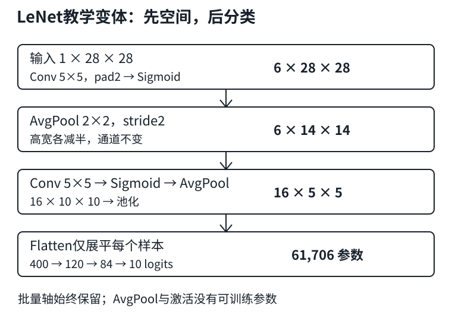

# LeNet：把卷积、池化与分类头接起来

## 1. 先理解接口，不急着训练

一张Fashion-MNIST图片有1通道、$28\times28$像素。MLP很早就把它展平；CNN先保留空间邻接关系，经过共享卷积、非线性和下采样，再送入分类头。

本讲使用**教材PyTorch的LeNet教学变体**：两层卷积、两次平均池化、三层全连接。复用[LEC20尺寸推导](#/c/d2l-pytorch-2021/lec/lec20?v=notes)、[LEC21参数与通道](#/c/d2l-pytorch-2021/lec/lec21?v=notes)、[LEC22池化边界](#/c/d2l-pytorch-2021/lec/lec22?v=notes)，不重新背一套术语。

| 操作 | 单样本输出（省略批量轴） | 含偏置参数量 |
|---|---|---:|
| 输入 | $1\times28\times28$ | 0 |
| Conv 1→6，5×5，padding2；Sigmoid | $6\times28\times28$ | 156 |
| AvgPool 2×2，stride2 | $6\times14\times14$ | 0 |
| Conv 6→16，5×5，无padding；Sigmoid | $16\times10\times10$ | 2,416 |
| AvgPool 2×2，stride2 | $16\times5\times5$ | 0 |
| Flatten（保留批量） | 400 | 0 |
| Linear 400→120；Sigmoid | 120 | 48,120 |
| Linear 120→84；Sigmoid | 84 | 10,164 |
| Linear 84→10 | 10 | 850 |

总计61,706个可训练参数。第一卷积保持高宽，不是“每层都缩小”；第二卷积把14变成10；池化每次高宽减半。没有加softmax的最后10个数是**logits**，不是概率。



图为编者按本页教学变体自绘，不复制历史网络图。

## 2. 一个参数量小算例：共享省参数，不代表免计算

普通卷积参数量为$C_o(C_i k^2+1)$；全连接为$d_o(d_i+1)$。第二卷积和第一个全连接分别是：

$$
\begin{aligned}
P_{\mathrm{conv2}}&=16(6\times25+1)=2416,\\
P_{\mathrm{fc1}}&=120(400+1)=48120.
\end{aligned}
$$

所以大部分参数在分类头。反过来，卷积核会在许多位置重复使用：单样本第二卷积的密集乘加约为$10\times10\times16\times6\times25=240000$ MAC，第一个全连接是48000 MAC。**参数最多的层不一定计算最多**。

批量$N$从1变64，不会复制64份参数，但前向激活、计算和训练中需要保存的中间量随之增长。记清三种轴：`Flatten(start_dim=1)`把每个样本的$16\times5\times5$变成400，不能把批量也展平进去。

## 3. 独立前向代码：保留教材模型，不代写训练实验

```python
import torch
from torch import nn

torch.manual_seed(23)
net = nn.Sequential(
    nn.Conv2d(1, 6, 5, padding=2), nn.Sigmoid(),
    nn.AvgPool2d(2, stride=2),
    nn.Conv2d(6, 16, 5), nn.Sigmoid(),
    nn.AvgPool2d(2, stride=2), nn.Flatten(start_dim=1),
    nn.Linear(400, 120), nn.Sigmoid(),
    nn.Linear(120, 84), nn.Sigmoid(), nn.Linear(84, 10),
)
net.eval()
x = torch.zeros(2, 1, 28, 28)
with torch.no_grad():
    for layer in net:
        x = layer(x)
        print(type(layer).__name__, tuple(x.shape))
assert x.shape == (2, 10)
assert torch.isfinite(x).all()
print(sum(p.numel() for p in net.parameters()))  # 解析预期：61706
```

这只检查网络连接、形状与有限输出，没有训练，没有准确率结论。初始化未改成教材训练函数里的Xavier；不能把这个随机前向称作教材训练复现。

## 4. 训练时接上已学会的合同

复用[LEC9分类输出与交叉熵](#/c/d2l-pytorch-2021/lec/lec09?v=notes)、[LEC14初始化](#/c/d2l-pytorch-2021/lec/lec14?v=notes)、[LEC16模块与保存加载](#/c/d2l-pytorch-2021/lec/lec16?v=notes)、[LEC17设备](#/c/d2l-pytorch-2021/lec/lec17?v=notes)。教材此处使用Fashion-MNIST、交叉熵、SGD和Xavier权重初始化；这些是一个具体配置，不是LeNet名字强制规定的训练方案。

- 输入应为浮点NCHW；标签为形状$(N,)$的整型类别编号。
- `CrossEntropyLoss`接收$(N,10)$ logits，不先做softmax，也不把10个类别压成一个数。
- 每次优化前清梯度，训练时`train()`，评估时`eval()`并配合`no_grad()`。即使本变体没有Dropout/BatchNorm，也先保持正确流程。
- 训练损失若为批均值，汇总到整轮时用“批均值×该批样本数”，最后除总样本数，避免最后一个小批量被赋同等权重。
- 不要原样搬教材的小批量绘图触发条件：`num_batches // 5`在不足5批时是0，取模会出错。日志频率不是训练数学的一部分，小实验可直接按轮记录。
- 每次“继续训练”都调用会重新初始化权重的函数，会抹掉恢复状态。恢复完整训练需同时考虑优化器、轮次等，见LEC16。

先在固定小子集上检查损失能否下降、参数是否更新，再做受控比较。把Sigmoid改ReLU或平均池化改最大池化时，保留其他条件、记录配置；结果未测前不保证提升。完整任务由CNN实验页给出，本页不提供端到端训练答案。

## 5. “LeNet”不是一个不变的实现文件

历史LeNet家族有多个版本；本页模型也**不等于1998年LeNet-5逐层复刻**。教材正文的简化说明不能取代实现核对：

| 项目 | 本页教材变体 | 原LeNet-5架构说明 |
|---|---|---|
| 输入与第一卷积 | 28×28，padding2 | 32×32，经5×5卷积成为28×28 |
| 下采样 | 无参数AvgPool2d | S2/S4含可训练系数、偏置及非线性 |
| 第二卷积连接 | 6到16全连接通道 | C3仅连接部分输入特征图 |
| 激活 | PyTorch Sigmoid | 缩放的双曲正切 |
| 400→120 | 展平后的Linear | C5为5×5卷积；在5×5输入上空间输出1×1 |
| 输出 | Linear到10个logits | 10个欧氏径向基输出单元 |

固定尺寸下C5与相应全连接映射可以有同样的参数形状解释，但输入空间变大时行为就不同。模型名称必须与**输入尺寸、连接方式、激活、输出定义**一起记录；不要把教学变体的61,706个参数贴成所有LeNet版本的统一数值。

无需为这些历史边界另刷整篇论文；本页的学习任务仍是能解释形状、共享、训练接口与自己的改动。

## 6. 自测

1. 为什么第一卷积后高宽还是28？第二卷积为什么变成10？
2. 为什么必须保留Flatten的批量轴？
3. 输出10维为什么不意味着它已是概率？
4. 把输入换成32×32而不改任何层，第一个Linear还能接上吗？
5. 本页参数最多和乘加更多的部分是否相同？

<details>
<summary>展开答案</summary>

1. 第一层每侧padding2抵消5×5核带来的4像素缩减；第二层无padding，14−5+1=10。
2. 分类头对每个样本独立映射，需输入$(N,400)$，不能混合不同样本。
3. Linear输出可负、和不为1；交叉熵内部处理logits。仅展示概率时才沿类别轴softmax。
4. 不能。空间路径变为32→16→12→6，展平576，不是400。不要仅修改输入而漏改分类头。
5. 不同。第一个Linear有48,120参数，但第二卷积的单样本MAC为240,000，大于该Linear的48,000。

</details>

## 来源、分P清单与缺口

实际阅读D2L作者团队[固定教材6.6](https://github.com/d2l-ai/d2l-zh/blob/e6b18ccea71451a55fcd861d7b96fddf2587b09a/chapter_convolutional-neural-networks/lenet.md)全文、习题与PyTorch模型/评估/训练实现。固定的是当前中文第二版源码，不是2021快照。

编者历史校核：Yann LeCun、Léon Bottou、Yoshua Bengio、Patrick Haffner，*Gradient-Based Learning Applied to Document Recognition*（1998），[作者页面](https://bottou.org/papers/lecun-98h)及其[PDF](https://leon.bottou.org/publications/pdf/ieee-1998.pdf)。仅实际阅读该作者稿PDF第6–8页（II.A/II.B、图2、表I、式5–7），不是全篇审读、不是新增必读。首次原作者域名读取失败；替代作者源获取成功，文本编码异常后改用渲染页审读。仅存自主架构对照与原PDF哈希，不转载论文图或全文。

2026-11-14按[官网课表](https://courses.d2l.ai/zh-v2/)核对[官方BV](https://www.bilibili.com/video/BV1t44y1r7ct)：作者“跟李沐学AI”（mid 1567748478），标题“23 经典卷积神经网络 LeNet【动手学深度学习v2】”，发布于2021-05-22 07:45:20 UTC。

| 分P | 接口标题 | 时长 |
|---|---|---:|
| P1 | LeNet | 08:31 |
| P2 | 代码 | 21:47 |
| P3 | QA | 30:08 |

合计60:26。此表不是课堂时间线。3P各请求一次公开player，均成功空字幕；未观看/下载音视频、未核实课堂演示或QA。无完整课堂源，`draft`阻塞，不建占位；`materials=not_required`。

来源与SHA-256见`sources/p4-lec23/manifest-fragment.json`。教材根LICENSE为Apache-2.0，不外推论文、视频或第三方图。视频copyright=1/no_reprint=1，未取得开放转录授权。代码未由撰写者运行。
