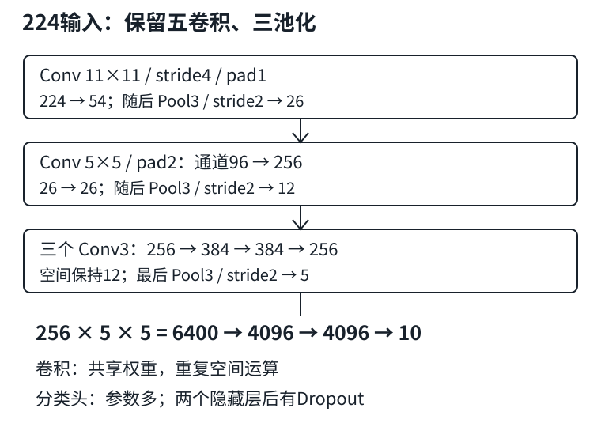

# AlexNet：深度、分辨率与大分类头的成本

## 1. 不只是把LeNet堆高

接着[LEC23的卷积编码器与分类头](#/c/d2l-pytorch-2021/lec/lec23?v=notes)，AlexNet让我们看见一个组合：更大数据、可训练表征、更深更宽网络、ReLU、正则化与适合密集运算的硬件共同起作用。不能把2012年的突破缩成“换了一个激活函数”，也不能认为任何数据集换大模型都会更好。

教材实现有**5层卷积＋3层全连接**，所以称8个有参数层；不是8层卷积。激活、池化、Flatten、Dropout仍然是执行图中的层，只是不计入这个历史命名口径。

本页讨论教材PyTorch的单通道、10类变体，不声称复现原ImageNet模型、原双GPU连接方式或原训练结果。输入固定为$(N,1,224,224)$；教材将Fashion-MNIST放大到224，是为了演示该空间结构，**放大不会创造新的图像细节**。

## 2. 224输入：把每个空间变化算到分类头

设卷积/池化的$k,s,p$分别为核、步幅、每侧padding，默认floor规则复用[LEC20](#/c/d2l-pytorch-2021/lec/lec20?v=notes)和[LEC22](#/c/d2l-pytorch-2021/lec/lec22?v=notes)。表中省略批量轴；卷积后均接ReLU。

| 层 | $k,s,p$ | 输出 | 含偏置参数 |
|---|---|---|---:|
| Conv 1→96 | 11,4,1 | 96×54×54 | 11,712 |
| MaxPool | 3,2,0 | 96×26×26 | 0 |
| Conv 96→256 | 5,1,2 | 256×26×26 | 614,656 |
| MaxPool | 3,2,0 | 256×12×12 | 0 |
| Conv 256→384 | 3,1,1 | 384×12×12 | 885,120 |
| Conv 384→384 | 3,1,1 | 384×12×12 | 1,327,488 |
| Conv 384→256 | 3,1,1 | 256×12×12 | 884,992 |
| MaxPool | 3,2,0 | 256×5×5 | 0 |
| Flatten | — | 6400 | 0 |
| Linear＋ReLU＋Dropout | — | 4096 | 26,218,496 |
| Linear＋ReLU＋Dropout | — | 4096 | 16,781,312 |
| Linear | — | 10 logits | 40,970 |

关键两步：

$$
\begin{aligned}
H_{\mathrm{conv1}}&=\left\lfloor\frac{224+2-11}{4}\right\rfloor+1=54,\\
H_{\mathrm{pool3}}&=\left\lfloor\frac{12-3}{2}\right\rfloor+1=5,\\
d_{\mathrm{flatten}}&=256\times5\times5=6400.
\end{aligned}
$$

看到其他实现的55、6×6或不同通道数时，先检查输入、padding和具体版本，不能直接拼接别人的全连接维度。本页明确采用固定教材PyTorch代码，不混用其他框架分支的默认设置。



图为编者自绘；三个连续3×3卷积之间不插入额外池化，末尾才下采样。

## 3. 独立完整前向：不删关键层来假装原结构跑通

以下保留上述五卷积、三次池化、两层4096隐藏全连接与Dropout。仅做批量1的CPU前向，**不是小训练答案**；仅参数float32就约178.4 MiB，先确认内存再运行。

```python
import torch
from torch import nn

torch.manual_seed(24)
net = nn.Sequential(
    nn.Conv2d(1, 96, 11, stride=4, padding=1), nn.ReLU(),
    nn.MaxPool2d(3, stride=2),
    nn.Conv2d(96, 256, 5, padding=2), nn.ReLU(),
    nn.MaxPool2d(3, stride=2),
    nn.Conv2d(256, 384, 3, padding=1), nn.ReLU(),
    nn.Conv2d(384, 384, 3, padding=1), nn.ReLU(),
    nn.Conv2d(384, 256, 3, padding=1), nn.ReLU(),
    nn.MaxPool2d(3, stride=2), nn.Flatten(),
    nn.Linear(6400, 4096), nn.ReLU(), nn.Dropout(0.5),
    nn.Linear(4096, 4096), nn.ReLU(), nn.Dropout(0.5),
    nn.Linear(4096, 10),
)
net.eval()
x = torch.zeros(1, 1, 224, 224)
with torch.no_grad():
    for layer in net:
        x = layer(x)
        print(type(layer).__name__, tuple(x.shape))
assert x.shape == (1, 10)
assert torch.isfinite(x).all()
print(sum(p.numel() for p in net.parameters()))  # 解析预期：46764746
```

`eval()`关闭Dropout随机遮蔽，`no_grad()`不记录反向图，作用不同，见[LEC13](#/c/d2l-pytorch-2021/lec/lec13?v=notes)。模型的随机输出没有类别识别意义；这里检查的只是形状连接与参数总量。

若直接输入28×28，空间路径很快变为5→2，下一次3×3池化无法得到合法输出。把输入缩小后删除池化、删除卷积或把4096改成32，都可以是**另一个明确标注的教学小模型**，但不能再用它证明上表结构已完整前向。即使只改变分辨率，Flatten维度也必须重新计算。

## 4. 为什么ReLU与Dropout放在这里

- ReLU为$\max(0,x)$。正半轴导数为1，避免Sigmoid在很大正输入时趋近饱和；但负半轴导数为0，仍可能出现长期不激活的单元。它不是“永不梯度消失”的保证。
- 逐层卷积加非线性，允许组合局部模式。不能把某个隐藏通道永久命名为“猫耳朵检测器”；学到什么受数据、训练和后续组合影响。
- 两个大的隐藏全连接层后使用Dropout，减少训练时对固定协同特征的依赖。它不减少保存的参数个数，不能当成内存压缩。
- 数据增强改变训练样本的呈现方式，但标签保持的假设必须合理。教材叙述了AlexNet历史上的裁切、翻转、颜色变化；本页短代码没有实现这些，也没有执行ImageNet训练。

## 5. 三份账：参数、激活、计算

总参数46,764,746；仅两个隐藏全连接层就有42,999,808个。按float32每参数4字节，这两层约164.0 MiB，而不是“光权重必然近1GB”。梯度、优化器状态、激活和后端工作区应另算，不能把训练总占用混称参数大小。

用一个位置的共享权重反复运算，导致卷积即使参数相对少也可能计算很多。例如单样本第二卷积：

$$
\begin{aligned}
\mathrm{MACs}_{\mathrm{conv2}}
&=26^2\times256\times96\times5^2\\
&=415334400,\\
\mathrm{MACs}_{\mathrm{fc1}}
&=6400\times4096=26214400.
\end{aligned}
$$

一次MAC指乘法及累加，FLOPs常用约2倍口径；两者都不是实测耗时。训练中的峰值内存也不能只看某一层输出：反向需要保存多个中间激活。输入从28放到224，像素数增加64倍，是否值得必须看任务，而不是因为网络名字著名。

硬件部分只保留可迁移的工程结论：大批密集卷积可利用并行；实际速度受设备、批量、内存带宽、数据加载与算子实现影响。教材年代性的核心数量和峰值数字不是今天的购机建议，设备基础复用[LEC17](#/c/d2l-pytorch-2021/lec/lec17?v=notes)。

## 6. 自测

1. “AlexNet有8层”在本页数的是什么？
2. 224输入为什么不是展平成256×6×6？
3. 训练时Dropout丢掉一半激活，会让参数文件缩小一半吗？
4. 第一全连接参数更多，是否一定比第二卷积更费计算？
5. 把输入改28并删除两个池化层，能否记录为本页模型完整验收？

<details>
<summary>展开答案</summary>

1. 五个卷积层＋三个全连接层；不计激活、池化等无参数操作。
2. 本页第一层padding1得到54，后续空间路径54→26→26→12→12→12→12→5，最后为256×5×5。
3. 不会；训练时遮蔽激活，不删除权重。推理时关闭随机遮蔽。
4. 不一定。第二卷积参数在26×26位置共享，MAC约4.15亿，第一全连接约2621万。
5. 不能。可以另列编者改型实验，但要记录删层和输入变化，不能替代这里的结构验收。

</details>

## 来源、分P清单与缺口

实际阅读D2L作者团队[固定教材7.1](https://github.com/d2l-ai/d2l-zh/blob/e6b18ccea71451a55fcd861d7b96fddf2587b09a/chapter_convolutional-modern/alexnet.md)全文、全部习题和PyTorch代码：表征学习、数据/硬件背景、模型、分辨率调整与训练调用。版本为当前中文第二版固定源码，不是2021快照。形状、成本和代码为编者推导；历史论文仅为教材背景，未额外审读，不新增论文必读，也不复制其滤波器图片。

2026-11-14按[官网课表](https://courses.d2l.ai/zh-v2/)核对[官方BV](https://www.bilibili.com/video/BV1h54y1L7oe)：作者“跟李沐学AI”（mid 1567748478），标题“24 深度卷积神经网络 AlexNet【动手学深度学习v2】”，发布于2021-05-23 07:21:06 UTC。

| 分P | 接口标题 | 时长 |
|---|---|---:|
| P1 | AlexNet | 35:16 |
| P2 | 代码 | 10:39 |
| P3 | QA | 16:06 |

合计62:01。此表不是课堂时间线。3P各请求一次公开player，均成功空字幕；未观看/下载音视频，未核实课堂演示或QA。中文原课通过页头观看，本课不另作课堂逐段整理；`materials=not_required`。

来源、SHA-256、代码与数值验收目标见`sources/p4-lec24/manifest-fragment.json`。教材根LICENSE为Apache-2.0，不外推视频或第三方图；视频copyright=1/no_reprint=1，未取得开放转录授权。代码未由撰写者运行，未执行完整训练。
