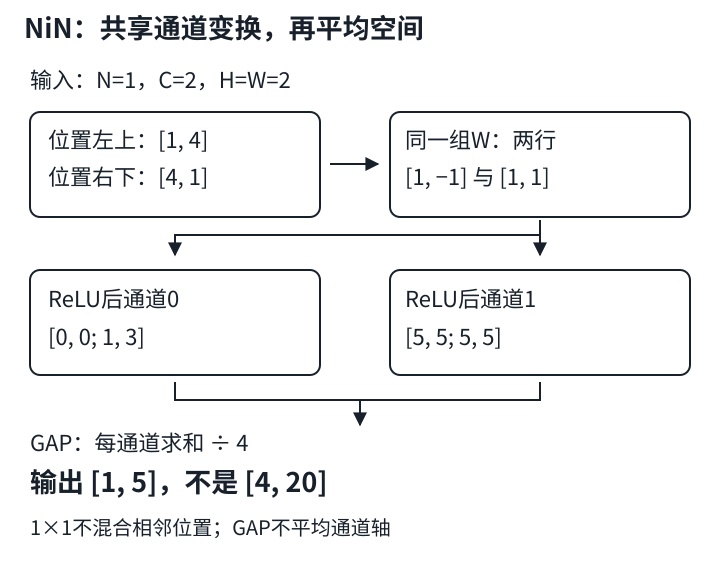

# NiN：每个位置一个共享的通道MLP

## 1. 不把空间摊平，也能做多层感知机

AlexNet、VGG把空间特征交给较大的全连接分类头。NiN（Network in Network）保留卷积特征图的空间布局，改为在**每个空间位置的通道向量上**应用共享的小网络，最后对空间取平均。

先分清两种“全连接”：

- `Flatten → Linear`：把所有位置、所有通道拼成一个向量，不同位置可以拥有不同权重。
- 步幅1的`Conv2d(Cin, Cout, 1)`：同一位置的所有输入通道连到所有输出通道；不同位置复用**同一套**权重，不混合相邻像素。

输入$X$为$(N,C_{in},H,W)$。固定样本$n$和位置$(h,w)$，取出向量$x=X_{n,:,h,w}$，长度为$C_{in}$。普通、无分组的$1\times1$卷积就是：

$$
\begin{aligned}
y_o&=\sum_{c=1}^{C_{in}}W_{o,c}x_c+b_o,\\
W&\in\mathbb R^{C_{out}\times C_{in}},\\
b&\in\mathbb R^{C_{out}}.
\end{aligned}
$$

输出仍有$H\times W$个位置。它不是“每个通道单独乘一个数”：那种逐通道缩放没有上述完整通道混合。

## 2. NiN块为什么不只是小卷积核

教材的一个块按下面顺序组织：

1. 一个空间卷积，如$3\times3$，整合邻域信息；
2. ReLU；
3. $1\times1$卷积、ReLU；
4. 再一个$1\times1$卷积、ReLU。

空间卷积先构成局部特征，后两个点卷积相当于在该特征向量上再做两次非线性变换。**共享参数不代表输出相同**：每个位置读入的通道向量不同。

若两个$1\times1$仿射层之间没有激活，在无其他操作时可合并成一个仿射层：

$$
\begin{aligned}
y&=W_2(W_1x+b_1)+b_2\\
 &= (W_2W_1)x+(W_2b_1+b_2).
\end{aligned}
$$

加上ReLU后，一般不能这样合并，NiN才能增加逐位置非线性表达能力。点卷积本身不扩展空间感受野；块内的空间卷积以及块间池化才负责空间混合和下采样。若把点卷积步幅改为2，它会采样更少位置，但仍不读取相邻位置来做空间加权。



图为自拟两通道、四位置小例。箭头上方在每个位置共享权重；下方只沿空间轴平均，不跨类别求平均。

## 3. 小例：同一套权重作用四次

输入为一个样本、两个通道、$2\times2$空间：

$$
\begin{aligned}
X_0&=\begin{bmatrix}1&2\\3&4\end{bmatrix},\\
X_1&=\begin{bmatrix}4&3\\2&1\end{bmatrix}.
\end{aligned}
$$

点卷积输出两个通道，权重两行为$[1,-1]$和$[1,1]$，偏置为零。经ReLU：

$$
\begin{aligned}
A_0&=\begin{bmatrix}0&0\\1&3\end{bmatrix},\\
A_1&=\begin{bmatrix}5&5\\5&5\end{bmatrix}.
\end{aligned}
$$

例如左上位置的输入是$[1,4]$，先变为$[-3,5]$，再变为$[0,5]$。右下位置的输入$[4,1]$变为$[3,5]$。这里仅展示一个点卷积和激活，不冒充完整NiN块。

## 4. GAP：每个通道压成一个数

全局平均池化（GAP）不含可学习权重。对特征图$A\in\mathbb R^{N\times C\times H\times W}$：

$$
\begin{aligned}
z_{n,c}&=\frac{1}{HW}\sum_{h=1}^{H}\sum_{w=1}^{W}A_{n,c,h,w},\\
(N,C,H,W)&\longrightarrow(N,C,1,1)\\
&\longrightarrow(N,C).
\end{aligned}
$$

上例得到$z=[1,5]$，不是空间求和$[4,20]$，也不是把两个通道混成一个数。教材小结将GAP简写成“求和”，按具体API应理解为**求和后除以空间元素数**。

若最后一个NiN块输出$K$个通道，GAP直接给出$K$个分类分数。教材的末块仍含ReLU，分数非负，但它们仍可作为交叉熵的输入：**logits不要求必须有负数，也不等于概率**。不要在`CrossEntropyLoss`前额外加softmax。

一般CNN也可以先GAP到$C$维，再接`Linear(C,K)`；这和教材NiN“先映射到类别通道，再平均”的分类头不是同一种参数布局。

### 一个局部核对，不是整网答案

```python
import torch
from torch.nn import functional as F

x = torch.tensor([[[[1., 2.], [3., 4.]],
                   [[4., 3.], [2., 1.]]]])
w = torch.tensor([[1., -1.], [1., 1.]]).reshape(2, 2, 1, 1)
a = F.relu(F.conv2d(x, w))
z = F.adaptive_avg_pool2d(a, 1).flatten(1)
print(a)
print(z)  # 解析预期：tensor([[1., 5.]])
```

自己再做一个改变：把空间大小改成$3\times5$，保持通道数不变，预测`a`与`z`的形状后再运行。不要先照着整架构抄代码。

## 5. 参数少，为什么不一定更快

以$C_{in}=64,C_{out}=32,H=W=14$为例，含偏置时：

| 操作 | 参数量 | 说明 |
|---|---:|---|
| $1\times1$卷积 | $64\times32+32=2080$ | 所有196个位置共享 |
| $3\times3$卷积 | $9\times64\times32+32=18464$ | 同通道数，更多空间连接 |
| 摊平后直接输出32维 | $64\times196\times32+32=401440$ | 输出不再保留196个位置 |
| GAP | 0 | 仍要计算空间平均 |

前三行输出形状和作用不完全相同，不能只按参数量说它们可随意互换。点卷积每个位置仍需约$64\times32$次乘加，总计$196\times2048=401408$次MAC（忽略偏置和激活）。多插入两层也增加激活存储、算子调度和反向计算。

工程选择：

- **参数与空间自由度**：GAP不为每个位置学独立分类权重，减小大分类头的过拟合压力，也会丢掉精确位置布局。位置敏感任务不能只靠GAP。
- **感受野**：点卷积不能替代所有空间卷积，否则网络无法逐层组合邻域。
- **输入分辨率**：GAP能适配进入它的特征图大小，但前面的卷积和池化仍有合法尺寸约束；不是任何小图都能直接过完整NiN。
- **训练成本**：参数更少不保证更快收敛，也不保证推理延迟更低，应同时记录参数、MAC、激活尺寸与实际设备耗时。

读教材整网时，先标出四个NiN块、三个最大池化、Dropout和末尾GAP。保留这些机制进行缩小实验，不通过删除点卷积把NiN“简化”成普通CNN。

## 6. 自测

<details>
<summary>1. 1×1卷积能把64通道变成16通道吗？会让宽高减少吗？</summary>

能。输出通道数由卷积核组数决定。步幅1、无填充时宽高不变；通道缩减不是空间下采样。

</details>

<details>
<summary>2. 如果GAP前形状是(8, 10, 5, 7)，分类分数形状是什么？</summary>

GAP输出(8,10,1,1)，`flatten(1)`后为(8,10)。只对两个空间轴平均，不能把批量轴平均掉。

</details>

<details>
<summary>3. 删除两个点卷积之间的ReLU，是否仍然得到同样的非线性能力？</summary>

一般不能。连续仿射点卷积可合成一个仿射变换；保留中间非线性会得到不同的函数类。

</details>

<details>
<summary>4. 把GAP改成全局求和，训练会完全一样吗？</summary>

不会。在固定特征图大小时分数被乘以HW，改变softmax的尖锐程度及梯度尺度；输入尺寸改变时缩放还会改变。平均和求和不能默认为等价。

</details>

## 7. 来源与课堂缺口

- 实读：《动手学深度学习》中文第二版[7.3 网络中的网络](https://zh.d2l.ai/chapter_convolutional-modern/nin.html)；[固定源码](https://github.com/d2l-ai/d2l-zh/blob/e6b18ccea71451a55fcd861d7b96fddf2587b09a/chapter_convolutional-modern/nin.md)全文，重点为NiN块、PyTorch模型、形状循环、训练入口和习题。固定版本不是2021快照，未执行教材整套Notebook。
- [官方课表](https://courses.d2l.ai/zh-v2/)的NiN入口指向本页BV；元数据作者为“跟李沐学AI”（mid 1567748478），发布于2021-05-29。下表只是分P目录和真实时长，**不是片内讲解时间轴**。

| 分P | 平台标题 | 时长 |
|---|---|---:|
| P1 | NIN | 10:55 |
| P2 | 代码 | 10:01 |
| P3 | QA | 16:42 |
| 全部分P合计 | 2258秒 | 37:38 |

2026-11-14各P公开字幕接口各请求一次，均code=0、空列表。未下载或观看媒体，无法核实具体讲述和QA，也没有可靠完整课堂文本；中文原课通过页头观看，本课不另作课堂逐段整理；不编造时间索引。教材已为中文，无独立materials需求，状态为`not_required`。

教材根LICENSE为Apache-2.0，setup包的MIT-0字段另记；均不外推视频或第三方图。本页不用教材原图、不重译中文教材。来源原件、SHA-256、实读范围和待统一验收项保存在`sources/p4-lec26/manifest-fragment.json`。
