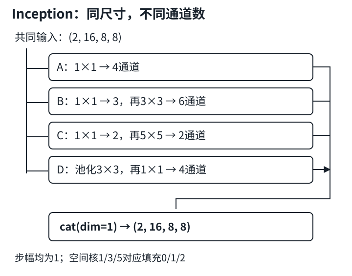

# GoogLeNet：多条分支，先对齐再拼接

## 1. 不必给所有特征只选一种卷积核

一个位置可能同时需要细粒度特征和更大邻域的上下文。Inception块让同一个输入流入多条路径，分别变换后合并。这里的“并行”是**计算图分叉**，不保证Python调用或GPU内核真的同时运行。

教材7.4介绍的是简化GoogLeNet：保留四路Inception和后续堆叠，没有提供所有历史版本的完整复现。学会本讲四路结构不等于实现了Inception V3。

| 路径 | 运算顺序 | 主要作用 |
|---|---|---|
| A | $1\times1$卷积 → ReLU | 逐位置通道变换 |
| B | $1\times1$降维 → ReLU → $3\times3$ → ReLU | 控制成本的较小邻域特征 |
| C | $1\times1$降维 → ReLU → $5\times5$ → ReLU | 控制成本的较大邻域特征 |
| D | $3\times3$最大池化 → $1\times1$ → ReLU | 汇聚后调整通道数 |

最后沿通道轴`torch.cat(..., dim=1)`，不是逐元素相加。

## 2. 形状合同比背网络图更重要

输入$X$为$(N,C,H,W)$，四路末端通道数分别为$a,b,c,d$。要沿通道拼接，各路的$N,H,W$必须完全一致：

$$
\begin{aligned}
P_A&\in\mathbb R^{N\times a\times H\times W},\\
P_B&\in\mathbb R^{N\times b\times H\times W},\\
P_C&\in\mathbb R^{N\times c\times H\times W},\\
P_D&\in\mathbb R^{N\times d\times H\times W},\\
Y&\in\mathbb R^{N\times(a+b+c+d)\times H\times W}.
\end{aligned}
$$

默认膨胀率1时，某个空间轴的卷积或普通池化输出长度是：

$$
L_{out}=\left\lfloor\frac{L+2p-k}{s}\right\rfloor+1.
$$

本块取步幅$s=1$；核$k=1,3,5$对应填充$p=0,1,2$，都保持尺寸。池化路也必须显式`stride=1,padding=1`；`MaxPool2d(3)`默认步幅是3，不能用它替代这里的池化。

最大池化的隐式padding按负无穷处理，不是用0参与最大值比较。对负数输入，手工补0可能把边界最大值错误地抬高。

### 一个小而完整的形状例子

取输入$(2,16,8,8)$，设A输出4通道，B先降到3再输出6，C先降到2再输出2，D输出4：

| 路径 | 中间形状 | 末端形状 |
|---|---|---|
| A | 无额外中间层 | $(2,4,8,8)$ |
| B | $(2,3,8,8)$ | $(2,6,8,8)$ |
| C | $(2,2,8,8)$ | $(2,2,8,8)$ |
| D | 池化仍为$(2,16,8,8)$ | $(2,4,8,8)$ |
| 拼接 | $4+6+2+4=16$ | $(2,16,8,8)$ |

输出通道恰好也是16只是本例的选择，不是Inception的规定。教材首个Inception输入192通道，输出$64+128+32+32=256$通道。



自绘图对应上述小例。分支中间的3和2是瓶颈通道数，不能把它们误加到最终输出通道数中。

## 3. 瓶颈省了多少，又付出什么

忽略偏置、激活、池化和访存，只数卷积权重以及每个输出位置的乘加次数。直接从$C$输入通道卷积到$O$输出通道，核为$k\times k$：

$$
P_{direct}=C O k^2.
$$

先以$1\times1$压到$r$通道，再做空间卷积：

$$
\begin{aligned}
P_{bottle}&=Cr+rOk^2,\\
P_{bottle}<P_{direct}
&\iff r<\frac{COk^2}{C+Ok^2}.
\end{aligned}
$$

“加一层就省计算”不总成立，关键是$r$是否足够小。

上例B路：

- 直接$16\to6$的$3\times3$：$16\times6\times9=864$个权重；
- 先$16\to3$再$3\to6$：$16\times3+3\times6\times9=210$个权重。

C路：直接$16\to2$的$5\times5$为800个，瓶颈方式为$16\times2+2\times2\times25=132$个。四路总卷积权重数为：

$$
\begin{aligned}
P&=64+210+132+64\\
 &=470,\\
\mathrm{MAC}_{per\ image}&=8\times8\times470\\
 &=30080.
\end{aligned}
$$

这里一次乘加算1 MAC；若用乘和加各算一次的FLOP口径，数字约翻倍。默认卷积偏置共$4+3+6+2+2+4=21$个，所以实际参数量为491。批量2的卷积MAC为60160，不含池化比较和ReLU。

瓶颈有代价：先压通道限制了可保留的信息；ReLU又使它不是一个无损线性压缩。不能期待任意窄瓶颈与直接大卷积具有相同表达能力。额外层和多分支中间激活也会影响显存与延迟，理论MAC下降不等于墙钟时间同比下降。

## 4. 局部检查：只验证最容易错的一条路径

下面只核对B路的形状和参数，不提供完整Inception类或整网答案。

```python
import torch
from torch import nn

branch = nn.Sequential(
    nn.Conv2d(16, 3, kernel_size=1), nn.ReLU(),
    nn.Conv2d(3, 6, kernel_size=3, padding=1), nn.ReLU(),
)
x = torch.ones(2, 16, 8, 8)
y = branch(x)
print(tuple(y.shape))  # 解析预期：(2, 6, 8, 8)
print(sum(p.numel() for p in branch.parameters()))  # 219
```

219包含210个权重和$3+6=9$个偏置。随机初始化会使数值输出不固定，但不影响这里的形状与参数预期。

继续练习时自己补全其余路径，**先记录各分支输出，再拼接**。若空间尺寸不同，不要为“让代码跑通”随意切掉边缘；回查核、填充、步幅以及池化默认值。拼接可接受各路通道数不同；求和则通常要求所有轴相同，语义也变成特征融合而非保留四路特征。

## 5. 从块读到GoogLeNet，但不抄整架构

教材整体路径可按“卷积入口 → 两个Inception → 五个Inception → 两个Inception → GAP → 小分类器”理解，共九个Inception块。下采样主要在入口和块组之间，不是让四条路径自行选择互不一致的分辨率。

需要留意两个教材阅读细节：

1. 章节概述说GAP避免末尾全连接层，具体PyTorch模型仍有`Linear(1024,10)`。更准确地说，它避免了把大空间图直接摊平后接**大型**全连接头，不是完全没有Linear。
2. 教材训练入口把Fashion-MNIST缩放到$96\times96$以减轻计算，这是该示例的设置，不是原ImageNet训练配置，也不是所有GoogLeNet版本的输入约定。

工程上先保留四路及九个块的机制，跟踪形状，再考虑缩通道的小型实验。删掉$5\times5$路径会改变教材的四路结构，不能仍说“完整验证了教材Inception”；剩余三路仍然是并行分支。训练任务的端到端实现放在CNN实验中由你完成；本讲先把分支合同和成本模型做牢。

## 6. 自测

<details>
<summary>1. 四路输出通道为4、6、2、4，可以直接相加吗？</summary>

不能按本例逐元素相加，因为通道轴不同。沿通道拼接得到16通道，保留各路径的输出。若改成求和，既要先对齐通道，也改变了架构语义。

</details>

<details>
<summary>2. 8×8输入经过5×5、stride=1、padding=1后是多少？为什么拼接失败？</summary>

输出为6×6，不再与其他8×8路径一致。这里应设padding=2才能保持尺寸，而不是事后裁剪其他路径掩盖问题。

</details>

<details>
<summary>3. B路瓶颈宽度改成16一定更省权重吗？</summary>

不。此时权重数为16×16+16×6×9=1120，大于直接卷积的864。瓶颈是否省资源必须计算，不能只看层名。

</details>

<details>
<summary>4. 计算图有四路并行，是否能保证GPU推理快四倍？</summary>

不能。设备执行调度、算子启动、访存、通道大小、拼接成本都会影响耗时；结构并行不等于四个独立处理器同时满速工作。

</details>

## 7. 来源与课堂缺口

- 实读：《动手学深度学习》中文第二版[7.4 含并行连结的网络](https://zh.d2l.ai/chapter_convolutional-modern/googlenet.html)，[固定源码](https://github.com/d2l-ai/d2l-zh/blob/e6b18ccea71451a55fcd861d7b96fddf2587b09a/chapter_convolutional-modern/googlenet.md)全文；重点核对四路实现、所有块组、GAP后的Linear、训练分辨率和习题。固定提交不是2021教材快照，没有执行整套Notebook。
- [官方课表](https://courses.d2l.ai/zh-v2/)指向本页BV。元数据作者“跟李沐学AI”（mid 1567748478），发布于2021-05-29。平台完整标题含“GoogLeNet / Inception V3”；仅凭标题不能推断片内如何讲V3，本页不伪造该段内容。

| 分P | 平台标题 | 时长 |
|---|---|---:|
| P1 | GoogLeNet | 26:59 |
| P2 | 代码 | 07:10 |
| P3 | QA | 16:33 |
| 全部分P合计 | 3042秒 | 50:42 |

这只是分P目录，不是片内时间轴。2026-11-14各P公开字幕接口各请求一次，均code=0且空列表；未观看或下载媒体，讲授、演示和QA未核实。中文原课通过页头观看，本课不另作课堂逐段整理；中文教材无需重复materials，状态`not_required`。

教材根LICENSE Apache-2.0与setup包MIT-0字段分开，均不外推视频或第三方图。本页使用自主讲解、算例和自绘SVG；来源原件、SHA-256、实读范围和数值机制清单见`sources/p4-lec27/manifest-fragment.json`。
