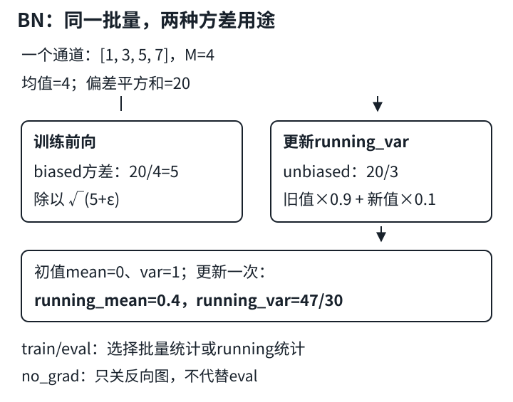

# BatchNorm：统计轴、运行状态与梯度开关

## 1. 先回答：哪些数参与同一次统计

BatchNorm（BN，批量规范化，也常称批量归一化）在网络内部对特征做标准化，再学会适合任务的缩放与平移。它不是把每张图的所有通道混在一起标准化。

| 输入与层 | 每份统计收集哪些元素 | 每份统计元素数$M$ |
|---|---|---:|
| $(N,C)$，`BatchNorm1d(C)` | 固定特征$c$，跨样本$n$ | $N$ |
| $(N,C,H,W)$，`BatchNorm2d(C)` | 固定通道$c$，跨$n,h,w$ | $NHW$ |

对于卷积特征图，计算均值和方差的轴是`(0,2,3)`，不是把`dim=1`通道轴求掉。每个通道有一个均值、一个方差、一个可学习缩放$\gamma_c$和一个偏移$\beta_c$。

`nn.BatchNorm2d(C)`的可学习向量形状为`(C,)`，广播到NCHW时可想成`(1,C,1,1)`。教材自制层直接把参数存成后一种形状。它们不是每个像素各学一份参数。

## 2. 均值、方差、标准差随课补回

把同一通道收集到的$M$个值写为$x_1,\ldots,x_M$。训练前向使用除以$M$的方差估计：

$$
\begin{aligned}
\mu_B&=\frac1M\sum_{i=1}^{M}x_i,\\
v_B&=\frac1M\sum_{i=1}^{M}(x_i-\mu_B)^2,\\
\hat x_i&=\frac{x_i-\mu_B}{\sqrt{v_B+\epsilon}},\\
y_i&=\gamma\hat x_i+\beta.
\end{aligned}
$$

- 均值：中心在哪；方差：偏离中心的平方平均；标准差：方差开平方，恢复原单位。
- $\epsilon>0$放在根号内，防止除零。它不是解决所有退化批量问题的万能补丁。
- 标准化后的均值约为0，但方差为$v_B/(v_B+\epsilon)$，不是精确等于1。再经过$\gamma,\beta$，最终输出更不要求均值0、方差1。
- $\gamma,\beta$由损失的梯度更新；running统计由前向中的状态更新维护，不由优化器反向学习。

### 一个通道、四个数

设$N=2,H=1,W=2$，某通道的数为$[1,3,5,7]$：

$$
\begin{aligned}
M&=4,\qquad \mu_B=4,\\
v_B&=(9+1+1+9)/4=5,\\
s_B^2&=(9+1+1+9)/3=20/3.
\end{aligned}
$$

$5$是biased估计（分母$M$），$20/3$是unbiased估计（分母$M-1$）。名称是在讨论对总体方差的估计偏差，不是说前向用5“算错了”。设$\gamma=1,\beta=0$，训练输出依次是$[-3,-1,1,3]/\sqrt{5+\epsilon}$。



图为自拟四数算例。训练输出用当前批量的biased方差；运行方差接收unbiased方差；梯度开关不选择这两条路径。

## 3. PyTorch的running_var不是把前向方差原样存进去

以下明确讨论默认`track_running_stats=True`的`nn.BatchNorm2d`。训练时：

1. 前向标准化用当前批量的$\mu_B,v_B$，其中$v_B$分母为$M$；
2. `running_mean`吸收当前均值；
3. `running_var`吸收经过$M/(M-1)$修正的$s_B^2$；
4. eval时使用保存的running均值和方差，不再从当前输入重新估计。

设PyTorch的`momentum=m`：

$$
\begin{aligned}
r_{\mu,new}&=(1-m)r_{\mu,old}+m\mu_B,\\
r_{v,new}&=(1-m)r_{v,old}+ms_B^2.
\end{aligned}
$$

默认$m=0.1$，表示**新批量占10%**。它不同于SGD优化器的动量参数。教材自制函数则用`momentum * old + (1-momentum) * current`，其`momentum=0.9`才对应这里旧值保留90%的系数。

上例running初值为均值0、方差1，更新一次后：

$$
\begin{aligned}
r_{\mu,new}&=0.9\times0+0.1\times4=0.4,\\
r_{v,new}&=0.9\times1+0.1\times(20/3)\\
&=47/30\approx1.566667.
\end{aligned}
$$

同一输入的eval输出为$(x-0.4)/\sqrt{47/30+\epsilon}$，不等于训练输出。running统计是训练过程中的估计，**不是自动计算出的整个训练集精确统计量**。各批量大小不同、数据顺序和分布变化都会影响它。

`momentum=None`改为按已处理批次数累计平均，不等于按每批样本数加权的全数据精确均值/方差。`momentum=0`冻结running数值更新，但训练前向仍用当前批量统计；它不等价于eval。

## 4. train/eval与no_grad是两条独立轴

对标准`nn.BatchNorm`，层的`.training`决定模式；自动求导开关决定是否记录反向图。默认跟踪running统计时：

| 调用模式 | 标准化用什么 | running是否更新 | 是否可能构建反向图 |
|---|---|---|---|
| `train()`，正常梯度模式 | 当前批量统计 | 是 | 是，取决于输入/参数是否需梯度 |
| `train()`，`no_grad()` | 当前批量统计 | 是 | 否 |
| `eval()`，正常梯度模式 | running统计 | 否 | 是，取决于输入/参数是否需梯度 |
| `eval()`，`no_grad()` | running统计 | 否 | 否 |

因此验证/推理通常要同时`model.eval()`和`torch.no_grad()`。只写`no_grad()`仍可能把验证集统计写进BN，造成状态污染；只写`eval()`则仍可能保留不必要的反向图。反过来，在eval模式下研究输入梯度也是合法需求。

例外不是“no_grad改变BN”，而是显式配置`track_running_stats=False`：这时没有可用的running buffers，训练和eval都用当前批量统计，输出可能依赖同批其他样本。

### 四数检查：局部探针，不是训练模板

```python
import torch
from torch import nn

x = torch.tensor([1., 3., 5., 7.]).reshape(2, 1, 1, 2)
bn = nn.BatchNorm2d(1, momentum=0.1)
bn.train()
with torch.no_grad():
    y_train = bn(x)
print(bn.running_mean)  # 解析预期：[0.4]
print(bn.running_var)   # 解析预期：[47/30]
bn.eval()
x_eval = x.clone().requires_grad_()
y_eval = bn(x_eval)
print(y_train.flatten())
print(y_eval.requires_grad)  # True；eval没有禁用求导
```

继续自己核对：`y_train`是否符合四数公式？运行第二次训练前向后，running状态是否继续变化？比较模式时保存状态或重建同初值层，避免先后顺序把比较混成两种不同状态。

## 5. 真正的退化条件：每通道只有一个值

卷积BN要看$M=NHW$，不能只看$N$。

- `(1,C,2,2)`有$M=4$，标准BN训练可统计；但四个空间值不等于四个独立样本，估计质量仍可能较差。
- `(1,C,1,1)`有$M=1$。若按简化公式，均值就是输入本身、biased方差为0，输出退化到$\beta$，输入差异被消掉；unbiased方差还需要除以0。
- PyTorch标准BN在需要批量统计且$M=1$时会抛出`ValueError`，不是静默输出$\beta$。增大`eps`不能绕过这个形状检查。
- 默认跟踪running统计的eval不需要当前批量估计，因而`(1,C,1,1)`可用；`track_running_stats=False`即使eval仍要批量统计，不能靠eval避开退化。

实务中常见于最后一批只剩一个样本，或网络下采样到$1\times1$之后又接BN。先诊断具体层的$N,H,W$；合理调整批量、数据批次策略或归一化设计，而不是在训练遇错时临时切eval来隐藏问题。

## 6. 教材自制BN与nn.BatchNorm不可混为一谈

固定教材的PyTorch `batch_norm`用`torch.is_grad_enabled()`判断“训练/预测”。这是一种适配示例调用方式的简化，**不是PyTorch模块的模式语义**：

- 对该自制实现，`train()+no_grad()`走moving统计分支；标准BN此时仍用当前批量并更新running。
- 该自制实现即使`eval()`，只要梯度开着，仍走批量统计分支；标准BN默认eval使用running。
- 其moving方差直接使用分母$M$的`var`，没有标准BN保存running方差时的unbiased修正。上例相同旧值权重下，它更新为$0.9\times1+0.1\times5=1.4$，不是$47/30$。
- 教材把moving统计保存为普通Tensor属性，没有注册为buffer；不能想当然认为它们会随`state_dict()`保存、随`.to()`完整迁移。标准BN注册了`running_mean`、`running_var`、`num_batches_tracked` buffers。

所以不能直接把教材自制类替换成`nn.BatchNorm2d`，再要求所有模式组合和running状态逐位一致。学习公式时可拆开实现；工程里优先使用标准层，并保存包含buffers的完整`state_dict`。恢复训练还需优化器等状态，保存权重不等于恢复全过程。

## 7. 工程取舍与易错点

- BN经常帮助优化，但“消除内部协变量偏移”不是一个足以解释全部效果的定理；教材本身也讨论了这一解释的局限。不要据此保证任意网络收敛更快。
- Conv紧接BN时，卷积的通道偏置在训练批量中心化中会被抵消，常用`bias=False`省掉冗余参数。必须结合层序和推理状态理解，不能训练完后只删除偏置而不处理相关状态。
- 学得$\gamma,\beta$不意味着恢复所有被批量标准化丢失的信息；它们每通道共享，不随本批均值自动变化。
- 小批量、分布偏移或分布式训练会影响统计；增大图片空间不自动等价于增大独立样本数。先记录每层统计样本数，再比较方案。

## 8. 自测

<details>
<summary>1. 输入(4, 8, 3, 3)有几份均值？每份统计多少个数？</summary>

8份均值，各统计4×3×3=36个数。gamma和beta各8个可学习参数，而不是各288个。

</details>

<details>
<summary>2. 给[1,3,5,7]手算前向方差与running方差更新。</summary>

均值4，前向biased方差5，unbiased方差20/3。从running_var=1且PyTorch momentum=0.1出发，更新到47/30。训练归一化仍用5，不是47/30。

</details>

<details>
<summary>3. no_grad里跑验证，为什么验证前后模型state_dict会变？</summary>

若模型仍为train，标准BN会在前向更新running buffers，尽管没有梯度图。需要适当地切eval；no_grad只管理自动求导。

</details>

<details>
<summary>4. batch_size=1一定不能用BatchNorm2d吗？</summary>

不是。需要批量统计时检查NHW；空间元素足够时M可以大于1。但M=1的标准BN训练会报错，不能靠增大eps修复。

</details>

<details>
<summary>5. 教材momentum=0.9和PyTorch momentum=0.9意义相同吗？</summary>

不同。教材该函数0.9是旧统计权重；PyTorch 0.9是新批量统计权重。仅对更新系数而言教材0.9对应PyTorch0.1，方差估计差异还需另算。

</details>

## 9. 来源与课堂缺口

- 实读[教材7.5](https://zh.d2l.ai/chapter_convolutional-modern/batch-norm.html)及[固定源码](https://github.com/d2l-ai/d2l-zh/blob/e6b18ccea71451a55fcd861d7b96fddf2587b09a/chapter_convolutional-modern/batch-norm.md)正文、PyTorch自制函数/类、训练入口、简洁实现、争议与习题。未审读部分其他框架实现，未运行整套Notebook；该版本不是2021快照。
- 编者工程补充：实际读取[PyTorch v2.5.1 BatchNorm源码](https://github.com/pytorch/pytorch/blob/v2.5.1/torch/nn/modules/batchnorm.py)，包括buffer注册、`forward`分支和BatchNorm2d文档；[functional源码](https://github.com/pytorch/pytorch/blob/v2.5.1/torch/nn/functional.py)的`_verify_batch_size`与`batch_norm`；[官方Autograd说明](https://docs.pytorch.org/docs/2.15/notes/autograd.html)的局部禁用梯度和Evaluation Mode。在线文档为当前版本，机制以另存v2.5.1源码定位，不冒称2021 API。
- [官方课表](https://courses.d2l.ai/zh-v2/)指向本页BV。元数据作者“跟李沐学AI”（mid 1567748478），发布于2021-05-30。

| 分P | 平台标题 | 时长 |
|---|---|---:|
| P1 | 批量归一化 | 17:59 |
| P2 | 代码 | 17:12 |
| P3 | QA | 11:00 |
| 全部分P合计 | 2771秒 | 46:11 |

以上是分P目录，不是片内时间轴。2026-11-14各P公开字幕接口各请求一次，均code=0且空列表。未下载或观看媒体，讲授、演示和QA未核实；中文原课通过页头观看，本课不另作课堂逐段整理。教材中文已足够，无独立materials需求，状态`not_required`。

教材根LICENSE Apache-2.0、setup包MIT-0字段、PyTorch许可与视频授权各自独立，不外推第三方图。来源哈希、实读范围、获取失败记录和数值/模式验收清单在`sources/p4-lec28/manifest-fragment.json`。
