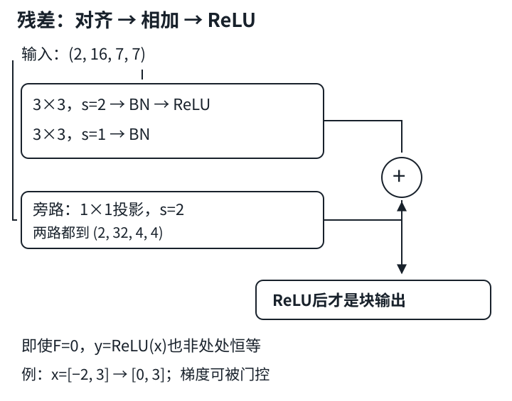

# ResNet：学习修正量，不是保证恒等与不消失

## 1. 更深的模型，为什么可能连训练误差都更差

层数增加通常扩展计算能力，但优化器未必能找到好的参数。要把两个问题分开：

1. **表示能力**：是否存在一组参数能表示旧模型或更好的函数？
2. **优化结果**：实际训练是否找到那组参数？

如果函数类满足$\mathcal F\subseteq\mathcal F'$，在相同训练目标下，新类的**最优可达**损失不会比旧类更大。这既不保证随机初始化后的SGD找到最优点，也不保证测试误差更低。不要把“能表示”读成“轻易训练得到”。

残差连接的想法是保留原输入，让新分支学习一个修正量。把期望映射记为$H(x)$，残差函数记为$F(x)$：

$$
\begin{aligned}
F(x)&=H(x)-x,\\
H(x)&=x+F(x).
\end{aligned}
$$

若合适映射接近恒等，学一个较小的$F$可能比重新制造整个$x$更方便。这是一种结构上的优化帮助，不是对任意训练过程的成功保证。

## 2. 教材块的准确顺序

教材的基本残差块是post-activation（加法后激活）形式：

1. 主分支：`Conv3×3 → BN → ReLU → Conv3×3 → BN`；
2. 旁路：形状不变时直接传$x$，否则用投影$P(x)$；
3. 逐元素相加；
4. 再做ReLU。

$$
\begin{aligned}
u&=\operatorname{ReLU}(\operatorname{BN}_1(\operatorname{Conv}_1(x))),\\
F(x)&=\operatorname{BN}_2(\operatorname{Conv}_2(u)),\\
s&=F(x)+P(x),\\
y&=\operatorname{ReLU}(s).
\end{aligned}
$$

第二个BN后面在相加**之前没有额外ReLU**。若改成先ReLU再相加，负的修正量会先被截掉，已经改变了块的函数。整条旁路也不自动是恒等：改变通道或下采样时，$P$是带参数的投影。



自绘图标出教材post-activation块及奇数空间尺寸示例。两路必须拥有相同形状；加法后ReLU仍会截断负值。

## 3. 相加合同：不仅通道要相同

残差合并希望两路逐元素对应。目标合同是两者均为$(N,C_{out},H_{out},W_{out})$，而不是借PyTorch广播“凑出可相加”。

### 不变形块

输入$(N,16,8,8)$，两个$3\times3$卷积都步幅1、填充1，输出仍为$(N,16,8,8)$。旁路直接用输入，不需要学习投影。

### 改变通道并下采样

输入$(2,16,7,7)$，主路第一层设`Conv2d(16,32,3,stride=2,padding=1)`：

$$
H_{out}=\left\lfloor\frac{7+2-3}{2}\right\rfloor+1=4.
$$

主路第二层$3\times3$步幅1、填充1，维持$(2,32,4,4)$。旁路使用`Conv2d(16,32,1,stride=2)`：

$$
H_{skip}=\left\lfloor\frac{7-1}{2}\right\rfloor+1=4.
$$

两路一致，才能相加。若只投影通道却忘了`stride=2`，旁路还为$7\times7$；若通道不变但主路下采样，也仍需同步处理旁路。

本例投影无偏置时有$16\times32=512$个参数；带偏置则为544。投影不是无成本、无参数的“快捷线”。$1\times1$步幅2只采样部分位置并混合通道，不自动做邻域平均或抗混叠滤波。

工程里常用奇数输入测试形状，能暴露把“减半”机械写成整除的错误。这里$7\to4$，不是$7\to3$。

## 4. F为零，不代表整个post-activation块处处恒等

先假定旁路是真正的恒等，且残差分支输出确实为0。教材块仍是：

$$
y=\operatorname{ReLU}(x).
$$

对$x=[-2,3]$，得到$[0,3]$，并不等于输入。只有在该处输入非负时，这个零残差块才保留输入；很多块的输入来自前面的ReLU，但不能把这个条件删掉后推广到任意实数输入。

若旁路是投影，则零残差时为$\operatorname{ReLU}(P(x))$，更不是一般意义上的恒等。教材中为了讲函数类嵌套而使用的“恒等”直觉，应用到具体含激活和投影的代码时必须保留这些条件。

另外，“卷积权重设0”不总能直接推得“残差分支为0”：还要考虑卷积偏置、BN的$\beta$及eval时的running统计。做实验时先明确你控制的是哪个函数输出，而不是只盯着一个参数张量。

## 5. 梯度直路为什么有用，又为什么不是永不消失

先看不含末尾ReLU、且旁路恒等的理想化表达$y=x+F(x)$。记$J_F$为$F$对$x$的雅可比矩阵，$I$为恒等矩阵：

$$
\begin{aligned}
\frac{\partial y}{\partial x}&=I+J_F,\\
\nabla_x L&=(I+J_F)^\mathsf T\nabla_y L.
\end{aligned}
$$

$\nabla_yL$是从后面传来的梯度，$I$提供不必经过主分支所有权重层的项。这有助于优化，但总梯度仍是两项之和，不是强制保留一个不可抵消的数。

教材post-activation块需要再乘激活的门控。设$D$是对角矩阵，正的$s_i$处为1，负处为0；避开不可微的零点：

$$
\begin{aligned}
\frac{\partial y}{\partial x}&=D(I+J_F),\\
\nabla_xL&=(I+J_F)^\mathsf TD\nabla_yL.
\end{aligned}
$$

如果旁路是投影，则$I$还要换成$J_P$。因此：

- $F'(x)=-1$时，标量理想残差的导数$1+F'(x)=0$，两路会抵消；
- 加法结果为负时，post-activation ReLU门控为0；
- 很深的复合、投影、参数尺度等仍可能带来梯度衰减或放大。

### 一个可以手算的标量残差族

设$F(x)=ax$，则$y=\operatorname{ReLU}((1+a)x)$。取$a=0.5,x=[-2,3]$，输出$[0,4.5]$，对两个输入的梯度分别为$[0,1.5]$（损失取输出之和）。再取$a=-1$，加法前的函数恒为0，导数已经是0，无须借助ReLU解释“抵消”。

```python
import torch

x = torch.tensor([-2., 3.], requires_grad=True)
y = torch.relu(x + 0.5 * x)
y.sum().backward()
print(y.detach())  # 解析预期：[0., 4.5]
print(x.grad)      # 解析预期：[0., 1.5]

u = torch.tensor([2.], requires_grad=True)
s = u + (-u)
s.sum().backward()
print(u.grad)      # 解析预期：[0.]，在激活之前已抵消
```

这是梯度机制的小例，不是完整残差模块，也不代表真实CNN的所有梯度都等于这些数。

## 6. 从基本块读ResNet-18的工程地图

教材网络含一个卷积入口、四个残差阶段（每阶段两个基本块）、GAP和小分类器。阶段通道逐步增加，后面三个阶段的首块负责下采样和投影，其余块维持形状。

“18”按惯例数主干带权重的卷积/全连接层：入口1层、8个块各2层、分类器1层，共18；额外投影层通常不计入这个命名，不代表网络真的只有18个模块对象。BN、ReLU、池化也不计入这个数字。

按工程顺序学习：

1. 先核对一个不变形块的主路和旁路；
2. 再核对一个变通道/步幅2块，包含奇数输入；
3. 再记录各阶段形状与BN的每通道统计元素数；
4. 最后做小型训练、验证模式和checkpoint恢复。

教材形状演示用$224\times224$，训练入口把Fashion-MNIST缩放到$96\times96$；不要把两者混成同一次实测。小型CPU实验可以缩通道，但需要写明配置，保留残差加法、投影、BN及阶段下采样，不能删到一个普通CNN后宣称ResNet复现。

### 取舍与排错顺序

- **Inception拼接与残差相加不同**：前者扩大通道轴并保留分路输出；后者对齐后做对应元素求和。不要把`cat`和`+`互换。
- **偏置和BN**：Conv后紧接BN时常省略偏置；教材投影写法与其他库实现未必相同，不要混搭后要求逐参数一致。
- **模式**：残差网络内部含BN；`no_grad()`不代替`eval()`。恢复预测需恢复BN buffers；恢复训练还需优化器、进度及必要随机状态。
- **投影成本**：通道翻倍、尺寸减小的块，主路和旁路参数都要计数；只数主路会低估。
- **版本边界**：pre-activation将BN/激活移到不同位置，不能只删掉末尾ReLU就声称完成该版本。教材习题提到更深的bottleneck与后续变体，本讲不把它们冒称已实现。

## 7. 自测

<details>
<summary>1. 主路输出(2,32,4,4)，旁路输入(2,16,7,7)，该如何匹配？</summary>

本讲配置用16→32的1×1投影，步幅2，使7→4。通道数和空间步幅都要对齐，不是只改通道。

</details>

<details>
<summary>2. 旁路恒等、F=0，输入[-2,3]，教材块输出是多少？</summary>

[0,3]。加法之后仍有ReLU，因此对任意实数输入不保证逐点恒等；在非负输入域内才可得该结论。

</details>

<details>
<summary>3. 有残差连接，为什么梯度仍可能为0？</summary>

直路项和主分支梯度可能抵消，例如F(x)=-x；末尾ReLU也可能关闭。投影旁路并不具有恒等雅可比，深层复合仍有其他数值因素。

</details>

<details>
<summary>4. 更大的嵌套函数类保证测试集更好吗？</summary>

不保证。它只约束相同训练目标下的理想最优可达损失，实际优化不一定找到最优，更不自动给出泛化保证。

</details>

## 8. 来源与课堂缺口

- 实读：[教材7.6 残差网络](https://zh.d2l.ai/chapter_convolutional-modern/resnet.html)及[固定源码](https://github.com/d2l-ai/d2l-zh/blob/e6b18ccea71451a55fcd861d7b96fddf2587b09a/chapter_convolutional-modern/resnet.md)的函数类讨论、残差块、PyTorch投影实现、阶段组装、ResNet-18计数、形状演示、训练入口与习题；未审读部分其他框架实现。固定版本不是2021快照，未执行整套Notebook。条件化恒等结论和标量梯度反例是编者据公式自拟推导，不归为课堂原话。
- [官方课表](https://courses.d2l.ai/zh-v2/)指向本页BV；元数据作者“跟李沐学AI”（mid 1567748478），发布于2021-05-30。

| 分P | 平台标题 | 时长 |
|---|---|---:|
| P1 | ResNet | 14:10 |
| P2 | 代码 | 09:26 |
| P3 | QA | 10:33 |
| 全部分P合计 | 2049秒 | 34:09 |

上表只列分P和真实时长，不是片内时间轴。2026-11-14各P公开字幕接口各请求一次，均code=0且空列表。未下载或观看音视频，无法核实讲授、演示和QA；中文原课通过页头观看，本课不另作课堂逐段整理。中文教材不重复翻译，无独立materials需求，状态`not_required`。

教材根LICENSE Apache-2.0和setup包MIT-0字段独立记录，均不外推视频或第三方图。本页算例与SVG自主编写。来源原件、哈希、实读范围与主agent数值机制验收清单在`sources/p4-lec29/manifest-fragment.json`。
