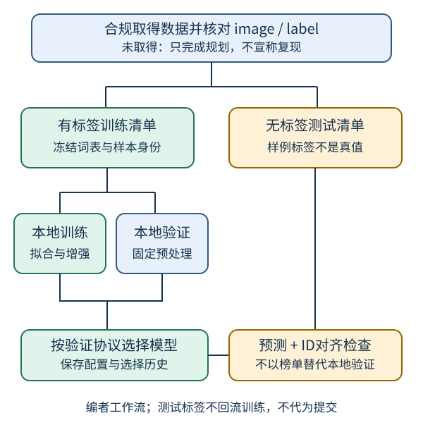

# 树叶分类：先建立可信验证，再规划竞赛

## 1. 学习问题：怎样证明模型学到的是分类规律

一个高分模型至少需要四份彼此一致的合同：**任务身份、样本与标签、训练/验证边界、评估口径**。只把网络跑起来，或看到排行榜上涨，都不足以证明泛化能力。

本讲先为历史竞赛建立学习计划，不代写参赛答案，也不提前交付后续`cv-transfer`实验。可以复习[ResNet导读](#/c/d2l-pytorch-2021/lec/lec29?v=notes)，但网络深度不是本讲的首要问题。

## 2. 核实的是哪一场比赛

课程2021年5月30日课表只写“图片分类”；**第十一周公告明确它是树叶分类，并直接链接Kaggle Classify Leaves**。不是教材CIFAR-10比赛，也不是狗品种识别；不能换成这些数据后声称复现了本课竞赛。

以下来自2026-11-14匿名浏览器实际渲染的官方竞赛页，不来自课堂音视频：

| 项目 | 已核实内容 |
| --- | --- |
| 竞赛 | Classify Leaves；预测树叶所属植物类别 |
| Host | Mu Li；Community Prediction Competition |
| 年份与页面日期 | Start May 28, 2021；Close Jun 26, 2021 |
| 数据规模 | 176类；18,353张训练图、8,800张测试图 |
| 训练类覆盖 | 官方说明每类至少50张训练图 |
| 榜单划分 | 测试集等分为public/private两部分 |
| 官方指标 | Classification Accuracy，越高越好 |
| 数据描述 | `train.csv`、`test.csv`、`sample_submission.csv`、`images/` |
| 字段 | `image`为图像路径；`label`为类别名称 |

日期为页面显示日期，没有核实时区或精确截止时刻。课程6月27日另有总结；日期不同不代表资料冲突。榜单等分只说明官方测试划分，**不意味着本地也必须五五分训练/验证**。

样例提交的标签由官方说明为随机生成；约$1/176$的初始准确率只是随机猜测的量级，不能把这些标签当测试集真值。这里仅阅读了Data页描述，**没有检查真实CSV行数、图像尺寸、损坏情况、重复情况或实际文件内容**。

### 访问边界也是任务合同

匿名页面能读描述，显示`Login`、`Sign Up`和`Late Submission`，不等于当前可以下载或提交。数据页许可仅写`Subject to Competition Rules`；Rules页只显示通用模板文字，未提供可据以确认数据再分发权的详细条款。一次点击`Late Submission`后的即时观察没有可见跳转，不能据此判定功能可用或失效。

本轮没有登录、接受规则、加入比赛、下载数据或提交榜单。将来如需参与，应由学习者在官网按当时要求登录、阅读并接受适用规则；若下载或参赛被限制就停下，不绕过。**登录后的具体下载/加入/迟交条件，以及原始图片的独立授权，仍未核实。**历史比赛的名次、奖品或开放状态不作为本站验收条件。

## 3. 把样本合同写成形状与不变量

设类别数$K=176$、批大小$B$。下列尺寸是编者建模约定，不是已读数据文件的尺寸：

| 对象 | 约定形状或类型 | 必须保持的不变量 |
| --- | --- | --- |
| 输入图像 | $X\in\mathbb R^{B\times3\times H\times W}$ | $H,W$由方案规定；先核实际解码通道 |
| 模型输出 | $Z\in\mathbb R^{B\times K}$ | 每列始终对应同一类别 |
| 整数目标 | $y\in\{0,\ldots,K-1\}^{B}$ | 由固定类别字典映射，不按批次重建 |
| 预测标签 | 长度$B$的类别名称 | `argmax`结果用同一字典反解 |
| 图片身份 | 唯一路径/稳定ID | 划分、预测和导出以ID对齐，不靠目录顺序 |

`train.csv`的字符串类别不是直接传给分类损失的数字；`test.csv`不能被假定具有真值。类别词表是任务模式定义，可以在已获准的有标签训练清单上固定并保存；图像归一化统计、模型选择等数据驱动步骤必须只在划定的训练部分拟合，不能借此读取验证分布。

图为编者自绘工作流。源自官方字段与竞赛任务，验证设计为编者建议；不是课堂投影片。测试真值不可用，不能画出一条虚构的“测试标签回流训练”路径。

## 4. 一个准确率小例：不要平均每批的百分比

对$N$个有标签的本地验证样本，令$z_i$为其logits，预测与准确率为：

$$
\begin{aligned}
\hat y_i&=\arg\max_k z_{ik},\\
\mathrm{Acc}&=\frac{1}{N}\sum_{i=1}^{N}\mathbf 1[\hat y_i=y_i].
\end{aligned}
$$

自拟4类小例：真值为`[0, 1, 2, 3, 1]`，预测为`[0, 2, 2, 3, 0]`，正确3个，准确率为$3/5=60\%$。这不是竞赛样本或实测成绩。

若先处理4个样本，再处理尾批1个，两批分别为$3/4$和$0/1$。直接平均得到$37.5\%$是错的；累计正确数与样本数才得到$60\%$。训练时可用交叉熵作为可导目标，评估时使用准确率；**二者不能互换，较低交叉熵也不保证每次都有更高准确率**。

总体准确率与各类召回率回答不同问题。对少数类失效可能被总体分数掩盖，因此可以额外报告每类样本数、混淆类别和错误图像，但不能把宏平均召回率改称官方指标。

## 5. 自主路线：每一步留下什么证据

1. **合规取得数据后再盘点。** 保存来源、取得日期、适用规则和文件哈希；核对CSV字段、路径存在性、类别数量、重复ID。缺数据时只交规划，不标记“训练完成”。不把图片、凭据或完整预测CSV提交本站。
2. **先冻结验证清单。** 在有标签训练数据内部设计分层划分，保存ID与seed。若发现同一叶片的近重复拍摄、同源分组等，应按可证实的组整体划分，避免跨集合泄漏；这里不宣称官方数据实际含这些问题。小类无法合理拆分时记录限制，不静默删除。
3. **先建立可审计基线。** 自选已学模型；固定预处理、类别映射、初始化和训练预算。先核少量样本的数据流、形状、损失是否有限，再做本地验证。没有真实训练记录，就不宣称模型达到任何分数。
4. **一次回答一个问题。** 例如比较有/无某种训练增强；固定验证集、训练预算和其他设置。增强只用于训练路径，验证使用固定预处理。扩大分辨率或改模型时记录资源变化，不能只报最优一轮。
5. **封存选择依据。** 每次试验记录配置、验证正确数/总数、错误类别、耗时与停止理由。反复按同一验证集调参也会过拟合；必要时保留未参与选模的本地最终评估集，数据少时说明代价。
6. **如获允许再考虑提交。** 导出前只检查列名、行顺序、唯一ID和类别字符串合法性，严格匹配真实样例格式。不要用public榜单不停调模型后把它当独立泛化证据。本文不要求、不代为提交。

无数据时仍可用上节的人工标签检查指标聚合与ID对齐；这种练习只证明逻辑，不是Classify Leaves复现。CPU可做小批数据流与形状检查；完整176类训练所需时间和硬件应按实际配置记录，不能承诺本页未测的吞吐或成绩。

## 6. 常见陷阱

- **路径顺序错位**：文件系统枚举顺序不等于`test.csv`顺序，预测要保留ID。
- **类别字典漂移**：训练与导出分别调用一次无固定顺序的集合，会把正确的列翻译成错误的类别名。
- **泄漏增强样本**：先增强再随机拆分，让同一原图的变体进入两边；应先划分原始身份。
- **验证状态错误**：模型仍处于训练模式，Dropout和BatchNorm使比较失真；评估模式与关闭梯度记录是两件事。
- **把样例标签当答案**：官方已说随机生成，不能用来验真。
- **把比赛许可当书许可**：教材Apache-2.0不涵盖Kaggle图片或B站视频。

## 7. 自测

为什么训练集18,353张不等于“全部可以用于调参后再报告训练准确率”？

训练准确率不提供独立泛化证据。应在官方有标签训练数据内部划出固定本地验证部分，选模只使用事先约定的验证协议；最终报告要说明验证曾被用于多少次选择。官方测试集没有可供本地评估的真值。

两批准确率75%和0%，为什么本例答案不是37.5%？

批大小分别为4和1，应按样本数加权：正确数3，总数5，得到60%。只有批大小相等时，简单平均批准确率才与全体准确率一致。

有176类就一定该把分类层写死为176吗？

竞赛合同是176类，但实现前仍要核真实已取得训练清单与固定类别词表。若观察不一致，应调查获取是否完整、字段解释是否错误，而不是静默训练一个不符合合同的分类器。

看到Late Submission按钮能证明本轮完成了参赛条件核验吗？

不能。只确认匿名页面显示该按钮；没有登录、接受规则、下载或提交。详细访问条件和数据再分发许可仍是缺口，不绕过也不捏造。

## 8. 视频清单、来源与缺口

2026-11-14公开元数据核实：作者“跟李沐学AI”，mid `1567748478`，发布于2021-05-30。只有真实P1 `leaf`，397秒（6:37），**全1P合计6:37**。公开player字幕请求成功但列表为空；未下载或观看音视频，不排除烧录字幕。没有课堂内容、时间轴或问答依据，因此不创建draft，不把本页规划说成教师建议。

- [官方2021课表](https://courses.d2l.ai/zh-v2/)：5月30日“图片分类”入口。
- [官方课程公告](https://courses.d2l.ai/zh-v2/announcements.html)：第十一周竞赛身份及第十六周结束说明，使用项目已存原件。
- Mu Li，[Classify Leaves Overview](https://www.kaggle.com/competitions/classify-leaves/overview)，2021：host、日期、规模、榜单划分、准确率。
- [Data](https://www.kaggle.com/competitions/classify-leaves/data)与[Rules](https://www.kaggle.com/competitions/classify-leaves/rules)：仅阅读匿名渲染描述与规则模板；未读取数据原件。
- [官方视频](https://www.bilibili.com/video/BV1z64y1o7iz/)：只核身份、全部P与时长，不是本页内容来源。

课表无本讲单独教材阅读，不借CIFAR-10/狗品种章节代替树叶竞赛。来源摘要、原始URL、逐文件SHA-256及阅读范围见`sources/p5-lec30/manifest-fragment.json`；本页所有路线、小例与SVG均为自主编写。
