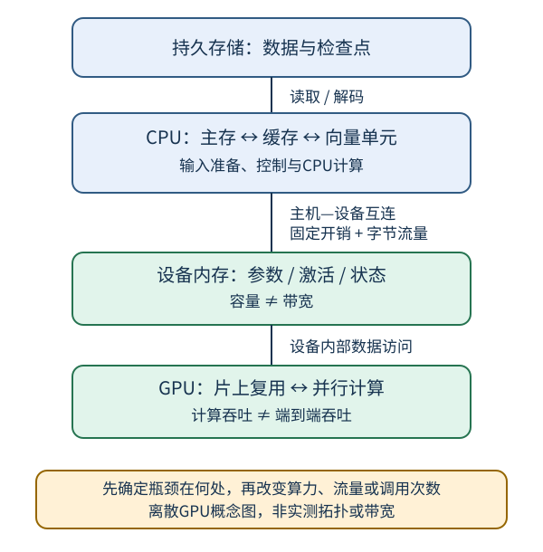

# CPU与GPU：计算快，还要喂得上数据

## 1. 学习问题：为什么更多算力不一定缩短训练时间

一次训练迭代可能依次等待：存储读取、图像解码、主机内存、设备传输、设备内核、梯度同步。增加计算单元，只会加速它真正负责且能并行的部分。**显存容量、显存带宽、主机到设备链路带宽、计算吞吐，是四个不同的量。**

2021年6月5日课表给出硬件阅读链接。本页据固定版本教材12.4解释其机制，不逐段复述视频，不把教材历史硬件型号或价格转换成现在的采购建议。

编者自绘离散GPU示意；并非所有机器都具备这种拓扑。统一内存设备不一定有同样的显式PCIe复制路径，但仍受内存访问、同步与共享资源限制。箭头不是实测带宽，也不表示步骤必然串行或必然重叠。

## 2. CPU、GPU与局部性：比较工作，而不是数“核心”

| 机制 | 解决的问题 | 不能由此推断什么 |
| --- | --- | --- |
| CPU控制流、缓存、向量单元 | 分支、调度与局部数据复用；SIMD批量计算 | CPU只能串行，或不能做矩阵运算 |
| GPU大量并行工作单元 | 对足够多的同类数据执行大量运算 | 一个GPU核心等价一个CPU核心 |
| 寄存器/缓存/片上存储 | 让短期反复使用的数据靠近计算单元 | 所有读取都能命中，或容量无限 |
| 设备内存 | 放权重、激活、梯度和工作区 | 装得下就一定跑得快 |
| 主机—设备互连 | 跨存储域搬运数据 | 带宽等于设备内部显存带宽 |

连续访问常更容易利用缓存行、预取或合并访问；跨步、随机访问可能为少量有效数据搬来更多字节。**局部性减少的是某一层级的流量**，不是数学运算自动减少。CPU和GPU都有并行与层次存储，只是取舍不同；小批、强控制依赖或频繁启动的任务，不一定从GPU获益。

教材关于缓存与历史微架构的数字只作当时例子。尤其不要把文中的Gb/s与GB/s直接混用，或把某代芯片特性当成全部设备规则。下面重新规定单位和模型，避免依赖未核实的历史参数。

## 3. 最小性能模型：算多少、搬多少、启动几次

定义这些**针对同一个操作、同一内存层级**的量：

| 符号 | 含义 | 单位 |
| --- | --- | --- |
| $F$ | 浮点运算数；本页乘加记2次运算 | FLOP |
| $D$ | 在选定边界上读写的字节总数 | byte |
| $P$ | 对该精度/算子的假设计算上限 | FLOP/s |
| $\beta$ | 该边界的假设带宽上限 | byte/s |
| $I=F/D$ | 运算强度 | FLOP/byte |
| $L$ | 一次启动/传输固定开销 | s |

理想下界与吞吐上界为：

$$
\begin{aligned}
T_{\mathrm{compute}}&\ge F/P,\\
T_{\mathrm{memory}}&\ge D/\beta,\\
T&\ge\max(F/P,D/\beta),\\
R&\le\min(P,\beta I).
\end{aligned}
$$

这是编者的简化上界分析：假定可充分重叠计算与访问；忽略启动、依赖、缓存未命中、争用和未饱和资源。**下界不是预测实测时间**。若完全不能重叠，串行模型应相加；多段流水线还要分首批时延与稳态吞吐，不能只写一个`max`就声称实现了流水。

转折运算强度为$I_*=P/\beta$。当$I<I_*$，只增加$P$可能没用；减少流量、复用数据或融合操作才可能改变瓶颈。

### 自拟小例A：逐元素加法

设两个长度为$10^6$的FP32向量相加，输出一个新向量。假设每个输入从所讨论内存读取一次，结果写一次，不计缓存写分配及额外临时副本：

$$
\begin{aligned}
F&=10^6,\\
D&=3\times4\times10^6\ \mathrm{byte},\\
I&=1/12\ \mathrm{FLOP/byte}.
\end{aligned}
$$

再**假设**$P=10^{12}$ FLOP/s、$\beta=100\times10^9$ byte/s，可得计算下界1微秒、内存下界120微秒。即使计算峰值翻倍，内存下界仍是120微秒。这里的100 GB/s为十进制假设，不是本机带宽。

### 自拟小例B：矩阵乘法为何值得分块

设$A\in\mathbb R^{m\times k}$、$B\in\mathbb R^{k\times n}$，$C=AB$。忽略低阶项，约需$F=2mkn$ FLOP。若理想地每个FP32输入只从选定内存边界读取一次、输出只写一次：

$$
\begin{aligned}
D_{\min}&=4(mk+kn+mn),\\
I_{\mathrm{ideal}}&=\frac{2mkn}{D_{\min}}.
\end{aligned}
$$

这是假设足够复用的**最小流量**，不是任意实现都能达到。方阵边长$s$时$I_{\mathrm{ideal}}=s/6$；$s=600$时为100 FLOP/byte，比逐元素加法高得多。矩阵分块让同一小块在更近的存储层反复使用，实际流量取决于块尺寸、容量、布局和算法；不能拿该理想值保证某台GPU满速。

## 4. 搬运的固定成本：量大次少，但不要无限扩大批次

把总计$S$字节分为$q$次串行传输，简化模型为：

$$
T_{\mathrm{transfer}}\approx qL+S/\beta.
$$

自拟假设：$S=12$ MB、链路$\beta=12$ GB/s，每次$L=10$微秒，均为十进制单位、单向且不重叠。

| 传输策略 | 数据项 | 固定开销项 | 模型合计 |
| --- | --- | --- | --- |
| 一次12 MB | 1 ms | 0.01 ms | 1.01 ms |
| 1000次，每次12 kB | 1 ms | 10 ms | 11 ms |

数据没变，只改变调用次数就可能改变时间。可考虑批量传输、把中间张量留在设备上、避免循环里反复取回标量，但需核实语义和内存预算。无限扩大batch也不对：它可能超显存、增大响应时延，且改变优化动态。吞吐高不等于单请求时延低。

## 5. 容量账本不是参数文件大小

训练时至少区分：参数、梯度、优化器状态、为反向保留的激活、临时工作区、框架与分配器开销。推理仍有激活和工作区，但不必保留整条反向计算图；并不是“推理只占权重大小”。

自拟账本：一百万个FP32参数，参数为4 MB。若每个参数另有FP32梯度、两个FP32优化器状态张量，四项合计16 MB；**不含激活、工作区、额外主权重、实现临时量**。这不是任意Adam实现的显存峰值，也不是训练所需容量的完整上界。

混合精度可能减少部分张量流量，但不能简单把所有字节除以二；累加、主权重或某些状态可能仍为FP32。dtype变化也要重新核对数值稳定性与任务质量。

## 6. 如何把纸面估算变成可信实验

到[训练性能实验](#/c/d2l-pytorch-2021/lab/training-performance?v=zh)时，先明确测量对象：只测内核，还是包含加载/搬运/反向/更新的端到端迭代？

- 保存设备型号、框架版本、dtype、形状、batch、线程数、模式和热身策略。
- 异步设备必须在计时边界等待相应工作完成，否则测到的可能只是提交开销；同步方法按实际后端选择。
- 多次重复，说明统计量和异常值处理；首次编译/初始化单独报告。
- 同时保留正确性与误差标准；更快的错误结果不算优化。
- CPU执行只能支持该CPU配置结论；CPU上模拟张量切分不能证明GPU通信或吞吐。本批不执行MPS，不虚构CUDA测量。

不要在`eval()`与训练模式之间偷换工作负载，不要去掉数据加载后仍称“端到端训练加速”。本页没有性能代码或实测数字。

## 7. 自测

显存48 GB，带宽比24 GB设备低，哪台一定更快？

不能判定。先看工作负载能否装入；都装得下再看计算、内存流量、互连、精度支持及实际内核。容量和带宽不能互相替代，采购还需预算与软件兼容等证据。

小例A里计算峰值翻倍，时间会减半吗？

模型中的计算下界从1微秒变为0.5微秒，但内存下界仍为120微秒，因而最大值不变。实际时间还可能更大；没有实测不报加速比。

为什么矩阵乘法的理想字节数不是每次乘法都读两个新数？

同一个输入元素参与多个输出，若分块和局部存储使其被复用，就不必每次从选定的远层级重读。最小流量假设只是一条理想界，容量不足或布局不佳会增加实际流量。

12 GB/s与12 Gbit/s能直接代入同一个字节公式吗？

不能。8 bit等于1 byte；12 Gbit/s在不计协议开销时相当于1.5 GB/s。还要区分十进制GB与二进制GiB、单向与双向合计。

## 8. 视频清单与来源边界

元数据核实作者“跟李沐学AI”，mid `1567748478`，2021-06-05发布。下表仅为平台分P清单，不是讲授时间轴；两P都保留。

| P | 平台标题 | 秒数 | 本P时长 |
| --- | --- | --- | --- |
| 1 | CPU 和 GPU | 2362 | 39:22 |
| 2 | QA | 3167 | 52:47 |
| 合计 | 全2P | 5529 | 1:32:09 |

各P仅一次公开player字幕检查，均成功空列表；没有下载或观看媒体，不代表不存在烧录字幕。不能由QA标题推断问答内容，不猜主题时间范围；中文原课通过页头观看，本课不另作课堂逐段整理。

- [2021官方课表](https://courses.d2l.ai/zh-v2/)：6月5日硬件：CPU和GPU，对应硬件阅读。
- [中文第二版12.4硬件](https://zh.d2l.ai/chapter_computational-performance/hardware.html)：实际读取的是[固定源码](https://github.com/d2l-ai/d2l-zh/blob/e6b18ccea71451a55fcd861d7b96fddf2587b09a/chapter_computational-performance/hardware.md)全文（217行）；在线构建不保证精确同版。重点为计算机、内存、CPU、GPU、网络和总线及小结。教材内所链论文、厂商资料和历史延迟表的原始外链未逐个阅读，不冒称已独立验证其性能。
- [官方视频](https://www.bilibili.com/video/BV1TU4y1j7Wd/)：只核元数据，不作为算例来源。

上界模型、容量账本、单位例子与SVG为编者自拟。教材根LICENSE为Apache-2.0，setup包MIT-0字段另记，不外推视频或第三方图；本页不复制教材插图。原件、SHA-256及阅读范围见`sources/p5-lec31/manifest-fragment.json`。
