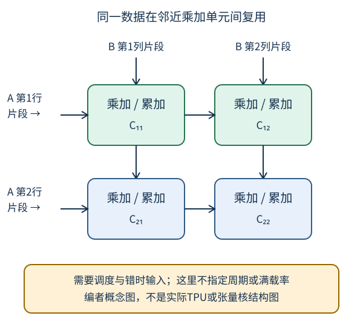

# 专有硬件：把有限资源押在哪一种计算上

## 1. 学习问题：专用乘法器更多，为什么端到端未必更快

专有硬件用面积、存储、互连和可编程性的取舍，换取某些操作的效率。问题不是“哪一种芯片总是最好”，而是：**目标算子是否覆盖、形状是否合适、数据能否及时到达、精度是否满足质量、系统其余部分能否跟上**。

本讲课表标题为“更多的专有硬件”，视频上传标题含“TPU和其他”；但课表没有单独教材阅读链接。下文的12.4“GPU和其他加速卡”关联及例子均为**编者选择**，不能据此宣称课堂讲过某种芯片、采购建议、问答或性能数值。先读[CPU与GPU](#/c/d2l-pytorch-2021/lec/lec31?v=notes)中的计算/流量模型。

## 2. 从标量到矩阵：专用电路固定了什么

设$A$形状为$(m,k)$，$B$为$(k,n)$，输出$C$为$(m,n)$。矩阵乘法的一个输出是：

$$
C_{ij}=\sum_{r=1}^{k}A_{ir}B_{rj}.
$$

数学不变，执行方式可以不同：

- **标量循环**：逐项读入、乘、加，执行更多控制与寻址工作。
- **向量化**：一条指令处理多个相同类型的元素，减少逐项控制成本；仍需连续或可高效访问的数据布局。
- **矩阵专用单元**：为一小块矩阵的乘加设计数据通路，减少重复取数与调度。输入形状、精度、布局和累加方式必须被支持。
- **脉动式数据流**：让操作数按节拍在相邻计算单元间传递，局部累加，避免每一次乘加都从远端存储取同一数据。填充、排空、分块和边界处理仍有成本。

教材把TPU的脉动阵列与GPU张量核作为矩阵专用计算的例子。这只能支持机制层面的比较；不能把第一代TPU的描述外推为所有TPU代际规格，也不能把某代张量核块尺寸当作所有设备接口。

编者自绘二维乘加阵列：$A$的片段向右、$B$的片段向下，单元累加对应输出。图不是任何商用芯片的实际布局；输入需要调度和错时对齐，图中不指定周期或声称每个周期都满载。

### 一个不依赖硬件的2×2小例

令$A$的两行为`[1, 2]`、`[3, 4]`，$B$的两行为`[5, 6]`、`[7, 8]`。那么$C$两行是`[19, 22]`、`[43, 50]`。

例如$C_{11}=1\times5+2\times7=19$。同一个$A_{11}=1$也参与计算$C_{12}$，同一个$B_{11}=5$也参与$C_{21}$。这解释了局部复用为何有价值；结果正确只能证明矩阵乘加逻辑，**不能证明阵列时序、专有指令执行或性能**。

## 3. “峰值”之前先看利用率与覆盖率

### 形状与块利用率

自拟理想硬件一次处理一个$16\times16$输出块，归约轴$k$固定且其余条件完全理想。若输出只有$17\times17$，简单补齐到$32\times32$会占用四块：

$$
\begin{aligned}
N_{\mathrm{useful}}&=17\times17=289,\\
N_{\mathrm{slots}}&=32\times32=1024,\\
u&=289/1024\approx28.2\%.
\end{aligned}
$$

这只是**输出槽位的几何利用率**，忽略$k$轴、指令调度与内存。真实内核可能掩码、拆分或换算法，不能据此宣布某设备对17×17矩阵只有28.2%峰值，更不能据此给出实测加速比。

小batch、动态形状、不规则稀疏或控制流会让专用单元利用率不足。稀疏并不自动加速：只有零值布局、表示、索引成本和实际内核支持都匹配，才可能减少真实计算/流量；把稠密张量乘以很多零并未自动跳过这些操作。

### 只加速一部分的上限

假设原任务总耗时归一为1，可加速部分占比$f$，在新硬件上加速$a$倍，其余保持不变，且**没有额外搬运/回退开销**：

$$
\begin{aligned}
T_{\mathrm{new}}&=(1-f)+f/a,\\
S&=1/T_{\mathrm{new}}.
\end{aligned}
$$

编者例：$f=0.8,a=10$，得到$T_{\mathrm{new}}=0.28$，$S\approx3.57$，不是10倍。即使可加速部分无限快，总体上限仍是5倍。若不支持的算子回退CPU并造成额外同步/搬运，新时间可能更长。这是带假设的算式，不是任何TPU/GPU测评。

## 4. 精度是质量合同，不只是“位数越小越快”

降低表示位数可能减少存储/流量，让同样面积容纳更多运算单元，但要同时检查三个不同的精度：**输入、乘法结果处理、累加/输出**。产品峰值必须与具体精度、稀疏条件和算子一起读；不同口径的TOPS不能直接排名。

| 使用阶段 | 需要考虑的状态 | 质量风险 |
| --- | --- | --- |
| 推理 | 权重、前向激活、临时工作区 | 量化误差、异常范围、类别决策改变 |
| 训练 | 还包括梯度、反向所需信息、优化器状态 | 小梯度下溢、累加误差、溢出与优化不稳定 |
| 混合精度 | 不同张量/算子可用不同dtype | 不能假设所有状态减半；需要对应后端支持 |

推理不保留整条反向图，不代表中间激活不存在；训练也不必机械保存每个中间量，重计算等策略可交换时间与空间。教材中的低精度经验不是“INT8对所有推理都足够”或“FP16对所有训练都安全”的定理。

### 对称量化的纸面小例

仅为说明误差，设正尺度$s$，整数范围$[-127,127]$，先四舍五入再截断：

$$
\begin{aligned}
q&=\operatorname{clip}(\operatorname{round}(x/s),-127,127),\\
\tilde x&=s q.
\end{aligned}
$$

无截断且按最近整数舍入时，绝对误差不超过$s/2$。设$s=0.1$，$x=0.26$会映射为$q=3$、反量化为0.3，误差0.04；若$x=20$则被截为127，反量化12.7，误差7.3，已不满足无截断的误差界。

这里没有零点、逐通道尺度或实际量化API，也不是训练方案。校准数据与验证集的边界仍要保持，不能拿测试真值调尺度。纸面量化可展示截断风险，却不证明硬件INT8算子可用或精度合格。

## 5. 硬件取舍表：先写需求，再核产品

| 决策维度 | 应该提出的问题 | 常见误判 |
| --- | --- | --- |
| 工作负载 | 训练还是推理？密集矩阵、卷积还是不规则操作？ | 只比较宣传峰值 |
| 内存容量/带宽 | 全部状态和峰值工作区装得下吗？在哪层搬字节？ | 把显存容量当吞吐 |
| 算子/编译栈 | 当前框架、dtype、动态形状是否支持？有无回退？ | 支持模型名称就等于所有算子原生执行 |
| 时延/吞吐 | 单请求SLA还是批量训练？编译和冷启动是否计入？ | 批量高吞吐等于交互响应快 |
| 扩展与互连 | 多设备要搬多少激活、梯度或参数？ | 单芯片峰值线性相加 |
| 资源成本 | 可用性、维护、迁移、功耗和总预算如何记录？ | 用历史标价给现在采购结论 |

这些维度足以规划后续调研，不构成任何型号推荐。本文未读取具体产品新规格、价格或论文实验，故不列未经核实的历史采购表，也不编造TPU、FPGA或ASIC各代性能清单。

## 6. 从纸面走向实验的最小证据

先在CPU检查2×2乘法、量化的无截断/截断两种误差，以及时间占比公式；它们只验证数学。真正比较设备时，应使用相同任务、数据处理、精度/质量目标和预算，分别记录编译/热身、原生算子与回退、搬运/同步、峰值内存和端到端统计。

一个“更快但准确率下降”的方案可能仍有用途，但必须公开质量—资源取舍，不能假装相同任务。一个只测矩阵内核的结果不能标成完整训练提速。继续学习[多GPU训练](#/c/d2l-pytorch-2021/lec/lec33?v=notes)时，这些限制会扩展到通信和同步；CPU分片推演仍不是GPU多卡实测。

## 7. 自测

模型80%的时间可加速10倍，为什么整体只约3.57倍？

剩余20%没有加速，新时间为0.2+0.8/10=0.28。原时间除以新时间得到约3.57。算式还忽略了迁移和回退开销，因此不能直接当产品测量。

本页17×17例子的28.2%是什么，不是什么？

它是简单补齐到32×32时的输出槽位利用率，不是算术单元利用率、端到端时间占比或GPU实测吞吐；真实库可能采用更好的边界策略。

为什么量化误差不总在尺度的一半以内？

该界要求没有发生截断并采用最近整数舍入。超出表示范围时，截断误差可能任意大；例中的20只能重建为12.7。

为什么“硬件支持INT8”不足以保证模型加速？

还需算子、布局、形状、后端路径与校准质量支持。量化/反量化、回退、搬运或未被加速的部分可能抵消收益，需要端到端且质量可比的实测。

## 8. 视频清单、阅读来源与缺口

公开元数据核实作者“跟李沐学AI”，mid `1567748478`，2021-06-06发布。平台上传标题为“32 深度学习硬件：TPU和其他【动手学深度学习v2】”。

| P | 平台标题 | 秒数 | 本P时长 |
| --- | --- | --- | --- |
| 1 | 更多的芯片 | 1759 | 29:19 |
| 2 | QA | 2238 | 37:18 |
| 合计 | 全2P | 3997 | 1:06:37 |

两P均只检查一次公开player字幕，成功空列表。没有下载或观看音视频，不排除烧录字幕；中文原课通过页头观看，本课不另作课堂逐段整理；不推断课堂问答、不猜主题时间范围。

- [2021官方课表](https://courses.d2l.ai/zh-v2/)：6月6日“更多的专有硬件”，**无单独教材链接**。
- [中文第二版12.4硬件](https://zh.d2l.ai/chapter_computational-performance/hardware.html)为**编者关联阅读**；实际读取[固定源码](https://github.com/d2l-ai/d2l-zh/blob/e6b18ccea71451a55fcd861d7b96fddf2587b09a/chapter_computational-performance/hardware.md)全文217行，重点第103–136行及小结。不是2021全书快照。书内TPU/脉动阵列论文仅见引用，未独立读论文，不冒称核验论文实验或商用代际规格。
- [官方视频](https://www.bilibili.com/video/BV1VV41147PC/)：身份、真实P与时长证据，不是本页课堂内容证据。

矩阵复用示意、槽位利用率、占比加速与量化例均为编者补充。教材根Apache-2.0与setup包MIT-0字段分开，均不外推视频/第三方图；本页不复制教材插图。逐文件哈希、原始URL与阅读范围见`sources/p5-lec32/manifest-fragment.json`。
