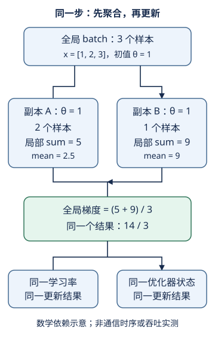

# 多GPU原理：分的是样本，合的是同一目标的梯度

## 1. 学习问题：两份模型怎么仍是一次更新

把同一批样本拆到两张卡，各算一个梯度，再更新模型，为什么可能与单卡算整批相同？反过来，为什么“两个局部平均再平均”有时是错的？本讲先钉住数学合同，不以设备数量代替正确性。

阅读前应会分辨[梯度与参数](#/c/d2l-pytorch-2021/lec/lec07?v=notes)、[设备与张量](#/c/d2l-pytorch-2021/lec/lec17?v=notes)。下一讲再看[框架负责了什么](#/c/d2l-pytorch-2021/lec/lec34?v=notes)。

教材12.5比较三种拆分：

- **按层拆模型**：不同设备负责不同层，层间传激活，反向传相应梯度。
- **层内拆计算**：例如拆输出通道；通常需要更细的跨设备协作。
- **数据并行**：每个设备持有完整模型，处理不同样本，聚合参数梯度。

本页只推演第三种。普通数据并行减少每卡的样本/激活负担，却不自动把完整参数与优化器状态切成几份。因此“总显存变大”不等于“任何大模型都能放下”。教材对模型并行的时代性取舍不是所有现代模型的普遍禁令。

## 2. 先写形状与分片不变量

设全局批量有$B$个样本，$k$个工作设备，参数向量有$P$个元素。设备$r$得到索引集合$S_r$，样本数$n_r$。

$$
B=\sum_{r=1}^{k}n_r.
$$

| 对象 | 形状/含义 |
| --- | --- |
| 输入$X$ | $(B,C,H,W)$，图像分类例 |
| 标签$y$ | $(B,)$，与输入按同一索引切分 |
| 局部输入$X_r$ | $(n_r,C,H,W)$ |
| 局部参数$\theta_r$ | $(P,)$；每卡完整副本 |
| 局部梯度 | $(P,)$，不是$(n_r,P)$的逐样本梯度表 |

合同是：分片不重不漏、样本和标签对应、所有$n_r>0$、每个副本从相同的$\theta$开始。尾批不整除时，必须按**本次实际样本数**计算，不能还除以配置中的满批大小。空分片不应算`mean()`；如何让真实多进程各方以兼容顺序参加通信是另一个系统问题。

自绘概念图，依据教材12.5的数据并行流程；箭头表示依赖，不代表实测时间或通信带宽。

## 3. sum与mean：只允许归一化一次

令$\ell_i(\theta)$为单样本损失。这里假定每个样本等权、目标按样本平均，不含跨样本耦合操作。

$$
\begin{aligned}
L(\theta)&=\frac1B\sum_{i=1}^{B}\ell_i(\theta),\\
s_r&=\sum_{i\in S_r}\nabla\ell_i(\theta),\\
g&=\nabla L=\frac1B\sum_{r=1}^{k}s_r.
\end{aligned}
$$

这就是教材从零实现的口径：`CrossEntropyLoss(reduction='none')`得到逐样本损失，在各分片上`.sum()`反向；`allreduce`求和并把结果送回每卡；更新时使用全局`X.shape[0]`归一化。**这里的allreduce是求和，不是自动取平均。**教材通过先集中到一张卡再分发来演示语义，不代表高性能库的环或树实现。

如果本地已经取平均，记$\bar g_r=s_r/n_r$，则应按样本数加权：

$$
\begin{aligned}
w_r&=\frac{n_r}{B},\\
g&=\sum_{r=1}^{k}w_r\bar g_r.
\end{aligned}
$$

只有$n_r$相等时，才可写成$\frac1k\sum_r\bar g_r$。带类别权重、掩码或变长序列的损失，分母还可能是有效权重或有效token数；不要把这里的$n_r$公式机械套到所有`mean`上。

### 一个刻意不等长的小例

这是编者手算，不是GPU输出。取标量模型$f_\theta(x)=\theta x$、$y=0$，单样本损失为$\frac12(\theta x)^2$。在$\theta=1$时，样本$x=1,2,3$对应梯度$1,4,9$。分片为$[1,2]$与$[3]$。

| 计算路径 | 聚合梯度 |
| --- | --- |
| 全批平均 | $14/3$ |
| 局部sum相加，再除3 | $(5+9)/3=14/3$ |
| 局部mean按$2/3,1/3$加权 | $14/3$ |
| 错误：两个局部mean等权平均 | $(2.5+9)/2=5.75$ |

同一学习率下，最后一行不是“精度误差”，而是优化了另一种样本权重。设学习率$0.1$，正确SGD一步后$\theta'=8/15$；错误平均得到$0.425$。

## 4. 一步等价需要哪些前提

将单卡全批作为对照，分片聚合只有在以下条件下才应得到数学上相同的一步更新：

1. **同一参数起点**：不是每张卡各自重新随机初始化。
2. **同一数据集合与损失**：全批和分片不改变样本、标签、权重、增强或分母。
3. **可按样本相加**：训练态BatchNorm使用局部统计时，前向本身已经改变；对比学习等跨样本目标也不能直接按本页证明。
4. **相同随机实现或可控随机性**：Dropout等随机操作的具体掩码若不同，不能要求逐元素相同。
5. **先聚合再更新**：各卡不能用各自局部梯度先走一步，再把参数平均冒充同一算法。
6. **相同更新规则和状态**：学习率、权重衰减、动量/Adam状态、步数一致；梯度裁剪等非线性变换的顺序一致。
7. **清楚浮点容差**：求和次序变化会带来舍入差异，不能由实数的交换律推断位级一致。

即使起点和梯度相同，两个Adam副本若历史状态不同，下一步参数也可能不同。也不要把“增卡并把全局batch翻倍”叫作相同目标的一步等价：本次参与更新的数据和每轮更新次数已经变了。

### 正则项的重复计数

若目标为$L_{data}+\lambda R(\theta)$，需要的是数据平均梯度加**一次**$\lambda\nabla R$。使用sum再全局归一化时，不能让每个worker无解释地添加完整正则项，最后又除以$B$。先写最终目标，再决定本地系数；不要凭“库应该会处理”猜。

## 5. 同步不等于所有操作都串行

同一参数块的更新必须等到该步的聚合梯度可用。不同参数块的反向就绪时间不同，因此系统可在后面的反向仍进行时通信已经就绪的梯度。所谓同步数据并行，是共同完成逻辑训练步的约束，不是要求每个算子都全局停下来。

但计算与通信能否重叠、尾部等待有多长，取决于图依赖、桶划分、设备和互连；CPU列表上的加法无法测量这些成本。小模型的计算可能很快，复制、调度和通信开销反而占主导。教材小LeNet示例未出现有意义加速的叙述，不能当作本站硬件实测。

## 6. CPU局部验证路线，不是多卡答案

在[计算性能与多设备训练实验](#/c/d2l-pytorch-2021/lab/training-performance)中，只需先构造小张量完成以下局部证据：

- 保留一份全批参考，用相同初值构造**独立存储**的两个副本；CPU上的两个名称不能代表两张卡。
- 用上面$2+1$分片，比较全批平均梯度、局部sum路径和样本加权mean路径。
- 比较同一SGD一步后的参数，再保留“mean再等权mean”的失败反例。
- 用样本ID确认拼回后无重复、无漏样、标签一一对应。

这证明的是分片与聚合的数学，不验证`scatter`、NCCL、跨卡复制、流同步、吞吐或加速比。本页不提供完整多GPU训练器。

## 7. 自测

四张卡各算局部sum，allreduce后要除以4吗？

若目标是本次全部样本的平均损失，应除以实际全局样本数$B$。除以4只是在平均四个“样本和”，一般不是样本平均。若库已经对梯度做了worker平均，还要重新推导系数，不能再照搬教材sum路径。

两卡梯度一样，为什么更新后的参数仍不一样？

检查初值、优化器历史状态、学习率、正则化、梯度裁剪和更新次数。相同梯度只是必要条件之一；检查的是整条状态转移，不只看梯度张量。

把batch扩大到两倍并把学习率翻倍，是数学保证吗？

不是。它是需要验证的扩展策略；数据噪声、优化器、训练预算和收敛都可能改变。固定全局batch的一步等价证明不能证明扩大batch后的训练质量。

## 8. 官方入口、阅读来源与缺口

[2021官方课表](https://courses.d2l.ai/zh-v2/)的6月6日“多GPU训练”对应本BV与教材12.5。B站元数据核实作者为**跟李沐学AI，mid 1567748478**，发布日期2021-06-06。

| 官方分P标题 | 时长 | 秒数 |
| --- | --- | --- |
| P1 单机多卡并行 | 6:59 | 419 |
| P2 QA | 3:56 | 236 |
| **全2P合计** | **10:55** | **655** |

每P仅做一次公开player字幕检查，均`code=0`且字幕列表为空。未下载或观看音视频，不猜QA内容、不生成draft或主题时间轴。分P标题与长度仅是平台元数据，不能证明本笔记某节在视频何时讲过，也不能证明不存在烧录字幕。

实际读取：[固定提交12.5原件](https://github.com/d2l-ai/d2l-zh/blob/e6b18ccea71451a55fcd861d7b96fddf2587b09a/chapter_computational-performance/multiple-gpus.md)，全文正文、PyTorch实现与练习；重点为“数据并行性”“数据同步”“数据分发”“训练”。它是当前中文第二版固定源码，不是2021全书快照。本文的不等batch算例、一步等价条件与练习路线是编者说明，不冒称课堂内容；不重复制作教材materials。

教材根LICENSE为Apache-2.0，不外推视频与第三方图片。本页SVG自绘，未复制教材图片；来源原件、阅读范围与逐文件sha256保存在`sources/p5-lec33/manifest-fragment.json`。多GPU通信、训练与吞吐均未执行。
