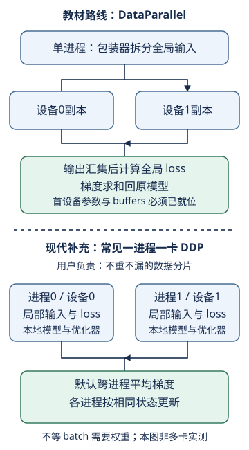

# 多GPU实现：DataParallel替你做了什么，DDP又没替你做什么

## 1. 学习问题：少写通信代码，能否少写正确性合同

不能。高级API接管了模型复制、梯度归约等机制，但损失分母、样本划分、模式、设备和优化器状态仍由训练程序负责。

先读[LEC33的sum/mean与不等batch](#/c/d2l-pytorch-2021/lec/lec33?v=notes)。本页把两条路线分开：**固定教材12.6使用`nn.DataParallel`；现代DDP的说明来自实际读取的PyTorch v2.5.1官方资料，不是对2021课堂的复述。**

## 2. 教材网络：小图像版本ResNet-18

教材把[ResNet](#/c/d2l-pytorch-2021/lec/lec29?v=notes)的入口改为`3×3, stride=1, padding=1`卷积，删除入口最大池化；四个残差stage仍各有2块，通道为64、128、256、512，后接自适应全局平均池化与分类层。

以单通道28×28输入为形状推演：

| 位置 | 单卡局部形状 |
| --- | --- |
| 输入 | $(n_r,1,28,28)$ |
| 入口与stage1 | $(n_r,64,28,28)$ |
| stage2 | $(n_r,128,14,14)$ |
| stage3 | $(n_r,256,7,7)$ |
| stage4 | $(n_r,512,4,4)$ |
| 全局池化、展平 | $(n_r,512)$ |
| 十类logits | $(n_r,10)$ |

这不是原ImageNet输入配置，也不是靠删通道得到的任意“小ResNet”。本页不重抄整套模型或完整多卡训练循环。

## 3. DataParallel的单进程合同

根据v2.5.1的`DataParallel`文档字符串与`forward`实现：

1. 输入张量默认沿`dim=0`拆分；通常这就是batch维。
2. 每次前向把module复制到参与设备，每个副本处理一份输入。
3. 输出收集到`output_device`，默认第一张卡。
4. 反向时，各副本对原module参数的梯度贡献被**求和**。
5. 优化器更新原module；不要再手动把这些梯度额外allreduce一次。

自绘职责图，依据教材12.6和PyTorch v2.5.1 API合同。上下两条是替代路线，不是要串联执行的两个阶段。

### 放置模型不是放置输入的副作用

官方要求：调用多设备`DataParallel`前，原module的**参数和buffers**都在`device_ids[0]`。单把`X`和`y`送到第一张卡，不会自动满足这个条件。

教材固定源码的训练函数包装`nn.DataParallel(net, device_ids=devices)`，未在这里显式把原module移到首卡。其单GPU分支可能触发包装器的单设备搬移，但这不应成为“先跑一轮单卡才能多卡”的隐含前提。现代代码应在包装前明确设备放置；这是依据v2.5.1源码的编者适配提醒，**不是本站已复现的报错**。

### 全局loss与局部loss不是同一个接口

教材在收集后的`net(X)`上计算`CrossEntropyLoss()`：logits为$(B,10)$，标签为$(B,)$，按本次全局样本取mean。反向求和汇集的是已经带$1/B$系数的贡献，所以不应再除以设备数。

若把损失计算移入每个副本的`forward`并返回标量，DataParallel会收集成每设备一个值的向量，而非自动替你求全局平均。局部batch为$3$和$1$、局部平均loss为$2$和$8$时：

$$
L=\frac{3\times2+1\times8}{4}=3.5.
$$

直接对两个标量再mean会得到5。loss日志如此，梯度缩放也必须遵循同一权重合同。

## 4. BatchNorm、状态与评估：复制不等于全局共享

教材网络含BatchNorm。多卡前向的局部batch统计通常不同于单卡全批统计，所以即使样本和初始参数完全一致，也不能套用“可分解损失的一步等价”结论。

DataParallel的官方限制尤其重要：

- 每次前向的副本会被销毁；普通Python计数器等前向更新不能当作可靠持久状态。
- 首设备副本与原module的参数/buffer共享存储，因此其原地buffer更新可留下来；其他副本的局部BN统计不会自动合成全局统计。
- hook在各设备分别触发，不能假设所有设备的全局执行顺序。
- `train()`和`eval()`改变模型行为；禁用梯度与切换评估模式仍是两件事。

评估指标按总正确数除总样本数；不同大小分片的准确率不能直接平均。尾批为1不意味着可以忽略它。多进程评估还要确认采样器是否为了对齐长度补了重复样本；本页不声称已检查任何真实数据分布。

## 5. 现代DDP边界：明确是编者补充

PyTorch v2.5.1官方建议，即使单机多卡也优先考虑`DistributedDataParallel`。这不把教材中的DataParallel变成DDP，也不意味着本机无CUDA就已验证DDP性能。

| 责任 | DataParallel | 常见一进程一卡DDP |
| --- | --- | --- |
| 进程模型 | 单进程，多设备副本 | 多进程，每进程本地模型 |
| 输入分片 | 包装器沿指定维切分 | **用户负责**采样与数据分配 |
| 输出 | 通常收集到首卡 | 通常各进程保留局部输出 |
| 梯度 | 副本贡献求和回原模型 | 默认跨进程平均梯度 |
| 参数更新 | 原模型优化器一步 | 各进程以相同状态各走一步 |

DDP要求先初始化进程组。官方文档还要求各进程模型参数注册顺序一致，构造/前向/反向包含同步点；各进程若执行不兼容分支，可能等待而不能完成。它不是“把类名换一下”就自动分数据的包装器。

DDP在初始化时同步模型状态；正常迭代中归约梯度，而不是每一步广播全部参数来修复不同优化器。默认`broadcast_buffers=True`会在前向开始同步buffers，但**广播rank0的BN运行统计不是把当前各卡batch合并后计算BN统计**。

### 默认梯度平均与不等batch

以下只讨论固定$k$个参与进程、每步都参与、无自定义通信hook、无join改变除数的默认梯度平均。若各进程本地loss已为均值，DDP的结果为：

$$
g_{DDP}=\frac1k\sum_{r=1}^{k}\bar g_r.
$$

当$n_r$不等时，这不是全局样本平均。为得到同一目标，可在本地对均值loss使用系数：

$$
\begin{aligned}
B&=\sum_{r=1}^{k}n_r,\\
a_r&=\frac{k n_r}{B},\\
L'_r&=a_r L_r.
\end{aligned}
$$

于是默认worker平均后，权重是$n_r/B$。这是数学推导，**不是完整DDP实现**：真实程序还要让每个进程知道同一步的$B$，管理采样、尾批和通信顺序。若本地使用sum，则相应系数为$k/B$，不能沿用mean的$n_r$系数。

把LEC33的$2+1$样本例代入：两个局部mean梯度为2.5、9；默认等权平均得到5.75，正确样本加权结果是$14/3$。当两个本地batch等大时系数$a_r=1$，无需这种额外加权。

## 6. 为什么不能把教材打印值当作性能证据

教材对比单卡batch256/lr0.1和双卡batch512/lr0.2，同时改变了设备数、全局batch和学习率。这更接近固定每卡工作量的扩展情境，**不是固定全局batch的纯硬件加速比**。

若真实做性能测试，先写清：训练还是推理、全局/局部batch、精度、输入形状、设备及库版本、热身、计时起止和必要同步。异步工作提交结束不等于所有GPU完成。应报告完成时间的统计与样本吞吐，另看相同训练预算下的质量，不从一次计时猜瓶颈。

本页不运行多卡，不提供伪吞吐。CPU能做的局部检查是：拼接logits后全局mean，与各分片损失按样本数加权的值/梯度相同；再展示错误等权平均。这个证据不能证明DataParallel或DDP真实通信成功。

## 7. 自测

为什么DataParallel反向“求和”不一定把梯度放大k倍？

若全局loss已按全部$B$个样本mean，每个副本的梯度贡献已经带$1/B$。求和只是补全所有样本。只有把局部mean错误求和、又没有相应系数时，才会改变规模。

DDP会自动使各进程读到互不相交的数据吗？

不会。官方明确把输入分片留给用户，例如用分布式采样器。还要区分一轮数据是否重复补齐、是否丢弃尾部，以及每步所有进程是否按相容顺序参加通信。

参数和梯度都相同，能否忽略优化器与BN状态？

不能。动量/Adam历史状态影响更新；BN buffers影响评估预测。复制参数、同步梯度、同步buffer与同步优化器状态不是一个概念。

## 8. 官方入口、阅读来源与未完成边界

[官方2021课表](https://courses.d2l.ai/zh-v2/)6月19日“多GPU训练的实现”指向本BV和教材12.6。平台作者核实为**跟李沐学AI，mid 1567748478**，发布日期2021-06-19。

| 官方分P标题 | 时长 | 秒数 |
| --- | --- | --- |
| P1 从零开始 | 21:41 | 1301 |
| P2 简洁实现 | 11:53 | 713 |
| P3 QA | 20:40 | 1240 |
| **全3P合计** | **54:14** | **3254** |

P1标题确实是“从零开始”；课表阅读链接为12.6，这两种证据不能互相覆盖。未看视频，不能声称12.6完整解释了P1或QA。每P一次公开字幕检查均成功空列表；不生成draft、片段时间轴，不下载媒体。

实际读取来源：

1. [固定教材12.6原件](https://github.com/d2l-ai/d2l-zh/blob/e6b18ccea71451a55fcd861d7b96fddf2587b09a/chapter_computational-performance/multiple-gpus-concise.md)：全文正文与PyTorch模型、初始化、训练、对比及练习；当前中文第二版固定源码，非2021全书快照。
2. [PyTorch v2.5.1 DataParallel官方源码与API文档字符串](https://github.com/pytorch/pytorch/blob/v2.5.1/torch/nn/parallel/data_parallel.py#L1-L220)：读取1–220行，关注复制、首设备、输出与梯度约定。
3. [PyTorch v2.5.1 DDP官方API文档字符串](https://github.com/pytorch/pytorch/blob/v2.5.1/torch/nn/parallel/distributed.py#L313-L560)：读取313–560行，关注用户分片、梯度平均、buffers、同步点与桶参数。属现代编者补充。
4. [同版本仓库DDP设计说明](https://github.com/pytorch/pytorch/blob/v2.5.1/docs/source/notes/ddp.rst)：全文已读，特别核对初始化状态同步与反向桶归约；文件明确说明设计基于v1.4，不能把其中所有内部细节都当作v2.5新保证。本页不据此展开编译器或私有实现教程。
5. [PyTorch v2.5.1 LICENSE](https://github.com/pytorch/pytorch/blob/v2.5.1/LICENSE)：完整版权、再分发条件与免责声明。

教材Apache-2.0、PyTorch许可与视频权利分开；本页为改写导读，SVG与算例自拟。不提供完整多卡答案，不重建materials，不声称GPU通信/吞吐已实测。原件、精确读取范围、逐文件sha256见`sources/p5-lec34/manifest-fragment.json`。
