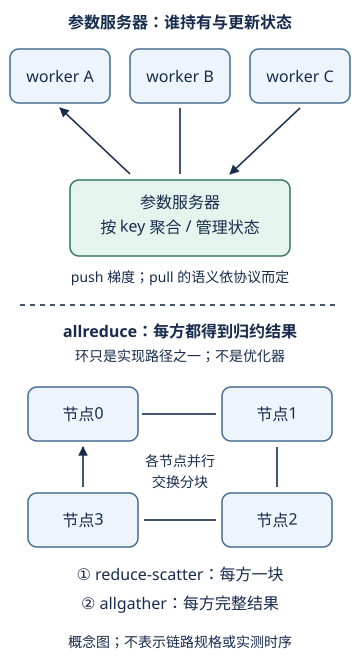

# 分布式训练：梯度相同，不代表通信代价相同

## 1. 学习问题：一台机器上的加法，为什么跨机器会成为瓶颈

[LEC33](#/c/d2l-pytorch-2021/lec/lec33?v=notes)说明怎样聚合出同一个目标的梯度，[LEC34](#/c/d2l-pytorch-2021/lec/lec34?v=notes)说明框架包装器的职责。本讲进一步问：**数据放在哪里，谁经过哪条链路发送多少字节，谁必须等待谁？**

教材12.7覆盖集中聚合、环同步、多机层次同步与键值抽象。正文提及的旧硬件带宽只是该例背景，不是今天所有机器的规格。教材本节没有PyTorch代码；本页也不把CPU列表求和称为分布式实现，更不要求部署集群。

## 2. 参数服务器和allreduce不是同一层次的名词

### 参数服务器：状态归谁管理

工作节点（worker）读取不同数据并计算梯度；参数服务器（parameter server，PS）持有某些参数/聚合状态，以键标识参数块。可以只有一个服务器，也可以按参数块分片到多个服务器；worker与server角色还可以位于同一物理机器。

教材的多机流程是：机器内先聚合，发送到CPU，再发往参数服务器；服务器聚合并更新参数，随后逐层分发。它是一个具体架构，不意味着所有现代通信都必须绕经CPU。

`push(key, value)`表达发送某块梯度供聚合；`pull`表达取回某块结果。**返回的是聚合梯度还是更新后的参数，要看所选协议。**教材同时讨论这两种组织方式，不应混写成“pull永远只返回权重”。

### allreduce：参与者应得到什么结果

allreduce是集合通信语义：把每个参与者的对应输入做同一归约，最后每个参与者都拿到归约结果。它本身不规定优化器、参数服务器角色、输入采样方式，也不自动规定“求和还是平均”。例如`SUM`归约后是否除以worker数，属于调用方合同。

集中式“reduce到一个节点，再broadcast”可以实现allreduce语义；环和树也可以实现。**PS与allreduce不是绝对互斥的两种训练目标**：PS系统内部可使用集合通信，同一同步SGD目标也可以用不同架构实现。

自绘组织图，依据教材12.7；下半图不是精确网络拓扑或逐包时序。环中节点都参加传输，不表示所有数据只在一个节点持久保存。

## 3. 版本与权重：不能只看张量能不能相加

一次同步更新要求本轮所有梯度在相同参数版本$\theta_t$上计算。设worker$r$的本地样本数为$n_r$、局部梯度和为$s_{r,t}$：

$$
\begin{aligned}
B_t&=\sum_r n_r,\\
g_t&=\frac1{B_t}\sum_r s_{r,t},\\
\theta_{t+1}&=\theta_t-\eta_t g_t.
\end{aligned}
$$

两级聚合不改变这个式子：先在机器内对sum求和，再跨机器求和，最后只除一次全局样本数。若先算每台机器的mean，就必须携带其样本数再加权。机器内有几张GPU不等于这台机器的样本权重。

**编者协议检查点**：参数键、训练步/版本、贡献者身份、归约方式、分母、完成条件。漏掉一份梯度或重复计入一份，都可能得到形状正确但目标错误的结果。

异步系统若把在旧参数$\theta_{t-\tau}$上算的梯度应用到当前参数，就改变了更新轨迹。它可能减少等待，但不是本页同步一步等价证明的一部分。重试、掉线和重复消息也不是简单重发就天然正确；本页只识别这些问题，不提供未经验证的容错部署方案。

## 4. 环同步：先reduce-scatter，再allgather

令$k$个节点各持有长度$P$的梯度，整份梯度占$G$字节。为方便推演，假定可均分为$k$块；不能整除时的填充或不等块开销不计。

1. **reduce-scatter阶段**：每轮每个节点把一个块发给邻居，并把收到的贡献加到对应块。经过$k-1$轮，各节点各拥有一个已聚合完成的不同块。
2. **allgather阶段**：再经过$k-1$轮交换已聚合的块，让每个节点都拼齐完整结果。

只完成第一阶段，不能声称每个节点已经有全部梯度。逻辑上每个输入贡献应在对应输出块出现一次；浮点求和次序仍可能造成小的舍入差异。

教材先用分块思维实验说明聚合带宽优势。本页把第二阶段与消息启动时延显式写出来，防止把“带宽项近似不随节点数增长”误读成“总通信时间恒定”。

## 5. 通信简化模型：先列假设再代数字

以下都是**编者理想模型，不是本站实测**。$G$是每个worker的完整梯度字节数；$\beta$是每条所建模链路的有效单向字节带宽；$\alpha$是每一轮的启动时延。用十进制MB/GB，不混用MiB/GiB。

共同忽略：梯度加法计算、内存复制、协议头、网络竞争、失败、计算/通信重叠，以及硬件的非均匀链路。假设梯度与参数同样大，不压缩、不稀疏。

### 一个worker兼任集中根节点

假设其余$k-1$个worker逐个发送整份梯度，根节点再逐个返回整份结果，根端口完全串行：

$$
T_{root}=2(k-1)\left(\alpha+\frac{G}{\beta}\right).
$$

如果参数服务器是**独立于所有worker的额外节点**，则要接收和返回$k$份，把$k-1$改为$k$。不能在比较中偷偷少算一台机器。

### 理想均匀环

每轮每节点发送$G/k$字节，所有节点同时发送且可同时接收；总计两阶段、各$k-1$轮：

$$
\begin{aligned}
T_{ring}&=2(k-1)\alpha\\
&\quad+\frac{2(k-1)G}{k\beta}.
\end{aligned}
$$

每节点发送量为$2(k-1)G/k$，接收量相同。这里的传输时间按可重叠的收发轮数计算，不能把发送加接收字节再除带宽而无故翻倍。整个系统的总发送字节数是$2(k-1)G$，不是$2G$。

### 便于检查的假设例

取$k=4$，$G=120$ MB，$\beta=12$ GB/s，$\alpha=0.1$ ms。完整向量一次传输10 ms，一个块30 MB传输2.5 ms。

| 模型 | 预测值，不是测量 |
| --- | --- |
| worker兼任集中根 | $6\times(0.1+10)=60.6$ ms |
| 理想环 | $6\times(0.1+2.5)=15.6$ ms |
| 环每节点发送字节 | $6\times30=180$ MB |

这不能证明现实环一定快3.88倍：我们假定了根串行、环并行且链路带宽相同。真实交换网络、树归约、层次聚合或不同链路会改变结果。小消息时$\alpha$可能主导；节点数增加时启动项仍增长。

## 6. 强扩展与弱扩展：比较的是哪个工作量

先记$T_k(B)$为$k$个worker完成全局batch $B$的一步时间。这里讨论每步固定工作量，不把收敛步数变化藏进硬件加速比。

### 强扩展（strong scaling）

固定全局$B$，增加worker数，本地batch约为$B/k$。定义：

$$
\begin{aligned}
S_k&=\frac{T_1(B)}{T_k(B)},\\
E_k&=\frac{S_k}{k}.
\end{aligned}
$$

理想情况计算时间缩为$1/k$，但梯度体积不因本地batch变小而同样缩小，通信、输入加载和小算子利用率会限制收益。

### 弱扩展（weak scaling）

固定每worker批量$b$，全局batch变为$kb$。理想情况下每步时间维持单worker时的$T_1(b)$。可报告弱扩展效率：

$$
E^{weak}_k=\frac{T_1(b)}{T_k(kb)}.
$$

每步样本吞吐是$Q_k=B/T_k(B)$。弱扩展吞吐提高不等于同一模型更快收敛；全局batch改变会影响每轮更新次数、噪声和学习率选择。

### 一个非测量的对照

假设单worker处理128样本需80 ms：

- 强扩展至4个worker、仍128样本，假设每步35 ms，则加速比$80/35\approx2.29$，效率约0.57。
- 弱扩展至4个worker、共512样本，假设每步100 ms，则弱扩展效率0.8，吞吐是单worker的3.2倍。

两行使用不同工作量，不应画成同一条“加速比曲线”。这些时间是**为解释定义而假设的数字**，没有采样或硬件依据。

## 7. 同步的尾部：最慢worker决定何时能更新

若一个同步步没有计算通信重叠，可粗略写为：

$$
T_{step}\approx\max_r T_{compute,r}+T_{comm}.
$$

实际程序还可能有输入等待、更新和调度开销。增加worker会暴露慢节点、负载不均和网络抖动；只报告最快worker的计算耗时没有代表性。若部分梯度已就绪，可边反向边通信，简单相加又会高估实际完成时间。因此要区分**依赖模型**与**观测测量**，不能拿其中一个假装另一个。

多参数服务器可以分散参数存储、聚合和网络压力，但仍需检查总出口带宽、参数块分配及最忙服务器。教材的$\mathcal O(m/n)$描述依赖均匀分片与带宽假设，不是添加服务器必然线性提速的保证。

## 8. 自测与有限练习

四个worker都拿到相同的向量，是否证明聚合正确？

不够。它们可能都拿到了同一个错误结果。还要核对每个输入贡献是否恰好一次、参数版本一致、归约与分母正确，并与独立的全批参考比较。

环的带宽项接近2G/β，为什么不能说增卡没有通信代价？

启动项有$2(k-1)\alpha$；真实链路、争用、分块开销和慢节点也未包含。这个近似只适用于带宽主导、理想均匀并行链路的模型。

机器A处理2个样本、机器B处理6个样本，两个局部mean能等权平均吗？

不能。对于样本等权目标，应分别乘$2/8$和$6/8$；或先恢复两个局部sum，相加后除8。机器数不是样本数。

去[训练性能实验](#/c/d2l-pytorch-2021/lab/training-performance)保留三类证据：小张量的集中求和与分块聚合一致性；通信模型的单位和字节数；强/弱扩展指标的分母。CPU可用于这些推演，不能验证真实ring通信、死锁处理、PS容错、GPU吞吐或跨机加速。

## 9. 来源、官方全P入口与缺口

[2021官方课表](https://courses.d2l.ai/zh-v2/)6月19日“分布式训练”对应本BV和12.7。核实上传作者**跟李沐学AI，mid 1567748478**，发布日期2021-06-19。

| 官方分P标题 | 时长 | 秒数 |
| --- | --- | --- |
| P1 分布式训练 | 21:45 | 1305 |
| P2 QA | 9:00 | 540 |
| **全2P合计** | **30:45** | **1845** |

每P只查一次公开player字幕，均成功空列表。未下载或观看媒体，不推测QA、不生成draft或课堂主题时间轴。时长表来自元数据，不是本页段落的时间定位。

实际读取：[固定提交12.7参数服务器](https://github.com/d2l-ai/d2l-zh/blob/e6b18ccea71451a55fcd861d7b96fddf2587b09a/chapter_computational-performance/parameterserver.md)全文，包括“数据并行训练”“环同步”“多机训练”“键值存储”与练习。固定的是当前中文第二版，不是2021教材快照；本节无PyTorch代码，相关现代API边界见已区分来源的LEC34。

教材中的论文引文与硬件图本页未独立读原论文，故不将其列为已读论文，不复制第三方图或把教材旧数字当实测。强弱扩展定义、时延项、版本检查点及全部具体算例均为编者解释。教材Apache-2.0不外推视频权利；本页自绘图与改写正文不等于课堂转录授权。原件、阅读范围、逐文件sha256与待主验收的数值点见`sources/p5-lec35/manifest-fragment.json`。
