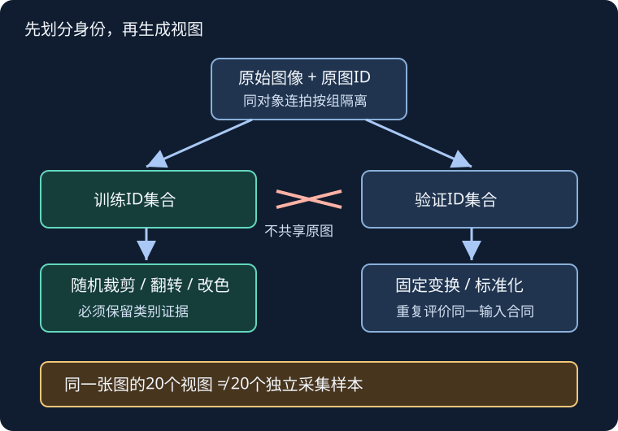

# 图像增广：改变输入，不应改变答案

## 1. 学习问题：更多图片，还是更多独立信息

假设只拍到一张叶片照片。随机裁出20张小图，是否就得到20片不同的叶子？**没有。**增广增加的是同一观测的不同视图，帮助模型不依赖无关因素；它既不创造新个体，也不修复错误标签。

本讲先回答三个工程问题：哪些变化保留类别？随机操作放在哪条数据路径？怎样比较增广有没有帮助？教材13.1的训练案例是普通CIFAR-10，不是[LEC38](#/c/d2l-pytorch-2021/lec/lec38?v=notes)的Kaggle文件接口，更不是树叶竞赛。

## 2. 增广隐含了一个关于任务的假设

设输入图像为$x$，类别为$y$，随机变换为$T_\omega$。普通单标签分类希望：

$$
y(T_\omega(x))=y(x).
$$

这不是数学恒真式，而是数据设计者要审查的条件：猫的水平翻转通常仍是猫；把字符“6”旋转180度可能改变类别；只留下背景的狗图裁剪不再可靠支持原标签；若病变颜色决定标签，过强色调扰动就可能删掉有效信息。

训练目标可写成对随机变换的期望：

$$
\begin{aligned}
L(\theta)&=\frac1N\sum_{i=1}^{N}\mathbb E_\omega[\ell_i(\omega)],\\
\ell_i(\omega)&=\ell(f_\theta(T_\omega(x_i)),y_i).
\end{aligned}
$$

每次取样只生成一个视图，是对这个期望的随机近似。训练集显示的长度仍可为$N$；通常无需先存一套膨胀后的图片文件。若先增广后划分，来自同一原图的视图可能同时进入训练和验证，验证就泄漏了。

自绘合同图，依据教材13.1；抽象叶形是编者几何示意，不是数据集图片。随机视图只在训练支路，验证支路使用固定操作。

## 3. 符号、形状和像素范围

| 对象 | 本页约定 | 应检查的内容 |
| --- | --- | --- |
| 单张RGB图片 | 高$H$、宽$W$、3通道 | 不是灰度或RGBA直接混入 |
| 单张张量 | $3\times H\times W$ | 通道不是最后一维 |
| 批张量$X$ | $B\times3\times H'\times W'$ | 同一批形状能堆叠 |
| 类别$y$ | 长度$B$的整数 | 增广不擅自重排标签 |
| 输出logits | $B\times C$ | $C$为任务类别数 |

对常用8位RGB图，`ToTensor`把每张图从HWC转为CHW，并将0–255缩放到0–1；**批维是DataLoader后来堆出来的**。这个缩放结论不能外推到任意浮点数组：传入已经是浮点、值域却仍为0–255的数组，不会因为叫“转张量”就自动纠正量纲。

标准化是逐通道的仿射变换，不是增广本身：

$$
x'_c=\frac{x_c-\mu_c}{\sigma_c}.
$$

标准化后的数可以小于0或大于1。不要又除255一次，也不要因为范围超出0–1就裁断；增广、像素缩放、标准化的先后顺序属于输入合同。

## 4. 手算：面积比例不是边长比例

`RandomResizedCrop`先选原图中的区域，再把区域缩放到指定输出大小。`scale`约束的是**裁剪前的面积比例**，`ratio`约束的是宽高比，而`size`决定最终张量尺寸。

取编者小例：原图宽200、高100，面积$A=20000$；取面积比例$s=1/4$，宽高比$r=1$。忽略像素取整时：

$$
\begin{aligned}
A'&=sA=5000,\\
w'&=\sqrt{A'r},\\
h'&=\sqrt{A'/r}.
\end{aligned}
$$

因此裁剪区域约为$70.71\times70.71$，实际像素需取整。它不是$50\times25$；后者面积只有原图的$1/16$。把裁剪区域再缩放为$32\times32$，并不表示保留了原图32像素宽的窗口。

**当前API与教材叙述的边界**：教材用“未特别说明则区间内均匀采样”帮助介绍参数；实读TorchVision0.20.1源码可见面积在区间内均匀取样，宽高比在对数空间均匀取样，并做最多10次适配尝试，失败后中心裁剪。因此不要把最终有效裁剪区域称为所有位置/形状上的均匀分布。此处是API补充，不是对课堂说法的纠正。

## 5. 选增强时，从假设而不是从菜单出发

- **翻转**：先看任务是否有方向语义。左右翻转常比上下翻转稳妥，但没有跨任务保证。
- **裁剪**：看主体是否仍在、局部纹理能否代表类别。细粒度任务可能需要耳朵、边缘或叶脉，过强裁剪会删掉判别信息。
- **颜色扰动**：亮度、对比度、饱和度、色调不是同一种变化。几何不变不代表颜色可以随意变。
- **组合**：`Compose`按顺序调用。裁剪再改色与改色再裁剪，不应未经检查就认为完全等价。

先画一小批增广前后的配对图，再决定强度；本页不复制教材猫图或竞赛图片。增广强度和概率属于超参数，只在训练/验证设计中选择。

## 6. 可解释的对照实验合同

比较“无随机增广”和“有随机增广”时，应保持划分、初始权重策略、优化器、训练预算、评价处理一致。至少记录训练损失与验证指标，不用训练准确率更低来证明泛化更好。

1. 先按原始样本ID划分；同一原图的所有视图只能归属同一集合。存在同对象连拍时还应按对象分组。
2. 训练路径允许随机变换，验证/测试路径固定尺寸变换与标准化；训练与验证不能共享一个可变`transform`对象后相互覆盖。
3. 验证使用`eval()`并停止梯度记录；这两者也不会替你关闭数据集中的随机裁剪。
4. 验证保留最后不足整批的样本；平均损失以实际样本数为分母。
5. 小随机训练的结果只能说明这次设置；需要重复实验才能区分增强效果与随机波动。

测试时多视图平均是另一种明确命名的推理策略，涉及额外计算和聚合规则，不应悄悄混入“确定性单视图”验证基线。固定一个随机种子也不等于证明所有设备和算子逐位确定。

教材训练辅助函数使用逐样本交叉熵再求和反传。若工程实验改为mean，必须同步说明学习率与batch缩放含义，不能直接照搬原数值。这里提供合同和局部推导，不提供整块训练答案。

## 7. 自测与答案

1. **同一图翻转10次后，验证能否随机抽其中两张？**不能；先按原图/对象划分，否则同源泄漏。
2. **`scale=(0.25, 0.25)`是否把宽和高各缩成1/4？**不是，它指定所选区域的面积比例；最终输出尺寸由`size`另定。
3. **训练模式改成`eval()`后，验证图为何还变？**随机操作在数据处理管线中，模型模式不控制它。
4. **裁剪后的标签未改，是否就满足标签不变性？**不满足；标签文件未改只是机械事实，必须确认画面仍保留类别证据。
5. **增广视图训练准确率降低，能否判定效果差？**不能；训练任务更难，需用同一固定验证管线比较泛化，同时检查是否强到损坏语义。
6. **浮点数组数值为128，转张量后仍为128是错误吗？**不一定是API错误，而是输入合同错误；先明确dtype和值域，不能假定自动除255。

下一步：[LEC37微调](#/c/d2l-pytorch-2021/lec/lec37?v=notes)把输入合同与预训练权重绑定。

## 8. 来源、分P核实与未完成边界

- 官方课表“图像增广”绑定教材13.1与本BV；原始HTML相关项已留证。教材实读为固定提交的13.1全文，包含全部正文、PyTorch路径、训练辅助函数、小结与练习；其他框架代码仅作对照，不声明执行兼容。它是当前中文第二版固定源码，不是2021全书快照。
- [固定教材13.1源码](https://github.com/d2l-ai/d2l-zh/blob/e6b18ccea71451a55fcd861d7b96fddf2587b09a/chapter_computer-vision/image-augmentation.md)。中文原教材不再生成重复翻译materials。
- [TorchVision0.20裁剪API](https://docs.pytorch.org/vision/0.20/generated/torchvision.transforms.RandomResizedCrop.html)及[v0.20.1变换源码](https://github.com/pytorch/vision/blob/v0.20.1/torchvision/transforms/transforms.py)：实读`ToTensor`、`Resize`、`RandomResizedCrop`；随机采样细节是编者API补充。
- [官方课表](https://courses.d2l.ai/zh-v2/)；[对应视频](https://www.bilibili.com/video/BV17y4y1g76q/)上传标题“36 数据增广”，作者跟李沐学AI，mid 1567748478，2021-06-20发布。

| 全部分P（平台标题） | CID | 时长 |
| --- | --- | --- |
| P1 数据增广 | 356993232 | 12:49 |
| P2 代码 | 356996025 | 19:41 |
| P3 QA | 356999447 | 22:30 |
| 全3P合计 | — | 55:00（3300秒） |

2026-11-14每P各请求一次公开字幕接口，均返回成功空列表；这不是“绝无烧录字幕”的证明。未下载或观看音视频，不能确认课堂例子、问答或片内主题时间轴，所以没有draft、课堂截图或伪造片段索引。上表只记录平台分P与时长，不是课堂内容摘要。

视频字段`copyright=1`、`no_reprint=1`不授予本站全文转录权；教材仓库许可不能代替视频、CIFAR图片或模型权重许可。原件、精确实读范围、hash、未运行声明及建议数值验收见`sources/p6-lec36/manifest-fragment.json`。本页未下载数据、训练模型或测量GPU；公共资料入口在[课程首页](#/c/d2l-pytorch-2021)。
