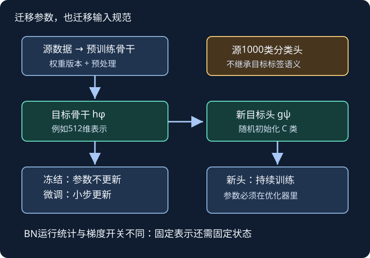

# 微调：搬来的不只是参数，还有输入合同

## 1. 学习问题：为什么不把最后一层也原样搬走

源模型认识ImageNet的类别，目标模型要认识叶片或热狗。两者可能共享边缘、纹理和形状表示，却不共享输出索引的含义。**权重形状能装进去，不等于类别语义能直接继承。**

教材13.2用热狗二分类介绍微调；本页以该案例解释机制，再用树叶的176类作形状练习。树叶数据身份延续[LEC30](#/c/d2l-pytorch-2021/lec/lec30?v=notes)，不是把热狗数据更名为树叶。预训练也不保证优于从零训练：领域差异、目标数据大小、输入处理与调参预算都可能改变结果。

## 2. 三种训练方式，三份不同合同

设骨干为$h_\phi$，目标分类头为$g_\psi$：

$$
z=g_\psi(h_\phi(X)).
$$

| 方案 | 骨干初始化/更新 | 目标头 | 你在比较什么 |
| --- | --- | --- | --- |
| 从零训练 | 随机初始化、训练 | 随机初始化、训练 | 不使用预训练知识 |
| 冻结特征 | 预训练、参数固定 | 随机初始化、训练 | 固定表示是否适合目标任务 |
| 微调 | 预训练、小步更新 | 随机初始化、训练 | 表示能否适应目标分布 |

“迁移学习”是更广的概念；“微调”通常指继续更新已有权重；只训练新头的基线不能标成全模型微调。分阶段解冻还必须记录阶段、参数集合与优化器状态，不能仅在报告里写“解冻了”。

自绘示意，依据教材13.2；箭头表示数据或参数更新关系，不表示已运行的真实训练结果。

## 3. 符号与形状：每个类别是一列，不是一张图

取ResNet-18池化后的512维表示作为例子。批大小$B$，目标类别数$C$：

$$
\begin{aligned}
X&\in\mathbb R^{B\times3\times224\times224},\\
H&\in\mathbb R^{B\times512},\\
W&\in\mathbb R^{C\times512},\quad b\in\mathbb R^C,\\
Z&=HW^\top+b\in\mathbb R^{B\times C}.
\end{aligned}
$$

每行输出一张图的$C$个logits。类别整数$y_i$必须指向这$C$列中正确的一列。训练使用原始logits和整数标签的交叉熵，不在送入交叉熵前手工做一次softmax。

**手算头部大小**：含bias的线性层参数数为$(512+1)C$。

| 目标 | $C$ | 头部参数数 |
| --- | --- | --- |
| 教材热狗二分类 | 2 | 1026 |
| 树叶形状练习 | 176 | 90288 |

这只算新头，不是全模型参数量。源头的1000个类别顺序不等于目标头的类别顺序；保存checkpoint时也应保存目标`class_to_idx`及其逆映射。

## 4. 手算分组学习率：新头和旧表示走不同步长

普通无动量、无权重衰减SGD的小例中，两参数初值都为1，梯度都为0.2：

$$
\theta'=\theta-\eta g.
$$

骨干学习率0.001，更新量为$-0.0002$，新值0.9998；头部学习率0.01，更新量为$-0.002$，新值0.998。**十倍学习率只表示同一梯度下十倍更新；真实梯度大小不同，不意味着两层实际移动距离始终十倍。**

教材用参数组给新头更大学习率，这是实用起点而不是普适最优值。替换分类头应先于构造优化器，否则优化器可能仍持有旧头参数；解冻时也要确保被解冻的参数真正进入优化器且没有重复归属。清楚写明loss是sum还是mean，再比较学习率。

## 5. “冻结”有三个开关，不能只关一个

1. **参数梯度**：骨干参数不需要梯度；新头仍需要。不要照搬“冻结整个模型”的循环而把新头一起冻结。
2. **优化器成员**：只更新明确允许训练的参数。切换冻结策略时处理残留梯度和优化器参数组。
3. **训练状态与缓冲区**：BatchNorm的运行均值/方差不是普通可训练参数；即使参数`requires_grad=False`，训练模式的前向仍可能更新它们。

因此“固定特征基线”应明确让骨干处于`eval()`，同时允许头处于训练模式；每次对整体调用`train()`后，要重新落实骨干模式策略。标准预训练ResNet使用运行统计；如果换成不跟踪运行统计的自定义BatchNorm，单靠`eval()`也不等于使用固定统计。

`no_grad()`控制是否建立反向图，不会自动切换BatchNorm或Dropout。验证和预测通常同时需要模型`eval()`、禁用梯度记录、确定性数据变换。微调时是否更新BN统计是单独实验变量，尤其要警惕极小batch或领域变化。

固定特征可以考虑缓存，但只有固定预处理、固定骨干状态下才是同一映射；如果训练每次随机裁剪，缓存一个视图就改变了原来想优化的增广目标。

## 6. 预训练权重必须带着预处理一起登记

当前TorchVision推荐显式的权重枚举，而不是只写历史接口`pretrained=True`。本页绑定：

- 模型构造器：`resnet18`。
- 权重枚举：`ResNet18_Weights`。
- 具体版本：`IMAGENET1K_V1`，不依赖未来可能变化的`DEFAULT`别名。
- 推理管线：由该权重对象的`transforms()`给出。

在已读0.20版本文档和0.20.1实现中，该权重推理先以双线性插值把短边变为256，再中心裁剪224，像素缩放到0–1，然后按RGB通道标准化。

$$
\begin{aligned}
\mu&=(0.485,0.456,0.406),\\
\sigma&=(0.229,0.224,0.225).
\end{aligned}
$$

红通道若$x=0.5$，则$(0.5-0.485)/0.229\approx0.06550$。这是预处理手算，不是训练结果。输入若本来是0–255浮点却未正确缩放，就会破坏这个合同。

**不能把教材预处理与当前权重预设混称完全相同**：固定13.2的PyTorch测试代码用`Resize([256,256])`先强制方形；当前权重预设是短边256、保留宽高比。两者后面都裁224，也不等于相同视图。训练增广可另行设计，但要记录与权重推理规范的差异。

权重URL和版本可登记，未实际下载的权重不能编造文件hash，也不能把包名相同当作权重文件相同。

## 7. 公平比较与工程产物

冻结和微调的比较应固定训练/验证ID、类别映射、初始化来源及预算口径。选择超参数使用验证集，不能把最终测试集当每轮调参反馈；报告预训练本身已使用外部数据，别称为只用目标训练集从零学习。

要保留的最小产物是：划分清单、类别映射、权重身份、训练/推理预处理说明、可训练参数集合、BN模式策略、验证指标和checkpoint。无需把完整数据集或大权重上传到学习站。

**四类权利分别看**：教材源码许可、框架源码许可、预训练权重使用条件、原始图片与竞赛规则。TorchVision官方明确提示，权重可能有来自训练数据的独立使用条件，使用者需判断其用途是否获准。公开可下载与允许重新分发/商用不是同义词；本页没有下载或重新发布权重、热狗图、ImageNet图或树叶图。

树叶身份/访问状态直接复用P5证据：176类，18353训练、8800测试，host Mu Li；匿名规则只见通用模板，登录后下载、加入、迟交与图片再分发权未核实。本页不绕限制，也不以热狗、CIFAR或Dogs替代树叶实战。

## 8. 自测与答案

1. **为什么用176输出替换1000输出？**目标类别语义和数量不同；512维表示可迁移，原标签空间不能直接沿用。
2. **冻结512维表示后，176类头有多少可训练参数？**单个含bias线性头为90288；若另有隐层，必须重新计算。
3. **骨干参数没变化，是否证明特征映射没变化？**不一定。BN缓冲区、模型模式、随机预处理都可能改变输出。
4. **整体`train()`后固定骨干策略为何失效？**该调用递归改变子模块模式，需要重新设置骨干`eval()`；它不由`requires_grad`决定。
5. **同样输入尺寸224，预处理能任意互换吗？**不能。裁剪、宽高比、插值、像素量纲和标准化都可能不同。
6. **权重能被TorchVision下载，就能随项目重新分发吗？**不能据此推断；模型权重与训练数据条件独立于代码许可。

接着对照[LEC38 CIFAR-10](#/c/d2l-pytorch-2021/lec/lec38?v=notes)和[LEC39 Dogs](#/c/d2l-pytorch-2021/lec/lec39?v=notes)：不是每个视觉任务都应直接套同一个模型头和导出格式。

## 9. 来源、视频索引与缺口

- [官方课表](https://courses.d2l.ai/zh-v2/)“微调”明确指向13.2与本BV；[固定教材13.2源码](https://github.com/d2l-ai/d2l-zh/blob/e6b18ccea71451a55fcd861d7b96fddf2587b09a/chapter_computer-vision/fine-tuning.md)已实读全文，包括四步迁移、热狗数据、PyTorch参数组、从零对照与练习。中文第二版固定提交，不是2021全书快照；原中文不重复翻译。
- 编者API补充：[TorchVision权重总说明](https://docs.pytorch.org/vision/0.20/models.html)的预训练通则、初始化和使用部分；[ResNet-18权重页](https://docs.pytorch.org/vision/0.20/models/generated/torchvision.models.resnet18.html)；[0.20.1权重定义](https://github.com/pytorch/vision/blob/v0.20.1/torchvision/models/resnet.py)及[推理预设](https://github.com/pytorch/vision/blob/v0.20.1/torchvision/transforms/_presets.py)。没有把文档的ImageNet指标当本站结果。
- [PyTorch2.5.1 BatchNorm实现](https://github.com/pytorch/pytorch/blob/v2.5.1/torch/nn/modules/batchnorm.py)实读`_BatchNorm.forward`；冻结BN提醒是工程补充，不宣称课堂原话。
- 树叶证据沿用`sources/p5-lec30/kaggle-evidence.txt`、`announcement-evidence.txt`及P5 manifest；[LEC30](#/c/d2l-pytorch-2021/lec/lec30?v=notes)保留完整访问缺口。
- [对应视频](https://www.bilibili.com/video/BV1Sb4y1d7CR/)作者跟李沐学AI，mid 1567748478，2021-06-20发布。

| 全部分P（平台标题） | CID | 时长 |
| --- | --- | --- |
| P1 微调 | 357000346 | 13:53 |
| P2 代码 | 357000451 | 08:55 |
| P3 QA | 357000547 | 11:33 |
| 全3P合计 | — | 34:21（2061秒） |

2026-11-14每P一次公开字幕请求均成功空列表；不等于无烧录字幕。未观看或下载音视频，不提供课堂转录、教师问答归纳、片内主题时间轴或截图；draft阻塞。视频`copyright=1/no_reprint=1`不是开放转录授权。

精确原件范围、hash和主验收建议见`sources/p6-lec37/manifest-fragment.json`。本页未运行真实迁移训练、竞赛提交或GPU性能测试；手算机制与真实迁移收益严格分开。[课程公共资料](#/c/d2l-pytorch-2021)。
