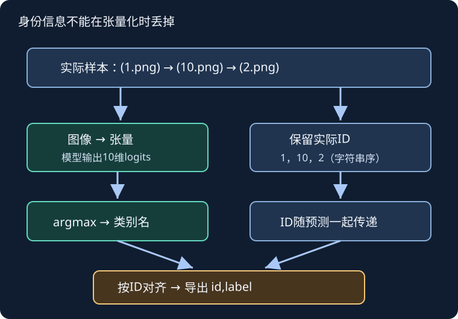

# CIFAR-10实战：模型之外，ID与标签也是接口

## 1. 学习问题：准确率没错，提交文件为何仍可能全错

一批图的预测类别都正确，却把预测与文件ID错位，最终CSV依然失败。训练loss不知道你的文件名；**“模型正确”和“结果正确交付”是两个必须同时成立的条件。**

教材13.13从PNG文件和标签CSV走到分类导出。它不是[LEC36](#/c/d2l-pytorch-2021/lec/lec36?v=notes)中直接调用数据集类的同一个接口，更不是课程树叶竞赛。本站按官方课表连续编号为LEC38，视频上传标题开头是39；这是编号体系差异，不改动本站讲次。

## 2. 先分清三个数据身份

| 身份 | 数据/任务 | 测试与输出 |
| --- | --- | --- |
| 原始CIFAR-10 | 10类，RGB 32×32；50000训练、10000测试 | 原始测试带标签，用于本地基准评价 |
| 教材Kaggle CIFAR-10 | 同一分类主题，PNG文件与标签CSV | 教材描述300000测试图，其中10000用于评价；导出`id,label` |
| Classify Leaves | 176类；18353训练、8800测试 | 树叶图片路径与类别名，独立竞赛合同 |

原始CIFAR主页核实60000张图、每类6000张、训练每类5000张。Kaggle那300000测试图的用途来自固定教材说明，**不是本次下载后数文件得出的结论**。树叶身份与访问条件复用P5公告和匿名页面证据，不因名字都是“图像分类”就能互换。

教材的小样本包含前1000训练图与5张随机测试图，用于调通流程；tiny既不是全量训练，也不能产生有意义的全量排行榜结论。本页不自动下载tiny，也不把镜像可访问视为图片再分发许可。

## 3. 数据合同：从文件到张量，还要保留ID

教材路径包括训练/测试PNG、`trainLabels.csv`和示例提交文件。标签CSV表示“文件ID→类别名”，不是“读入顺序→类别”。教材列表中的`sampleSubmission.csv`与随后正文的小写下划线写法存在差别；实际操作应以合法取得的文件及表头为准，不凭名字猜文件内容。

| 层次 | 对象 | 不变量 |
| --- | --- | --- |
| 身份层 | 图像ID与路径 | ID唯一，每条标签能找到对应图 |
| 标签层 | 类别名→整数 | 全程固定，训练/验证/导出共享 |
| 输入层 | $X\in\mathbb R^{B\times3\times32\times32}$ | 通道/尺寸/值域明确 |
| 监督层 | $y\in\{0,\ldots,9\}^B$ | 整数目标，不把ID当类别 |
| 模型层 | $Z\in\mathbb R^{B\times10}$ | 未归一化logits |
| 导出层 | ID与预测类别名 | 与真实测试样本一一对应 |

`ImageFolder`按类别子目录建立标签。已读0.20.1源码按类别名排序建立`class_to_idx`，并排序遍历文件。不要在训练与验证中独立建出不同映射却只检查“类别数都是10”；应比较完整字典。测试目录里的`unknown`只是为了满足目录加载器的结构，其整数0不是真实类别标签，也不能拿来算准确率。

自绘管线示意，依据教材13.13与目录加载器源码。身份信息和图像张量各走一条路径，预测后按身份连接，不靠“看起来同样排序”。

## 4. 手算划分：教材算法并非每类都取10%

固定教材设最少类别样本数为$n_{\min}$，比例$r$，每类统一抽取：

$$
v=\max(1,\lfloor n_{\min}r\rfloor).
$$

完整平衡CIFAR-10中$n_{\min}=5000$、$r=0.1$，每类500验证图，总5000，训练45000。但对编者不平衡小例，类A有20张、类B有10张，$r=0.2$：每类都取2张，验证总数4，而不是30张的20%即6张。这是**按最小类确定统一每类验证数**，不能概括为“所有数据严格按比例随机分层”。

源码按目录遍历先后选择验证图片，没有显式随机打乱。工程练习应先固化带种子的ID划分，再应用各自变换；若存在同源或近重复图，按组隔离。极小类别只有1张时，上述`max(1,...)`会把它全部划去验证，训练可能缺类：应明确小数据实验的可行划分，而不是靠复制同图填满训练集。

## 5. 损失、验证与训练预算

整数标签的交叉熵可写成：

$$
\begin{aligned}
\ell_i&=-z_{i,y_i}+\log\sum_{c=1}^{10}e^{z_{ic}},\\
L&=\frac1B\sum_{i=1}^{B}\ell_i.
\end{aligned}
$$

分类准确率只比较argmax。对正确类概率0.8的单样本，交叉熵为$-\log0.8\approx0.2231$；另一张正确类概率0.2，损失约1.6094，两张平均约0.9163。这些概率是为手算构造的，不是模型预测记录。训练API接收logits，数值稳定的log-sum-exp由损失函数处理。

教材使用适合小图的`d2l.resnet18`和10输出，不是自动调用带ImageNet权重的大图ResNet。训练管线先放大到40，再随机裁剪缩放回32，水平翻转，并用该案例的通道均值/标准差；验证/测试只做确定性转换与标准化。**不要把ImageNet标准化数值不加说明地替换到此从零案例。**

教材将逐样本损失求和反传，打印时再除样本数；本页上式是mean目标。若练习实现采用mean，要记录这种差异，不能机械沿用sum版本学习率。

验证应做到：固定图像处理、`eval()`、停止梯度记录、覆盖全部验证ID，以损失总和除实际样本数。固定教材的验证加载器设置了`drop_last=True`；工程基线建议明确改为保留尾批，否则指标分母和覆盖范围改变，小验证集甚至没有批次。这是编者工程修订，不声称原代码已处理。

例如验证有65张、batch32，丢尾批只评估64张。只报告64张的正确率不能写成“全65张验证准确率”。选择好配置后可用训练+验证重训最终模型，但此时旧验证集已参与训练，不能再声称是独立泛化分数。

## 6. 导出陷阱：排序不是身份

假设实际测试文件顺序是`1.png, 10.png, 2.png`，模型给出`cat, dog, bird`。正确关系是：

| ID | 预测类别 |
| --- | --- |
| 1 | cat |
| 10 | dog |
| 2 | bird |

如果导出时擅自生成顺序ID`1,2,10`而不同时按ID重排预测，后两行就配错。教材按字符串排序连续整数ID去匹配目录顺序；这依赖“ID连续、文件无缺失、排序规则一致”的前提。更稳妥的合同是**从实际样本路径保留ID，预测时一起传递，按ID对齐示例提交表**，不要由样本数量重建身份。

交付前应核：测试ID集合一致、无重复/遗漏、类别名属于训练词表、列名恰为接口要求、行数正确、不保存额外DataFrame索引。CSV采用示例提交的ID顺序是一种清晰约定，不意味着模型预测必须按那个顺序分批。

推理要显式切换`eval()`并禁用梯度，尤其是教材最终重训时没有验证阶段，不应依赖“上一次评估顺便把模型切了模式”。测试图的`unknown`标签不参与损失或评价。

## 7. 自测与答案

1. **原始CIFAR测试10000张，为什么教材竞赛写300000？**是不同发布/评测接口；教材说明竞赛额外包含不计分图。本次未下载核数。
2. **两个数据集的标签集合相同，整数标签就一定同义吗？**不一定；必须比较类别到整数的完整映射。
3. **20/10张两类、比例0.2，教材方法验证几张？**每类2，共4；不是6。
4. **`unknown`文件夹产生的0标签能用于测试准确率吗？**不能，它是目录结构占位标签，不是真值。
5. **验证集被用于最终重训之后，还能拿它选下一轮超参数吗？**不应再把它当独立验证集；调参和最终训练的边界必须清楚。
6. **输出文件行数正确，就能排除身份错位吗？**不能；需要按ID比较对应关系和集合。

下一讲[Dogs](#/c/d2l-pytorch-2021/lec/lec39?v=notes)同样需要身份检查，但提交的是120列概率，不是一列类别名。

## 8. 来源、全P索引与访问缺口

- [官方课表](https://courses.d2l.ai/zh-v2/)将CIFAR-10案例与本BV及教材13.13绑定；[固定教材13.13全文](https://github.com/d2l-ai/d2l-zh/blob/e6b18ccea71451a55fcd861d7b96fddf2587b09a/chapter_computer-vision/kaggle-cifar10.md)已实读：数据组织、分层数量、增强、PyTorch模型/训练/验证/导出、小结与练习。教材固定为当前中文第二版，非2021全书快照。
- [CIFAR原始主页](https://www.cs.toronto.edu/~kriz/cifar.html)实读CIFAR-10数量、类别、下载引用要求与数据布局；作者Alex Krizhevsky、Vinod Nair、Geoffrey Hinton。主页要求引用技术报告，但本页未独立阅读该报告，不把它列为已读论文，也未据此取得图片再分发授权。
- [ImageFolder文档](https://docs.pytorch.org/vision/0.20/generated/torchvision.datasets.ImageFolder.html)与[0.20.1目录源码](https://github.com/pytorch/vision/blob/v0.20.1/torchvision/datasets/folder.py)：实读`find_classes`和`make_dataset`的排序行为。
- [教材指定Kaggle竞赛入口](https://www.kaggle.com/c/cifar-10)仅作为任务定位；本讲没有登录、接受规则、读取真实CSV/图像、训练或提交，当前下载/加入/迟交及图片再分发条件未核实。教材所写历史访问步骤不是当前访问实测。
- 树叶竞赛绑定与访问证据复用P5：官方公告指向Classify Leaves，匿名规则为通用模板；不能拿CIFAR结果替代树叶结果。
- [对应视频](https://www.bilibili.com/video/BV1Gy4y1M7Cu/)标题为“39 实战 Kaggle 比赛：图像分类（CIFAR-10）”，作者跟李沐学AI，mid 1567748478，2021-06-26发布。

| 全部分P（平台标题） | CID | 时长 |
| --- | --- | --- |
| P1 Kaggle Cifar10 | 359962250 | 27:57 |
| P2 QA | 359967377 | 17:46 |
| 全2P合计 | — | 45:43（2743秒） |

2026-11-14每P一次公开字幕请求均成功空列表。未下载或观看音视频，不能确认代码演示、问答和主题片段；没有draft或课堂截图，空字幕列表也不证明没有烧录字幕。视频`copyright=1/no_reprint=1`不是转录许可。

原件/hash/精确范围与建议验收见`sources/p6-lec38/manifest-fragment.json`。本站无全量训练、排行榜成绩或GPU吞吐结论；教材源码许可不扩张至第三方图片、平台规则或权重。[公共资料](#/c/d2l-pytorch-2021)。
