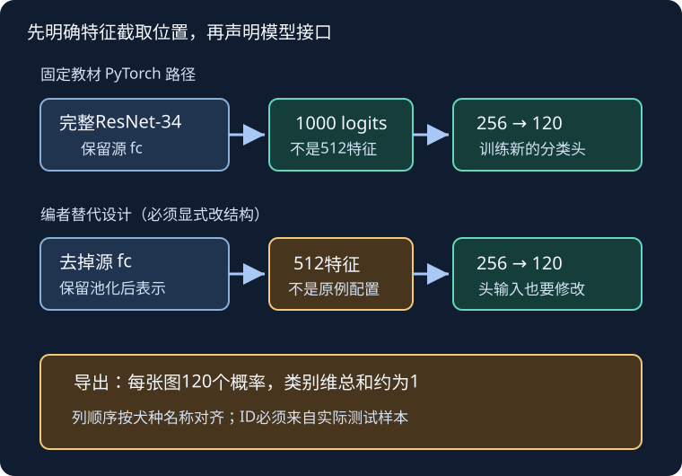

# 狗品种识别：冻结特征，输出完整概率分布

## 1. 学习问题：都猜对了，为什么概率损失仍不同

预测“这是一只狗”与区分120个犬种，不是同一分类问题。两个模型都把正确犬种排第一，一个给0.9概率、另一个给0.4概率；它们的top-1准确率相同，交叉熵却不同。**分类头维度、验证目标和导出内容要一起决定，不能只改一个类别数。**

教材13.14用预训练ResNet-34构建固定特征分类器。这里讲的是教材对应的Dog Breed Identification，不是课程Classify Leaves，也不把本讲写成树叶获奖方案总结。本站LEC39与上传标题“40”保留各自编号。

## 2. 和CIFAR-10相比，接口变在哪里

| 合同 | CIFAR-10教材案例 | Dogs教材案例 |
| --- | --- | --- |
| 原图 | 32×32 RGB PNG | 尺寸不一的RGB JPEG |
| 类别数 | 10 | 120 |
| 标签文件 | `trainLabels.csv` | `labels.csv`，ID与犬种 |
| 常见模型输入 | 32×32 | 224×224 |
| 教材初始化 | 小图ResNet从零训练 | 预训练ResNet-34固定参数 |
| 教材验证重点 | 准确率 | 平均交叉熵损失 |
| 教材导出 | ID与一个类别名 | ID与120列类别概率 |

固定教材描述10222张训练图、10357张测试图、120犬种，并称它来自ImageNet子集。这里把这些记作**教材数据描述**，不是本站已读取真实压缩包或当前Kaggle文件后的统计。`dog_tiny`是流程调试样本，不是可替代全量竞赛的证据。

## 3. 重要源码辨析：教材文字和PyTorch路径不完全相同

正文说取预训练输出层的输入，即特征；但固定提交的**PyTorch实际代码保留完整ResNet-34，包括原来的1000输出层**，再接：

$$
\begin{aligned}
X&:\ B\times3\times224\times224,\\
S&:\ B\times1000,\\
U&=\operatorname{ReLU}(SW_1^\top+b_1),\\
U&:\ B\times256,\\
Z&=UW_2^\top+b_2:\ B\times120.
\end{aligned}
$$

这里$S$是源ImageNet分类器的1000维logits，不是原模型池化后的512维向量，也不是经过softmax的概率。新头可利用这些源任务分数作为表示；这与“删除原fc后提取512维通用特征”是两种不同接口。

**编者可选改造**：若显式删除源fc，输入头的维数才是512，并应同步改变第一个线性层。这个改造不能被写成固定教材PyTorch原例，也不能仅根据文字叙述声称代码已经这样实现。

自绘源码对照图。上路径是固定教材PyTorch配置，下路径是编者替代设计，不表示哪个一定更准，也不是课堂板书重建。

**手算新头参数**，含bias、ReLU无参数：

$$
\begin{aligned}
P_{1000}&=(1000+1)\times256\\
&\quad +(256+1)\times120\\
&=287096.
\end{aligned}
$$

如果改为512维输入，相同256隐层与120输出的新头为162168参数。两种数量都不含冻结的源模型。少参数不自动等于更好；比较必须固定数据划分、预处理、训练预算和源权重。

## 4. 输入规范与冻结状态要成套保存

本页识别的明确权重身份为：模型`resnet34`，枚举`ResNet34_Weights`，版本`IMAGENET1K_V1`。官方0.20文档与0.20.1源码给出推理预处理：短边256、双线性插值、中心裁224、缩放到0–1、按ImageNet RGB均值与标准差归一化。

$$
\begin{aligned}
\mu&=(0.485,0.456,0.406),\\
\sigma&=(0.229,0.224,0.225).
\end{aligned}
$$

训练可以用随机裁剪/翻转/颜色扰动，但不能把此训练管线当作固定推理规范。细粒度犬种可能依赖毛色、耳形等线索，强颜色扰动或只剩背景的裁剪可能破坏标签。固定13.14 PyTorch增广块有“添加随机噪声”的注释，下面实际直接进入`ToTensor`，没有独立噪声变换；不要把注释补写成执行步骤。

教材把源模型参数设为不求梯度，但这不等于完整固定其状态。工程固定特征基线还需让骨干`eval()`，防止BatchNorm运行统计被训练或验证图片改变；头部可保持训练模式。整体`train()`会递归改变骨干模式，需要重新落实冻结策略。推理应显式`eval()`并禁用梯度记录，不依赖某次验证“碰巧”留下的模式。

这里是[LEC37](#/c/d2l-pytorch-2021/lec/lec37?v=notes)冻结合同的复用；本页没有下载权重、验证预训练效果或声称节省了多少GPU时间。若预训练与目标数据有重叠风险，应披露源数据关系，不能把它当作完全独立、从零学习的比较。

## 5. 验证的是概率质量，不只是argmax

设$z_{ic}$为logits，类别概率按**类别维**计算：

$$
p_{ic}=\frac{e^{z_{ic}}}{\sum_{k=1}^{120}e^{z_{ik}}}.
$$

训练的整数标签交叉熵：

$$
L=-\frac1N\sum_{i=1}^N\log p_{i,y_i}.
$$

**编者三类小例，不是实际犬种预测**：同一正确类为A，两个预测分别是$(0.8,0.1,0.1)$与$(0.4,0.35,0.25)$。两者都猜A，但损失约为0.2231与0.9163。概率更有把握且正确的前者更好；若真值实际为B，前者损失反而为$-\log0.1\approx2.3026$，后者约1.0498。过度自信的错误会付出更高代价。

训练把logits送给交叉熵，不先softmax；导出概率时才按类别维softmax。对$B\times120$矩阵，类别维是`dim=1`。沿batch维归一化可能让每列和为1，却不满足每张图的120个类别概率和为1。

对不平衡犬种要看每类样本数及混淆关系，不能只看全局一个数。验证应由训练数据合法划分，记录固定ID、完整标签映射与确定性变换；损失按实际样本数加权，不把各batch平均值再不加权平均。教材沿用按最小类别数量固定每类验证数的算法，并设置验证丢尾批；它们不等于严格比例随机划分和全覆盖验证。工程基线需显式处理这些差异。

## 6. 导出：120列的顺序也是模型的一部分

模型列顺序由训练时的类别映射决定，而输出文件列顺序由示例提交定义。若模型列是`[A,B,C]`，概率为`[0.7,0.2,0.1]`，示例提交列要求`[C,A,B]`，正确导出值应是`[0.1,0.7,0.2]`。只改列名不重排值，会把完全合法的概率行赋给错误犬种。

工程导出合同：

1. 预测时保留来自实际样本的ID；测试集不能shuffle后再配另一份独立目录列表。
2. 检查训练类别词表与要求的120个概率列集合一致，按名称构造列重排。
3. 每行概率有限、非负、类别维总和接近1；不能只验证矩阵宽度。
4. 预测ID无重复/遗漏，与实际示例提交按ID连接。测试目录的`unknown`标签不是真值。
5. 输出一列ID加120列概率，不输出argmax类别名，也不附加DataFrame索引。

若tiny仅包含部分类别，加载器可能只生成部分类别映射，不能把缺失类别随意补成零来伪造完整120类训练。小样本练习要明确是合成接口验收还是已合法获取的真实120类子集，并保留映射/缺类检查结果。

此处讲教材指定的历史导出格式；当前平台的评测细节、接受概率的具体处理和提交开放状态仍需按当前规则核实。本页没有实际提交，不声称平台已接受文件。

## 7. 自测与答案

1. **固定教材PyTorch代码的新头第一层为何是1000输入？**它保留完整源ResNet-34的分类层，输入是源logits，不是512维池化特征。
2. **换成512维后只改图注可以吗？**不可以；必须改变实际特征截取位置和头部输入维度，并注明这是编者改造。
3. **同样top-1正确为何验证损失不同？**交叉熵还评价真值概率大小；高置信正确与低置信正确贡献不同。
4. **每列概率和为1，是否保证导出正确？**不保证；每行要在类别维归一化，还需核ID和类别列对应。
5. **模型输出A/B/C，提交要C/A/B，能只替换表头吗？**不能；列值也必须按同一置换重排。
6. **冻结参数后跑验证会不会改变模型？**若BN仍在训练模式，运行统计仍可能改变；冻结参数和冻结状态是不同合同。
7. **完成Dogs训练能否代替树叶实验？**不能；任务、数据、标签映射、许可、输出接口和课堂总结来源各不相同。

## 8. 来源、全P核实与缺口

- [官方课表](https://courses.d2l.ai/zh-v2/)明确把狗品种案例与教材13.14、本BV绑定；[固定13.14源码](https://github.com/d2l-ai/d2l-zh/blob/e6b18ccea71451a55fcd861d7b96fddf2587b09a/chapter_computer-vision/kaggle-dog.md)全文实读，包括数据描述、各增广代码、PyTorch1000→256→120头、冻结、验证损失、概率导出与练习。教材是当前中文第二版固定提交，不是2021全书快照，中文原文不重译materials。
- 数据组织对照[固定13.13](https://github.com/d2l-ai/d2l-zh/blob/e6b18ccea71451a55fcd861d7b96fddf2587b09a/chapter_computer-vision/kaggle-cifar10.md)，迁移概念对照[固定13.2](https://github.com/d2l-ai/d2l-zh/blob/e6b18ccea71451a55fcd861d7b96fddf2587b09a/chapter_computer-vision/fine-tuning.md)；本批均实读。源码与文字差异是编者对照，不推测视频采用哪个版本。
- [ResNet-34权重说明](https://docs.pytorch.org/vision/0.20/models/generated/torchvision.models.resnet34.html)、[权重定义](https://github.com/pytorch/vision/blob/v0.20.1/torchvision/models/resnet.py)、[推理预设](https://github.com/pytorch/vision/blob/v0.20.1/torchvision/transforms/_presets.py)和[权重通则](https://docs.pytorch.org/vision/0.20/models.html)为API补充；BN实现范围复用LEC37来源，不声明已读所有框架源码。
- [教材指定Dogs竞赛入口](https://www.kaggle.com/c/dog-breed-identification)仅用于任务定位；当前登录后下载、加入、迟交、图片再分发及权重具体用途许可未核实。未登录、接受规则、读取真实CSV/图片、下载权重、训练或提交。不把代码LICENSE扩大为ImageNet图片/权重许可证。
- 树叶身份、host Mu Li及176类/18353训练/8800测试复用P5证据；匿名Rules只见模板，访问和再分发缺口不变；[LEC30](#/c/d2l-pytorch-2021/lec/lec30?v=notes)有对应来源。
- [对应视频](https://www.bilibili.com/video/BV1j5411T7wx/)上传标题“40 实战 Kaggle 比赛：狗的品种识别（ImageNet Dogs）”，作者跟李沐学AI，mid 1567748478，2021-06-26发布。

| 全部分P（平台标题） | CID | 时长 |
| --- | --- | --- |
| P1 Kaggle ImageNet Dog | 359967655 | 19:09 |
| P2 QA | 359970791 | 15:16 |
| 全2P合计 | — | 34:25（2065秒） |

2026-11-14每P一次公开字幕请求均成功空列表，不等于无烧录字幕；未下载/观看音视频，因此不做课堂稿、教师问答、主题时间轴或课堂截图。视频`copyright=1/no_reprint=1`不构成全文转录授权。上表仅是平台元数据索引。

原件、精确范围、hash和主验收建议见`sources/p6-lec39/manifest-fragment.json`。本页推导与合成接口检查不能证明真实迁移效果，未报告竞赛成绩、GPU吞吐或真实数据训练结果。[课程公共资料](#/c/d2l-pytorch-2021)。
