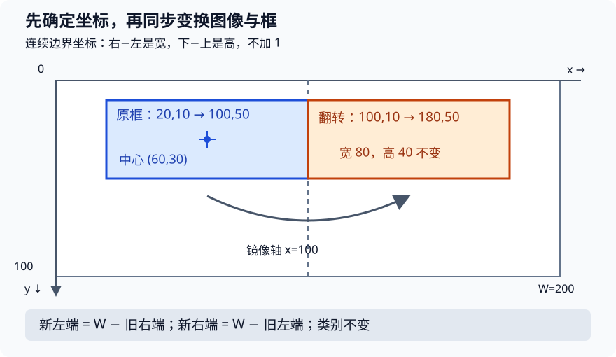

# 物体检测：让坐标、标签与图像一起移动

## 1. 学习问题：分类器为什么不够用

分类器回答“这张图主要是什么”，检测器还要回答“**有几个、各在哪里、分别是什么**”。一张图中的两片叶子可以有两个框，即使它们属于同一类别。图像级类别正确，不代表框的位置正确；检测也不是给每个像素分类的语义分割。

本讲保留课表的三个主题：**物体检测、边缘框实现、物体检测数据集**。课表用“边缘框”，教材和本文统一称“边界框”；这不是另一种表示法。先学清楚数据合同，下一讲再讨论锚框匹配。本页不提前交付SSD训练或密集预测实验。

## 2. 先写坐标合同，再碰张量

约定图像宽$W$、高$H$，原点在左上角，$x$向右、$y$向下。使用连续边界坐标：完整图像范围为$[0,W]\times[0,H]$，宽高是端点之差，**不加1**。它不同于某些旧数据集“两端像素索引都包含”的约定，导入标注时必须先转换。

| 对象 | 形状或含义 | 本页约定 |
| --- | --- | --- |
| 图像批次$X$ | $(B,3,H,W)$ | 通道先行；像素值范围另行规定 |
| 两角表示$Q$ | $(N,4)$ | 顺序为$x_1,y_1,x_2,y_2$ |
| 中心表示$C$ | $(N,4)$ | 顺序为$c_x,c_y,w,h$ |
| 一张图的有效标注 | $(M,5)$ | 类别ID，再接四个坐标 |
| 打包的标签 | $(B,M_{\max},5)$ | 不足行数用显式无效标签填充 |

有效框要求$x_2>x_1$、$y_2>y_1$，且数值有限。坐标是否必须位于图像内取决于阶段：数据集有效标注通常在图内；下一讲生成的候选锚框可能越界。不要在所有阶段无条件截断并以为含义不变。

### 两种表示可逆，但顺序不能猜

$$
c_x=(x_1+x_2)/2,\qquad w=x_2-x_1
$$

$$
c_y=(y_1+y_2)/2,\qquad h=y_2-y_1
$$

反过来分别计算$x_1=c_x-w/2$、$x_2=c_x+w/2$，以及对应的$y$坐标。中心不一定落在整数像素上，应该保留浮点数。

**手算：**在$W=200,H=100$的图里，框$(20,10,100,50)$变成中心表示$(60,30,80,40)$。恢复后必须得到原四个端点。若需要归一化，四列分别除以$(W,H,W,H)$，得到$(0.1,0.1,0.5,0.5)$，不是四列都除以200。

教材正文说可接收长度4的张量，但固定源码实际使用`boxes[:, 0]`这类二维切片。**直接复用该函数时应传$(N,4)$，一个框也应是$(1,4)$**；不凭正文一句话假定任意前导维度都能运行。

图为编者自绘：同一画布里的原框、中心和水平翻转后的框。框的位置随图像一起移动，类别保持不变；不是教材图片或课堂截图。

## 3. 图像变换也是标签变换

缩放图像到新宽高$(W',H')$时，像素坐标的$x$乘$W'/W$，$y$乘$H'/H$。若只是完整图像缩放，归一化坐标保持不变；一旦裁剪、填充或改变坐标原点，就不能套用这个结论。

水平翻转的连续坐标公式是：

$$
x'_1=W-x_2,\qquad x'_2=W-x_1
$$

上例变成$(100,10,180,50)$。翻转两次恢复原框，宽高不变；如果只对$x_1,x_2$各做$W-x$而不交换两端，便会得到负宽度。图像分类的随机翻转只改图片即可，检测则必须对图片与全部框使用**同一次随机决定**。

裁剪的正确思路是：平移坐标原点→求与裁剪窗的交集→处理空框或严重残缺目标→按新画布归一化。是否保留“只剩一点点”的目标需要明确策略，不能随机丢标签。把框裁成零面积后仍送给IoU或对数宽高偏移，会产生除零或非有限值。

**IoU预告：**下一讲用交集面积除以并集面积比较两个框。两框只是相切时交集面积为0，而不是因为共享边界就算正面积。框坐标正确是这一量有意义的前提。

## 4. 香蕉检测数据：相似的DataLoader，不同的目标

教材13.6使用小型合成香蕉检测数据：把不同姿态的香蕉放入背景，再记录框。它是机制演示，不证明现实拥挤、遮挡、多尺度场景已经解决。这里阅读的是固定源码和说明，**没有下载ZIP或检查真实图像/CSV**，因此不声称已验证数据的实际完整性或独立再分发许可。

源码按`img_name`对齐图像和CSV行，使用`bananas_train`与`bananas_val`两个目录。每行目标包含类别及四个坐标。此例只有香蕉类，原始类别ID为0，每图一个框；教材示例的图像边长256，因而批次形状为：

$$
X:(32,3,256,256)
$$

$$
Y:(32,1,5)
$$

这是源码示例规定的形状，不是本站读取数据得到的输出。`val`是验证划分；源码介绍中的“测试集”措辞不应让我们把它误当成永不参与选择的最终测试集。

### 两个容易照抄出错的细节

1. **类别不是坐标。**教材把整个目标张量除以256，在香蕉唯一类别ID为0时刚好不改变类别。推广到多类时，应只归一化四个坐标。若类别为2，除256会变成$0.0078125$；随后转整数便可能悄悄变成0。
2. **转float不等于归一化图像。**PyTorch读取图像后，教材数据集只调用`.float()`；显示图像时另除255。这两条路径不是同一件事。不要把“坐标除256”“像素除255”“预训练均值方差归一化”混成一个操作。

### 多物体与空图像怎样打包

一般检测图像有不同的$M_i$。可保留每张图独立列表，也可以填充到$M_{\max}$。教材约定填充行类别为$-1$，**这是无效标注，不是某个真实对象，也不是原始香蕉类别0**。

例如两张图分别有2个、0个目标，填充标签形状可为$(2,2,5)$；有效目标数仍分别是2和0。后续匹配前必须移除无效行，并为“零真实目标”的图显式走全背景分支。不能把$-1$行当真框，也不能指望教材的单目标数据示例已经覆盖所有空集情况。

## 5. 从现象反查接口，而不是先换网络

| 现象 | 先查什么 |
| --- | --- |
| 框整体偏移、图像看起来正常 | 坐标原点、裁剪平移、宽高是否颠倒 |
| 训练图的框和物体分离 | 增广随机参数是否图片/框同步 |
| 所有目标都变成类别0 | 是否把类别列除以图像尺寸再转整数 |
| 长方形图的框被拉偏 | 是否用同一边长归一化所有坐标 |
| NaN或负面积 | 空框、反向端点、无效填充是否进入几何计算 |
| 验证表现随读取顺序异常变化 | 图像ID与标注是否错位、验证是否还有随机变换 |

本讲的完成标准是能解释接口，并在纸上还原变换，不是训练出检测分数。网络、目标函数和检测评估的完整实践留在后续密集预测模块。

## 6. 自测与答案

1. 归一化框(0.1,0.2,0.6,0.8)，图像宽300、高100，像素坐标是什么？

$(30,20,180,80)$。中心$(105,50)$，宽150、高60。不是把四个数都乘300。

2. “翻转两次恢复原框”能证明标签管线完全正确吗？

不能。它只覆盖翻转的一项代数不变量；还需检查图像与框用同一次随机决定、样本身份对应、裁剪后的空框处理和类别未被改动。

3. 香蕉原始类别0和下一讲背景0会冲突吗？

它们属于不同阶段的编码。原始对象类别0在锚框分类目标中会加1成为前景1，锚框目标0留给背景。填充行的$-1$必须在匹配前去掉。

4. 单个框形状(4,)为什么可能在教材转换函数里报错？

固定源码使用二维索引，实际接口是$(N,4)$。一个框先组织成$(1,4)$；不能把形状错误当成坐标数学错误。

## 7. 来源、分P索引与未覆盖边界

- [官方2021课表](https://courses.d2l.ai/zh-v2/)三行对应物体检测、边缘框实现、物体检测数据集。站内LEC40不是上传标题“41”的错误编号；二者分别是本站编排与上传序号。
- 教材[13.3目标检测和边界框](https://zh.d2l.ai/chapter_computer-vision/bounding-box.html)、[13.6目标检测数据集](https://zh.d2l.ai/chapter_computer-vision/object-detection-dataset.html)。实际阅读为固定提交的两份完整源码，包括正文、PyTorch实现、小结与练习；其他框架分支仅随文读过，不承诺运行。
- 固定版本为`e6b18cce…`，完整提交与SHA-256在本讲source manifest及[公共资料](#/c/d2l-pytorch-2021)。这是当前中文第二版源码固定版本，**不是2021全书快照**；中文原书不另译成materials。

2026-11-14公开API核实作者为“跟李沐学AI”（mid 1567748478），2021年发布；[官方视频](https://www.bilibili.com/video/BV1Lh411Y7LX/)的全部分P如下。仅列平台标题和时长，**不是实听后的主题时间轴**。

| 分P | 平台标题 | 本P时长 |
| --- | --- | --- |
| P1 | 物体检测 | 11:36 |
| P2 | 边缘框实现 | 3:49 |
| P3 | 数据集 | 9:46 |
| P4 | QA | 10:29 |
| 全4P | 合计2140秒 | 35:40 |

每P公开字幕接口请求一次，均成功但字幕列表为空。未下载或观看音视频，未核实P1具体讲授、P2/P3演示或P4问答，不把教材填成课堂稿，不猜时间码；空列表也不证明没有烧录字幕。视频的原创/禁止转载标记不是开放转录授权。正文、手算与SVG为编者解释；数据许可需独立核实，本页不分发数据。
