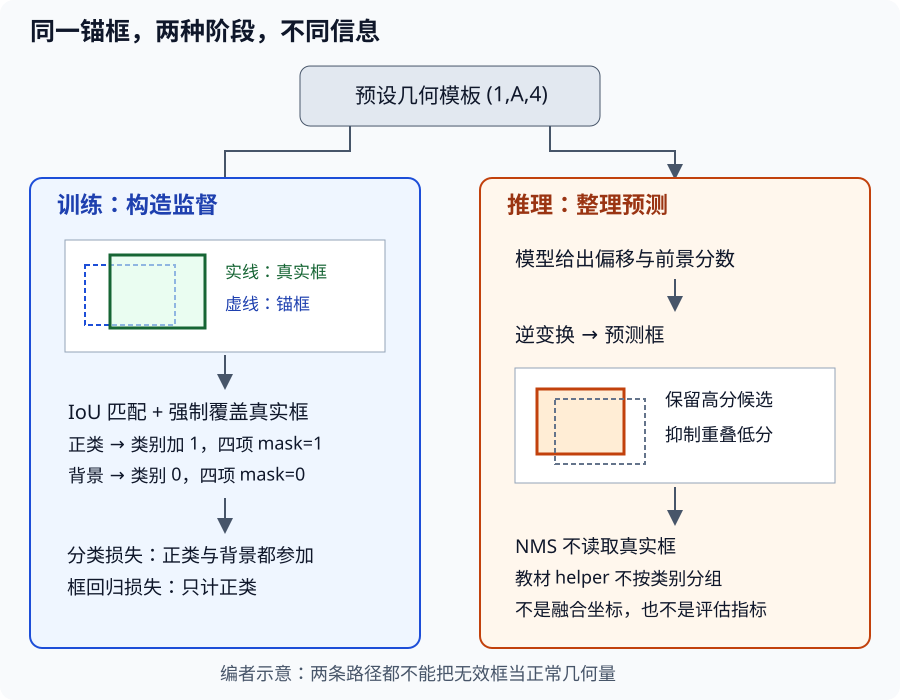

# 锚框：把找物体拆成匹配、回归与去重

## 1. 学习问题：谁告诉一个候选框该学什么

锚框是预设的候选几何框，不是模型已经发现的物体。训练时，要给每个候选框构造“是哪一类”和“该往哪改”的目标；推理时，再把预测偏移解码成框，去掉重复候选。

这三件事不能混用：**匹配用真实标注产生监督，回归学习几何修正，NMS只根据预测去重**。测试时不能拿真实框帮模型匹配。本讲止于这些机制，不提前实现SSD网络或密集预测实验。

沿用[上一讲](#/c/d2l-pytorch-2021/lec/lec40?v=notes)的连续坐标：左上原点、$x$右$y$下，四列顺序$x_1,y_1,x_2,y_2$，面积不加1。

## 2. 候选框怎样生成：数量与真实宽高比

设输入网格高$H$、宽$W$，有$n$种缩放比、$m$种宽高比。教材不取全部$nm$组合，而只取“第一宽高比配所有缩放比”以及“第一缩放比配其余宽高比”，每个中心有$n+m-1$个框。

$$
A=HW(n+m-1)
$$

网格第$i$行、第$j$列的归一化中心为：

$$
c_x=(j+0.5)/W,\qquad c_y=(i+0.5)/H
$$

教材的缩放比$s$以高度为基准，像素宽高分别为$Hs\sqrt r$与$Hs/\sqrt r$；归一化后：

$$
w=s\sqrt r\,H/W,\qquad h=s/\sqrt r
$$

因此矩形图也能保留像素空间的真实宽高比$r$。不能删掉宽度上的$H/W$因子，再宣称$r=1$就是像素正方形。

**手算：**网格$H=2,W=4$，两种缩放比、三种宽高比，得到$2\times4\times4=32$个框。若$s=0.5,r=1$，归一化宽0.25、高0.5；乘回宽4、高2后，两者都是1。教材`multibox_prior`实际返回$(1,A,4)$，首维是共享几何模板，**不是自动复制成输入批大小$B$**。它依据空间尺寸，不依据每张图像内容。

边缘锚框可以小于0或大于1；生成函数没有自动裁剪。是否、何时裁剪要明说，因为裁剪改变面积、IoU和回归目标。

## 3. IoU：相交多不等于相似度高

设两个框面积为$S_a,S_b$。先取交集左右端点：

$$
l_x=\max(x_{1a},x_{1b})
$$

$$
r_x=\min(x_{2a},x_{2b})
$$

同理得到上下端点$l_y,r_y$，交集宽高为：

$$
w_I=\max(0,r_x-l_x)
$$

$$
h_I=\max(0,r_y-l_y)
$$

再计算$I=w_Ih_I$与$U=S_a+S_b-I$，于是：

$$
\operatorname{IoU}=I/U
$$

**手算：**$a=(0,0,2,2)$、$b=(1,0,3,2)$，各面积4，交集2，并集6，IoU为$1/3$，不是$1/2$。相同有效框为1，分离或仅接触边界的有效框为0。

| 输入/中间量 | 形状 |
| --- | --- |
| 锚框 | $(A,4)$ |
| 有效真实框 | $(G,4)$ |
| 广播后的交集两角 | $(A,G,2)$ |
| 成对IoU矩阵 | $(A,G)$ |

前提是有效、有限、正宽高。两个零面积框会出现$0/0$；不能靠一个任意小分母把坏标注伪装成正常监督。应先按数据合同处理无效框。对两组框做相同的正比例$x/y$缩放，交集与并集乘同一面积因子，所以IoU不变。

## 4. 匹配：阈值之外，还要给每个真实框一个机会

令$J_{ag}$为IoU矩阵，要求有效真实框数$G\le A$。教材PyTorch实现分两步：

1. 每个锚框找到IoU最大的真实框；最大值**大于等于**阈值（默认0.5）就暂时分配，否则暂记$-1$。
2. 在整个矩阵中找最大值，把该真实框强制分配给该锚框，删除其行与列；重复$G$次。强制匹配可覆盖第一步的分配，且即使IoU低于阈值也保留。

这样，每个锚框最多一个真实目标，但多个锚框可以学习同一个目标；每个真实框至少有一个不同锚框负责。强制匹配解决的是“某个目标完全没有监督”，**不是保证每个匹配几何质量都高**。这是贪心分配，不是最大总IoU的最优匹配求解器。

为隔离逻辑，下表是编者给定的**假设IoU矩阵**，不是从真实图片测得：

| 锚框 | 真实框甲 | 真实框乙 | 阈值步骤结果 |
| --- | --- | --- | --- |
| A0 | 0.80 | 0.10 | 甲 |
| A1 | 0.60 | 0.20 | 甲 |
| A2 | 0.10 | 0.40 | 未匹配 |
| A3 | 0.20 | 0.10 | 未匹配 |

强制步骤先选A0→甲，再在剩余行/列选A2→乙。最终是`[甲, 甲, 乙, 未匹配]`。不能删掉A2，因为乙也需要监督。若某个未被强制选中的锚框最大IoU恰好0.5，固定代码的`>=`会把它设为正类；教材叙述中的“大于”不能替代代码边界。

空图像$G=0$必须显式产生全背景和零回归mask，不能对空列做最大值。类别$-1$的填充行要先去掉；固定教材`multibox_target`没有替你过滤填充行，不应把单目标演示误当通用检测数据管线。并列最大值的选择也要有固定规则，不能宣称所有设备必选相同下标。

编者自绘：左路真实框只用于生成训练目标；右路NMS只看预测分数与预测框。两条路共享锚框模板，但没有“推理时读取真值”的捷径。

## 5. 类别、mask和offset必须逐框对齐

原始对象类别为$0,\ldots,K-1$；锚框训练目标把背景设为0，匹配对象类别加1成为$1,\ldots,K$。未匹配锚框虽然没有回归目标，**仍是背景分类监督**。

上面的甲/乙若分别为原始类别0/1，四个锚框分类目标为`[1,1,2,0]`；回归mask每个正类四个1，负类四个0，mask元素和为12。

| 张量 | 教材批次形状 | 含义 |
| --- | --- | --- |
| 类别目标 | $(B,A)$ | 背景或对象类别加1 |
| 偏移目标 | $(B,4A)$ | 每框依次中心$x/y$、宽/高修正 |
| 回归mask | $(B,4A)$ | 只有正类参加框回归 |

### 为什么不能直接回归四个绝对坐标

相同的10像素位移，对小框与大框意义不同。教材按锚框宽高标准化位移，对尺度比取对数。设锚框中心宽高为$(c_{xa},c_{ya},w_a,h_a)$，匹配框为下标$b$，理论编码是：

$$
t_x=10(c_{xb}-c_{xa})/w_a
$$

$$
t_y=10(c_{yb}-c_{ya})/h_a
$$

$$
t_w=5\log(w_b/w_a),\qquad t_h=5\log(h_b/h_a)
$$

例如锚框中心$(0.4,0.5)$、宽高$(0.2,0.4)$，目标中心$(0.5,0.5)$、宽高$(0.4,0.2)$，则：

$$
(t_x,t_y)=(5,0)
$$

$$
(t_w,t_h)=(5\log2,-5\log2)
$$

解码时中心为$c_{xa}+t_xw_a/10$，宽为$w_a\exp(t_w/5)$，其余轴同理。理论上恢复目标框；零偏移恢复锚框。

**源码与理论的小差别：**固定`offset_boxes`在宽高比的对数内加$10^{-6}$，逆变换没有减去它。因此同框编码的宽高项也不是严格0，而约为$5\times10^{-6}$；编码后解码会使宽、高分别多出$10^{-6}$倍锚框宽、高。这是源码数值保护的近似，不应把“逐位完全相等”设为该组合的验收条件。零预测偏移的解码仍精确代表“不改锚框”（浮点误差另计）。

回归mask应作用在逐元素回归损失上；只把背景目标置零而不屏蔽背景预测误差，仍会训练背景框回归。$0\times\mathrm{NaN}$仍是NaN，不能先生成非法对数再寄望mask消除。分母使用所有锚框数还是正类数也会改变损失尺度，必须与后续训练设计保持一致。

## 6. NMS：删除重复，不是修框或评估

给预测框按置信度从高到低排序；保留最高者，删除与其IoU**大于**阈值的剩余框，再处理尚未删除的候选。教材保留条件为`IoU <= threshold`，所以恰好等于阈值的框保留。

**手算：**三个同类预测框为A=$(0,0,2,2)$、B=$(0.5,0,2.5,2)$、C=$(3,0,5,2)$，分数分别0.9、0.8、0.7。A与B交集3、并集5，IoU为0.6；阈值0.5时保留A、删除B，再保留C。NMS输出A、C，不平均它们的坐标，也不证明它们真是物体。若阈值恰好0.6，按该实现B会保留。

### 不把教材简化实现当所有检测器的定义

- 教材`multibox_detection`在**非背景通道**上取最大分数，并不是先在所有类别中取最大再丢背景；背景概率最大时，也可能留下超过前景阈值的候选。
- 教材调用一次NMS，**没有按类别分组**。不同类的重叠框也可能互相抑制。实际工程可采用逐类NMS，但那是另一个明确的策略，不能说教材已实现。
- 教材先NMS再处理低置信度；低于`pos_threshold`才被标无效，恰好等于阈值仍保留。源码对低置信度行还把分数改为$1-\text{conf}$，不能再把所有输出行的分数都当“有效前景概率”。
- 输出$(B,A,6)$，每行是类别、分数、四坐标；有效对象类恢复为$0,\ldots,K-1$，无效/被抑制为$-1$。因此**训练标签0是背景，输出类别0却是第一个对象类**。
- 解码与NMS不会自动把越界框裁进图像；并列分数的保留顺序也不能假定跨设备完全一致。NMS不使用真值，既不是检测准确率，也不保证保留框中的目标都存在。

## 7. 自测与答案

1. 只用IoU≥0.5匹配有什么缺陷？

某个真实目标可能与所有锚框的IoU都低于0.5，因而得不到正类监督。教材强制匹配为每个真实目标安排不同锚框，但低质量匹配并未因此变成高IoU。

2. 回归mask全零的背景锚框是不是完全不参加训练？

不是。框回归损失不计，但其背景类别仍参与分类监督。空图像可以提供背景信息，而非必须伪造一个目标。

3. 匹配阈值0.5与NMS阈值0.5相等时，含义相同吗？

不同。匹配比较锚框与真实框，等于阈值可成为正类；NMS比较预测框与已保留预测框，等于阈值不被抑制。二者处于不同阶段。

4. 两个不同类的完全重叠预测框能否同时留下？

教材的单次、不分组NMS可能删除低分的一个；逐类NMS则可各留一个。先明确策略再判断正确性，不能把策略差异当浮点故障。

5. 一个背景概率0.8、前景概率0.2的框一定被教材函数删除吗？

不一定。函数在非背景通道取最大分数；若0.2达到前景阈值且没被NMS抑制，它可以留下。这不等价于在背景和前景之间取最大类别。

## 8. 来源、分P索引与未覆盖边界

- [官方课表](https://courses.d2l.ai/zh-v2/)对应锚框；[教材13.4](https://zh.d2l.ai/chapter_computer-vision/anchor.html)固定源码全文已读，范围包括生成、IoU、分配、类别/偏移/mask、逆变换、NMS、检测输出及练习。本文的阈值、形状和实现限制以PyTorch分支为准，不宣称其他框架运行等价。
- 固定提交`e6b18cce…`完整值、原件哈希与精确范围见本讲manifest和[公共资料](#/c/d2l-pytorch-2021)。当前中文第二版固定源码不是2021快照；没有新读13.5多尺度或13.7 SSD，也没有训练或性能结论。
- [官方视频](https://www.bilibili.com/video/BV1aB4y1K7za/)作者“跟李沐学AI”，mid 1567748478，2021年发布。上传标题序号42与站内LEC41分开保留。

| 分P | 平台标题 | 本P时长 |
| --- | --- | --- |
| P1 | 锚框 | 18:07 |
| P2 | 代码 | 23:21 |
| P3 | QA | 11:25 |
| 全3P | 合计3173秒 | 52:53 |

2026-11-14每P公开字幕请求一次均成功空列表；未下载或观看音视频，无法核实讲授细节、代码演示和QA。以上只是平台分P目录，不是片内主题时间轴；教材不冒充课堂稿，空字幕列表不证明烧录字幕不存在。视频copyright=1/no_reprint=1不构成开放转录授权。正文、假设矩阵、数值小例和SVG均为编者自主组织。
