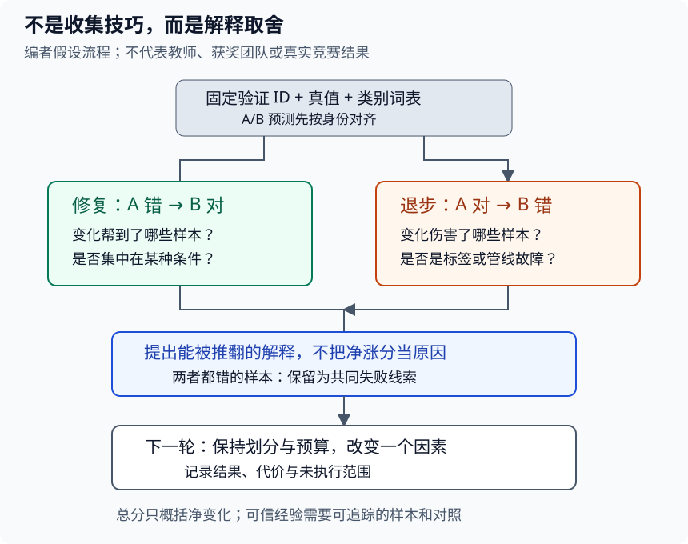

# 树叶竞赛总结：怎样把一个好结果变成可信经验

## 1. 学习问题：这次改动究竟帮了谁

看到“某方案分数更高”，下一步不该立刻复制所有技巧，而应问：比较的是同一批样本吗？增益来自哪项改变？有哪些样本从错变对，又有哪些从对变错？结论在哪些条件下失效？

> **本页是编者复盘阅读框架，不是课堂内容摘要。**已核实官方公告把本讲视频列为树叶竞赛技术总结，但没有取得可靠字幕，也没有观看音视频。因此不能写出教师的结论、获胜团队方法、名次或分数。以下案例均为假设，不代表比赛实际结果。

[LEC30](#/c/d2l-pytorch-2021/lec/lec30?v=notes)解决“开工前怎样确认任务与验证边界”；本讲解决“拿到一份实验记录或获准阅读的技术总结后，怎样审查结论”。无需重抄竞赛页面信息，更不需要先追榜。

## 2. 先锁住比较的对象，而不是记模型名

官方公告绑定的比赛是**Classify Leaves，host为Mu Li**。P5已读公开页面说明176类、18,353张训练图、8,800张测试图，指标为分类准确率；这些是页面描述，不是本站下载CSV核得的计数。CIFAR-10、Dogs与其他叶片数据都不是它。

一份复盘至少分开三种陈述：

| 层次 | 可以回答什么 | 不能替代什么 |
| --- | --- | --- |
| 官方任务事实 | 比什么、怎么评估 | 不能推出某团队如何训练 |
| 方案作者的陈述 | 作者说改了哪些条件 | 不自动等于独立复现 |
| 自己的实验观察 | 在固定环境/划分下实际发生什么 | 不能外推为历史排名或所有硬件表现 |

即使将来读到了某队总结，也要保存其真实出处、作者、日期及具体段落；没有原始证据的“据说”留为未核实，不把它写成老师推荐。公开视频元数据只能证明身份与分P，不能证明片内讲了什么。

## 3. 一份可比较记录需要哪些形状与身份

设固定验证样本数为$N$，类别数$K=176$。模型A/B输出可以组织为概率矩阵$P^A,P^B\in\mathbb R^{N\times K}$，真值$y$与预测$\hat y$均为长度$N$的整数向量。必须使用**同一组样本ID、同一行顺序、同一类别列顺序**。只有张量形状相等还不够。

| 记录 | 为什么需要 |
| --- | --- |
| 样本ID与划分版本 | 防止两个分数实际来自不同题目 |
| 类别词表及输出列顺序 | 防止概率平均或标签反解错位 |
| 训练/验证变换与预训练权重身份 | 判断改变的是模型还是输入合同 |
| 单次改变及不变项 | 判断比较是否能归因 |
| 验证正确数/总数、逐样本预测 | 不只留下四舍五入后的百分比 |
| 实际硬件、测量边界和代价 | 不能用网络名字推算速度或显存 |
| 失败、未执行范围和访问限制 | 不把没有完成的项目写成负面实验结果 |

其中“预训练”“微调”“多模型平均”等是**待核对的方案要素**，不是本讲教师或获奖团队已采用的事实。与[迁移学习实践](#/c/d2l-pytorch-2021/lab/cv-transfer)衔接时，也不能拿合成机制测试替代真实树叶训练。

## 4. 手算配对错误：总分一样，经验可能不同

定义第$i$张图的正确性：

$$
a_i=\mathbf1[\hat y_i^A=y_i]
$$

$$
b_i=\mathbf1[\hat y_i^B=y_i]
$$

把同一组验证样本分成四格：两者都对、A对B错、A错B对、两者都错。假设$N=20$：

| 配对类别 | 假设数量 |
| --- | --- |
| 两者都对 | 12 |
| A对、B错：退步 | 3 |
| A错、B对：修复 | 4 |
| 两者都错 | 1 |

A正确15张，准确率75%；B正确16张，准确率80%。提升5个百分点，不等于相对提升5%。相对准确率提升为$1/15$，约6.67%；错误数从5降到4，错误数相对减少20%。先讲清分母，再谈“提升”。

更重要的是：B修复4张，又损失3张。只汇报净增1张会掩盖取舍。差值可以直接写成：

$$
\Delta=\frac{n_{A错B对}-n_{A对B错}}{N}
$$

这只是有限验证集上的描述，不是统计显著性或泛化提升的证明。若不断在同一个验证集尝试几十种方案再只报告最高分，选择偏差不会因为“没有看测试真值”就消失。

图为编者自绘：按样本ID配对后，把修复与退步分开检查；下一轮只检验一个能被推翻的解释。它不画虚构的榜单成绩，也不把任一方法连成必然提升的路径。

### 再看类别条件，而不是只看总体

混淆矩阵$C$的形状为$(K,K)$，本文约定行是真实类、列是预测类。$C_{jk}$表示真实为$j$却预测为$k$的样本数，总和必须为$N$。第$j$行之和是该类支持数；对角线总和除$N$就是总体准确率。

若某类有10张、正确8张，另一类只有2张、正确1张，总体是$9/12=75\%$；两类召回率均值是$(80\%+50\%)/2=65\%$。二者不是互相矛盾，而是权重不同。宏平均可以帮助诊断少数类，但**不能把它冒充官方准确率指标**。某类在验证中没有样本时，召回率无定义，应标为不可估计，不伪装成0或100%。

## 5. 从错误到假设：一条证据链胜过技巧清单

对“B修复的4张”和“B弄错的3张”分别抽查时，可以按下列顺序提问。这里没有读取真实竞赛图片，类别均为检查维度，不是已经发现的数据问题。

1. **标注与身份有问题吗？**先看是否图像ID错位、类别反解错了、解码失败。不要把管线故障解释为模型泛化。
2. **是否集中在某种条件？**例如背景、姿态、缩放、遮挡或样本很少的类别。人工看过多少张应写清楚，不把少数印象说成全数据规律。
3. **提出能反驳的解释。**“B更强”不能反驳；“变化主要修复指定姿态的样本，但伤害另一组”可以用预先定义的切片检查。
4. **下一轮只改一个主要因素。**保持划分、标签词表、评估变换和训练预算一致。若连分辨率、模型、训练时长都变了，只能称组合方案比较，不能归因给某个单独技巧。
5. **写清停止条件与代价。**不是所有微小收益都值得额外内存或推理开销。没有实测时间，就把代价留为未测，不根据GPU型号编造吞吐。

如果考虑多个模型的预测平均，必须先按ID和类别对齐概率；不同模型“错得不一样”不保证平均一定更好。上例的两者都对12、至少一个对19，仅给出假设的“知道谁正确就挑谁”的上限，不是可实现的融合准确率，更不是比赛成绩。

## 6. 怎样阅读真正的竞赛总结而不脑补

对今后合法取得的本讲字幕、视频或方案原文，可以逐条提取下列内容；**当前这些课堂字段没有可靠材料，不能填入猜测**。

| 阅读问题 | 接受什么证据 | 当前边界 |
| --- | --- | --- |
| 谁提出了什么主张？ | 可定位原话/段落与作者 | 未取得片内材料 |
| 是否使用外部数据或预训练？ | 实际方案和适用竞赛规则 | 不从模型名称推断 |
| 本地验证怎样设计？ | 划分、去重/分组、指标口径 | 不从榜单名次反推 |
| 哪项改动贡献了收益？ | 同条件消融或明确限制 | 不把组合结果拆成单项收益 |
| 计算代价与失败在哪里？ | 实测记录及未运行说明 | 不虚构GPU性能 |
| 我能复用什么？ | 与自己的目标/访问条件相容 | 不要求复现获奖方案 |

当前可完成的是：解释上面的配对误差、识别不可归因的对照、提出一个有明确不变量的下一轮实验。**“已阅读真实课堂技术总结”仍然未完成**，不能因为读完本页而自动打勾。该缺口不影响先把自己的实验记录做可信。

## 7. 自测与答案

1. B从75%提高到80%，为什么不能只说“提升5%”？

绝对提升是5个百分点；相对准确率提升约6.67%；错误数减少20%。用词不同对应不同分母，必须说明口径。小例也没有证明统计显著性。

2. A和B输出都为(N,176)，可以直接按元素平均吗？

不能。还要核实样本ID、行顺序、类别词表与列顺序，以及两者是否真是可比较的概率。形状相同不会阻止语义错位。

3. 同时换模型、分辨率和训练轮数后涨分，能证明新模型更好吗？

只能证明这次组合在该评估条件下得到更高分。缺少控制变量对照时，无法把增益单独归因给模型结构。

4. 没拿到树叶数据，可以用CIFAR-10实验报告代替吗？

可以另做CIFAR-10教材任务，但必须保持身份独立。不能称为树叶实验、历史竞赛复现或本讲教师总结。

## 8. 来源、访问边界与真实课堂缺口

- [官方课表](https://courses.d2l.ai/zh-v2/)列出“树叶分类竞赛总结”；[官方公告](https://courses.d2l.ai/zh-v2/announcements.html)第十一周把比赛链接到Classify Leaves，第十六周把获胜团队和技术总结链接到本讲BV。本文直接复用P5已留存的公告证据，不从公告链接本身推导获奖方法。
- [Kaggle Overview](https://www.kaggle.com/competitions/classify-leaves/overview)、[Data](https://www.kaggle.com/competitions/classify-leaves/data)、[Rules](https://www.kaggle.com/competitions/classify-leaves/rules)：复用2026-11-14 P5匿名浏览器读取的正文与p5-manifest竞赛字段，不重复刷新访问接口。Data只写`Subject to Competition Rules`，Rules只有通用模板。**登录后的下载、加入与迟交条件，以及图片再分发权仍未核实。**本轮没有登录、接受规则、下载数据、训练或提交；今后按官网当时规则办理，不能绕过限制。
- [官方视频](https://www.bilibili.com/video/BV1by4y1K7SE/)作者“跟李沐学AI”，mid 1567748478，API发布时间为2021年7月3日；**课表安排日期为6月27日，两者分开保留**。真实全1P标题“树叶分类竞赛”，时长1589秒，即26:29。上传标题序号43、本站LEC42与课表日期是不同字段，不能据此重编课堂时间线。
- 2026-11-14公开player字幕接口请求一次，成功但列表为空；未下载或观看音视频，未取得教师/团队方案、演示、问答或片内时间轴。**没有可靠课堂来源，所以不生成draft，不用教材冒充树叶技术总结**；空列表也不证明没有烧录字幕。copyright=1/no_reprint=1不是开放转录许可。
- 本页没有对应的独立教材章节，未把CIFAR-10/Dogs章节当作树叶课堂材料。手算、配对诊断和SVG都是编者框架。精确证据复用路径、SHA-256与未运行记录见本讲manifest及[公共资料](#/c/d2l-pytorch-2021)。
