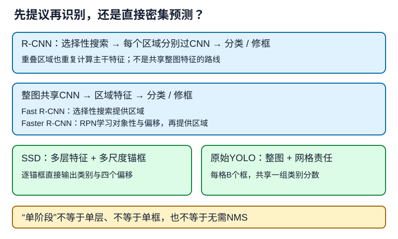

# 检测器如何从整张图走到多个对象

## 1. 学习问题：已有分类网络，为什么还不能检测

分类器给整张图片一个类别；检测器要输出**数量可变的一组类别和框**。困难不只是多预测四个数，还包括：哪里可能有目标、哪些预测对应同一个目标、没有目标的位置怎样训练。

[LEC40](#/c/d2l-pytorch-2021/lec/lec40?v=notes)定义框与变换，[LEC41](#/c/d2l-pytorch-2021/lec/lec41?v=notes)解决锚框、匹配、偏移和NMS。本讲不重做几何推导，而比较三条完整路线：**R-CNN系列先提议再识别，SSD从多层特征直接密集预测，原始YOLO用网格组织整图预测**。

“单阶段”不是只有一层，“两阶段”也不是对整张图运行两次完整主干。区别在于是否有独立的提议区域阶段，再对提议区域作对象识别与细化。

## 2. R-CNN系列：不断减少重复工作

| 方法 | 提议区域怎样来 | 特征怎样算 | 主要变化 |
| --- | --- | --- | --- |
| R-CNN | 选择性搜索 | 每个区域变形后分别过CNN | 用深度特征识别候选区域 |
| Fast R-CNN | 仍用选择性搜索 | 整图共享CNN，再RoI pooling | 消除大量重复主干计算 |
| Faster R-CNN | 共享特征上的RPN | 共享主干，提议后再识别 | 学习生成候选区域 |
| Mask R-CNN | 延续Faster R-CNN | RoI Align及额外mask分支 | 从框扩展到实例像素 |

原始R-CNN并不是一个简单的“CNN后接softmax”模型：教材介绍的路线包括区域特征、分类SVM和框回归。Fast R-CNN才在共享特征上组织分类与回归头。不能把后来的一套训练接口倒填成所有历史方法都相同。

设每张图有$R$个区域，每次区域主干计算成本约为$C$。原始路线粗略承担$RC$的区域特征计算；共享路线约为整图主干成本加$R$次轻量区域头。**这是解释重叠区域重复计算的成本模型，不是实测加速比**：整图与区域输入大小不同，提议生成、内存和后处理也占时间。

### RoI pooling：区域大小不同，输出形状一致

输入特征为$(N,C,H,W)$，共有$R$个区域，指定输出网格$(h,w)$，得到$(R,C,h,w)$。这里$R$是整个batch的区域数，不是每张图固定的类别数。

编者小例：单通道区域恰好是下面的$4\times4$网格，划为四个互不重叠的$2\times2$块，各取最大值：

$$
X=\begin{bmatrix}0&1&2&3\\4&5&6&7\\8&9&10&11\\12&13&14&15\end{bmatrix}
$$

$$
\operatorname{pool}(X)=\begin{bmatrix}5&7\\13&15\end{bmatrix}
$$

这是整齐分块的手算，不把它推广为任意浮点区域的取整规则。实际RoI pooling还要把原图坐标映射到特征坐标，按具体算子处理边界和量化。空间分辨率变为原图的$1/10$时，原图位置20对应特征位置2，不能直接把20拿去切特征。

**接口纠偏：**`torchvision.ops.roi_pool`的$(R,5)$区域张量第一列是**图像在batch中的索引**，不是目标类别。固定教材的相关文字把它写成类别，但单图示例恰好全是0，掩盖了差别。其余四列才是$x_1,y_1,x_2,y_2$。这项API约定不改变LEC40的连续框面积规则，不要将算子内部取整混入IoU公式。

### RPN：候选框也可以学习

RPN在共享特征图每个位置放置多种锚框，并预测“有对象/背景”与框偏移，再筛选为提议区域。后续区域头才判断具体对象类别并继续修框。

因此，RPN的二元对象性与最终$K$个对象类别不是同一输出；训练时两处都需要各自的分类和框回归监督。它不是把选择性搜索简单改名，也不是在推理时读取真实框。

Mask R-CNN再增加实例mask头，RoI Align用插值缓解空间量化误差。**两个同类对象仍要输出两个实例**；这与LEC45“同类像素同标签”的语义分割不同。

编者自绘：只比较计算组织，不表示原视频板书、网络精确层数或速度排名。

## 3. SSD：多个尺度，一起预测

SSD在多层特征上设置锚框，每个锚框直接预测对象类别（含背景）和四个偏移量；没有第二个RoI识别阶段。高分辨率层提供密集位置，较低分辨率层配合更大感受野和较大的锚框，覆盖不同尺度对象。

若第$l$层为$H_l\times W_l$，每位置有$a_l$个锚框，则候选总数为：

$$
A=\sum_l H_lW_la_l
$$

$K$个对象类别需要$K+1$个分类logits，另有4个框参数。一个$4\times4$层、每位置3框、2个对象类别，产生48个候选框、144个分类logits与192个框参数。**144不是物体个数，48也不是最终检测数**；还要解码、阈值筛选及去重。

“单发”表示一轮网络计算组织所有候选预测，不表示不要匹配监督、不要NMS，或者每张图只有一个框。完整教材TinySSD形状、损失和训练路径见[LEC44](#/c/d2l-pytorch-2021/lec/lec44?v=notes)。原论文SSD与教学小网络不等同，后者不能自动继承前者全部训练技巧或性能。

## 4. 原始YOLO：由目标中心确定负责的网格

这里明确讨论2016年原始YOLO，而不是把后来各代YOLO混成一个架构。模型将图分成$S\times S$网格；目标中心落在哪个格子，该格子负责预测它。每格输出$B$个框，每框有中心、宽高及置信度共5个值，另有**该格共享**的$K$个条件类别概率。

$$
\text{输出形状}=S\times S\times(5B+K)
$$

原始VOC配置$S=7,B=2,K=20$，因此是$7\times7\times30$，总计1470个数、98个候选框。不是$7\times7\times2\times25$，因为类别概率不是每个框各一份。中心偏移相对网格，宽高相对整张图，这两个归一化尺度不要混淆。

原始YOLO把框置信度的训练含义写成对象存在概率与定位IoU的组合；推理时模型只能**预测**该置信度，不会知道真实框来计算IoU。类别条件概率乘以框置信度，得到类别特定分数。编者例：某类条件分数0.8、框置信度0.6，乘积0.48；它不是“准确率48%”的测量结果。

训练在同一格的候选中让与真值当前IoU最大的预测器负责该目标；原始目标函数使用分类、置信度和坐标的平方误差项，另对坐标及无对象项加权，并处理宽高平方根。**不要把SSD的锚框匹配和交叉熵代码直接说成原始YOLO的定义。**

原始模型每格只有一组类别概率，对密集相邻的小物体存在表达限制。“整图一次预测”不等于永不重复框；原论文仍讨论NMS。后续版本改变了很多细节，本讲不据此概括所有YOLO的网格、锚框或损失设计。

## 5. 选型时先问什么

- **计算重复在哪里？** R-CNN区域间重叠，Fast系列共享主干；不凭名称中的Fast猜本机吞吐。
- **预测位置怎样组织？** 区域提议、SSD多尺度锚框、原始YOLO网格的监督责任不同。
- **小目标有哪些瓶颈？** 特征分辨率、中心密度和下采样损失，比“框画得更多”更重要。
- **指标衡量什么？** 框类别正确但定位差，仍可能是错误检测；训练分类准确率不能代替检测评估。
- **训练需要哪些东西？** 网络、标注、预处理、权重来源与评估协议缺一不可。可下载模型代码不等于数据和预训练权重可以任意再分发。

## 6. 自测与答案

1. Fast R-CNN是否已经不需要候选区域？

仍需要。它共享整图特征，但候选区域仍来自选择性搜索；Faster R-CNN才用RPN替代这一步。

2. 两张图的RoI张量第一列分别填猫类编号8和狗类编号12，哪里错？

第一列应是图像batch索引0或1。类别标签存于监督目标，不是RoI坐标接口的第一列。

3. SSD有多个尺度，为什么仍叫单阶段？

多个尺度直接输出最终候选的类别和框修正，并不先生成一批提议再送第二个区域识别头。层数和尺度数不是阶段数。

4. 原始YOLO每格两个框，所以能独立表达同格的任意两个类别吗？

不能这样保证。它们共享一组条件类别概率，目标责任和原始训练设计都有限制。输出98个框也不意味着任意98个物体都能被正确检测。

## 7. 来源、分P目录与边界

- [2021官方课表](https://courses.d2l.ai/zh-v2/)把R-CNN、SSD、YOLO三主题都链接到同一BV。真实平台目录只有目标检测和QA两P，**不是三个独立视频，也不能凭重复链接删除两个主题**。未核片内三主题各自起止时间。
- [教材13.8](https://zh.d2l.ai/chapter_computer-vision/rcnn.html)固定源码1–182行全文；[教材13.7](https://zh.d2l.ai/chapter_computer-vision/ssd.html)设计及预测头段落为SSD补充，完整实现交LEC44。固定提交`e6b18cce…`为当前中文第二版，不是2021快照，完整哈希见[公共资料](#/c/d2l-pytorch-2021)与本讲manifest。
- 编者补充：Joseph Redmon、Santosh Divvala、Ross Girshick、Ali Farhadi，[You Only Look Once: Unified, Real-Time Object Detection](https://arxiv.org/html/1506.02640)，CVPR 2016，核读§2、图2及§2.1–2.4；无需另做论文必读任务，不复制论文图或基准结论。
- 编者API纠偏：[torchvision 0.20 roi_pool](https://docs.pytorch.org/vision/0.20/generated/torchvision.ops.roi_pool.html)，参数与输出。几何机制复用LEC40/41及P6验收，不在本讲重训。
- [官方视频](https://www.bilibili.com/video/BV1Db4y1C71g)，作者“跟李沐学AI”、mid 1567748478；课表日期7月3日，上传日期2021年7月4日，两者分开。上传标题编号44不等于站内LEC43。

| 分P | 平台标题 | 本P时长 |
| --- | --- | --- |
| P1 | 目标检测 | 42:05 |
| P2 | QA | 16:24 |
| 全2P | 合计3509秒 | 58:29 |

2026-11-14每P公开字幕请求一次均成功空列表。未下载或观看音视频，不编造演示、问答和片内时间轴；空列表不证明不存在烧录字幕。元数据不是转录许可，教材及补充阅读不冒充课堂整理。本讲架构比较不报告模型训练结果；本批主agent独立执行的香蕉TinySSD小训练及其局限见[公共资料](#/c/d2l-pytorch-2021)，不是R-CNN或YOLO训练验证。
