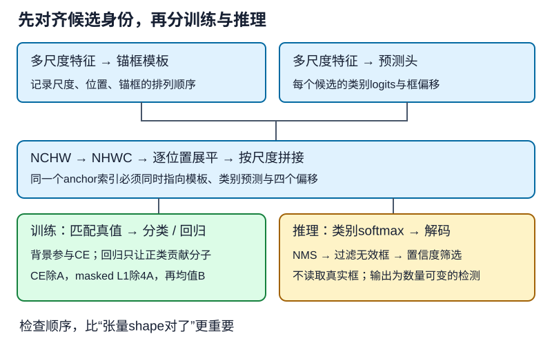

# 多尺度预测怎样组成一个可训练SSD

## 1. 学习问题：把几何函数接到网络上，最容易错在哪里

不是某个卷积层是否少写一行，而是**锚框顺序、分类通道、回归通道、监督目标是否指向同一个候选框**。维度完全合法，语义也可能错位；损失还会下降，却不代表框学对了。

本讲沿着“特征→候选与预测→监督→损失→更新→推理”的整条链检查教材TinySSD。它是教学小模型，不是原论文完整SSD复现。框坐标、匹配、NMS与偏移公式直接复用[LEC40](#/c/d2l-pytorch-2021/lec/lec40?v=notes)和[LEC41](#/c/d2l-pytorch-2021/lec/lec41?v=notes)。

## 2. 多尺度：中心密度和框大小是两件事

特征图$H\times W$决定中心网格；每中心的尺寸与宽高比列表决定框形状。减小特征图不会自动扩大你传入的锚框尺寸，扩大尺寸也不会增加中心数。

教材13.5用$4\times4$、$2\times2$、$1\times1$特征图，分别配尺度0.15、0.4、0.8，每处3种比例。候选数分别是48、12、3，共63。小物体中心位置变化多，适合更密的采样；深层较大感受野为大物体提供上下文，但不能据此保证每一层只检测某一种尺寸。

**坐标陷阱：**锚框中心处于归一化坐标，并不表示四个角一定都在$[0,1]$内。LEC41已说明边缘框可越界、矩形网格需$H/W$修正；本讲不偷偷裁剪再更改监督。

## 3. 从五个特征块算出5444个候选

教材基本网络串联三个减半块，每个减半块是两组卷积、BatchNorm、ReLU，再接$2\times2$最大池化。$3\times3$卷积配padding=1保留空间尺寸，池化减半。基础网络通道为$3\to16\to32\to64$，把$256\times256$输入变为$64\times32\times32$。

在每个减半块内部，两次步幅1的$3\times3$卷积与一次步幅2池化，使输出一个位置在该块输入上的理论感受野为$6\times6$；不是说整个深层网络感受野永远只有6。

| 预测块 | 特征通道 | 特征高×宽 | 每位置框数 | 框数 |
| --- | --- | --- | --- | --- |
| 基础网络 | 64 | 32×32 | 4 | 4096 |
| 第一个后续减半块 | 128 | 16×16 | 4 | 1024 |
| 第二个后续减半块 | 128 | 8×8 | 4 | 256 |
| 第三个后续减半块 | 128 | 4×4 | 4 | 64 |
| 自适应全局最大池化 | 128 | 1×1 | 4 | 4 |

最后一步直接从$4\times4$池化为$1\times1$，**没有额外$2\times2$预测层**。总计$4096+1024+256+64+4=5444$。

教材各层有2个尺度、3个比例，每处只用$2+3-1=4$种组合，不是6种。五组尺度为`[0.2,0.272]`、`[0.37,0.447]`、`[0.54,0.619]`、`[0.71,0.79]`、`[0.88,0.961]`；各组比例均为`[1,2,0.5]`。这些是固定教材的设置，不是普遍最优超参数。

## 4. 分类与回归头：相同位置，不同通道合同

设对象类别数为$K$，每处$a$个锚框，则分类头输出$a(K+1)$通道，回归头输出$4a$通道。两者都用保留高宽的$3\times3$卷积。

某位置的分类通道编号$a_i(K+1)+c$，表示该位置第$a_i$个锚框的第$c$类logit。0类为背景，原对象类别要加1。框偏移按每锚框4个值连续存放。

**顺序不变量：**先把$(B,C,H,W)$变成$(B,H,W,C)$，再展平空间及通道；按尺度顺序拼接，最后把分类输出恢复为$(B,A,K+1)$。直接展平原NCHW张量会把相同通道的所有位置堆在一起，与逐位置的锚框排列不一致。

编者顺序小例：一个$1\times2$网格有两个输出通道，通道0的两个数是10、20，通道1是11、21。正确的逐位置顺序为`[10,11,20,21]`；原NCHW直接展平是`[10,20,11,21]`。两者形状相同，内容归属不同。

教材单对象类别$K=1$时，每层分类头8通道、回归头16通道。任意batch大小$B$的总输出为：

| 输出/目标 | 形状 | 解释 |
| --- | --- | --- |
| anchors | $(1,5444,4)$ | batch共享几何模板 |
| cls_preds | $(B,5444,2)$ | 每框背景/香蕉两个logits |
| bbox_preds | $(B,21776)$ | 每框四个偏移 |
| cls_labels | $(B,5444)$ | 分类整数目标 |
| bbox_labels、bbox_masks | $(B,21776)$ | 回归目标与mask |

编者自绘：图示强调候选身份与数据流，具体尺度数量见上表。

## 5. 损失的分母就是模型合同的一部分

对第$b$张图，记第$a$个锚框分类logits为$z_{ba}$、类别为$y_{ba}$，偏移预测为$t$、目标为$t^*$，二元mask为$m$。固定PyTorch实现为：

$$
L_{\mathrm{cls},b}=\frac1A\sum_{a=1}^{A}\operatorname{CE}(z_{ba},y_{ba})
$$

$$
L_{\mathrm{box},b}=\frac1{4A}\sum_{j=1}^{4A}m_{bj}|t_{bj}-t^*_{bj}|
$$

$$
L=\frac1B\sum_{b=1}^{B}(L_{\mathrm{cls},b}+L_{\mathrm{box},b})
$$

源码把mask同时乘到回归预测与目标，再算逐元素L1；对于有限数和0/1 mask，与上述式子一致。不能用mask消灭NaN，因为$0\times\mathrm{NaN}$仍是NaN。

**背景仍参加分类；回归只由正类贡献分子，但分母仍是全部$4A$个坐标。** 这里既不是除以正类坐标数，也没有默认做hard-negative mining。分类输入必须是logits，不先softmax再交给交叉熵。

### 纸面反例：mask了背景，不代表按正类平均

一图有2个锚框，只有第一个是正类，其四个坐标绝对误差都是1；第二个是背景，预测误差即使很大也被mask掉。回归分子为4，教材回归损失是$4/8=0.5$，而按正类坐标平均会是1。

再添加2个背景锚框，保留同一个正类及其误差，教材值变为$4/16=0.25$。因此，**增加负类数量也改变了回归尺度**，不能把分母悄悄改成正类数却宣称完全复现教材。

若两个锚框的两个logits都为0，每框CE都是$\log2$，总损失是$\log2+0.5\approx1.1931$。背景回归梯度为0，背景分类梯度却不为0。

空GT、变长标注和填充$-1$需要数据适配层明确处理。LEC41已指出教材单目标路径不是通用检测数据管线；“loss有mask”不等于上游匹配函数已过滤填充行。

## 6. 训练：哪些状态和指标要记下来

教材用香蕉检测数据，batch=32，SGD学习率0.2、weight decay为$5\times10^{-4}$，20轮。这些只是**教材配置**，不是在任何设备上都合适，也不是本站已经训练的证据。

一轮更新的逻辑是：训练态→清梯度→前向生成锚框与预测→用当前图像真值构造目标→逐图损失→batch均值反传→优化器更新。真值匹配只在训练/有标注评估的监督侧发生，不进入无标注推理。

教材图中的两个指标分别是：

- `class error`：所有锚框类别错误比例，背景很多时可能很低；全预测背景也可能看起来不错。
- `bbox mae`：mask后**偏移量**绝对误差总和除以所有坐标数。不是像素单位框误差，不是只对正类平均，更不是mAP。

教材训练循环为简洁起见不评估验证集。自己的实验应单独冻结验证策略、检查无参数与BN状态更新，并记录匹配/定位情况；不要把训练曲线或一张漂亮图片当泛化结论。真实训练、CPU机制检查与GPU吞吐测量分别留证，不能互相替代。

## 7. 推理：不读真值，逐步把张量变回框

1. 保持输入像素尺度和训练一致。固定PyTorch香蕉演示读入后转float，并不是默认除255；不要把别的预训练网络Normalize无说明地接进来。换数据或训练管线时须同步明确范围。
2. 使用评估态固定BatchNorm行为。教材`predict`调用`eval()`，但没有自动关闭梯度；独立评估应另用无梯度上下文，二者职责不同。
3. 在类别维softmax，将$(B,A,K+1)$转为$(B,K+1,A)$，交给教材检测函数。
4. 对偏移解码，运行NMS，过滤类别$-1$。输出有效类别恢复为对象编号0起，与训练标签0代表背景不同。
5. 可视化将归一化坐标乘$(W,H,W,H)$。教材展示阈值0.9是额外筛选，不等于匹配阈值或NMS阈值。

固定PyTorch图片示例没有显式resize步骤；不能把其他框架的resize代码说成这个分支已经执行。任意输入尺寸改变特征网格和候选数量，5444只对应这里的$256\times256$结构。教材检测函数的**非背景最大分数、不按类分组NMS、越界框及等阈值边界**均沿用LEC41的说明，不替它暗中换策略。

## 8. 自测与答案

1. 把对象类别数改成3，总分类张量最后一维是多少？

4，含背景。256方图的候选数仍为5444；每位置4锚框时，分类卷积输出16通道，回归仍16通道。

2. 为什么正确reshape并不保证预测与锚框对齐？

形状只约束元素数量，不约束语义顺序。必须核尺度顺序、行列顺序、每位置锚框顺序及每锚框通道顺序。给各位置通道放可识别的小数字，比只看随机输出shape更有效。

3. 只有一个正类时，增加背景锚框是否不影响回归损失？

会影响固定教材的归约尺度。背景不增加回归分子，但全部坐标数分母变大；正类误差不变时损失变小。

4. eval()是否同时关闭梯度并计算验证mAP？

都不是。它切换模块行为；关闭梯度需独立上下文，检测评估需另实现明确的匹配及指标协议。教材class error不是mAP。

## 9. 来源、分P目录与边界

- [官方课表](https://courses.d2l.ai/zh-v2/)对应多尺度实现、SSD实现；[教材13.5](https://zh.d2l.ai/chapter_computer-vision/multiscale-object-detection.html)固定源码1–178行及[13.7](https://zh.d2l.ai/chapter_computer-vision/ssd.html)1–978行全文已读，包含完整模型、训练、预测、总结和练习。实现结论只按PyTorch分支，不宣称运行其他框架。
- 固定提交`e6b18cce…`不是2021快照，原件/范围/hash见本讲manifest及[公共资料](#/c/d2l-pytorch-2021)。本讲未重写LEC40/41几何；复用P6的检测与笔记数值证据，不据此宣称训练完成。教材练习的smooth L1/focal loss是改进方向，未混入基础模型或整段提供答案代码。
- [官方视频](https://www.bilibili.com/video/BV1ZX4y1c7Sw?p=1)，作者“跟李沐学AI”、mid 1567748478，2021年7月4日发布；上传标题45与站内LEC44区分。

| 分P | 平台标题 | 本P时长 |
| --- | --- | --- |
| P1 | 多尺度锚框 | 09:57 |
| P2 | SSD | 52:45 |
| P3 | QA | 27:01 |
| 全3P | 合计5383秒 | 1:29:43 |

2026-11-14每P一次公开字幕查询均成功空列表。这里只列平台分P，不猜片内时间、代码演示或QA；未下载/观看媒体，不创建draft。本讲编写者未执行训练；本批主agent已独立取得官方香蕉包、核对SHA1并执行完整五尺度TinySSD小训练，证据见[公共资料](#/c/d2l-pytorch-2021)。损失下降不等于检测质量已达标：检查图在0.9阈值下没有预测框，不能宣传训练成功识别目标。没有发布原图、数据包或权重，也不据此宣称完整教材训练、原Notebook兼容或GPU性能。
