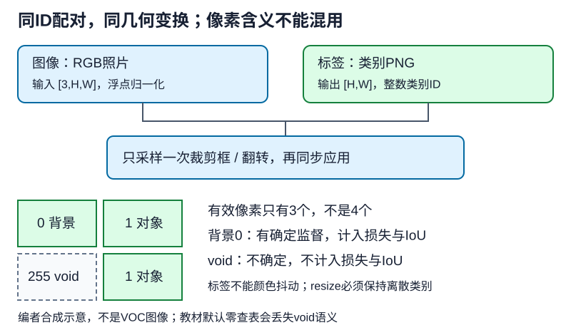

# 语义分割首先是一份像素标签合同

## 1. 学习问题：一张彩色标签图，为什么不能当普通图片训练

标签图的颜色是类别编码，不是要拟合的RGB外观。把它像照片一样做颜色抖动、除255、双线性缩放，可能悄悄产生不存在的类别。模型仍能接收张量，但监督已经损坏。

语义分割要求每个有效像素预测语义类别：两只狗都标为“狗”，不用区分是哪一只。实例分割还要区分对象身份；仅按外观相似性划分区域的图像分割，也不保证得到人想要的语义类别。框检测只用矩形范围，并不逐像素刻画轮廓。

## 2. 从磁盘文件到一一对齐的样本

VOC2012教材路径包含三类关键文件：

| 位置 | 内容 | 必须保持的不变量 |
| --- | --- | --- |
| `ImageSets/Segmentation` | train、val样本ID列表 | 用ID配对，不分别排序两堆文件 |
| `JPEGImages` | 输入照片 | 与标签原始高宽一致 |
| `SegmentationClass` | 像素语义标签PNG | 使用类标签，不换成实例编号mask |

官方分割划分在教材过滤之前为1464张训练、1449张验证；小于裁剪尺寸的样本会被教材过滤，因此这不是过滤后必然保留数量。代码将`is_train=False`映射到`val.txt`，**不是有公开真值的官方隐藏test集**；变量名`voc_test`不能改变文件身份。

对于batch大小$B$、裁剪高宽$H,W$，常见PyTorch合同是：

| 张量 | 形状 | 数据含义 |
| --- | --- | --- |
| 图像$X$ | $(B,3,H,W)$ | 浮点通道值，按训练规则归一化 |
| 标签$Y$ | $(B,H,W)$ | 整数类别ID，或明确ignore值 |
| logits$Z$ | $(B,K,H,W)$ | 每像素$K$个未归一化分数 |
| 预测标签 | $(B,H,W)$ | 在类别维取argmax |

VOC语义类别是20个对象类加背景，共$K=21$。这不同于检测里“每个候选框有一个类别”：这里每个位置都有分类任务。本讲止于数据与监督，恢复空间分辨率的网络机制接[LEC46](#/c/d2l-pytorch-2021/lec/lec46?v=notes)和[LEC48](#/c/d2l-pytorch-2021/lec/lec48?v=notes)。

## 3. 颜色查表：看得见的颜色不是模型类别轴

教材将PNG显式读取成RGB，再把每像素颜色编码成整数键：

$$
q=(256R+G)256+B
$$

再查表得到类别编号。这里$R,G,B$是0到255的颜色整数；运算前要转足够宽的整数类型，不能在uint8里溢出。颜色只是查表键，不能直接用其大小推断类别。

例如黑色$(0,0,0)$对应背景0；$(128,0,0)$键为8388608，对应飞机1；$(0,128,0)$键为32768，对应自行车2。直接把颜色通道当作三个类别，或者对RGB做argmax，都不等于完成类别映射。

教材建立$256^3$个long条目的查找表。在64位整数条件下需134217728字节，即128 MiB，尚未包括图片和其他张量。这是实现选择，不是VOC有一千多万个类别。若改成更紧凑的映射，必须保留未知/void处理与一致的类别顺序，不能用“省内存”掩盖语义变化。

### 最关键的差别：背景0不是void 255

官方VOC文档把不确定边界、模糊/困难/严重遮挡对象和一些过小区域标为void，索引255。它表示**此处没有可用于监督的确定类别**，不是背景，也不是第22个普通类别。官方规定训练时当作未标注像素，评估时忽略。

固定教材RGB查表先把所有条目初始化为0，再只写入21种类别颜色。因此未列入的颜色会被映射为背景，**源码没有忠实保留VOC的void语义**。即使标签图中某颜色看着像白边，也不能凭肉眼决定它是背景；应读原始索引或核对完整调色板。

忠实的数据管线有两条可选路径：保留PNG调色板索引，明确0–20与255；或转RGB后使用已核调色板，同时把void单独映射到ignore值。未知异常颜色应报错或记录为待处理，不能默认塞进背景。不能把“所有未知颜色都是void”当作掩盖损坏标签的万能规则。

编者自绘：示意格子与像素不是VOC原图；虚线格代表ignore，与有效背景分开。

## 4. 增广：同一几何参数，不同像素处理

**图像与标签必须共享一次采样的裁剪框、翻转方向及几何变换参数。** 给两者分别调用随机裁剪，即使尺寸相同，也可能把左边的狗配上右边的背景。教材`voc_rand_crop`先取一套裁剪参数，再同时应用到图像与标签，这一点应保留。

- 图像可做亮度、颜色等增广；标签不能做颜色抖动或通道标准化。
- 标签若确需resize，使用保持离散类别的最近邻等明确策略；不能双线性插值ID后四舍五入。图像插值可以不同，但几何坐标必须一致。
- 裁剪可能去掉某类全部像素；应记录真实类别分布，不能强求每裁剪块含有目标。
- padding应明确标签补ignore还是有效背景，二者改变监督含义，不能默默取0。

教材图像路径是先转float、除255，再按均值`[0.485,0.456,0.406]`、标准差`[0.229,0.224,0.225]`处理；标签保持整数类别。本讲不声称这组统计量自动适合任何数据或预训练权重，应与后续模型约定一起确认。

**验证态仍可能随机的陷阱：**固定教材训练与验证都使用同一个`__getitem__`随机裁剪；`shuffle=False`只固定取样次序，不固定裁剪。两个迭代器还都设置`drop_last=True`，会丢掉不足一batch的验证样本。可复现验证应采用明确的确定性裁剪/全图策略、不丢尾批，并记录实际覆盖像素；这些是编者建议，不能说教材已实现。

## 5. ignore必须同时进入损失分母和指标

令有效像素集合$V=\{i:y_i\ne255\}$，$p_{i,y_i}$是真实类别概率，则只对有效像素计算：

$$
L=\frac{1}{|V|}\sum_{i\in V}-\log p_{i,y_i}
$$

不能把void损失乘0后仍除以全部像素数，除非你明确选择这种不同的归约尺度。若一个裁剪块全是void，没有有效监督，应显式跳过其监督项并记录；不能把NaN或空集合平均值当成正常训练样本，亦不能改造一个假背景目标。

编者小例：2×2标签为：

$$
Y=\begin{bmatrix}0&1\\255&1\end{bmatrix}
$$

三个有效位置的真实类别概率分别为$1/2,1/4,1/2$，所以损失是：

$$
\begin{aligned}
L&=\frac{\log2+\log4+\log2}{3}\\
 &=\frac43\log2\approx0.9242
\end{aligned}
$$

不是除以4得到约0.6931。改变void位置的logits应不改变损失，且该位置各类logit梯度为0；有效背景位置仍参与训练。

### 像素准确率与IoU分别回答什么

假设预测为：

$$
\hat Y=\begin{bmatrix}0&1\\1&0\end{bmatrix}
$$

排除真值void后，三个有效像素中两个正确，像素准确率$2/3$。背景类交集1、并集2，IoU=$1/2$；对象类也是$1/2$，本例两类均值为$1/2$。void处无论预测成什么，都不应增加任何类别的TP/FP/FN。

若用混淆矩阵，先在真值侧过滤ignore，再按“行是真值、列是预测”累加。本例为：

$$
M=\begin{bmatrix}1&0\\1&1\end{bmatrix}
$$

真实VOC报告要声明对背景及20类的平均方式；小子集某类并集为0时，需声明缺类处理，不能不加说明把NaN改成0或1。全预测背景在背景占比很高时可能有很高像素准确率，因此也要看各类IoU。

## 6. 开始模型前的检查顺序

先核样本ID与划分，再核原始高宽、类别/ignore唯一值、配对几何变换、有效像素数，最后看batch形状与可视化叠加。对真实照片做叠加验收还涉及图片使用权；公开笔记可以只保留合成示意和数字证据，不能默认发布下载到的原图。

教材一次读入所有图像和标签，CPU内存不等于零成本；不能把数据总量、查表内存和GPU显存混为一谈。这里的纸面mask例子只解释机制，不冒充真实样本；本批主agent另行取得VOC并执行小规模FCN基线，其数据、权重、运行范围及局限统一见[公共资料](#/c/d2l-pytorch-2021)与[密集预测实验](#/c/d2l-pytorch-2021/lab/cv-dense-prediction?v=zh)，不由本讲算例替代。

## 7. 自测与答案

1. 黑色像素和void像素都不像目标，是否都设为0？

不可以。背景0是确定类别，提供监督；void表示标签不确定，不进入损失及指标。把void当背景会给边界与困难区域注入错误监督。

2. 标签值只有0、1，双线性缩放后再取整是否安全？

不安全。它改变类别边界及采样含义；对RGB标签还会造出未登记颜色。应选择保持离散类别、坐标与图像对齐的明确几何策略。

3. 验证loader不shuffle，为什么两次IoU仍可能不同？

因为数据集内部仍在随机裁剪；固定样本次序不固定像素内容。还要检查随机增广、尾批、ignore与模型评估态。

4. 上面的2×2例子，把void位置预测从1改成0，会改变IoU吗？

不会。该位置由真值ignore掩码剔除；有效像素的混淆矩阵完全不变。背景类与对象类IoU仍都是1/2。

## 8. 来源、分P目录与边界

- [2021官方课表](https://courses.d2l.ai/zh-v2/)包含语义分割与分割数据集；[教材13.9](https://zh.d2l.ai/chapter_computer-vision/semantic-segmentation-and-dataset.html)固定源码1–558行全文已读，具体张量/随机裁剪/颜色查表按PyTorch分支。当前中文第二版固定提交`e6b18cce…`不等于2021快照，完整版本及hash见[公共资料](#/c/d2l-pytorch-2021)与manifest。
- 编者纠偏：[Mark Everingham、John Winn，VOC2012 Development Kit](https://www.robots.ox.ac.uk/~vgg/projects/pascal/VOC/voc2012/htmldoc/index.html)，§2.2划分、§2.6 void/实例与类别mask、§5.4 IoU。文档证实标签含义，不证实第三方图片的开放再分发权。主agent单独记录数据取得与使用条件；本站不发布原图/标签包/权重，不把可公开读文档等同于数据使用许可。
- [官方视频](https://www.bilibili.com/video/BV1BK4y1M7Rd)，作者“跟李沐学AI”、mid 1567748478，2021年7月10日发布；上传标题46与站内LEC45区分。

| 分P | 平台标题 | 本P时长 |
| --- | --- | --- |
| P1 | 语义分割 | 07:12 |
| P2 | 语义分割数据集 | 27:57 |
| P3 | QA | 20:01 |
| 全3P | 合计3310秒 | 55:10 |

2026-11-14每P一次公开字幕请求均成功空列表，未观看或下载音视频，不编造课堂小例、QA或时间轴；空列表不证明无烧录字幕。正文例子与图为编者教学设计，不是数据集样本或课堂截图。本讲编写者未执行数值或训练；主agent独立完成的真实数据加载和小基线以集中证据为准，不外推为官方VOC评测、全量训练或GPU实验。
