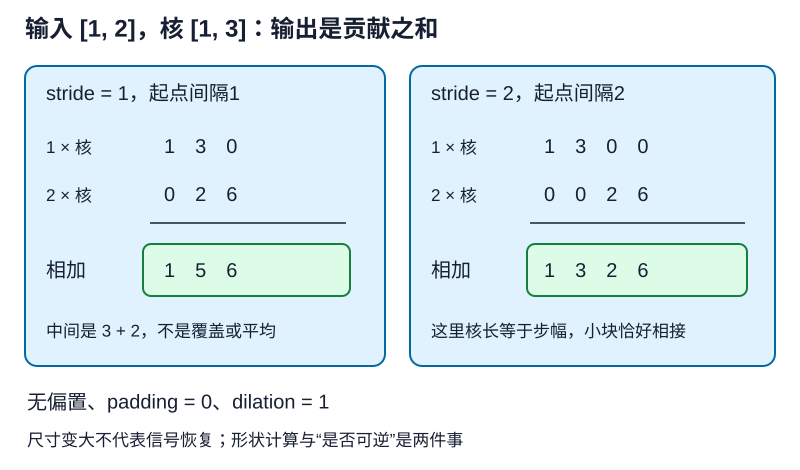

# 转置卷积：每个输入向输出散布一块

## 1. 学习问题：把尺寸变大，是否就还原了原图

分割网络下采样后得到较小特征图，但需要在更多空间位置给出类别分数。转置卷积提供一种**可学习的空间扩展**，不是找回所有丢失信息的魔法。学会它先分清三件事：数值怎样累加、输出尺寸怎样算、为什么尺寸恢复不等于数值恢复。

本讲用散布操作和形状反例建立直觉；[LEC47](#/c/d2l-pytorch-2021/lec/lec47?v=notes)专门解释线性伴随、矩阵转置以及等价卷积。两讲共用教材不等于重复课堂，也不在这里提前展开那套矩阵证明。

## 2. 基本操作：乘核，放到对应位置，再相加

先假设单输入/输出通道、无偏置，步幅1、padding=0、dilation=1。输入每个元素$X_{ij}$都乘同一个核$K$；把得到的小块左上角放到输出位置$(i,j)$。多个小块重叠时**相加，不覆盖、不取最大、不平均**。

设输入高宽$n_h,n_w$，核高宽$k_h,k_w$，最右下输入对应的小块会继续向外延伸，因此输出尺寸为：

$$
(n_h+k_h-1)\times(n_w+k_w-1)
$$

教材小例取：

$$
X=K=\begin{bmatrix}0&1\\2&3\end{bmatrix}
$$

输入右上角1把$K$放在输出右上；左下角2把$2K$放在输出左下；右下角3把$3K$放在输出右下。重叠相加得到：

$$
Y=\begin{bmatrix}0&0&1\\0&4&6\\4&12&9\end{bmatrix}
$$

中心位置4来自$0\times3+1\times2+2\times1+3\times0$。这也说明，输入右下角的3不一定只影响输出右下角一个元素。

编者自绘的一维简化：输入$[1,2]$、核$[1,3]$，步幅1时贡献重叠，得到$[1,5,6]$；步幅2时小块起点间距为2，得到$[1,3,2,6]$。它用于解释二维同样的散布原则，不是视频截图。

## 3. stride、padding各改变什么

### 步幅：相邻散布起点的距离

普通卷积的步幅控制读取窗口的移动；转置卷积的步幅控制各输入元素在**输出网格上**散布的起点间隔。步幅2时，输入$(i,j)$的核块起点为$(2i,2j)$，不能理解成丢掉一半输入值。

上面的$2\times2$输入和$2\times2$核，stride=2、padding=0时四个小块不重叠，输出为：

$$
\begin{bmatrix}
0&0&0&1\\
0&0&2&3\\
0&2&0&3\\
4&6&6&9
\end{bmatrix}
$$

若核尺寸比步幅大，小块仍可能重叠；“stride>1就没有重叠”是错误概括。

### padding：从完整散布结果裁掉边界

对于这套散布约定，padding=$p$相当于在完整结果两侧各裁掉$p$个位置，而不是简单给输出加零。二维高宽各裁两边；在刚才stride=1的$3\times3$结果上设padding=1，只剩中心$[4]$。

所以转置卷积**不一定放大尺寸**：输入$2\times2$、核2、padding1、stride1，输出反而是$1\times1$。先代入参数再判断，不能把“上采样层”当成无条件放大保证。

## 4. 一条形状公式，逐轴使用

设一轴输入长度$n$、核尺寸$k$、步幅$s$、padding=$p$、dilation=$d$、output_padding=$o$。有效核跨度是$d(k-1)+1$，则：

$$
n_{\mathrm{out}}=(n-1)s-2p+d(k-1)+o+1
$$

高与宽分别代入自己的参数，不要求是正方形。常见$d=1,o=0$时，就是“起点跨度$(n-1)s$加核尺寸$k$，减两侧裁剪$2p$”。

| 一轴输入$n$ | $k,s,p,d,o$ | 一轴输出 | 要说明的事 |
| --- | --- | --- | --- |
| 2 | 2,1,0,1,0 | 3 | 基本散布 |
| 2 | 2,1,1,1,0 | 1 | padding可能缩小 |
| 2 | 2,2,0,1,0 | 4 | 起点间距变大 |
| 3 | 3,2,1,1,0 | 5 | 输出尺寸有歧义 |
| 3 | 3,2,1,1,1 | 6 | 选择另一合法尺寸 |

### output_padding不是给结果补一圈零

普通卷积因向下取整，会把多种输入尺寸映射到同一种输出尺寸。例如$k=3,s=2,p=1$时，长度5和6都会变为3。转置运算只知道长度3，并不能推断原来是5还是6；默认返回5，output_padding=1选择6。

它是**确定输出形状的参数**，不保证新增位置数值为0，更不会补回原信号。不要把它等同于一般的零填充，也不能用任意大的output_padding修补架构尺寸错误；参数合法性必须遵守算子约束。

### 教材“形状恢复”的条件不能省略

教材示例输入16、$k=5,s=3,p=2$，普通卷积输出6，默认转置卷积返回16，确实恢复形状。但是把原输入改为17，普通卷积仍输出6，默认转置仍只返回16。相同超参数、交换通道数，并不普遍保证恢复任何输入尺寸。

用公式先核对下采样余数与需要的output_padding，再设计像素级输出。不能在最后随意裁图/补图，使尺寸看似正确，却让语义标签发生一像素偏移。

## 5. 多通道：每一对通道都有核，输出求和

输入为$(B,C_{\mathrm{in}},H,W)$；一个输出通道接收所有输入通道的散布贡献，再相加。多个输出通道各有各自核组。groups=1时，PyTorch `ConvTranspose2d`的权重形状是：

$$
(C_{\mathrm{in}},C_{\mathrm{out}},k_h,k_w)
$$

这与`Conv2d`的输出通道在前不同。不要只看到核高宽一样，就无条件互换权重两轴；共享某个正向卷积的权重时，还必须对应正确的输入/输出通道角色，详见下一讲。

例：2个输入通道、3个输出通道、$2\times2$核，权重24个；若启用bias，再加3个，共27个参数。bias是每输出通道一个，作用于最终输出，不是每个输入散布小块都额外加一次bias。所有手算例关闭bias，避免混入这一项。

## 6. 为什么不是逆运算

只需一个一维反例，不必先学完矩阵推导。普通无填充卷积用核$[1,1]$、stride=1，把长度2的输入$[1,0]$与$[0,1]$都变为$[1]$。输出完全相同，任何只接收$[1]$的算子都无法判断原来是哪一个。

用同核转置卷积把$[1]$散布回长度2得到$[1,1]$，不是上述任何一个原输入。即使输出形状正确，也不可能凭空恢复信息。

转置卷积通常作为可训练模块，学习怎样从语义特征生成较密的表示；它不要求是前面下采样层的数值逆。术语“反卷积”容易误导，这里始终称转置卷积。与真正矩阵转置和梯度的关系留给LEC47展开。

### 重叠次数也会影响纹理

编者一维例：输入$[1,1,1]$、核$[1,1,1]$、stride=2、padding=0，散布和为$[1,1,2,1,2,1,1]$。即使输入和核都常数，输出也可能因重叠次数不同而不均匀。这帮助理解为什么上采样输出要检查纹理，**不是断言每个转置卷积必然出现伪影**。

## 7. 自测与答案

1. 基本2×2例子中心位置应当保留最后一次写入的值吗？

不应覆盖，必须把所有贡献相加。该例中心是0×3+1×2+2×1+3×0=4。

2. 长度3，核3，stride2，padding1，为何能得到5或6？

普通卷积把长度5和6都映射到3，存在形状歧义。转置卷积output_padding=0返回5，设1返回6；这只选择形状，不恢复原始值。

3. 输入2通道、输出3通道、核2×2，不带bias有几个参数？

2×3×2×2=24，权重形状(2,3,2,2)。带bias再加3，不是加每个输出像素一个独立偏置。

4. 17→6→16是否说明转置卷积实现坏了？

不说明。k5、stride3、padding2下这是默认output_padding=0的正确尺寸。需要按原尺寸决定输出歧义参数；形状恢复后也不能宣称值恢复。

## 8. 来源、分P目录与边界

- [官方课表](https://courses.d2l.ai/zh-v2/)保留“转置卷积”和下一讲“转置卷积是一种卷积”两个独立BV。[教材13.10](https://zh.d2l.ai/chapter_computer-vision/transposed-conv.html)固定源码1–291行全文已读；本讲主要使用35–184行，矩阵部分186–279行留给LEC47。两讲定位不同，不把共同阅读链接解释为重复内容。
- 编者补充：[PyTorch 2.5 ConvTranspose2d](https://docs.pytorch.org/docs/2.5/generated/torch.nn.ConvTranspose2d.html)的形状、output_padding、权重及非逆说明，用于纠正“任意输入都自动恢复形状”的过度概括；没有运行或保证2021原Notebook兼容。
- 固定教材提交`e6b18cce…`为当前中文第二版，不是2021快照；完整commit、原件hash和范围见本讲manifest及[公共资料](#/c/d2l-pytorch-2021)。小例是纸面机制合同，不是网络训练、像素恢复质量或GPU测量。
- [官方视频](https://www.bilibili.com/video/BV17o4y1X7Jn/)，作者“跟李沐学AI”、mid 1567748478，2021年7月10日发布；上传编号47与站内LEC46分开。

| 分P | 平台标题 | 本P时长 |
| --- | --- | --- |
| P1 | 转置卷积 | 09:21 |
| P2 | 代码 | 12:42 |
| P3 | QA | 09:55 |
| 全3P | 合计1918秒 | 31:58 |

2026-11-14每P一次公开字幕请求均成功空列表，未下载或观看音视频，不猜课堂时间轴、演示结果或QA；空列表不能排除烧录字幕。中文原课通过页头观看，本课不另作课堂逐段整理；不另作重复教材materials。主agent的CPU机制核验见P7主记录，真实分割小训练另见公共资料；未执行GPU实验。
