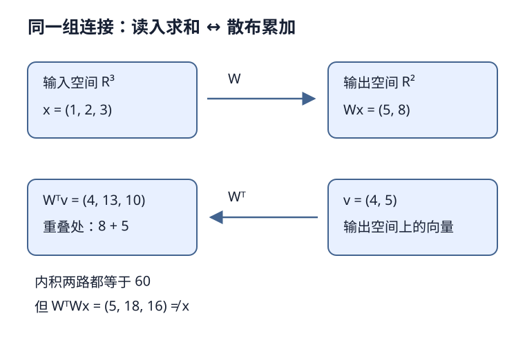

# 转置卷积是一种卷积：伴随不是逆

## 1. 学习问题：转置的到底是什么

[LEC46](#/c/d2l-pytorch-2021/lec/lec46?v=notes)从“每个输入值乘核、散布到输出、重叠相加”解释操作和形状；这一讲换一个问题：**为什么同一个操作既是矩阵转置，又能用普通卷积表达？** 两讲互补，不因共用教材而合并。

转置的不是把小卷积核沿主对角线翻一下，而是把**固定输入形状、边界规则、步幅及卷积核共同定义的大线性算子**转置。以下先固定实数、单通道、无偏置；深度学习库所谓卷积通常实际计算互相关，不预先翻转核。

## 2. 把一次局部求和写成矩阵

先用一维例子避免二维展开遮住概念。输入$x=(1,2,3)$，核$k=(1,2)$，步幅1、无填充：

$$
y_0=x_0+2x_1=5,\qquad y_1=x_1+2x_2=8
$$

把“窗口滑到哪”写进矩阵：

$$
W=\begin{bmatrix}1&2&0\\0&1&2\end{bmatrix},\qquad y=Wx
$$

$W$是$2\times3$，不是原始$1\times2$核。每行代表一个输出要读取哪些输入，重复的系数表达参数共享。

现在给输出空间一个向量$v=(4,5)$：

$$
W^\top v=\begin{bmatrix}4\\13\\10\end{bmatrix}
$$

第一份输入4散布出$(4,8,0)$，第二份输入5散布出$(0,5,10)$，重叠处加成13。这恰好是LEC46的散布视角。二维只是把每个滑动窗口对应的输入坐标展开到更大的稀疏矩阵，原理不变。

图为编者自拟一维例；箭头标的是线性算子，不是自动逆运算。

## 3. 伴随关系为什么也是反向传播

实数欧氏内积下，伴随的定义是：

$$
\langle Wx,v\rangle=\langle x,W^\top v\rangle
$$

上例左边$5\times4+8\times5=60$；右边$1\times4+2\times13+3\times10=60$。这比“输出长得像”更能检验是否真是同一个卷积的伴随。

若标量损失$L$对输出的梯度为$v=\nabla_yL$，链式法则给出：

$$
\nabla_x L=W^\top v
$$

所以转置卷积的前向计算形式，就是对应普通卷积向输入传梯度的形式。**这不意味着转置卷积层正在执行训练的backward**：它可以作为一个正常的可训练前向层，随后再对自身求导。权重梯度是另一条链，不能把输入梯度和权重梯度混为一谈。

加入偏置后$y=Wx+b$是仿射映射；对输入的导数仍由$W$决定。比较伴随恒等式时必须去掉偏置，否则常量项会破坏等式。

## 4. 为什么不是把原图找回来

把$y=(5,8)$送回上面的伴随，得到：

$$
W^\top y=(5,18,16)\ne(1,2,3)
$$

一般$W^\top W\ne I$。而且从3个数变为2个数通常已经丢失信息；向量$(-2,1,-0.5)$经过$W$会得到零，所以原输入加上其任意倍数也给出同一个$y$。伴随无法凭空知道丢掉了哪一部分。

- **形状恢复**：输出元素数回到输入元素数。
- **伴随映射**：满足内积关系，按原连接把贡献累加回来。
- **求逆/反卷积问题**：在假设和约束下寻找解释观测的输入，可能不唯一或不稳定。

这三件事不是同义词。普通卷积后接一个随机初始化的转置卷积，连权重都未绑定，更不能称为逆。

## 5. 怎样改写成普通卷积

以深度学习的**互相关**约定看，步幅1转置卷积等于：给输入两端各补$k-1$个零，再用**反转后的核**做步幅1互相关，最后按原padding裁掉对应边界。

上例$v=(4,5)$补成$(0,4,5,0)$，用反转核$(2,1)$滑动：

$$
\begin{bmatrix}0\times2+4\\4\times2+5\\5\times2+0\end{bmatrix}
=\begin{bmatrix}4\\13\\10\end{bmatrix}
$$

二维时反转的是高、宽两个轴，即核旋转180度，不是只交换行列。若采用数学中本来就翻核的“卷积”定义，同一表达不需要再说一次反转；先交代术语约定才能比较公式。

步幅$s>1$时，在相邻输入元素之间插入$s-1$个零，再按相同思路做全尺寸互相关。例如核仍为$(1,2)$、输入$(4,5)$、步幅2，散布结果为$(4,8,5,10)$；插零输入$(4,0,5)$配反转核也可得到它。**插零是等价计算的解释，不是要求工程实现真的分配一个巨大零张量。** 高效实现保留卷积算子即可，显式大矩阵只适合小型机制检查。

多通道时还要交换算子的输入/输出通道角色。PyTorch普通卷积权重布局为$(C_{out},C_{in}/g,k_h,k_w)$，转置卷积为$(C_{in},C_{out}/g,k_h,k_w)$；当转置层的输入/输出通道与原层互换且分组一致时，可绑定同一存储形状的权重，不是随意对四维权重做`.T`。

## 6. 同一个输出可能对应不同输入长度

伴随必须把向量送回**原来的输入空间**，而不只是“某个差不多大的张量”。普通卷积的向下取整可能把不同长度映射到同一长度；因此比较内积或输入梯度前，要先确定原输入尺寸，再选择合法的`output_padding`。

形状公式、5/6→3的歧义及16→6→16反例已在[LEC46 §4](#/c/d2l-pytorch-2021/lec/lec46?v=notes)展开。本讲的额外不变量是：绑定同一核，保持padding、stride、dilation和groups，且转回的空间与原输入完全一致。否则连内积中的两个向量都可能不在同一个空间，不能据此检验伴随。

## 7. 自测与答案

1. 把2×2卷积核转置，能得到转置卷积吗？

不能。转置的是展开后的整体线性算子。二维互相关等价改写通常需要空间180度翻核、插零及边界处理，还包括通道角色交换。

2. 怎样检验两段实现是伴随，而不是只验证形状？

绑定核并关闭偏置，固定原输入空间和输出空间，比较随机$x,v$的两个内积；另用标量$(\mathrm{conv}(x)\cdot v)$求输入梯度，与转置卷积输出比较。允许浮点容差，不能用不同随机权重比较。

3. 上例的60和(5,18,16)分别说明什么？

60说明两条内积路径一致；$(5,18,16)$与原输入不同说明伴随不是逆。二者可以同时成立，没有矛盾。

4. 显式构造大W适合真正训练吗？

通常不适合：重复存储权重和大量零，失去卷积的共享与局部计算优势。矩阵表示用于推导及小例核对，不应成为大图训练的默认实现。

## 8. 来源与视频边界

- [官方课表](https://courses.d2l.ai/zh-v2/)把本讲和LEC46分别列为独立BV，指定同一[教材13.10](https://zh.d2l.ai/chapter_computer-vision/transposed-conv.html)。固定源码全文已读；当前中文第二版提交`e6b18cce…`不是2021快照，完整hash见本讲manifest及[公共资料](#/c/d2l-pytorch-2021)。一维数值、伴随恒等式与互相关改写为编者推导，不冒称视频板书。
- [官方视频](https://www.bilibili.com/video/BV1CM4y1K7r7/)作者“跟李沐学AI”，mid 1567748478；平台标题为“47.2 转置卷积是一种卷积”。课表日期7月10日，实际上传2021年7月13日，不能混为同一字段。平台动态说明这是补充重讲的角度，但不据此编造片内内容。

| 分P | 平台标题 | 时长 |
| --- | --- | --- |
| P1 | 再谈转置卷积 | 09:39 |
| 全片 | 579秒 | 09:39 |

2026-11-14公开字幕查询一次成功且列表为空；未观看音视频，没有片内时间索引、演示或QA覆盖证据。空列表不排除烧录字幕；视频没有开放转录再发布授权。不建占位draft或重复materials。
