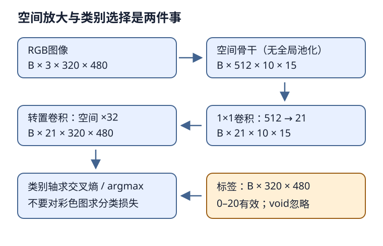

# FCN：从图像级特征回到逐像素预测

## 1. 学习问题：分类器怎么为每个像素作答

分类网络通常把空间特征汇聚成一个向量，再回答“整张图是什么”。语义分割要回答“每个位置是什么”，所以不能在输出前把空间坐标全部平均掉。

FCN的全称是**全卷积网络**（fully convolutional network），不是“把卷积接到全连接层”。官方课表标题保留其原措辞；本讲使用教材术语。核心链条是：保留空间网格的骨干 → 每个位置产生类别logits → 上采样到像素网格。它不是实例分割，同类的两只狗仍用同一个语义类别。

前置标签几何见[LEC45](#/c/d2l-pytorch-2021/lec/lec45?v=notes)，上采样形状见[LEC46](#/c/d2l-pytorch-2021/lec/lec46?v=notes)，线性伴随见[LEC47](#/c/d2l-pytorch-2021/lec/lec47?v=notes)。

## 2. 一条能够逐层核对的形状链

固定教材PyTorch示例取预训练ResNet18，去掉最后的全局平均池化和全连接层。对$320\times480$输入：

| 位置 | 张量形状 | 此时每个位置的含义 |
| --- | --- | --- |
| RGB输入 | $(B,3,320,480)$ | 图像像素 |
| ResNet18空间骨干 | $(B,512,10,15)$ | 大感受野特征 |
| $1\times1$类别卷积 | $(B,21,10,15)$ | 粗网格的21类logits |
| 转置卷积 | $(B,21,320,480)$ | 像素网格的21类logits |
| 类别轴argmax | $(B,320,480)$ | 每像素一个整数类别 |

$1\times1$卷积在每个位置共享一个512→21的线性分类器，**只换通道、不放大空间**。转置卷积放大的是空间，最后21个通道不是21张RGB图片，也不是21个实例。

编者重绘：图像特征和监督标签最终在同一网格相遇；void不是背景或第22类。

固定教材最后一层是21→21、核64、步幅32、padding16的转置卷积。取$d=1,o=0$：

$$
H_{out}=(10-1)\times32-2\times16+64=320
$$

$$
W_{out}=(15-1)\times32-2\times16+64=480
$$

这里恰好把高宽各放大32倍。**增加像素数量不等于找回被下采样丢失的边界细节**；这也是只从最后一层特征上采样的基础方案的局限。教材练习提到融合中间层，不等于本例已经实现多尺度跳连。

## 3. 21类包含背景，不包含void

VOC语义分割的训练类别是20种对象加背景。有效类别索引为0–20，背景0是一种需要学习的有效类别；void/未标注边界通常以原始调色板索引255表示，**不作为一个监督类别**。标签应保留整数语义，不要把调色板RGB的三个通道当成三个类别。

固定教材13.9把RGB颜色查表转成类别，但查表先全置0，仅填入21种合法颜色。未登记颜色因此会落到0；这是一种教学简化，**不等于void真的属于背景**。只看“转换结果都在0–20”无法证明标签正确，反而可能掩盖了边界丢失。

用于实际小基线时，标签管线须明确：

1. 保留原始类别索引，或对已核实的颜色表作显式映射；void映射为独立忽略值。
2. 图像和标签采用同一裁剪/翻转参数；图像可双线性插值，类别mask只能用不制造新类号的最近邻方式缩放。
3. 训练交叉熵与验证指标都排除void；背景仍参与二者。
4. 类别0–20、ignore值之外的输入应单独诊断，不能无条件把损坏颜色视为合法void或背景。

这里是对真实数据合同的编者补强，不宣称原教材的辅助函数已经实现忽略机制。原始标注和访问条件见[实验说明](#/c/d2l-pytorch-2021/lab/cv-dense-prediction?v=zh)。

## 4. 对logits求损失，而不是对彩色图求损失

交叉熵输入为$(B,21,H,W)$的浮点logits，目标为$(B,H,W)$的整数类号；类别维是1。训练时不先argmax，不额外把softmax结果再当logits传入交叉熵。

设$V$是有效像素集合，$\ell_i$是每个有效像素的交叉熵。编者采用有效像素全局平均：

$$
L=\frac{\sum_{i\in V}\ell_i}{|V|}
$$

仅设置`ignore_index`并取`reduction='none'`后，对包含已置零忽略位的整个$H\times W$求mean，会把分母变成所有像素数，结果被void比例稀释。固定教材的逐图两次mean适用于其未显式忽略标签的示例；改成void合同后，分母也要改。

**小例：**4个位置只有3个有效，21类全零logits使每个有效像素损失为$\log21$。正确有效平均仍是$\log21$；错误地除以4得到$\tfrac34\log21$。若整张图都被忽略，不能除以零；应按既定策略跳过并记录，不把空监督记作优秀的零损失。逐图等权平均与全有效像素平均是不同合同，不能悄悄混用。

像素准确率容易被大面积背景主导。教材报告像素准确率；工程上可另报每类IoU及mIoU，但必须说清楚哪些类别参与平均、零并集类别怎样处理、void怎样排除，不能把它们冒称教材已测指标。

## 5. 双线性初始化是起点，不是固定算法保证

教材给转置卷积核填入双线性滤波器：初始化时同类通道之间有空间权重，跨类别通道为0。因此初始意图是每类logit图独立平滑放大，而不是把“猫分数”直接混入“狗分数”。

对核大小4的示例，一维滤波权重为：

$$
a=(0.25,0.75,0.75,0.25)
$$

二维核为$a^\top a$，例如中心位置权重0.5625。核大小64时用同一构造，只是覆盖更大的空间范围。

有三条实现边界：

- 教材FCN的转置层未设`groups=21`，所以它是可学习的完整跨通道算子；训练后跨类权重不必仍为0。
- 教材独立的插值演示关闭bias，但FCN层默认带bias，初始化代码只复制weight。若要严格比较“纯双线性滤波”，须明确bias为0；不能直接声称任意实例都与插值函数逐点相同。
- 转置卷积的零边界、坐标对齐与插值API的边界/`align_corners`约定可能不同。应在固定约定下比较，不用一张视觉上相似的图代替逐点等价证明。

教材正文提到$1\times1$卷积的Xavier初始化，但固定PyTorch分支没有展示对应显式赋值；不能从文字外推该分支已执行Xavier。应记录实际构造与初始化，而不是混用不同框架的代码。

## 6. 任意尺寸、预训练与验证如何对齐

固定例子刻意选32的整数倍。对原始ResNet18空间骨干，输入$321\times481$会得到$11\times16$网格，上述转置层输出$352\times512$，不自动等于输入。

可采用明确的pad到32倍数再裁回、按目标尺寸对齐logits，或完整覆盖的滑窗。必须记录padding/坐标映射，并把相同处理施加到监督mask；不能为让损失通过而任意截去图像内容。重叠窗口可先平均logits再预测类别，不能简单平均整数类号。教材展示左上角裁剪只是局部示例，不代表预测过整图。

预训练ResNet18需要权重及相应输入标准化。权重枚举、数据使用和本地访问条件由实验留证；**随机初始化模型能跑通形状，不等于完成预训练分割训练**。训练/验证划分按原图身份固定，验证裁剪应确定；只在训练视图增加随机性。GPU、真实VOC小训练与合成形状检查分别记录，本站不据公式推算训练精度。

## 7. 自测与答案

1. 为什么去掉全局平均池化？

它将空间网格压成一个向量，丢掉逐像素定位所需的空间结构。FCN保留粗网格，再学习上采样。

2. 21类是否意味着应把void改成第21号？

不是。21个有效索引是0–20，含背景。void不参与分类监督，不应成为额外logit通道，也不能悄悄映成背景。

3. 全零logits的有效交叉熵是多少？

每个有效像素为$\log21$；有效平均仍为$\log21$，与忽略像素的个数无关。全void批次另行处理。

4. 经过32倍上采样，细边界一定恢复了吗？

没有。输出尺寸只解决网格对齐，信息恢复取决于特征和学习过程。丢失的细节不会因像素数增加自动出现。

## 8. 来源、分P索引与边界

- [官方课表](https://courses.d2l.ai/zh-v2/)对应[教材13.11](https://zh.d2l.ai/chapter_computer-vision/fcn.html)，全文已读；[13.9](https://zh.d2l.ai/chapter_computer-vision/semantic-segmentation-and-dataset.html)只追加读取数据、类别、颜色映射及同步裁剪部分。固定提交`e6b18cce…`是当前中文第二版，不是2021全书快照。原件hash及精确范围见本讲manifest。
- void的原始标注约定、VOC使用条件及ResNet18权重条件依[密集预测实验](#/c/d2l-pytorch-2021/lab/cv-dense-prediction?v=guide)的独立证据；源码许可不替代图像/权重条件。不发布VOC图片或权重，不把教材图片当本站执行结果。
- 本批主agent另做了真实VOC小规模FCN检查：冻结骨干、仅训练头，验证表现弱且可视化接近全背景，不是分割质量证明。权重/数据获取、执行范围与限制集中见[公共资料](#/c/d2l-pytorch-2021)，不等于原教材完整训练已复现。
- [视频](https://www.bilibili.com/video/BV1af4y1L7Zu/)作者“跟李沐学AI”，mid 1567748478，2021年7月11日上传。

| 分P | 平台标题 | 时长 |
| --- | --- | --- |
| P1 | FCN | 04:23 |
| P2 | 代码 | 17:41 |
| P3 | QA | 04:51 |
| 全3P | 合计1615秒 | 26:55 |

2026-11-14每P公开字幕请求一次均成功空列表；未观看音视频，以上不是片内主题时间轴，不补造QA或课堂演示。视频copyright=1/no_reprint=1，无全文转录再发布授权；不创建占位draft或重复materials。
