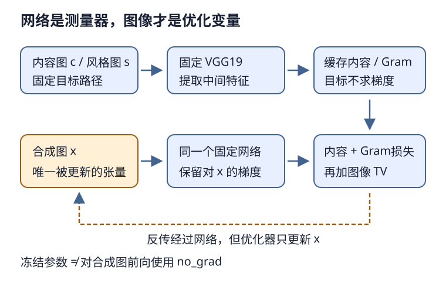

# 单图风格迁移：固定网络，优化图像

## 1. 学习问题：这次梯度下降改变了谁

通常训练神经网络时，图像是输入，网络参数是优化对象。这里反过来：预训练网络作为**固定的特征测量器**，优化的是一张合成图像的像素张量。

输入有内容图$c$和风格图$s$，输出是合成图$x$。我们想让$x$在特征空间里保留$c$的结构，并让某些通道的统计关系接近$s$，同时减少局部噪声。它不是训练一个以后能一次性变换任意图片的生成网络，也不是把风格图直接叠加到内容图上。

## 2. 三条前向路径，只有一张图被更新

固定教材使用ImageNet预训练VGG19的部分卷积特征。按PyTorch的`features`索引，风格层为0、5、10、19、28，内容层为25；保留到索引28即可，不需要分类头。

- 内容图只用于计算固定内容目标$F_c(c)$。
- 风格图只用于计算固定风格目标$G(F_l(s))$。
- 合成图每一步重新过网络，产生可对$x$求导的内容和风格特征。

编者自绘：橙色路径只有合成图$x$会更新；固定网络仍需把损失梯度传回$x$。

“固定网络”至少涉及三件不同的事：

1. 优化器只包含合成图张量，不包含VGG参数。
2. 可将VGG参数设为不求梯度，避免无用参数梯度；`eval()`控制训练/推理行为，但不等于冻结参数。
3. **合成图前向不能放进`no_grad()`**，也不能把其特征detach，否则$x$收不到梯度。固定目标可在无梯度模式下缓存或detach。

固定教材优化器只接收`SynthesizedImage`的参数，内容/风格损失detach目标；但没有显式冻结所有VGG参数。参数不在优化器中意味着不会被step更新，不意味着它们一定不计算梯度。编者建议明确冻结测量网络，同时保留对图像的导数，不将该建议冒称原代码已经完成。

## 3. 内容损失：在特征位置上保持接近

记内容层特征为$F_c(x)$，单张图形状$(1,C,H,W)$。教材对所有元素取平方误差均值：

$$
L_c=\operatorname{mean}\left[\bigl(F_c(x)-F_c(c)\bigr)^2\right]
$$

这里保留特征的空间位置：同一通道、同一位置互相比，不是把两图像素逐点相减。较深特征的感受野更大，但不能因此保证所有几何细节都不变。

**小例：**目标特征$(1,3)$，合成特征$(2,1)$，内容MSE为$(1+4)/2=2.5$。若合成图一开始复制内容图，且预处理与固定网络行为相同，初始内容损失应接近0；之后为了风格变好，内容损失可以上升。不能要求三个损失每步都下降。

## 4. Gram矩阵：比较通道共现，而不是位置对齐

对单张图，把风格特征重排为$A\in\mathbb R^{C\times N}$，$N=HW$。每一行是一个通道在所有空间位置的响应。教材规范化Gram为：

$$
G(A)=\frac{AA^\top}{CN}
$$

其形状是$C\times C$。第$i,j$项汇总两通道在对应位置的乘积，反映未经去均值的二阶统计；**不是已减均值的协方差，也不是范围固定在[-1,1]的相关系数**。

取$C=N=2$：

$$
A=\begin{bmatrix}1&2\\3&4\end{bmatrix},\quad
G(A)=\frac14\begin{bmatrix}5&11\\11&25\end{bmatrix}
$$

风格损失比较合成图和风格图的Gram，不要求它们的对象在同一位置：

$$
L_{s,l}=\operatorname{mean}\left[\bigl(G(F_l(x))-G(F_l(s))\bigr)^2\right]
$$

如果把$A$的空间列共同置换，设置换矩阵$P$满足$PP^\top=I$，那么：

$$
(AP)(AP)^\top=AA^\top
$$

因此Gram丢弃了显式空间顺序，能迁移纹理统计，却不能要求画中的树出现在照片某个精确位置。这里说的是**特征矩阵列置换**，不是说任意打乱原始图像像素后CNN的Gram仍不变。

教材的`gram`以单图为前提。直接把批量$B>1$的张量按同样reshape压成$(C,-1)$，既不保证通道排列正确，也不产生每图独立Gram。多图版本应明确保留批维；本讲只讨论单图，不把单图演示当批量风格迁移接口。

## 5. TV损失：抑制邻居差异，不替代语义目标

固定实现的TV是两个方向绝对差均值的平均，而不是原始差值总和。令$x$为正在优化的图像表示：

$$
L_{TV}=\tfrac12(D_h+D_w)
$$

$$
D_h=\operatorname{mean}|x_{:,:,1:,:}-x_{:,:,:-1,:}|
$$

$$
D_w=\operatorname{mean}|x_{:,:,:,1:}-x_{:,:,:,:-1}|
$$

**小例：**单通道$2\times2$图为两行$(0,1)$，竖直差均值0、水平差均值1，所以TV为0.5。常量图TV为0，但常量图不自动满足内容和风格要求。过大TV权重会抹平真实纹理和边缘，不是越小越好。

以上均值要求高和宽都大于1；某一轴只有一个像素时差分集合为空，不能不加说明就取mean。教材直接在标准化后的合成张量上计算TV，因此它和原RGB值域的TV也有尺度差别。

## 6. 总损失的名义权重与实际表达式

通常用三个目标的加权和描述问题：

$$
L=\alpha L_c+\beta\sum_l L_{s,l}+\gamma L_{TV}
$$

不同层数、Gram归一化、mean/sum约定都会影响权重意义，不应脱离定义照搬一个“神奇比例”。

**固定教材源码有一个必须读到表达式的细节：**它先设置`content_weight=1`、`style_weight=1e3`、`tv_weight=10`，把逐层风格损失乘1000后放进Python列表`styles_l`，最后写成：

`l = sum(10 * styles_l + contents_l + [tv_l])`

这里`10 * styles_l`是**列表重复10次**，不是每个tensor只出现一次。所以实际总目标为：

$$
L_{book}=\sum_l L_{c,l}+10^4\sum_l L_{s,l}+10L_{TV}
$$

教材内容层只有一个，因此第一项就是前面的$L_c$。绘图使用`sum(styles_l)`，只含$10^3$系数，**曲线三项直接相加不等于反向传播用的总损失**。这不是语法报错，也不能悄悄把源码“纠正”后声称忠实复现。

学习实验有两种清楚的做法：保留原表达式并明确有效系数；或采用自己明确定义的标准加权和，记录为编者变体。必须同时记录原始分项、加权分项和真正优化的总目标。规范不同，数值和图像效果就不能直接横比。

## 7. 像素值域、初始化与真实执行边界

教材预处理把RGB转为0–1浮点，再按ImageNet均值$(0.485,0.456,0.406)$和标准差$(0.229,0.224,0.225)$标准化；PyTorch指定尺寸为$(H,W)$。内容图和风格图要使用相同预处理合同，不把BGR或未缩放的0–255值直接喂入网络。

合成图在**标准化空间**里优化，不应该每步简单裁到0–1。可视化时先逆标准化，再把显示值裁到0–1。教材后处理裁剪用于显示，不是优化过程已经有了像素约束；若另加投影，应说明坐标空间及其影响。

初始化为内容图能从已有结构开始；随机噪声初始化是另一实验条件。换图、尺寸、初始化或权重时应控制其他变量。比较终图时同步看内容结构、纹理、局部噪声和三个损失，不从一个更小总loss直接宣布“更好看”。

VGG19预训练权重及内容/风格图片都需要可核实的使用条件。教程公开展示的照片/油画不自动授权本站再分发；可用自有或明确允许的图进行独立练习，但不能冒称复现了教材指定原图。随机网络或合成特征只能核机制，不是预训练单图风格迁移的质量验收；GPU耗时也不能用CPU解析算例推断。

## 8. 自测与答案

1. 冻结VGG后，为什么合成图仍能收到梯度？

网络权重作为常量参与可微计算，对输入的导数仍存在。冻结权重不等于关闭整条计算图；合成图前向仍须跟踪梯度。

2. Gram相等能否说明两个特征图逐点相等？

不能。共同置换空间列不改变Gram；许多特征图可能具有相同二阶统计。内容损失和TV约束提供不同信息。

3. 两行(0,1)的2×2图，教材TV是多少？

竖直差0、水平差1，两方向均值再平均得到0.5。若使用所有相邻差的总和，就不是这里的同一个定义。

4. 教材style_weight为1000，实际总损失中的逐层风格系数就是1000吗？

不是。最后的Python列表重复使每个加权风格项出现10次，有效系数是10000；绘图风格曲线仍是1000倍原始风格和。

## 9. 来源、分P索引与边界

- [官方课表](https://courses.d2l.ai/zh-v2/)指定[教材13.12风格迁移](https://zh.d2l.ai/chapter_computer-vision/neural-style.html)，固定源码全文已读，解释以PyTorch分支为准。当前中文第二版提交`e6b18cce…`不是2021快照；精确范围/hash见本讲manifest及[公共资料](#/c/d2l-pytorch-2021)。教材引用Gatys等人的研究，本批没有审读论文，不把它另列已读或额外必读。
- 图像与VGG19权重条件、真实单图执行及未完成范围分别见[密集预测实验](#/c/d2l-pytorch-2021/lab/cv-dense-prediction?v=guide)和P7主验收证据。本页不复制原图、不发布权重、不伪造风格迁移成图。
- 本批主agent另在教材两图上完成64×96、25步的有限单图优化，并核预训练权重；这不等于教材高分辨率500步复现。执行证据和图片使用边界集中见[公共资料](#/c/d2l-pytorch-2021)，本页解析小例仍与实际图像优化结果分开。
- [官方视频](https://www.bilibili.com/video/BV1Eh41167GN/)作者“跟李沐学AI”，mid 1567748478，2021年7月11日上传。

| 分P | 平台标题 | 时长 |
| --- | --- | --- |
| P1 | 样式迁移 | 04:58 |
| P2 | 代码 | 19:18 |
| P3 | QA | 08:32 |
| 全3P | 合计1968秒 | 32:48 |

2026-11-14每P公开字幕请求一次均成功空列表；未观看音视频，平台分P目录不是片内时间轴，不造演示或QA。视频copyright=1/no_reprint=1不构成开放转录许可；不建占位draft和重复materials。
