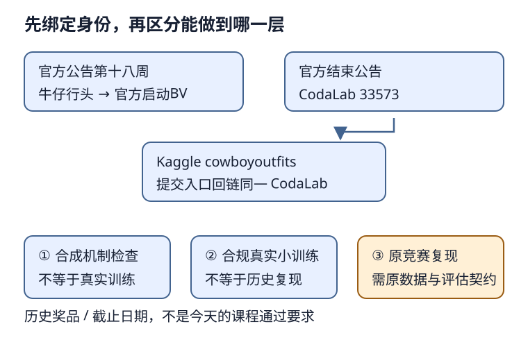

# 牛仔行头检测：先核竞赛身份，再建立可复现合同

## 1. 学习问题：从会算IoU到能交付检测器，还差什么

会生成锚框、训练一个小SSD，仍不等于复现了某场检测竞赛。原始图片、类别编号、框坐标、划分、评估器和导出字段必须属于同一个任务。检测器输出的“第0类、框的四个数”，离可解释的预测还隔着一份数据合同。

这一讲用2021牛仔行头历史竞赛串起这些接口，不添加新的完整方案。先复用[LEC40边界框](#/c/d2l-pytorch-2021/lec/lec40?v=notes)、[LEC41匹配与NMS](#/c/d2l-pytorch-2021/lec/lec41?v=notes)、[LEC43检测器路线](#/c/d2l-pytorch-2021/lec/lec43?v=notes)和[LEC44小SSD](#/c/d2l-pytorch-2021/lec/lec44?v=notes)，不重写已有机制。

## 2. 三个名字必须落到同一个历史任务

官方第十八周公告把第三次竞赛称为“牛仔行头检测”，链接本讲BV。官方第二十二周公告宣布目标检测竞赛结束，结果指向CodaLab编号33573。Kaggle的**CowBoy Outfits Detection / cowboyoutfits**公开说明又把实际提交入口指向同一CodaLab编号，形成可检查的身份闭环。

| 入口 | 能确认什么 | 不能单凭它确认什么 |
| --- | --- | --- |
| 官方课表/第十八周公告 | 本课程第三次竞赛、启动视频绑定 | 当前下载权或比赛字段 |
| 官方结束公告 | CodaLab结果入口、历史赠书条件 | 获奖技术方法或真实训练成绩 |
| Kaggle公开Overview | 主办方、检测任务、类别、指标与历史提交说明 | 真实CSV内容或现在仍能提交 |
| Data与Rules匿名页面 | 文件介绍、登录/接受规则门槛 | 登录后具体条款、图片再分发权 |

公开Kaggle页面列出的host是**Joshua Z. Zhang**，而不是仅因课程是李沐讲授就把所有页面的主办方都改成李沐。官方视频作者是“跟李沐学AI”，这是另一字段。

编者自绘：图中数据/执行层级不是已完成清单；必须分别保留实际证据。

## 3. 目标类别、外部ID与模型内部编号

公开说明强调**类别不均衡的目标检测**，要求定位野外图像中的五类行头。外部类别编号是：

| 类名 | 竞赛category_id |
| --- | --- |
| belt | 87 |
| sunglasses | 1034 |
| boot | 131 |
| cowboy_hat | 318 |
| jacket | 588 |

这些是五个类别的ID，不是五类样本数。不要因为最大ID为1034，就给模型建1035个前景logits。可以在内部建立五类连续索引0–4，但需要保存双向映射，导出时还原竞赛ID。

采用教材SSD时，再区分一个编号层：模型分类训练通常把背景占为0、五种前景占为1–5；有效检测输出再还原内部对象编号。**“训练类别0”“内部对象0”“外部category_id 87”不是同一表示**。映射须经导入、训练目标、解码、导出完整往返，而不是只在最终JSON里随便加1。

类别不均衡意味着只报总框数或总体指标可能掩盖弱类。先统计真实训练标注的每类实例数、每图目标数、框尺度和空图比例，再决定采样或损失策略；没有数据时不编造这些分布，也不提前保证某种重加权一定获益。

## 4. 导出字段可以确认，细节冲突不能猜

公开Overview要求输出JSON序列化的标注列表，每个预测含：

| 字段 | 已读到的公开要求 |
| --- | --- |
| image_id | 验证/测试清单提供的唯一图像标识 |
| category_id | 对应上面的外部类别ID |
| bbox | 四个浮点坐标；Overview没有明确四者的排列约定 |
| score | 0–1置信分数 |

一张图可以有零个、一个或多个目标，不是给每张图恰好一个分类标签。分数也不是IoU真值；推理时不能读取真实框帮预测选择答案。

**必须保留的接口冲突：**Data页面称`valid.csv/test.csv`包含`image_id,file_name`，实验审读的官方host Starter Kit Version 1却用`row['id']`取值。Starter Kit导出框用乘回图像宽高后的四角坐标，即像素`xyxy`；不能因为训练标注由COCO工具读取，就擅自把提交框改成常见的`xywh`。公开Overview只说“四个坐标”，不足以消除这个差异。

这时正确动作不是从经验挑一个格式，而是在获准读取真实文件后：核表头与数据类型、追踪starter的输入到导出、再与实际CodaLab scorer约定比对。本批未读竞赛真实CSV/图片或scorer，因此**精确列名与最终提交bbox合同仍待实物核验**。不能把不确定接口写成已经可提交的完整答案。

尤其大整数图像ID要作为不丢精度的标识传递，不应先转浮点再转回整数；文件名不是可任意重新排序的行号。图像缩放、裁剪或padding后，导出框需反变换到约定的原图坐标，再做有效性与边界检查。

## 5. 评估和NMS不是同一件事

公开Evaluation说明主指标是COCO式**AP 0.5:0.95**，不是分类Accuracy。页面通用标签即使显示Categorization Accuracy，也不能盖过实际任务的Evaluation文字。

AP需要结合预测分数排序、类别和定位匹配来衡量检测质量；这里的0.5:0.95对应多档IoU阈值，不能只取IoU≥0.5的正确率代替。完整复现还要核评估器的匹配、忽略对象、最大检测数量及其他设置；这些不能由指标名字自行补完。

[LEC41](#/c/d2l-pytorch-2021/lec/lec41?v=notes)的NMS则是推理后处理：只看预测框和分数，删除重复候选。NMS阈值、训练匹配阈值、评估IoU阈值分别服务不同阶段，即使碰巧都是0.5也不互相替代。调整NMS不能使用测试真值，反复根据最终榜调参也不等于可靠的离线验证。

教材NMS不按类别分组；若本任务选择逐类NMS，那是一个明确记录的工程策略，不要假称教材已提供同样实现。已验的几何与阈值机制直接复用P6证据，不重做一套不同坐标定义。

## 6. 今天怎样做这项历史练习

**层级一：机制检查。** 使用合成合法框和已有教材机制验证坐标往返、匹配、回归mask、类别映射与NMS；这不需要竞赛图片，但只能证明局部逻辑。

**层级二：真实小数据基线。** 对合规取得的真实检测数据，固定图像级训练/验证划分、种子和预处理，保存损失、逐类诊断及可解释预测。教材香蕉数据可以完成教材小SSD练习，**不能因此宣称已复现牛仔行头竞赛**。

**层级三：原竞赛适配。** 仅在取得访问资格、实际数据和确定的评估合同后，读取原始标注、建立五类映射、做本地验证并导出符合合同的预测。图片、标注与权重各自的使用条件要单独核对；不绕登录或规则，不自动接受条款，不发布受限原图或权重。

当前匿名Data页面显示4882个文件、1.47GB，类型包括jpg/csv/json；这不是“4882张训练图”的证明。页面明确要求登录并接受规则才能查看数据，license标为`Subject to Competition Rules`，匿名Rules只有通用模板。另一方面，**CodaLab公开条款确实说明教育目的、遵循非商用许可，并要求不要把数据再分发给其他用途**，不能写成完全没有使用条件。

教育/非商用条款不等于已完成Kaggle身份认证或接受下载规则；本地使用条件和公开再分发权也不是同一件事。应同时遵守已公开的限制，并在取得实际数据前核完整访问条件，不因这是Kaggle就推定全面禁止，也不从“网页可见”推出自由下载和发布图片。

实验指导给路线与验收，不提供完整竞赛答案。学习者应记录实际输入身份、合法访问条件、划分、配置、数值与失败分析；没有数据时保留原竞赛阻塞，继续能完成的教材任务，而不是换数据冒充。

## 7. 日期、榜单和后续讲次怎么放回历史

- 课表启动日期为2021年7月11日；本讲BV实际上传为7月19日。
- Kaggle页面显示2021年7月16日开始，并在Evaluation明确历史截止为2021年8月7日04:00 UTC，即UTC+8的12:00。
- 公开说明写明Kaggle不支持所需自定义评估，向Kaggle提交会失败；当时实际使用CodaLab最终阶段榜单判定获胜者。
- 官方结束公告的“8月15日前提交代码到Kaggle”是前十名取得签名赠书的资格步骤，**不是比赛截止日**。
- 当前界面出现Late Submission不证明现在仍能加入、下载或得到历史评分；本批未尝试登录或提交。

这些是历史信息，不是今天课程通过的要求。后续[LEC71](#/c/d2l-pytorch-2021/lec/lec71?v=notes)保留目标检测总结阅读依赖，但本批没有核其实质课堂内容，也未读获奖技术方案；不能从获奖名单推断“冠军用了某检测器”。

## 8. 自测与答案

1. category_id=1034说明要训练1035类吗？

不说明。它是外部编号。五个对象类可映成内部0–4，背景另按模型合同处理，导出必须恢复原外部ID。

2. 看到COCO AP能否断定提交bbox一定是xywh？

不能。评估指标、训练标注和提交序列化是不同接口。公开Overview未指定排列，而starter示例输出像素xyxy；应核实际文件和scorer，保留冲突，不靠常识覆盖证据。

3. 为什么不能把香蕉SSD训练成功写成牛仔竞赛完成？

任务身份、对象类别、图像分布、文件合同和评估均不同。它能证明教材模型训练链条的一部分，但不能替代原竞赛适配或评估。

4. 原比赛截止日是不是8月15日？

不是。公开Evaluation给出8月7日04:00 UTC；8月15日是官方结束公告中的代码提交赠书条件，两者职责不同。

## 9. 来源、分P索引与尚未完成的核验

- [官方课表](https://courses.d2l.ai/zh-v2/)row075无独立教材链接；本页不把其他书章假称本讲指定阅读。[课程公告](https://courses.d2l.ai/zh-v2/announcements.html)实读第十八周和第二十二周，分别绑定启动BV及[CodaLab33573结果](https://competitions.codalab.org/competitions/33573#results)。公告不提供获奖方案。
- [Kaggle Overview](https://www.kaggle.com/competitions/cowboyoutfits/overview)、[Data](https://www.kaggle.com/competitions/cowboyoutfits/data)、[Rules](https://www.kaggle.com/competitions/cowboyoutfits/rules)来自实验agent的匿名浏览器证据；本讲实际审读其小型文本快照，主办方/类别/指标/日期及匿名门槛据此陈述。官方host [Starter Kit](https://www.kaggle.com/code/zhreshold/cowboy-outfits-starter-kit)冲突范围及访问证据详见[实验指导](#/c/d2l-pytorch-2021/lab/cv-dense-prediction?v=guide)，不据其Apache代码许可扩张图片许可。
- [CodaLab公开页面](https://competitions.codalab.org/competitions/33573)的Evaluation及Terms and Conditions已通过实验保存的去凭据文本审读：评估由pycocotools产生mAP，条款明确教育/非商用及再分发边界。实际scorer实现未读，不能据此消除bbox格式冲突。
- 官方[启动讲义](https://courses.d2l.ai/zh-v2/assets/pdfs/part-2_18.pdf)静态读取提示3页文字抽取不完整，本页未据此声称读过幻灯片或补出竞赛字段。视频作者“跟李沐学AI”，mid 1567748478；[视频入口](https://www.bilibili.com/video/BV1F64y1x7xP/)与官方公告一致。

| 分P | 平台标题 | 时长 |
| --- | --- | --- |
| P1 | det_kaggle | 11:04 |
| 全片 | 664秒 | 11:04 |

2026-11-14公开字幕请求一次成功空列表；未观看音视频，无片内时间索引或教师安排的完整转录。视频copyright=1/no_reprint=1不构成转录授权。不造课堂稿、获奖方案或占位materials。实验的真实数据、权重、训练、GPU与竞赛执行分别记账；本页框架不能替代它们。
