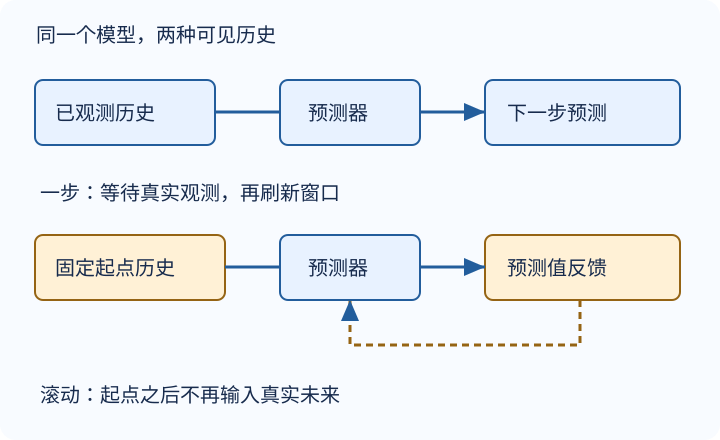

# 序列模型：预测时究竟知道什么

预测明天的温度与补齐昨天漏记的温度不是同一个任务。先写清预测发起时刻、可见历史、目标距离，再选择模型；否则一张漂亮的拟合曲线可能只是使用了未来观测。

## 把历史变成固定形状

设标量观测为 $x_t$，窗口长为 $\tau$。用过去窗口预测下一个值：

$$
\mathbf{z}_t=[x_{t-\tau},\ldots,x_{t-1}],
$$
$$
\hat x_t=f_\theta(\mathbf{z}_t).
$$

长度 $T$ 的序列产生 $T-\tau$ 对样本，输入形状为 $(T-\tau,\tau)$，目标为 $(T-\tau,1)$。例如序列 `[0,1,2,3,4,5]`、窗口3，第一对是 `[0,1,2]→3`，最后一对是 `[2,3,4]→5`，共3对。索引没有错位，比先挑网络更重要。

自回归模型把有限历史直接交给网络；隐状态模型则递推一个摘要。用“已处理到 $t-1$”定义 $h_{t-1}$，就有 $\hat x_t=g(h_{t-1})$、$h_t=u(h_{t-1},x_t)$。摘要维度固定不代表完整历史被无损保存。

## 链式法则不等于因果证明

$$
P(x_{1:T})=\prod_{t=1}^{T}P(x_t\mid x_{<t}).
$$

这是概率链式法则，本身不要求平稳。将条件近似为最近 $\tau$ 项才是有限阶马尔可夫假设；跨时间共享同一个预测规律又增加了稳定性假设。季节、设备更换、用户行为变化都可能使它失效。能反向分解联合概率，不意味着部署时能看到未来，也不证明统计相关是干预因果。

## 一步预测和滚动预测必须分开画

图为编者自绘：实线输入代表已观测数据，反馈路径代表模型自己的预测；不是教材或课堂运行曲线。

**一步预测**：每次起点前的真实观测都已到达。**固定起点多步预测**：起点之后没有新观测，后续窗口只能放入自己的输出。窗口2、模型取两数平均，起点历史 `[2,4]` 时：首个预测为3，第二个滚动预测为3.5；若下一真实观测是8，更新观测后的一步预测却是6。两者回答不同问题，不能把6称作原起点的二步预测。

误差回灌可用局部近似理解：$e_{k+1}\approx a e_k+\epsilon_{k+1}$。当 $|a|>1$ 时扰动可能被放大；小于1也不保证有用，预测可能塌缩为平滑常数。多步预测不必然每一步误差都增大，但必须按 horizon 分别报告。

## 时间划分是一条信息合同

1. 按目标时间切训练、验证、测试，不能先把高度重叠的滑窗随机分到三组。
2. 标准化均值、方差、插补器及调参只使用训练允许的数据；验证选方案，测试保留到最终。
3. 滚动一步验证可使用预测起点以前已到达的真实历史，包括早期验证观测；固定起点预测不能偷用它们。边界窗口能否跨区间，取决于这个合同，不是简单一刀切。
4. 在训练区间内部打乱独立窗口供MLP优化，并不等于打乱训练/测试的时间顺序；状态型RNN还要遵守后续讲次的行身份规则。
5. 同时报持久性基线（下一个等于最后观测）、预测跨度和误差指标。训练损失小不是外推证据。

教材的正弦加噪声是机制示例，不是股票、天气实证；本站小算例也不是训练成绩。真实文本实验另见[循环语言模型实验](#/c/d2l-pytorch-2021/lab/recurrent-language-model?v=guide)。

## 自测

为什么随机拆滑窗可能夸大泛化能力？

相邻窗口共享大量观测，而且训练可能覆盖测试目标之后的时间。它测到的是局部插值或泄漏后的拟合，不一定是未来外推。

模型参数固定，是否说明它能记住任意长历史？

不能。固定窗口截去更早信息；固定维隐状态对历史作压缩。共享参数解决参数量问题，不自动解决记忆或梯度问题。

下一步：[文本如何成为序列](#/c/d2l-pytorch-2021/lec/lec52?v=notes)。

## 引用与边界

- 张阿斯顿、李沐、扎卡里 C. 立顿、亚历山大 J. 斯莫拉，《动手学深度学习》当前中文第二版 [§8.1 序列模型](https://zh.d2l.ai/chapter_recurrent-neural-networks/sequence.html)。实际阅读固定提交 `e6b18ccea71451a55fcd861d7b96fddf2587b09a` 全节，不是2021快照。时间切分及均值小例为编者补充。
- [官方2021课表](https://courses.d2l.ai/zh-v2/) 标日期7月17日；视频上传2021-07-19，两者不混用。原入口由页头提供。
- 全P索引（各P独立计时）：P1「序列模型」00:00–20:04；P2「代码」00:00–11:53；P3「QA」00:00–22:14。只核元数据，不据标题猜内部讲解、问答或片段时间。
- 字幕空列表不能证明无烧录字幕；未下载音频、未转录，不创建占位译稿。公共版本与环境见[公共资料](#/c/d2l-pytorch-2021)。
