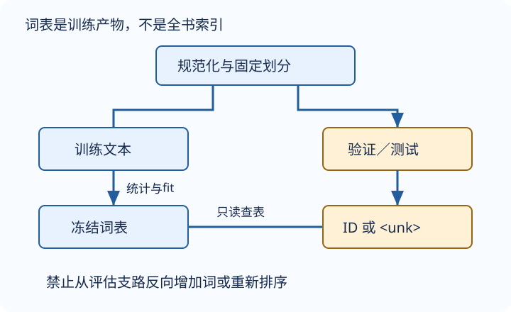

# 文本预处理：词表也是模型的一部分

语言模型并不直接读字符串。它读的是整数序列，而这些整数的含义由一整套约定决定：文本版本、规范化、切词、词表顺序、特殊符号与划分边界。保存模型权重却不保存这些约定，往往无法重现预测。

## 规范化是一种不可逆取舍

教材示例逐行执行：把非英文字母的连续片段变为空格，去掉行首尾空白，最后转小写。这适合简化英语字符实验，却会删除数字、标点、大小写与其他文字。

编者小例：`Time, 2021!` 变成 `time`；`Can't` 变成 `can t`，不是语义完整的 `can't`；中文会被这种规则消去。不要把这个正则当成通用多语言清洗器。

**分词**把 `time machine` 变成两个单词，词表大、序列短；**字符切分**保留行内空格，得到12个字符，词表小、序列长，模型要自己学习拼写。两者的困惑度单位不同，不能直接排名。子词方法属于后续可扩展选择，本讲不引入额外必修工具。

## 先划分，后拟合，再冻结

图为编者自绘：只有训练支路能更新词表；评估支路只能查表，未知符号走同一个保留入口。

1. 固定原始文本身份与切分方案。连续文本用固定连续区间，不能在训练前把全书随机打散；跨划分不拼接X/Y。
2. 训练区间统计词频，按 `min_freq` 过滤；确定并保存并列词频时的排序规则。
3. 预留 `<unk>`，必要时另设 `<pad>`、`<bos>`、`<eos>`。它们语义不同，不能拿OOV当填充再忽略其损失。
4. 冻结 `token_to_idx` 与 `idx_to_token`。验证/测试新词映射到 `<unk>`，不临时扩词表，不重新排序。
5. 用同一规范化和分词规则编码所有区间；统计未知比例，随模型产物保存词表和配置。

例如训练词序列 `[red, blue, red]`，设 `<unk>=0`、按频率降序分配，`min_freq=1` 得到 `red=1, blue=2`。验证 `[blue, green]` 编码为 `[2,0]`。提高到 `min_freq=2` 后，连 `blue` 也编码成0。已知词能索引往返，未知词解码只能得到 `<unk>`，无法恢复原词。

整数ID不是实数语义：编号8不比编号4“更像两倍”。后续使用one-hot或可训练嵌入；标签保留整数类别ID，不能与输入向量混淆。

## 《时光机器》到底是哪份文本

教材指向 H. G. Wells 的 *The Time Machine*（1895），并通过D2L数据镜像的 `timemachine.txt` 加载。文件校验标识列于页底，不能把教材声明的哈希当成已经下载的证据。本批实际取得文件、地域适用条件与固定切分统一见[实验说明](#/c/d2l-pytorch-2021/lab/recurrent-language-model?v=zh)和[公共资料](#/c/d2l-pytorch-2021)。

教材 `load_corpus_time_machine` 先在所有字符上建词表，再展平并可选截断 `max_tokens`。它是教学加载器，不是严格留出集协议：若把后半段当测试集，应先分区、再只在训练部分fit，不能照搬“全书fit后截断”。训练前看见测试词类型也是边界越界，即使没有看测试标签频次。

教材逐行 `strip` 后把字符列表直接展平，不自动加入行间空格；行末与下一行开头会相接。选择保留换行、补空格、沿用教材拼接都需要明说，并保存配置；不能换了预处理仍声称相同语料序列。行也不等于句子，不能未经检查就把每行视为独立语言事件。

## 工程检查点

- 只把原文本视为可审计输入；不要用模型预写的句子或随机token冒充真实语料。
- 固定切分位置使用“原始行”“规范化字符”还是“词元”必须说明，否则同一比例不代表同一数据。
- `<unk>` 本身要计入词表大小和输出类别；验证阶段不改变输出层维度。
- 如果采用填充，掩码只排除真实填充位；指标分母是有效目标token数。
- 小语料中字符OOV可能很少，但机制仍要用独立小例检查，不能以“这次没出现”删除路径。

## 自测

为什么同一权重配另一份按字母序排序的词表会失败？

输入ID和输出列的语义都改变了。权重学到的是特定ID到特定ID的关系，必须连同原词表加载。

能否在验证集遇到新词时把它追加到词表？

不能。这样改变评估任务、模型输入/输出合同并泄漏测试信息。映射到固定未知符号，报告OOV率。

继续：[语言模型与采样](#/c/d2l-pytorch-2021/lec/lec53?v=notes)。

## 引用与边界

- 张阿斯顿、李沐等，《动手学深度学习》[§8.2 文本预处理](https://zh.d2l.ai/chapter_recurrent-neural-networks/text-preprocessing.html)，固定提交 `e6b18ccea71451a55fcd861d7b96fddf2587b09a` 全节已读，当前中文第二版非2021快照。词表泄漏防护及小例为编者补充。
- 教材链接的 [Project Gutenberg #35](https://www.gutenberg.org/ebooks/35) 是作品身份入口，不意味着任意地区、版本或再分发都无条件；本讲不复制全文。实际语料条款核对见实验。

| 教材S3文本校验项 | 值 |
|---|---|
| SHA1（本批下载后已匹配） | `090b5e7e70c295757f55df93cb0a180b9691891a` |

- [官方课表](https://courses.d2l.ai/zh-v2/) 日期7月17日，官方作者mid1567748478视频上传2021-07-20。各P独立时钟：P1「代码」00:00–18:04；P2「QA」00:00–02:26。标题仅是元数据，不是内容审阅。
- 每P一次公开字幕返回空列表；这不排除烧录字幕。未看媒体，不补造课堂问答、代码运行结果或片内时间轴。教材根Apache-2.0不覆盖视频或第三方语料；统一约定见[公共资料](#/c/d2l-pytorch-2021)。
