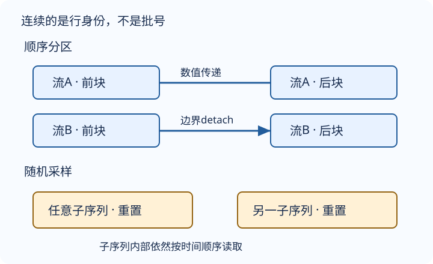

# 语言模型：概率、采样与评价必须对齐

语言模型回答“给定已经看到的前缀，下一个token有多大概率是什么”。采样器决定它实际看到了什么；损失和困惑度决定我们如何评价它。三个部分必须共享同一条时间方向。

## 从联合概率到局部计数

$$
P(x_{1:T})=\prod_{t=1}^{T}P(x_t\mid x_{<t}).
$$

unigram忽略前缀，bigram只看上一个token，trigram看前两个。这里的 $n$-gram含目标本身，因此历史长为 $n-1$。截断历史是模型近似，概率链式分解本身不是近似。

编者计数例：单条序列 `a b a b a c`，仅统计有后继的位置。上下文 `a` 出现3次，后继 `b` 两次、`c` 一次，因此 $P(b\mid a)=2/3$、$P(c\mid a)=1/3$。上下文 `c` 没有后继，分母为0，不能凭空说概率为0。一般应定义 $C(a)=\sum_v C(a,v)$；若把序列末尾也统计进分母却不加EOS，条件分布可能不归一。

加一平滑，目标词表为 `{a,b,c}` 时：

$$
P(v\mid a)=\frac{C(a,v)+1}{C(a)+3}.
$$

于是三项依次是 $1/6,3/6,2/6$，和为1。平滑避免零概率，并不解决长历史组合爆炸。词频常呈长尾（齐普夫规律的近似），扩大 $n$ 会让上下文更稀疏；高频停用词仍承担语言结构，语言建模不能未经任务论证就删除它们。

## 先错位，再切块

给定连续token序列，目标就是输入的下一位：$X_t=x_t$，$Y_t=x_{t+1}$。输入与标签通常都是整数张量 $(B,S)$，其中 $B$ 是批量大小，$S$ 是时间步数。**不能令Y等于X**，也不能给整段只配最后一个标签后仍称逐token语言模型。

编者顺序小例固定序列 `0…12`、偏移0、$B=2,S=3$。先取12个输入和对应12个目标，再变成两行：

| 批次 | X两行 | Y两行 |
|---|---|---|
| 1 | `[0,1,2]`；`[6,7,8]` | `[1,2,3]`；`[7,8,9]` |
| 2 | `[3,4,5]`；`[9,10,11]` | `[4,5,6]`；`[10,11,12]` |

第二批第一行紧接第一批第一行，第二行亦然。每行是一条连续流；把第二批两行互换却原样复用状态，就把别人的记忆接了过来。首批第二行从6开始，初始状态仍应重置，不能把第一行末状态偷偷当成它的前史。

图为编者自绘，展示状态能否跨批连接，不重复上表数值。

## 随机和顺序不是“打乱字符”和“不打乱字符”

**随机采样**：选初始偏移，切出内部连续的长度S子序列，打乱子序列起点再组成批次。相邻批次通常无连续关系，每批状态重置；不能把子序列内部字符打乱。教材随机起点不是对所有可能窗口做完全均匀抽样，尾部不足一个完整批次的数据会舍弃。

**顺序分区**：初始偏移后，把长流划成B行，沿列连续取块。只有保持批内行身份、同一数据流和相同批量约定，才可把上批最终状态传给下一批；跨批执行 `detach`，保留数值但切断旧计算图。换epoch起点、换划分、换文档流或随机采样，应重置状态。

教材随机偏移范围为 `0…S-1`，顺序实现为 `0…S`（含端点）；复现其采样必须保留这个区别。为了评估可比，验证偏移应固定，报告实际计入的token数，不能每轮随机舍弃不同目标而不记录。

训练和验证分别构造采样器；不能让训练末token以验证首token为标签，也不能把训练状态带入独立验证，除非明确设计的是允许此前历史的流式评估协议。

## 困惑度先加损失，再做指数

若第 $i$ 批有 $N_i$ 个有效目标，累计负对数似然为 $L_i$：

$$
\overline\ell=\frac{\sum_i L_i}{\sum_i N_i},
$$
$$
\operatorname{PPL}=\exp(\overline\ell).
$$

交叉熵用自然对数；实现时让CE接收logits，不要先softmax再当logits送入。若CE返回每批均值，要先乘回有效token数再累计。填充位置不进分子也不进分母，但真正的 `<unk>` 目标要计算。

编者小例：两批有效token数分别为2与6，平均CE分别为 $\log2$ 与 $\log8$。整体CE是 $2.5\log2$，所以PPL为 $2^{2.5}\approx5.657$，不是批PPL平均5，也不是批CE等权平均后得到的4。

词表大小为V的均匀预测给出PPL=V；它是**基线而非任意模型的上界**，一个过度自信的错误模型可以更差。困惑度是目标概率倒数的几何平均，不是算术或调和平均。只在同一语料划分、词元化、词表和掩码协议下比较；它不保证生成文本真实、流畅或安全。

## 自测

Y第一列为何不是X第一列？

模型在处理当前token后预测下一个token。错位一步才使输出对应条件分布；相同输入标签会把任务改成复制。

为什么顺序批次也不能无限保留计算图？

图会沿时间增长，反传跨越所有历史且可能触及已经释放或更新的参数。detach截断梯度范围；清零则连历史数值也删掉，二者不等价。

下一讲：[RNN如何保存状态](#/c/d2l-pytorch-2021/lec/lec54?v=notes)；练习接口见[实验指导](#/c/d2l-pytorch-2021/lab/recurrent-language-model?v=guide)。

## 引用与边界

- 张阿斯顿、李沐等，《动手学深度学习》[§8.3](https://zh.d2l.ai/chapter_recurrent-neural-networks/language-models-and-dataset.html)全节、[§8.4](https://zh.d2l.ai/chapter_recurrent-neural-networks/rnn.html)困惑度部分；固定提交 `e6b18ccea71451a55fcd861d7b96fddf2587b09a`，当前中文第二版非2021快照。边界计数、加权评价与小例为编者讲解；对PPL平均类型和“上界”的表述按公式澄清。
- [官方课表](https://courses.d2l.ai/zh-v2/) 日期7月18日，上传2021-07-22，作者mid1567748478。各P独立计时：P1「语言模型」00:00–16:18；P2「代码」00:00–25:47；P3「QA」00:00–09:08。
- 分P标题和长度不证明片内内容；没有字幕或媒体审阅，不伪造问答与主题时间轴。公开字幕空列表不排除烧录字幕。这里没有语料训练成绩、吞吐或生成文本；实测以共享实验记录为准。版本与许可见[公共资料](#/c/d2l-pytorch-2021)。
