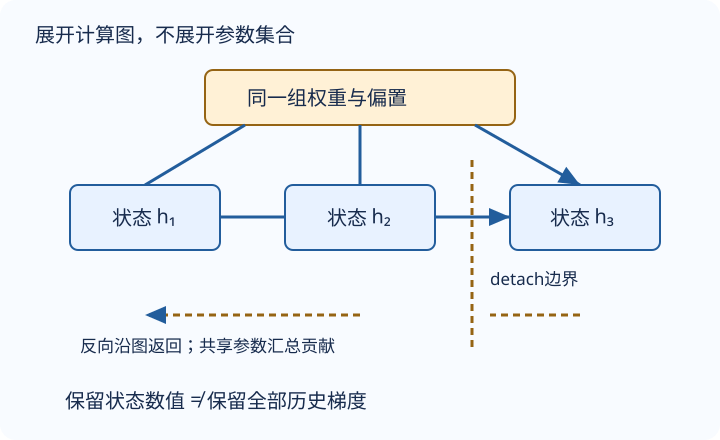

# RNN：同一组参数，沿时间反复使用

一个固定窗口会硬性丢掉更早历史。RNN改为每读入一个token，就更新一个固定维度的隐状态。状态是当前样本的记忆，参数是所有样本共享的规则；把这两者混为一谈，会直接导致错误的训练循环。

## 写出一个时间步的形状

令批量大小为B、输入特征维度为D、隐藏宽度为H、词表大小为V。为适应手机阅读，把加和分两步记：

$$
A_t=X_tW_{xh}+b_h,
$$
$$
H_t=\tanh(A_t+H_{t-1}W_{hh}),
$$
$$
O_t=H_tW_{hq}+b_q.
$$

| 张量 | 形状 | 含义 |
|---|---|---|
| $X_t$ | $(B,D)$ | 当前时刻各行的输入 |
| $H_{t-1},H_t$ | $(B,H)$ | 各序列的旧、新状态 |
| $W_{xh},W_{hh}$ | $(D,H),(H,H)$ | 输入变换与状态变换 |
| $W_{hq}$ | $(H,V)$ | 从状态到下一token logits |
| $O_t$ | $(B,V)$ | 每行一个下一token分布的未归一化分数 |

输入为one-hot时D=V；整数ID不能直接当成一个有大小关系的标量特征。用嵌入时D是嵌入宽度。偏置在批维广播，不能误为每个样本单独学习一份。

本讲单隐藏偏置、单输出偏置的数学参数数目为：

$$
DH+H^2+H+HV+V.
$$

例如D=3、H=2、V=3得到21，与序列长S无关。PyTorch `nn.RNN` 的输入侧与隐藏侧通常各有一份偏置，因此再接同样输出层时是23个参数；实现对齐时要区分单偏置数学式和双偏置API，不能混算。

## 时间展开不是复制出许多模型

图为编者自绘：所有时间步使用同一参数组；边界保留状态数值，但不让梯度跨回更早的块。

把 $X_t$ 与 $H_{t-1}$ 沿特征轴拼接，再把两个权重沿输入轴堆叠，就等价于原来两个矩阵乘积之和。形状为 $(B,D+H)$ 乘 $(D+H,H)$。这是一条代数等式，不意味着必须每步实际分配拼接张量。

状态并不是一个模型参数。它随输入与行身份变化，通常从零开始；共享的是 $W,b$，不是每行状态。长度S加倍时参数量不变，但训练需要保存更多中间激活，计算与内存仍会增加。固定宽状态也不保证保留任意遥远的信息。

字符序列 `cat` 可形成输入 `ca`、目标 `at`。处理 `c` 后的输出预测 `a`；处理 `a` 后预测 `t`。输出可以依赖当前及更早输入，不能依赖目标token本身。逐token CE与困惑度归约见[LEC53](#/c/d2l-pytorch-2021/lec/lec53?v=notes)。

## BPTT就是展开图上的链式法则

参数在每步复用，因此总梯度必须把各时间步对同一参数的贡献相加。更早状态还会通过后续状态影响后续损失。用一个局部导数记号说明：

$$
J_t=\frac{\partial h_t}{\partial h_{t-1}},
$$
$$
\frac{\partial h_t}{\partial h_k}=J_tJ_{t-1}\cdots J_{k+1}.
$$

乘积解释了为何梯度可能消失或爆炸。对tanh还要乘其局部导数，饱和时接近零。不能只看一层权重某个元素大于1就断言爆炸；这是整条路径的效应。

编者标量例：$h_t=w h_{t-1}+x_t$，$h_0=0$，两步输入均为1，令损失仅为 $L=h_2$（不是训练用CE）。则 $h_1=1$、$h_2=w+1$，在w=2时输出3、完整梯度 $dL/dw=1$。若在 $h_1$ 后detach，输出仍为3，本例梯度也仍为1，因为 $h_1$ 对w的梯度恰好为0。**这个例子不足以检验detach是否有效。**

把初始状态改为 $h_0=1$，仍取w=2及相同输入：$h_1=3$、$h_2=7$，完整梯度为5；在两步之间detach后梯度变成3，前向仍为7；若误清零，前向变成1。这个对照同时区分“不截断”“截断图”“清空数值”，不需要完整训练程序。

## 截断和裁剪解决不同问题

- **截断BPTT**：同一连续流跨批传状态，但在边界detach，阻断对更早块的梯度。它减少内存与反传跨度，也舍弃了跨边界的信用分配，并非完整长序列梯度。
- **重置状态**：随机样本、不同文档流、独立验证或新epoch起点需重新初始化，避免把无关历史拼在一起。
- **清空参数梯度**：`zero_grad` 是清除优化器梯度累积，不是detach状态，也不是清零隐状态。
- **全局范数裁剪**：把所有参数梯度看成一个向量g，若其二范数超过阈值 $\theta$，共同乘 $\theta/\lVert g\rVert_2$。例如g=(3,4)、阈值1，得到(0.6,0.8)。这保留方向，不等于逐元素裁到[-1,1]，也不能补回已经消失的梯度。

在backward之后、参数更新之前裁剪。RNN/GRU通常只有h；之后的LSTM含h与c，跨块两者都要detach。不要因为h看起来正常，就遗留c的旧计算图。

## 自测

把每个时间步都实例化成独立Linear层，还是本讲RNN吗？

不是同一个共享参数模型。参数量随步数增长，每步学习不同规则；应复用同一组参数。

detach之后，模型还能利用上个块的内容吗？

能利用传来的状态数值，但当前损失不会沿该边界更新产生旧状态的更早计算路径。前向记忆跨度与反向梯度跨度不同。

实现与API对应、训练循环、生成预热见[LEC55](#/c/d2l-pytorch-2021/lec/lec55?v=notes)，本讲不复制整段实现。后续[GRU](#/c/d2l-pytorch-2021/lec/lec56?v=notes)、[LSTM](#/c/d2l-pytorch-2021/lec/lec57?v=notes)、[深层](#/c/d2l-pytorch-2021/lec/lec58?v=notes)、[双向](#/c/d2l-pytorch-2021/lec/lec59?v=notes)分别解决不同结构问题；双向读到未来的表示不可当成因果自回归生成器。

## 引用与边界

- 张阿斯顿、李沐等，《动手学深度学习》[§8.4 循环神经网络](https://zh.d2l.ai/chapter_recurrent-neural-networks/rnn.html)、[§8.7 通过时间反向传播](https://zh.d2l.ai/chapter_recurrent-neural-networks/bptt.html)，固定提交 `e6b18ccea71451a55fcd861d7b96fddf2587b09a` 两节全文已读，当前中文第二版非2021快照。小例、形状合同与API偏置提醒为编者补充；未声称课堂讲过。
- [官方课表](https://courses.d2l.ai/zh-v2/) 日期7月18日，视频上传2021-07-23，作者mid1567748478。各P独立计时：P1「RNN」00:00–25:16；P2「QA」00:00–08:48；没有猜测片内主题或问答。
- 每P公开字幕一次返回空列表，不证明无烧录字幕；未下载或审阅音视频。机制小例不冒充语料训练、硬件测量或运行日志；实际记录由[实验](#/c/d2l-pytorch-2021/lab/recurrent-language-model?v=guide)统一提供。许可和环境见[公共资料](#/c/d2l-pytorch-2021)。
