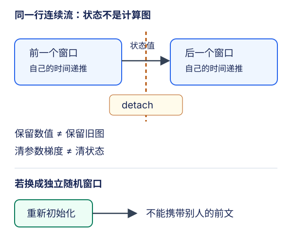

# 循环神经网络实现：让状态、轴和梯度对齐

## 1. 先建立四个可检查的接口

RNN语言模型不是一个`nn.RNN`就结束了。它包含**词元编码 → 循环状态 → 词表分类头 → 下一词元损失**。从零实现与简洁实现应共享数据合同，而不是各自训练出一段“看起来还行”的文本就认为等价。

约定批量$B$、窗口长度$T$、词表大小$V$、隐维度$H$。词表只用训练文本fit，验证/测试未知词元映射到固定`<unk>`，不能重新编号。输入整数`X`和目标`Y`均为$(B,T)$，且同一行中`Y[b,t]`是`X[b,t]`后面的真实词元。采样细节见[LEC53](#/c/d2l-pytorch-2021/lec/lec53?v=notes)。

| 接口 | 从零单层RNN | `nn.RNN`单层单向 |
| --- | --- | --- |
| 循环输入 | 独热$(T,B,V)$，浮点 | 同左，默认`batch_first=False` |
| 初始状态 | 元组内一个$(B,H)$张量 | 一个$(1,B,H)$张量 |
| 每步隐藏输出 | 手动收集 | `output`为$(T,B,H)$ |
| 窗口末状态 | 元组内一个$(B,H)$张量 | `h_n`为$(1,B,H)$ |
| 词表logits | $(TB,V)$ | 经线性头后$(TB,V)$ |

`nn.RNN`返回的`output`不是词表概率，也不包含语言模型输出层。对语言模型通常每个时间步都预测，不是只取最后一个状态。

## 2. 时间优先展平：形状相同也可能配错标签

独热编码前转置`X.T`，得到时间优先顺序。整数ID不具有“编号越近语义越近”的度量，不能直接当连续特征输入；`one_hot`还需转到与权重一致的浮点dtype。

自拟小例：两行连续流的窗口为

```text
X = [[0, 1, 2],      Y = [[1, 2, 3],
     [4, 5, 6]]           [5, 6, 7]]
```

循环先输出两个样本的第0步，再输出两个样本的第1步。对应标签必须是：

```text
Y.T.reshape(-1) = [1, 5, 2, 6, 3, 7]
```

不是`Y.reshape(-1)`的`[1,2,3,5,6,7]`。两者长度都是6，交叉熵照样能算，错误不会表现为形状异常。对$(T,B,H)$输出做`reshape(T*B,H)`，就必须采用同一$(t,b)$顺序展平标签。若选择batch-first全流程，则两边都用$(b,t)$顺序；不要只改输入的一端。转置常使张量不连续，直接`view`可能失败，`reshape`会在需要时复制；不要为调轴到处加不必要的复制。

取$B=2,T=3,V=8,H=4$，编码、隐藏、分类头的形状依次为$(3,2,8)$、$(3,2,4)$、$(6,8)$，标签为$(6,)$。这些是独立形状预期，不是训练结果。

## 3. 从零公式如何映射到库参数

用行向量写从零递推：

$$
A_t=X_tW_{xh}+H_{t-1}W_{hh}+b_h
$$

$$
H_t=\tanh(A_t),\qquad O_t=H_tW_{hq}+b_q
$$

PyTorch存储的是输出维在前的权重。单层、单向、`nonlinearity='tanh'`、无dropout时，映射合同为：

| 从零参数 | 库参数约束 |
| --- | --- |
| $W_{xh}$，$(V,H)$ | `weight_ih_l0 = W_xh.T` |
| $W_{hh}$，$(H,H)$ | `weight_hh_l0 = W_hh.T` |
| $b_h$，$(H,)$ | `bias_ih_l0 + bias_hh_l0 = b_h` |
| $W_{hq}$，$(H,V)$ | 分类头`weight = W_hq.T` |
| $b_q$，$(V,)$ | 分类头`bias = b_q` |

方阵$W_{hh}$也要转置；形状没变并不表示布局相同。初始状态的数值、dtype、设备必须相同，库状态比从零状态多一个层轴。默认随机初始化不同，不能靠相同随机种子就假定参数自动相同。

**前向等价不自动等于一步训练等价。** 库有两个bias，从零公式只有一个。即使初始两bias之和相等，若两个bias都用同一SGD学习率更新，相同的梯度会各更新一次，有效bias变化成为单bias的两倍。最简单的严格对照是设置`bias_ih=b_h`、`bias_hh=0`，并冻结后者的梯度；另一方案是明确设计重参数化和优化器合同。比较梯度时先按转置映射回同一坐标系；再比较相同loss归约、裁剪规则和学习率下的一次更新。

一个单步手算：$X=(1,0)$、$H_{prev}=(0,0)$、$W_{xh}=\left[\begin{smallmatrix}1&0\\0&1\end{smallmatrix}\right]$、$b_h=0$，则新状态为$(\tanh 1,0)$。先排除状态/参数映射问题，再比较长窗口，定位更容易。

## 4. 状态值可以跨批，计算图不必跨批



图为编者自绘：实线表示数值继续传递，虚线边界表示不把下一窗口的梯度反传到前一窗口；不是把状态值置零。

- **随机抽取独立子序列**：每批重新初始化状态；上一批第$i$行通常不是这一批第$i$行的前文。
- **顺序分区**：仅当每行流身份不变、下个窗口紧接该行前一个窗口时才可携带状态。不是“上一批最后一行”接“下一批第一行”。
- **跨窗口detach**：保留状态数值，切断其历史计算图，形成截断BPTT。RNN/GRU对整个状态张量detach；LSTM对`h`和`c`都detach。
- **新epoch、独立文档、验证集或流身份变化**：按数据合同重置，不能把训练末状态灌给验证文本。若批量大小改变，不能不加说明地截取旧状态凑形状。

`zero_grad()`只清参数梯度，不会切断状态图；`detach()`也不等于`zero_grad()`。每个时间步都detach会丢掉窗口内时间信用分配；完全不detach又每批更新参数，可能遇到复用已释放图或参数版本错误，不能靠`retain_graph=True`掩盖合同错误。

手算截断边界：标量递推$h_t=ah_{t-1}+x_t$，取$a=2,h_0=0,x_1=x_2=1$，两步得到$h_1=1,h_2=3$。只看下一窗口$x_3=0$的损失$L=h_3$，数值均为6。完整图给$\partial L/\partial a=5$；将$h_2$detach后给3。前向信息仍在，跨窗口的参数梯度贡献被截断。这是设计选择，不是autograd算错。

## 5. 裁剪与困惑度各自控制什么

先清梯度，再前向、反向、**全局范数裁剪**，最后更新。把所有参与训练的参数梯度视为一个长向量$g$：

$$
g\leftarrow g\min\left(1,\frac{\theta}{\lVert g\rVert_2}\right)
$$

小例$g=(3,4)$、阈值$\theta=2$，全局范数为5，裁后$(1.2,1.6)$。逐元素夹到$[-2,2]$得到$(2,2)$，方向和范数都不同；分别给每个参数各自裁到2也不是全局裁剪。零范数不必除零，未参与损失的参数可能没有梯度。裁剪缓解爆炸，不恢复已经消失的梯度，也不能证明学习率永远安全。

`CrossEntropyLoss`接收原始logits，不要先softmax。全评估集按有效token累计负对数似然：

$$
\bar\ell=\frac{\sum_j N_j\bar\ell_j}{\sum_jN_j},\qquad
\mathrm{PPL}=\exp(\bar\ell)
$$

每批token数$N_j$可能不同，所以不能平均各批PPL。若2个token的平均CE为$\ln2$，另1个token的CE为$\ln8$，整体PPL为$\sqrt[3]{32}$，不是$(2+8)/2=5$。padding或忽略位置不计入分母。验证要`eval()`并禁用梯度，与训练用相同训练词表、一步错位及状态策略；指标只能在相同tokenization/词表/评估集合下比较。

## 6. 自回归生成：前缀不是预测答案

给定非空前缀`abc`：以初始状态输入`a`，保留新状态但强制下个输入为已知`b`；再输入`b`，强制保留已知`c`；输入`c`后才选择第一个新token。前缀每个字符恰好消费一次。这里“预热”只更新隐藏状态，不训练参数。

生成阶段把自己的上一个输出作为下一输入，可以贪心argmax，也可以从明确温度的分布采样；训练时使用真实前文的teacher forcing，两者条件不同。使用`eval()`和无梯度上下文，每次独立生成重新初始化状态。未知前缀token依既定`<unk>`策略处理，不临时扩大词表。不能把真实后续文本继续喂给模型却声称那是自回归生成。

真实文本的小训练、输出样例和硬件用时由[实验](#/c/d2l-pytorch-2021/lab/recurrent-language-model?v=guide)与[公共资料](#/c/d2l-pytorch-2021)统一记账；本讲不预写“训练后生成”的句子，也不把上述合成小例当语料成绩。

## 7. 自测与答案

<details><summary>1. 两种展平方式长度相同，为什么仍需逐位置核对？</summary>

分类头第$i$行必须配同一$(t,b)$的下一词元。损失函数只检查形状，不认识样本身份；错配仍可能得到有限loss。

</details>

<details><summary>2. detach之后状态相同，为什么参数梯度会变？</summary>

它把边界状态当作当前窗口的常量，移除了经旧窗口回到参数的链式法则路径。数值记忆与可训练的时间跨度是两回事。

</details>

<details><summary>3. 简洁实现的两个bias之和等于从零bias，就能直接比较SGD吗？</summary>

只能保证相同其他条件下的前向。若两个bias均训练，它们的和会获得两次更新；冻结一个零bias等方式才能建立本讲的一步SGD对照合同。

</details>

<details><summary>4. 只传h_n、不加分类头能算词表交叉熵吗？</summary>

不能按这里的合同计算。`h_n`是窗口末的隐藏状态，既缺少各时间步输出，也不是$V$类logits。应使用每步隐藏输出和共享分类头。

</details>

## 8. 来源与视频边界

- [官方课表](https://courses.d2l.ai/zh-v2/)于7月24日把8.5与8.6映射到同一BV的P1/P2，整讲还包括P3 QA。平台P2真实标题写作“简介实现”，不自行改写元数据。
- 教材为张阿斯顿、李沐、扎卡里·C.立顿、亚历山大·J.斯莫拉《动手学深度学习》当前中文第二版，固定提交`e6b18ccea71451a55fcd861d7b96fddf2587b09a`，不是2021快照。已读[8.5](https://zh.d2l.ai/chapter_recurrent-neural-networks/rnn-scratch.html)、[8.6](https://zh.d2l.ai/chapter_recurrent-neural-networks/rnn-concise.html)相关正文/PyTorch代码与[8.7](https://zh.d2l.ai/chapter_recurrent-neural-networks/bptt.html)梯度/截断段；精确范围及hash见逐讲manifest。8.7是编者补充，不称视频指定独立阅读。
- 现代API对照：[PyTorch v2.5.1 RNN源码文档467–590行](https://github.com/pytorch/pytorch/blob/v2.5.1/torch/nn/modules/rnn.py#L467-L590)。参数映射、双bias更新、展平小例与状态边界图为编者展开，不冒充课堂板书。
- [官方视频](https://www.bilibili.com/video/BV1kq4y1H7sw/)作者“跟李沐学AI”，mid 1567748478；上传2021-07-24。

| 分P | 平台标题 | 时长 |
| --- | --- | --- |
| P1 | 从零开始实现 | 48:35 |
| P2 | 简介实现 | 07:11 |
| P3 | QA | 30:39 |
| 全3P合计 | 5185秒 | 1:26:25 |

2026-11-14每P公开字幕接口查询一次成功，列表均为空；空结果不排除烧录字幕。未观看音视频，不能给片内时间轴、QA内容或逐段译稿；不建占位draft/materials。视频copyright=1、no_reprint=1不授予开放转录再发布许可。教材根Apache-2.0、setup.py MIT-0、PyTorch许可与视频/语料条件分别记录，不互相外推。
