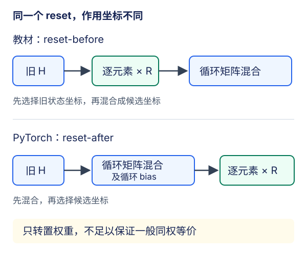

# GRU：决定保留什么，而不只是增加非线性

## 1. 为什么需要可以少改动的状态

普通RNN每一步都把旧状态与新输入经过一次`tanh`。重要线索想跨过许多无关词元，需要连续通过这些变换。GRU提供两种可学习的控制：**候选状态如何读取旧记忆，以及新状态保留多少旧记忆**。它不是事先写好的“遇到句号清零”规则，也不保证学到人能命名的语法单元。

约定一批输入$X_t\in\mathbb R^{B\times D}$，旧状态$H_{t-1}\in\mathbb R^{B\times H}$。下面采用教材的行向量及更新门约定：$Z$越接近1，保留旧状态越多。有些资料把更新门定义成互补量，不能只靠字母名称抄公式。

## 2. 两个门，一份状态

门由当前输入和旧状态共同决定。为避免长式，先定义每个门的仿射变换：

$$
A_r=X_tW_{xr}+H_{t-1}W_{hr}+b_r
$$

$$
A_z=X_tW_{xz}+H_{t-1}W_{hz}+b_z
$$

$$
R_t=\sigma(A_r),\qquad Z_t=\sigma(A_z)
$$

$R_t,Z_t$都是$(B,H)$，不是每条序列一个标量。教材候选状态使用**先reset，再矩阵混合**：

$$
U_t=(R_t\odot H_{t-1})W_{hh}
$$

$$
\widetilde H_t=\tanh(X_tW_{xh}+U_t+b_h)
$$

最终逐元素插值：

$$
H_t=Z_t\odot H_{t-1}+(1-Z_t)\odot\widetilde H_t
$$

- $Z\to1$：倾向保留旧状态；$Z\to0$：倾向采用候选状态。
- $R\to0$：在候选分支中抑制旧状态，不是把最终$H_t$直接清零。只要$Z$较大，旧状态仍可走保留分支。
- $R\to1$：候选计算接近普通`tanh`更新，但最终还要经过$Z$混合，不能因此说整个GRU已经退化成普通RNN。
- sigmoid在有限输入下处于$(0,1)$；0和1是便于思考的极限，不是一般训练中硬开关。

手算混合：旧状态$(0.8,-0.4)$、候选$(0.2,0.6)$、$Z=(0.75,0.25)$，得到新状态$(0.65,0.35)$。第一个坐标以保留为主，第二个以写入为主。把一个门当全局标量会失去这种逐特征控制。

## 3. 教材GRU与PyTorch GRU并非只差转置

自绘图只展开候选分支，省略共同的输入项和`tanh`，突出reset究竟作用于输入坐标还是混合后的输出坐标。

PyTorch 2.5.1候选状态采用**reset-after**。用与上文一致的行向量记法写成：

$$
U_t^{\rm pt}=H_{t-1}W_{hn}^{\top}+b_{hn}
$$

$$
V_t^{\rm pt}=X_tW_{in}^{\top}+b_{in}
$$

$$
N_t=\tanh(V_t^{\rm pt}+R_t\odot U_t^{\rm pt})
$$

实际实现先做循环仿射变换，再乘reset。教材是$(R\odot H)W$；库是$R\odot(HW+b)$，**矩阵乘法与逐元素门控一般不交换**，且循环bias是否被门控制也不同。官方源码明确这是为效率有意选择的变体。因此不能把教材从零参数转置后塞入`nn.GRU`，就要求输出、梯度和训练轨迹逐点一致。

构造不依赖训练的反例：

$$
H=(1,2),\qquad R=(0.25,0.75)
$$

$$
W=\begin{bmatrix}0&1\\1&0\end{bmatrix}
$$

关闭bias和输入项：

$$
(R\odot H)W=(1.5,0.25)
$$

$$
R\odot(HW)=(0.5,0.75)
$$

送入`tanh`之前已经不同。对角权重、特殊同值门等个别情形可能相等，但不能把特殊测试通过推广为一般等价。

**公平的实现对照有两种目标，必须先选清楚：**

1. 验证教材数学：用手写reset-before公式检查局部数值/梯度。
2. 验证库实现：手写reset-after，与`nn.GRU`绑定同一组参数后比较；按库的`r,z,n`顺序打包，不是教材参数列表的`z,r,h`顺序。训练比较还需说明双bias与优化器映射，不能忽略[LEC55](#/c/d2l-pytorch-2021/lec/lec55?v=notes)的参数化问题。

比较两个变体在真实语料上的指标是另一个实验，不是同权恒等式证明。

## 4. 状态与参数的工程合同

`nn.GRU(D,H,num_layers=L)`默认输入$(T,B,D)$，输出$(T,B,H)$，最终状态$(L,B,H)$；单层从零状态为元组中的$(B,H)$。GRU只携带一份$H$，没有LSTM的独立cell状态。

单层单向、带bias时，库循环体参数量为：

$$
3HD+3H^2+6H
$$

它有3组输入变换、3组循环变换和两份长度$3H$的bias；教材单bias版本则为$3HD+3H^2+3H$。语言模型的词表头还需另加$HV+V$。例如$D=5,H=4$，库GRU循环体132个参数；若词表$V=5$，加分类头后157。只比较隐维度不代表比较了相同参数预算。

$T=3,B=2,D=5,H=4$时：`output`为$(3,2,4)$，`h_n`为$(1,2,4)$，词表头产生$(6,5)$。`weight_ih_l0`为$(12,5)$，`weight_hh_l0`为$(12,4)$。多层/双向尺寸留到[LEC58](#/c/d2l-pytorch-2021/lec/lec58?v=notes)、[LEC59](#/c/d2l-pytorch-2021/lec/lec59?v=notes)。

数据和优化不变量不会因为换GRU而消失：词表只fit训练集；`X/Y`一步错位；随机窗口每批重置，连续窗口保持行身份并跨批detach；梯度按全局范数裁剪；困惑度由有效token加权CE后取exp。门不会自动识别“这批已经换成另一篇文档”。

## 5. 门控缓解梯度问题，不提供永生记忆

若暂时把门和候选值当常量，保留分支对旧状态的直接导数为$Z_t$。多个时间步沿该分支传播会乘上多个$Z$，当它们接近1时比反复乘一般循环矩阵更容易保留信号。

但真实总导数还含门和候选对旧状态的依赖，不能只写“梯度等于Z”就结束。长期$Z=0.9$的直接分支仍按$0.9^k$衰减；sigmoid饱和也会使门自身参数梯度变小。梯度裁剪仍有用，截断BPTT也仍限制了可回传的距离。不要把“增加一条可控的信息路径”说成“解决一切长距离依赖”。

比较RNN、GRU、LSTM应固定训练/验证划分、训练词表、token预算和评估方法，说明等隐维度还是等参数预算。吞吐受设备、dtype、后端与形状影响，不能从门数直接宣布某台机器快几倍；本讲没有硬件成绩或生成文本。

## 6. 自测与答案

1. R接近0时，最终状态一定接近0吗？

不一定。它主要抑制候选分支对旧状态的读取；保留分支$Z\odot H_{t-1}$仍在，输入也可产生非零候选。

2. 为什么H=1的某些小例不适合发现reset顺序错误？

一维无bias乘法可以交换，隐藏了多维坐标混合的差异。使用非对角循环矩阵、不同坐标的reset值；还应检查循环bias是否也被门乘。

3. GRU状态只有一份，随机采样时就可以不重置吗？

不能。是否携带状态取决于流身份连续性，不取决于状态张量个数。

4. 157个参数能否代表教材从零GRU加头的参数量？

不能直接代表。它是本讲$D=V=5,H=4$的PyTorch双bias版本；教材三组单bias会少$3H=12$个参数。

## 7. 来源与视频边界

- [官方课表](https://courses.d2l.ai/zh-v2/)7月25日指定[教材9.1 GRU](https://zh.d2l.ai/chapter_recurrent-modern/gru.html)。使用当前中文第二版固定提交`e6b18ccea71451a55fcd861d7b96fddf2587b09a`，不是2021快照；已读门控推导、PyTorch从零/简洁实现及小结，范围/hash保存在本讲manifest。
- reset-after、门打包顺序及形状依据[PyTorch v2.5.1源码1161–1290行](https://github.com/pytorch/pytorch/blob/v2.5.1/torch/nn/modules/rnn.py#L1161-L1290)，尤其1261–1279行明确变体差异。本文反例、参数量与图为编者展开，不称视频实演或原论文复现；未另立必读论文。
- [官方视频](https://www.bilibili.com/video/BV1mf4y157N2/)作者“跟李沐学AI”，mid 1567748478，上传2021-07-25。

| 分P | 平台标题 | 时长 |
| --- | --- | --- |
| P1 | 门控循环单元（GRU） | 15:23 |
| P2 | 代码 | 13:57 |
| P3 | QA | 10:29 |
| 全3P合计 | 2389秒 | 39:49 |

2026-11-14每P公开字幕接口查询一次成功且列表为空，不能据此断言无烧录字幕。未观看音视频，不给片内时间轴、QA或逐段译稿；无占位draft/materials。视频copyright=1、no_reprint=1不构成开放转录许可。教材根Apache-2.0不扩张到视频、第三方图片或语料，PyTorch条款另见[公共资料](#/c/d2l-pytorch-2021)。实践转入[实验指导](#/c/d2l-pytorch-2021/lab/recurrent-language-model?v=guide)。
