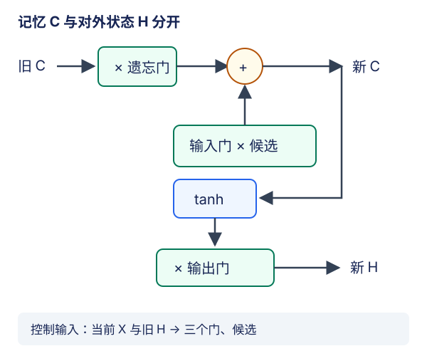

# LSTM：把记住的内容与露出的状态分开

## 1. 两个状态不是两份重复缓存

LSTM同时维护**记忆元$C_t$**与**隐状态$H_t$**。记忆元负责可控地保留、擦除、累积；隐状态是经过输出门筛选后的对外表示。下一时刻的门需要旧隐状态，下一时刻的记忆元需要旧记忆元，所以二者都要传递。

对于批量$B$、输入特征$D$、隐藏维度$H$，本讲先用无投影、单层单向版本：$X_t$为$(B,D)$，$H_t,C_t$均为$(B,H)$。`output`、`h_n`和`c_n`不是三个独立的预测头。

## 2. 三个门与一个候选

为每条分支定义一个仿射函数：

$$
A_q=X_tW_{xq}+H_{t-1}W_{hq}+b_q
$$

其中$q\in\{i,f,o,g\}$。三个门使用sigmoid，候选用`tanh`：

$$
I_t=\sigma(A_i),\quad F_t=\sigma(A_f)
$$

$$
O_t=\sigma(A_o),\quad G_t=\tanh(A_g)
$$

核心更新只有两式：

$$
C_t=F_t\odot C_{t-1}+I_t\odot G_t
$$

$$
H_t=O_t\odot\tanh(C_t)
$$

$F$决定旧内容保留比例；$I$决定候选内容写入比例；$O$决定记忆向外暴露多少。它们各为$(B,H)$，逐样本逐特征取值，而不是整层一只开关。候选$G$可正可负，写入也可以抵消已有内容。



图为编者自绘。上轨的加法通路与下方的对外表示不同；所有门实际还依赖当前输入和旧隐状态，图中统一标在控制区以免线条遮住核心路径。

几个有用的极限：

- $F\to1,I\to0$：保存记忆元，但$H$仍受当前输出门控制。
- $F\to0,I\to1$：用候选替换旧记忆；不等于开始了一条独立文档流。
- $O\to0$：$H_t$趋近零，$C_t$仍可非零并继续向后传。不是“隐藏状态保持旧值不更新”。

门的0/1是解释极限，sigmoid在有限输入下不严格等于端点。即便$G$限制在$(-1,1)$，$C$仍是累积量，不必位于该区间；普通无投影LSTM的$H$经`tanh`和输出门后才有界。

## 3. 一步手算分清三种作用

取标量旧记忆$c_{prev}=2$，$f=0.75,i=0.25,g=-0.4,o=0.5$：

$$
c=0.75\times2+0.25\times(-0.4)=1.4
$$

$$
h=0.5\tanh(1.4)
$$

旧记忆保留1.5，候选写入-0.1，记忆成为1.4；对外读出的状态还需压缩与门控。若只把$o$改成0，新的$h$为0，但$c$仍是1.4。这个小例能发现把输出门错乘到cell更新、或者误把`c`清空的实现。

训练时门由参数和数据算出，上面的指定门值只是一段独立机制推导，不能作为真实语料训练曲线或模型能力结论。

## 4. 为什么加法通路仍不能保证梯度不消失

沿记忆元的直接保留边，把门值视为固定，则局部导数为$f_t$，跨$k$步的这条路径贡献包含：

$$
\prod_{j=t-k+1}^{t}f_j
$$

$f$接近1时，这条通路可比普通RNN反复经过任意矩阵与饱和激活更容易保留信号。但$f=0.5$连续10步就只剩$1/1024$；$f=0.99$也会随足够长的距离衰减。并且这只是**固定门下的一条直接路径**，真实总导数还包含经$H$返回到门和候选的路径，不能断言完整雅可比就是对角$F$。

此外，读出还经过`tanh(C)`和$O$；$C$过大时读出激活可饱和，sigmoid门饱和时门参数也可能得到很小梯度。LSTM缓解长距离训练困难，不意味着“永不遗忘”或“不再需要梯度裁剪”。截断BPTT在批边界切图，也不会因为使用LSTM而自动接回去。

## 5. PyTorch接口：输出与状态要分开读

下面固定`proj_size=0`、单向、默认时间优先输入。令层数为$L$，不用$L$表示序列长度，避免与API文档符号混淆。

| 张量 | 形状 | 含义 |
| --- | --- | --- |
| 输入 | $(T,B,D)$ | 每步输入特征 |
| `output` | $(T,B,H)$ | 最顶层每一步的隐状态 |
| `h_0`,`h_n` | $(L,B,H)$ | 每层初始/最终隐状态 |
| `c_0`,`c_n` | $(L,B,H)$ | 每层初始/最终记忆元 |

调用返回结构是`output, (h_n, c_n)`。`batch_first=True`只交换输入/输出的前两轴，**不改变状态轴顺序**。语言模型用`output`接共享词表头，不把`c_n`直接当每步logits。

例如$T=3,B=2,D=5,H=4,L=1$，输出为$(3,2,4)$，两份末状态各为$(1,2,4)$；分类头$V=5$时展平logits为$(6,5)$。无投影库LSTM循环体参数量为：

$$
4HD+4H^2+8H
$$

该小例为176；加词表头25后共201。教材每个分支一个bias，比库双bias少$4H$个参数；从零按教材列出的`i,f,o,g`顺序，库打包顺序则是**`i,f,g,o`**，迁移时须重排、转置并明确bias如何分配。不要直接按列表位置拼接后宣称同权。

启用`proj_size=P>0`是另一个API配置：隐状态/输出宽度变成$P$，cell仍为$H$。本讲小例不启用投影，也不把$h,c$形状总是一样推广到所有LSTM。

## 6. 跨批与比较实验的底线

连续流的截断BPTT边界应同时执行：

```python
state = (h.detach(), c.detach())
```

这是局部接口提示，不是一份完整训练答案。只detach `h`仍可能经`c`保留旧图；只清零`c`又会破坏本来想携带的记忆。随机独立窗口、文档重启、训练切换验证时，两份状态都按合同重置。切勿凭“形状刚好相同”把不同样本的状态接起来。

RNN、GRU、LSTM共用的词表fit边界、未知token、一步错位、time-major展平、全局裁剪及token加权PPL见[LEC55](#/c/d2l-pytorch-2021/lec/lec55?v=notes)。比较GRU与LSTM时先固定真实文本划分、token预算、优化器及评估方法；等隐维度与等参数量是不同问题，不能把一次小跑的排名说成普适定理。有限实测统一见[实验指导](#/c/d2l-pytorch-2021/lab/recurrent-language-model?v=guide)。

## 7. 自测与答案

<details><summary>1. 输出门关闭，是否意味着下一步没有记忆？</summary>

不是。cell可以保留信息，只是本步隐状态读出接近零。下一步既接收这个隐状态，也接收非零cell。

</details>

<details><summary>2. 为什么只detach h不够？</summary>

cell是另一条跨时间的计算图路径。两份状态的值可以保留，但截断边界需同时切断它们的历史图。

</details>

<details><summary>3. f=1是否证明完整梯度恒为1？</summary>

不是。它只描述固定门下的直接cell保留边；总导数、读出激活和门参数梯度仍有其他因素，且训练不能假定所有门始终为1。

</details>

<details><summary>4. batch_first=True后h_n是(B,L,H)吗？</summary>

不是。状态仍为$(L,B,H)$；若双向则首轴为$2L$。batch-first只改变输入和逐步输出的布局。

</details>

## 8. 来源与视频边界

- [官方课表](https://courses.d2l.ai/zh-v2/)7月25日指定[教材9.2 LSTM](https://zh.d2l.ai/chapter_recurrent-modern/lstm.html)。已读门控推导、PyTorch实现和小结；固定当前中文第二版提交`e6b18ccea71451a55fcd861d7b96fddf2587b09a`，不是2021快照。精确范围/hash见本讲manifest。
- [PyTorch v2.5.1源码793–951行](https://github.com/pytorch/pytorch/blob/v2.5.1/torch/nn/modules/rnn.py#L793-L951)用于核公式、两状态、门顺序、投影和形状。梯度边界、手算及图为编者补充，不冒称录像推导；本讲不另加必读论文。
- [官方视频](https://www.bilibili.com/video/BV1JU4y1H7PC/)作者“跟李沐学AI”，mid 1567748478，实际上传2021-07-26；课表日期与上传日期分开记录。

| 分P | 平台标题 | 时长 |
| --- | --- | --- |
| P1 | 长短期记忆网络（LSTM） | 09:39 |
| P2 | 代码 | 04:37 |
| P3 | QA | 03:39 |
| 全3P合计 | 1075秒 | 17:55 |

2026-11-14每P公开字幕接口查询一次成功、列表均为空，不排除烧录字幕。未观看音视频，无法提供可信片内时间轴、QA或逐段译稿；中文原课通过页头观看，本课不另作课堂逐段整理；不另作重复materials。视频copyright=1、no_reprint=1不等于开放转录授权。教材根Apache-2.0、PyTorch条款与语料条件各有边界，详见[公共资料](#/c/d2l-pytorch-2021)。
