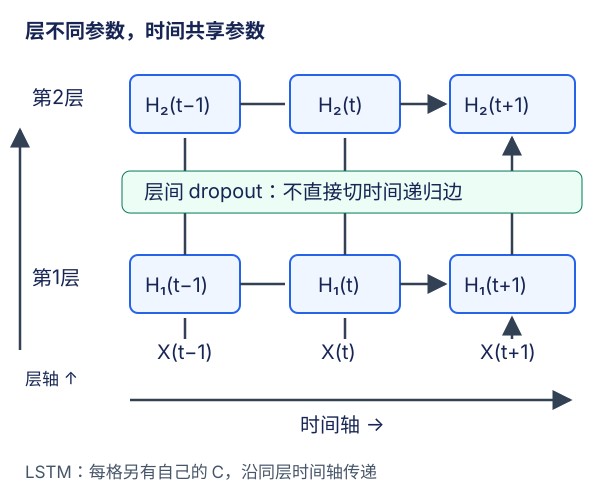

# 深层循环网络：时间轴之外，还有层轴

## 1. 深度不是把窗口变长

单层RNN已经会沿时间展开许多步，但这些步共享同一层参数。深层RNN则在**同一时刻堆叠多层不同参数的循环变换**。窗口长度$T$控制这一批看多少时间步，层数$L$控制每个时刻穿过多少层；调大二者改变的是不同的计算路径。

第$l$层在时刻$t$同时接收两个来源：下层当前时刻的输出，以及本层上一时刻的状态。记输入为$H_t^{(0)}=X_t$，先定义两条分支：

$$
A_t^{(l)}=H_t^{(l-1)}W_{xh}^{(l)}
$$

$$
B_t^{(l)}=H_{t-1}^{(l)}W_{hh}^{(l)}
$$

$$
H_t^{(l)}=\phi_l(A_t^{(l)}+B_t^{(l)}+b_h^{(l)})
$$

参数**同层跨时间共享，层与层之间通常不共享**。第一层输入宽度为$D$，所以$W_{xh}^{(1)}$为$(D,H)$；从第二层起、单向且各层等宽时才是$(H,H)$。不能把教材简写的高层尺寸无条件用于第一层。

## 2. 沿哪一条箭头传递什么

编者自绘双层示意。横向箭头传本层的时间状态，纵向箭头传当前时刻的层输出。dropout标在层间，不标在时间递归边；这是内置`dropout`参数的作用位置。

对LSTM，每一层都拥有自己的$(H_t^{(l)},C_t^{(l)})$。**向上一层输入的是本层隐状态$H$，不是把cell当额外特征拼上去**；本层cell沿本层时间轴传递。不要把上一层的末状态当成下一层的初始状态，两者虽然可能同形，却承担不同语义。

以两层、三个时间步为例，可先算第1层的$t=1$，再算第2层的$t=1$；到$t=2$时两层分别取回自己的前一状态。库也可采用其他等价调度，语义依赖图不变。增加层数没有让因果RNN看到未来，也没有消除时间依赖带来的串行部分。

## 3. 三种输出轴不要混合

对单向、无投影、$L$层LSTM：

| 对象 | 默认形状 | 里面装的是什么 |
| --- | --- | --- |
| 输入 | $(T,B,D)$ | 所有输入时间步 |
| `output` | $(T,B,H)$ | **最顶层**所有时间步的隐状态 |
| `h_n` | $(L,B,H)$ | **所有层**各自最后一步隐状态 |
| `c_n` | $(L,B,H)$ | 所有层各自最后一步cell |

`output`不额外带层轴；`h_n`不带整段时间轴。对于本表的单向网络，`output[-1]`对应`h_n[-1]`，但不能由此把`output`整体看成所有层状态。双向时末时间步与两方向末状态的关系还会变化，见[LEC59](#/c/d2l-pytorch-2021/lec/lec59?v=notes)。

小例$T=4,B=2,D=5,H=3,L=2$：

- 输入$(4,2,5)$；`output`为$(4,2,3)$。
- `h_n`和`c_n`各为$(2,2,3)$。
- `weight_ih_l0`为$(12,5)$，`weight_ih_l1`为$(12,3)$；两个循环权重均为$(12,3)$。
- 若词表大小为5，逐步分类头展平后为$(8,5)$。

`batch_first=True`改输入为$(2,4,5)$、输出为$(2,4,3)$；两份状态仍为$(2,2,3)$。本例状态两个前轴恰好同为2，不容易发现错置，调试时可用批量3、层数2避免尺寸偶合掩盖错误。

## 4. 内置dropout不是循环边上的遗忘门

PyTorch `nn.RNN/GRU/LSTM(..., dropout=p)`在训练模式下，把dropout用于**除最后一层外的层输出向下一层传递时**。要点如下：

1. `num_layers=1`没有层间边，因此该参数不会实现期望的单层正则化；不能仅写`dropout=0.5`就宣称循环状态每步有一半被擦掉。
2. 不在最顶层输出后自动再加一层dropout。若想对词表头输入额外dropout，必须单独定义；那是另一个模型配置。
3. 不是对$C_{t-1}\to C_t$或$H_{t-1}\to H_t$的递归边直接做recurrent dropout，也不是LSTM的遗忘门。
4. `eval()`关闭dropout；无梯度上下文只控制autograd，不会自动切到eval。
5. 不能从这一参数承诺“整段时间共用同一个mask”。若需要锁定时间mask的特定算法，应另有明确实现与验证；本课不把它与内置dropout混称。

层间dropout会改变下一层输入，进而间接影响以后状态，但这不改变它**直接作用在层间连接**的定义。比较两种实现的确定性前向时，先关闭dropout或用eval，并固定相同参数、初始状态和数据；不能拿两次独立随机mask制造的差异判断递推错误。

## 5. 深度的代价怎样记账

单向无投影的库LSTM每层有4组门/候选，输入宽度为$d$时参数量为：

$$
4Hd+4H^2+8H
$$

第一层$d=D$，以后各层$d=H$。因此循环体总参数量为：

$$
4HD+4H^2+8H
$$

$$
{}+(L-1)(8H^2+8H)
$$

上例$D=5,H=3,L=2$，第一层120，第二层96，共216；词表头为$3\times5+5=20$，合计236。参数量不随窗口长度$T$线性增加，因为时间共享权重；训练中保存的中间激活与计算量通常会随$T$和$L$增加。参数少不代表反向图小。

深度可以增加表达能力，也会加长梯度路径、改变优化难度。它不保证验证PPL下降；保持每层相同$H$时已经增加了参数，不能把提升只归因于“深度本身”。做GRU/LSTM或层数对比时，必须说明是固定隐维度、固定参数预算还是固定训练token预算。

硬件吞吐不仅取决于门数/层数，还取决于序列长短、批量、dtype、后端融合及设备。本讲不从教材历史训练文字推断现代CPU/GPU的速度，也不把形状推导当吞吐测试。

## 6. 状态连续性的要求反而更多了

顺序窗口在同一行流内续接时，携带的是**所有层**的末状态；LSTM的`h,c`均需跨批detach，而不是只detach顶层。随机窗口或文档边界则按合同重置所有层，不能只清第一层而让高层偷偷保留别的样本信息。

窗口内不得为了减少内存随意逐层detach，否则上层loss无法正常训练下层。梯度裁剪的范数应覆盖整个待训练模型，不能每层独立裁剪后称作同一全局阈值。词表只fit训练集、未知token、`X/Y`一步错位、有效token加权CE后exp等合同继续沿用[LEC55](#/c/d2l-pytorch-2021/lec/lec55?v=notes)。

调试顺序可以是：先单层固定参数核输出，再增加第二层核轴与参数尺寸，最后才启用dropout和真实文本训练。对应实验要求见[实验指导](#/c/d2l-pytorch-2021/lab/recurrent-language-model?v=guide)，不是在本讲给出整套训练答案。

## 7. 自测与答案

1. 两层LSTM的output是否形如(T,L,B,H)？

不是。常规输出只有最顶层每个时间步，形如$(T,B,H)$；各层末状态存在$(L,B,H)$的`h_n/c_n`中。

2. num_layers=1且dropout=0.5，能否代替对输入加dropout？

不能。内置参数用于层间，单层没有这样的连接；它既不等价于输入dropout，也不等价于递归状态dropout。

3. 时间步翻倍会让模型参数量翻倍吗？

不会，同层跨时间共享参数；但计算与保存激活的成本会增加。增加层数通常增加独立参数，与增加时间步不同。

4. 连续窗口只传递最顶层末状态够吗？

不够。每一层都有独立时间递归。应传所有层状态，LSTM还包含所有层的cell；并维护行身份和截断边界。

## 8. 来源与视频边界

- [官方课表](https://courses.d2l.ai/zh-v2/)7月25日指定[教材9.3](https://zh.d2l.ai/chapter_recurrent-modern/deep-rnn.html)。已读结构推导、PyTorch双层例与小结；固定当前中文第二版提交`e6b18ccea71451a55fcd861d7b96fddf2587b09a`，不是2021快照，精确范围/hash见本讲manifest。
- [PyTorch v2.5.1源码819–951行](https://github.com/pytorch/pytorch/blob/v2.5.1/torch/nn/modules/rnn.py#L819-L951)核层间dropout、状态形状、门权重和方向。二维依赖图、第一层尺寸说明及参数手算为编者补充，不是课堂片段。
- [官方视频](https://www.bilibili.com/video/BV1JM4y1T7N4/)作者“跟李沐学AI”，mid 1567748478，上传2021-07-27；课表7月25日是另一个日期字段。

| 分P | 平台标题 | 时长 |
| --- | --- | --- |
| P1 | 深层循环神经网络 | 03:23 |
| P2 | 代码 | 02:45 |
| P3 | QA | 07:11 |
| 全3P合计 | 799秒 | 13:19 |

2026-11-14每P公开字幕查询一次成功且列表为空，不代表没有烧录字幕。未观看音视频，无片内时间轴或QA内容，不建占位draft/materials。视频copyright=1、no_reprint=1不是开放转录授权。教材、PyTorch、视频和语料各自授权边界见[公共资料](#/c/d2l-pytorch-2021)，本讲不发布任何历史或当前硬件速度结论。
