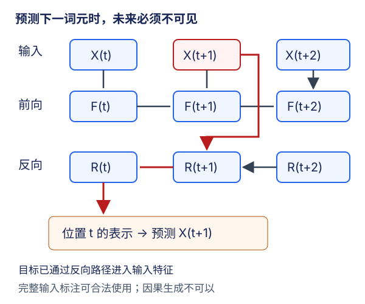

# 双向循环网络：先问预测时到底知道什么

## 1. 双向不是更强的因果语言模型

完整句子的词性标注，可以同时利用左右上下文；生成下一词元时，右侧真实词元还没有发生。两者都在处理序列，却有不同的**可用信息集合**。双向RNN适合前一种信息条件，不能仅凭训练loss更低就宣布它在后一种任务上更好。

例如对完整句子中的“苹果”做实体分类，后面出现“发布新品”或“切成小块”都是部署时已知的证据；但若目标是预测下一词元，先读到那个词元或它之后的真实后缀，就是泄漏。双向不必删掉，应该学会把它放在正确的问题里。

## 2. 两个方向分别计算，再按原位置对齐

对单层双向网络，设前向状态$F_t$、反向状态$R_t$：

$$
F_t=f(X_t,F_{t-1}),\qquad F_0=0
$$

$$
R_t=g(X_t,R_{t+1}),\qquad R_{T+1}=0
$$

$$
H_t=[F_t;R_t]
$$

前向递归处理$1\to T$，反向递归处理$T\to1$。这是**前向计算中的两种扫描顺序**，不是把神经网络反向传播得到的梯度当作第二份特征。两个方向通常有独立参数，不能把它理解成“一套权重自动倒放”。

单层在位置$t$的前向状态依赖$X_1,\ldots,X_t$，反向状态依赖$X_t,\ldots,X_T$；拼接后依赖整段已提供输入。反向输出仍要恢复到原始位置$t$再与$F_t$拼接，不能把逆序数组的第0行误配原序第0行。

多层时，上一双向层的拼接输出成为下一层输入。因此从第二层起，即使某个方向名叫“forward”，它的下层输入也已经可能包含右侧信息；不能只丢掉顶层reverse半边就声称恢复了因果性。



图为编者自绘，红色路径表示在“预测下一词元”任务中不该可用的信息。对于完整输入的标注任务，该路径可以是合法上下文，是否泄漏取决于目标和部署时的信息合同。

## 3. PyTorch输出与末状态的精确形状

设层数$L$、每方向隐维度$H$，固定无投影LSTM、`bidirectional=True`：

| 对象 | 默认形状 | 解释 |
| --- | --- | --- |
| 输入 | $(T,B,D)$ | 输入维度不会因双向翻倍 |
| `output` | $(T,B,2H)$ | 最顶层同位置两方向拼接 |
| `h_n` | $(2L,B,H)$ | 每层、每方向的最终隐状态 |
| `c_n` | $(2L,B,H)$ | 每层、每方向的最终cell |
| 每步分类头 | `Linear(2H,V)` | 读两方向拼接特征 |

`batch_first=True`只把输入/输出变为$(B,T,\cdot)$，不改变状态布局。状态首轴按`layer0 forward, layer0 reverse, layer1 forward, layer1 reverse, ...`排列；可逻辑重排成$(L,2,B,H)$再选择层和方向。

默认时间优先、无padding歧义时，对最顶层：

```text
h_n[-2] 对应 output[-1, :, :H]
h_n[-1] 对应 output[ 0, :, H:]
```

`output[-1]`的反向半边只完成了从右端开始的那一步，不是反向遍历全序列后的末状态。若做整句表示，不能把`output[-1]`直接当“两方向完整总结”；用末状态组合或明确的池化策略。对变长padding序列要处理真实长度，不能把补零位置当真实末词元。

小例$T=4,B=3,D=5,H=2,L=2$：输出$(4,3,4)$，`h_n/c_n`各$(4,3,2)$；第一层每方向输入权重$(8,5)$，第二层每方向$(8,4)$，因为高层接收的是两方向拼接。相同配置若单向，则高层输入宽度是2。双向增加方向参数与计算，不是只在输出末尾复制一份张量。

## 4. 一步错位为什么仍然挡不住泄漏

语言模型窗口通常为：

```text
原序列： a  b  c  d
X：      a  b  c
Y：      b  c  d
```

在$t=1$用$a$预测$b$时，反向状态已经处理输入中的$c,b,a$，目标$b$直接出现在右侧输入里。`Y`确实比`X`错开了一步，仍没有保证网络只读到左侧。对于窗口内除末尾外的目标，答案可能就在输入后缀中；末尾目标$d$未出现在该窗口，也不能把整段的指标自动称为因果指标。

独立线性反例，不需要训练：令反向递推$r_t=x_t+r_{t+1}$，右端状态为0。输入$X=(1,2,3)$时，$r_1=6$；仅改未来最后一个输入为9，得到$X'=(1,2,9)$，$r'_1=12$。前缀第一个输入完全相同，当前位置表示却变了。普通单向递推在初始状态相同时，该位置输出必须不变。

更贴近语言模型的审计是：关闭dropout、固定参数及初始状态，保持前缀不变，只改后缀，比较前缀位置logits。单向因果实现应不变；双向通常会变。双向在某次随机或退化参数下没变，不足以证明其因果性，必须结合依赖图；本讲的手算明确给出一条非零未来路径。

切断autograd、`eval()`、梯度裁剪都不改变前向可见范围，无法修复信息泄漏。`detach`阻断的是学习路径，不是从状态数值里抹掉未来。

## 5. 不能把双向训练CE的exp冒充因果PPL

因果下一词元模型应给出：

$$
p(x_{t+1}\mid x_1,\ldots,x_t)
$$

若输出还依赖真实后缀，实际条件变了。对这种输出计算交叉熵后取exp在数值上完全可行，但它不是同一个因果语言模型评估量，不能和单向RNN/GRU/LSTM的因果验证PPL并列排名。

教材9.4把双向网络放进语言模型训练的例子，本来就在“错误应用”小节中用于警示。本讲不把它的训练输出当正确因果PPL，不复制为本站成绩，也不把训练时见全窗口、生成时只见前缀当作同一种分布。

把生成时窗口缩成一个token也不能抹去训练时使用未来的事实。若每次仅编码已知完整前缀、只在末位置预测下一token，且训练也遵守同一prefix-only合同，可以另定义一个无未知后缀的预测器；但这不是教材全窗口逐位置双向训练的直接替代，也不能像单向状态那样简单缓存反向状态，新增token会改变之前位置的反向表示。本课实验不以此绕过双向泄漏检验。

正确的实验账本把以下项目分开：

- 单向真实语料训练：固定划分和训练词表，按有效token累计CE再exp，声明状态策略与可用前缀。
- 双向形状/信息范围：机制检查，不报告为因果生成模型成绩。
- 双向离线任务：完整输入在部署时可得，按该任务定义标注/分类指标；不偷换成自回归生成。

## 6. 双向适用的地方及边界

**完整输入标注、完整文本分类、编码完整源句**可合理使用双向上下文。掩码填空也可以，但要真的遮住待预测位置，明确可以读哪些其他token；把目标原样放进输入再重建它不构成有意义的预测。

教材用隐马尔可夫模型的前向/后向消息说明“从两端汇集已知观测”的思路。它是信息依赖上的类比，RNN隐藏向量并非自动等于HMM的归一化概率消息。一般稠密$K$状态HMM转移每个时间步需遍历前后状态对，朴素复杂度为$O(TK^2)$；不能脱离结构假设把它一概说成$O(TK)$。这里无需把HMM扩成新的前置课。

**在线流式预测**在时刻$t$还没有$X_{t+1:T}$，不能直接使用全句双向编码。有限前瞻可用于允许延迟的系统，但必须标明延迟和可见窗口，不能自称零延迟因果模型。

同样，普通单向顺序采样的跨批状态携带方法不能原封不动套给完整双向计算：反向状态应从右侧边界开始，而不是拿前一个左侧窗口的“末状态”当下一窗口右边界。双向独立窗口可以分别初始化，但可用上下文便被窗口截断；若要编码完整长文，必须定义整体扫描/分块协议。词表仍只fit训练数据，未知词元策略也仍适用，双向合法并不许可数据集泄漏。

## 7. 自测与答案

<details><summary>1. 输出的反向方向是不是backward()得到的梯度？</summary>

不是。它是另一个从右向左扫描输入的前向网络；训练时两方向各自还要参与反向传播。

</details>

<details><summary>2. 双向LSTM最后一个output是否包含两个方向的完整末状态？</summary>

不是。前向半边覆盖到序列末端，反向半边在该位置只刚开始扫描。最顶层反向最终状态对应原序第一个位置的反向输出。

</details>

<details><summary>3. 只取第二层forward输出能得到因果特征吗？</summary>

一般不能。它读取第一层已拼接双向信息的特征，仍可能间接依赖未来。

</details>

<details><summary>4. 低双向训练CE能证明下一词元生成更好吗？</summary>

不能。先核条件信息；若训练时含真实后缀，就不能当相同因果PPL比较，更不能在未实际生成时编造文本质量。

</details>

## 8. 来源与视频边界

- [官方课表](https://courses.d2l.ai/zh-v2/)7月25日指定[教材9.4](https://zh.d2l.ai/chapter_recurrent-modern/bi-rnn.html)。已读HMM类比、双向定义/应用、错误应用及PyTorch代码；固定当前中文第二版提交`e6b18ccea71451a55fcd861d7b96fddf2587b09a`，不是2021快照，范围/hash见manifest。HMM稠密转移计数、未来扰动反例与任务合同为编者推导。
- [PyTorch v2.5.1源码838–951行](https://github.com/pytorch/pytorch/blob/v2.5.1/torch/nn/modules/rnn.py#L838-L951)用于核双向状态、权重及`h_n`不等于最后`output`的说明。本文不把原文“initial reverse hidden state”误解成未消费输入的零状态：原序最后位置的反向输出已经处理该位置输入。
- [官方视频](https://www.bilibili.com/video/BV12X4y1c71W/)作者“跟李沐学AI”，mid 1567748478，上传2021-07-28，课表日期另为7月25日。

| 分P | 平台标题 | 时长 |
| --- | --- | --- |
| P1 | 双向循环神经网络 | 07:25 |
| P2 | 代码 | 01:51 |
| P3 | QA | 04:38 |
| 全3P合计 | 834秒 | 13:54 |

2026-11-14每P公开字幕查询一次成功且列表为空，不排除烧录字幕。未观看音视频，无可信片内时间轴、QA或逐段译稿，不建占位draft/materials。视频copyright=1、no_reprint=1不授予开放转录许可；教材、PyTorch及语料条件各自独立。统一数值、真实语料训练和硬件范围见[公共资料](#/c/d2l-pytorch-2021)，实践见[实验指导](#/c/d2l-pytorch-2021/lab/recurrent-language-model?v=guide)。
